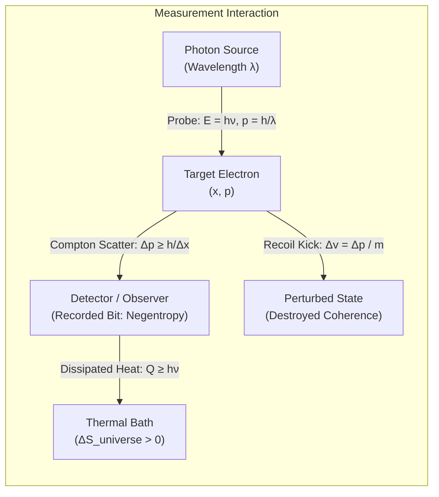
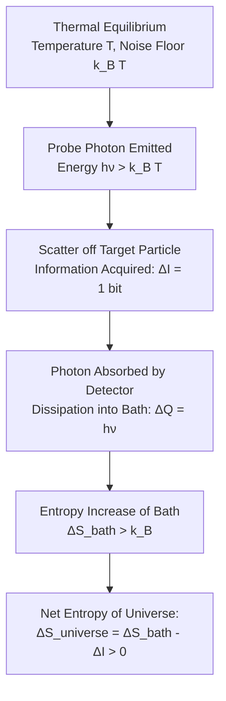
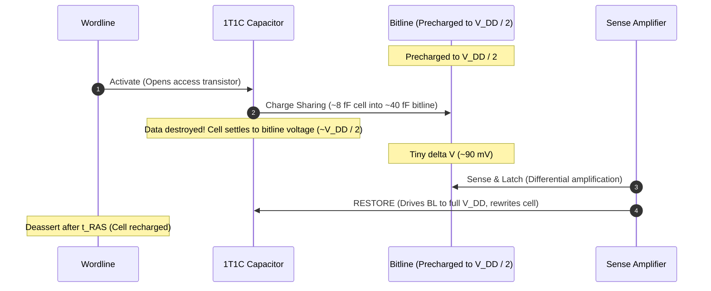
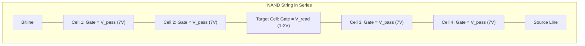
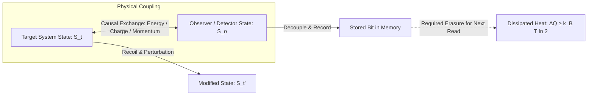



Software engineers operate under a comforting fiction: reading a value is free.

In C++, we decorate pointers with `const` to assure the compiler that inspection produces no side effects. In functional programming, we celebrate pure functions because evaluating an expression leaves the universe untouched. In database theory, an ideal `SELECT` query runs in an isolated read replica without locking rows or rewriting storage blocks. In classical mechanics, an observer is a disembodied spirit taking notes on the positions and velocities of billiard balls while exerting zero force on the table.

None of that is true.

Physics does not permit a passive observer. To read any physical state—the position of a particle, the charge on a capacitor, the contents of a cache line—you must couple to it. Coupling requires exchanging momentum, charge, or photons. And the instant you exchange a physical quantity with a system, you kick its trajectory, destroy its unperturbed state, and dissipate free energy into the surrounding thermal bath.

The Heisenberg uncertainty principle and the second law of thermodynamics are usually taught in separate classes. One belongs to quantum mechanics; the other belongs to statistical mechanics. They are distinct results, and neither implies the other. But look at them through the lens of measurement and they converge on the same conclusion: *inspection is an intervention*.

The universe does not have a read-only mode. Every read is a write, and the invoice always comes due in entropy.

## Feynman's flashlight and the Compton kick

The cleanest physical demonstration of this constraint comes from Richard Feynman's treatment of the double-slit experiment in *The Feynman Lectures on Physics*.[^1] He asked a basic question: what happens if you try to catch an electron in the act of passing through one of two slits?

You want to know where the electron is. You set up a light source behind the slits to watch the particles pass.



To see the electron, at least one photon must bounce off it and enter your detector. Optical diffraction dictates that if you want to resolve the electron's position with an uncertainty no larger than $\Delta x$, the light you use must have a wavelength on the order of that resolution:

$$\Delta x \approx \lambda$$

Shorter wavelengths give sharper images. If the slits are separated by a distance $d$, your probe must have $\lambda \le d$, or the diffraction blur will make it impossible to tell which slit the electron traversed.

Light is not a continuous, weightless fluid. As Einstein proposed to explain the photoelectric effect, Millikan established experimentally, and Compton confirmed with X-ray scattering, light arrives as discrete quanta carrying momentum:[^2]

$$p = \frac{h}{\lambda}$$

When your probe photon strikes the electron, it does not glance off passively. It undergoes Compton scattering. The photon imparts a momentum kick to the electron. Because the photon could have scattered at any angle within the aperture of your lens, the momentum transferred to the electron along the transverse axis is fundamentally uncertain:

$$\Delta p \approx \frac{h}{\lambda} \sin \theta \approx \frac{h}{\Delta x}$$

Multiply the spatial resolution by the momentum perturbation and the wavelength cancels:

$$\Delta x \, \Delta p \approx h$$

That is as far as the scattering argument goes, and it is as far as Heisenberg took it in 1927: an order-of-magnitude floor, not a sharp one. The exact bound,

$$\sigma_x \sigma_p \ge \frac{\hbar}{2} = \frac{h}{4\pi}$$

is a theorem about Fourier transform pairs rather than about photons, proved by Kennard and Weyl, and it is roughly twelve times tighter than the kick argument delivers.[^3] The microscope does not derive it. What the microscope shows is why you cannot evade it by building a better instrument. It is not a design flaw in your microscope. It is not an engineering limitation waiting for a clever patent. To pinpoint the electron's position, you need a high-energy, short-wavelength photon. But a short-wavelength photon carries a high momentum. The more accurately you measure where the electron is, the harder you kick its velocity:

$$\Delta v = \frac{\Delta p}{m}$$

By the time the scattered photon hits your retina or your CCD, the electron is no longer traveling at the velocity it had before you looked. You did not observe the system. You collided with it.

The interference fringes on the detector screen vanish because that momentum kick scrambles the electron's quantum phase. The moment you acquire the which-way information, the quantum coherence that produced the wave pattern is destroyed.

## The entropic bridge: where uncertainty meets heat

Why does that momentum kick link directly to entropy?

Engineers often think of entropy as a vague synonym for disorder, or as a thermodynamic quantity reserved for steam turbines. In physics and information theory, entropy is missing information. More precisely, it is the logarithm of the volume of accessible microstates consistent with what you have measured.

Consider what happened to that electron in phase space.

Before you turned on the flashlight, the electron's position and momentum were constrained by a coherent quantum wavefunction $|\psi\rangle$. Its von Neumann entropy was zero:

$$S(\rho) = -\mathrm{Tr}(\rho \ln \rho) = 0$$

The state was pure.

When the photon scatters off the electron, the two particles become quantum-mechanically entangled. The scattered photon flies off into the wider environment, carrying away the phase relationship between the electron's possible paths. If your measurement records only the electron's position and lets the scattered photon escape into the surrounding room, you must trace out the photon's degrees of freedom.

The electron's density matrix $\rho$ undergoes decoherence. The pure state collapses into a statistical mixture:

$$\rho \longrightarrow \sum_k P_k \, \rho \, P_k$$

By Klein's inequality, non-selective projective measurement never decreases the von Neumann entropy of the observed system:

$$S(\rho_{\text{after}}) \ge S(\rho_{\text{before}})$$

Equality holds only when the state was already diagonal in the measurement basis, which is the case where you learn nothing you did not already have. Everywhere else the measurement takes a coherent, low-entropy quantum state and injects classical statistical uncertainty into its conjugate variable.

### Entropic uncertainty relations

Heisenberg and Kennard framed uncertainty using standard deviations: $\sigma_x \sigma_p \ge \hbar/2$. That formulation works well for Gaussian wave packets, but it is clumsy for multimodal distributions.

In 1975, Iwo Białynicki-Birula and Jerzy Mycielski established a cleaner foundation: they reformulated quantum uncertainty directly in terms of Shannon information entropy.[^4]

If an electron has a spatial probability density $\rho(x) = |\psi(x)|^2$, its continuous Shannon entropy in position space is:

$$H(X) = -\int |\psi(x)|^2 \ln |\psi(x)|^2 \, dx$$

Similarly, in momentum space, with momentum wave function $\tilde{\psi}(p)$:

$$H(P) = -\int |\tilde{\psi}(p)|^2 \ln |\tilde{\psi}(p)|^2 \, dp$$

Białynicki-Birula and Mycielski proved that for any quantum state in one dimension:

$$H(X) + H(P) \ge \ln(e \pi \hbar)$$

Hans Maassen and Jos Uffink generalized this in 1988 for any two non-commuting observables $A$ and $B$ with discrete eigenstates $|a_j\rangle$ and $|b_k\rangle$:[^5]

$$H(A) + H(B) \ge \ln\left(\frac{1}{c}\right), \quad \text{where } c = \max_{j, k} |\langle a_j | b_k \rangle|^2$$

Look at that inequality. It does not speak of standard deviations. It sets an absolute mathematical floor on the sum of your ignorance about two conjugate properties.

If you measure $A$ with extreme precision, $H(A)$ shrinks. The inequality forces $H(B)$ to balloon. You cannot extract Shannon information from one observable without pumping entropy into the other. Nothing here is conserved: the sum is bounded from below and can be arbitrarily large. What the relation forbids is driving it down, so compressing uncertainty along one axis inflates it along another.

## Brillouin's negentropy principle: the cost of a bit

Long before modern quantum information theory formalized entropic uncertainty, Léon Brillouin realized that measurement has an inescapable thermodynamic price tag.

In 1951, Brillouin analyzed Maxwell's demon.[^6] James Clerk Maxwell had proposed a tiny entity standing at a trapdoor between two gas chambers. By watching incoming molecules, the demon could open the door for fast molecules moving left and slow molecules moving right. Over time, one chamber heats up and the other cools down, seemingly violating the second law of thermodynamics without doing work.



Brillouin asked the physical question everyone had skipped: how does the demon see the molecules?

If the chambers are in thermal equilibrium at temperature $T$, blackbody radiation fills both chambers. The ambient thermal noise floor has an energy scale set by $k_B T$. Everything is glowing with identical intensity in every direction. The demon is sitting in a featureless fog of isotropic thermal photons. It cannot distinguish an incoming molecule from the background.

To spot a molecule, the demon must switch on a flashlight.

To stand out against the blackbody noise, the flashlight's photons must carry energy above the thermal background:

$$h\nu > k_B T$$

When that probe photon scatters off a molecule and lands in the demon's eye or photodetector, its energy is absorbed and degraded into thermal heat. The heat dumped into the reservoir is $\Delta Q = h\nu$. The resulting increase in thermodynamic entropy in the reservoir is:

$$\Delta S_{\text{bath}} = \frac{\Delta Q}{T} > \frac{k_B T}{T} = k_B$$

Brillouin established what he called the **Negentropy Principle of Information**:[^7]

$$\Delta S_{\text{total}} = \Delta S_{\text{bath}} - \Delta I \ge 0$$

Brillouin's $\Delta I$ is written in entropy units, so one bit of acquired information counts as $k_B \ln 2$ of negentropy against the $k_B$ or more the flashlight dumped into the bath. Shannon information is dimensionless; the conversion is Brillouin's own convention and it is what makes the two terms subtractable.

Brillouin concluded from this that the cost is in the looking. That part did not survive. Rolf Landauer in 1961 and Charles Bennett afterwards located the unavoidable cost somewhere else: a measurement interaction can in principle be staged reversibly, at arbitrarily small dissipation, because it is logically reversible. What is not reversible is forgetting.[^8] Any observer must store the measurement in a physical register, and that register is finite.

When that register is reset or overwritten to prepare for the next read, logical irreversibility demands physical dissipation. This is where the $\ln 2$ enters, and it is per bit erased rather than per bit observed. Erasing one bit of information in a system at temperature $T$ must dissipate at least:

$$Q_{\text{min}} = k_B T \ln 2$$

Bennett made that argument explicit in 1982 and finally exorcised the demon.[^9] The demon can measure molecules, and it can sort them. But its brain is a finite physical memory. Eventually, the demon runs out of storage and has to erase its previous observations. That erasure cycle dumps the saved work straight back into the thermal bath as waste heat, balancing the second law down to the last decimal place.

## Silicon does not lie: the anatomy of hardware reads

Software engineers can pretend reads are passive because our programming languages insulate us from the substrate. We write `y = *ptr;` and assume the silicon obediently reports the byte without perturbing reality.

Talk to the engineers designing memory controllers, DRAM dies, or flash storage, and that illusion evaporates. At the physical layer, every read is an aggressive, destructive, entropy-generating electrical event.

### DRAM: every read is destructive

Take the memory sitting in your workstation right now. A DDR5 DIMM stores bits in dynamic random-access memory (DRAM).

A DRAM cell consists of a single access transistor and a microscopic capacitor (a 1T1C cell). Textbooks quote 25 to 30 femtofarads ($10^{-15}\text{ F}$) for that capacitor, and the industry held roughly 30 fF across many generations by growing the capacitor vertically as its footprint shrank. That has stopped being true. Recent nodes, which is what a DDR5 part is built on, are below 10 fF per cell, and the sensing margin has been shrinking with them.

At 8 fF and a core voltage of $1.1\text{ V}$, a full cell holds:

$$Q = C \cdot V \approx 8\text{ fF} \times 1.1\text{ V} \approx 8.8 \times 10^{-15}\text{ C} \approx 55{,}000 \, e^{-}$$

Fifty-five thousand electrons is the entire physical representation of one bit in the machine you are reading this on.

How does a memory controller read that cell?



The bitline is precharged to an intermediate voltage, typically $V_{DD} / 2$. When the row decoder activates the wordline, the access transistor turns on.

The tiny charge stored in the 1T1C capacitor immediately spills out onto the bitline. The bitline carries perhaps four to eight times the cell's capacitance, so the charge from the cell barely nudges the bitline voltage. With a 1:5 ratio the swing is

$$\Delta V = \frac{V_{DD}}{2} \cdot \frac{C_{cell}}{C_{cell} + C_{BL}} \approx 0.55\text{ V} \times \frac{8}{48} \approx 90\text{ mV}$$

and that is the entire signal the sense amplifier gets to work with.

The cell does not drain to ground. It equalizes with the bitline, settling to within about 90 mV of $V_{DD}/2$ — and for a stored zero the cell voltage *rises* to get there. Either way it no longer holds a value that can be told apart from the precharge level. **The bit in the cell is gone.**

The read destroyed the data. If the memory controller lost power in that window, roughly fifteen nanoseconds wide, the stored bit would be wiped out.

To finish the read, the sense amplifier performs a regenerative latch operation. It detects that 90 mV imbalance, slams the bitline rail-to-rail (driving one side to $V_{DD}$ and the other to ground), and uses that amplified voltage to force the charge back through the access transistor into the storage capacitor.[^10]

This is why every DRAM timing sheet specifies two critical parameters:
- **$t_{RCD}$ (RAS to CAS Delay):** The time required to activate the row, dump the cell charge, and let the sense amplifier detect the voltage swing.
- **$t_{RAS}$ (Row Active Time):** The mandatory time the wordline must remain asserted so the sense amplifier can physically recharge the capacitor back to its original state before the row can be closed.

If you read a row, you are forced to rewrite that row. Every single DRAM read in history is a destructive readout followed by a high-current restoration cycle. That restoration burns dynamic current, dissipates Joules across the parasitic resistance of the silicon, and warms the server chassis.

### NAND Flash: the read disturb penalty

In 3D NAND flash, the situation is even more direct. A flash memory cell uses a floating-gate or charge-trap transistor. Bits are represented by the threshold voltage ($V_{th}$) of the transistor, determined by the number of electrons trapped in the gate dielectric.

A NAND flash block consists of strings of cells wired in series—often 128 to 256 cells per vertical string.



To read a single target cell in that string, the memory controller must determine whether that cell conducts current at a reference read voltage ($V_{read}$).

Because all the cells are chained in series, current cannot flow through the target cell unless every other cell in the string is forced to conduct. The controller accomplishes this by applying a large pass-through voltage ($V_{pass}$, typically 6 to 8 volts) to the control gates of every unselected cell in the string.[^11]

Think about the physical consequence of that operation.

To inspect cell 42, you must subject cells 0 through 41 and cells 43 through 127 to an intense 8-volt electric field. That electric field exerts electrostatic pressure on the electrons in the substrate.

Over thousands of read cycles, this repeated high-voltage stress causes soft Fowler-Nordheim tunneling and hot carrier injection into the unselected cells. Electrons gradually leak through the tunnel oxide into neighboring charge traps. The threshold voltages of unselected cells drift upward.

In flash engineering, this failure mode is known as **Read Disturb**.[^12]

If an application repeatedly reads page 42 a hundred thousand times without ever writing to the block, the neighboring pages will suffer bit flips. Eventually, the hardware ECC cannot correct the accumulated drift, and the data is corrupted.

To prevent this, enterprise SSD controllers implement aggressive read-scrubbing firmware. The controller monitors read counters for every block on the drive:

```c
// Conceptual SSD Controller Read-Disturb Mitigation
void on_flash_page_read(uint32_t block_id, uint32_t page_id) {
    read_counters[block_id]++;

    // High pass-voltage stress on unselected cells accumulates.
    // When the threshold is crossed, we must physically evacuate.
    if (read_counters[block_id] >= READ_DISTURB_THRESHOLD) {
        schedule_background_scrub(block_id);
    }
}

void schedule_background_scrub(uint32_t source_block) {
    uint32_t target_block = allocate_free_erased_block();

    // The act of reading forced us to write an entire multi-megabyte block
    for (uint32_t p = 0; p < PAGES_PER_BLOCK; p++) {
        PageData data = read_with_ecc(source_block, p);
        program_page(target_block, p, &data);
    }

    mark_block_for_erase(source_block);
}
```

Look at what happened. The user asked for a pure read. The physical reality of the substrate caused that read to degrade adjacent silicon. To protect against that degradation, the SSD firmware must allocate a fresh block, copy megabytes of data, and schedule a high-voltage block erase cycle ($V_{erase} \approx 20\text{ V}$).

A read command generated physical wear, forced a multi-megabyte write, and dissipated thermal energy.

### Cache coherence: snoop energy and bus heat

Move inside the processor package to the CPU caches. Software treats an L1 cache hit on a shared variable as an effortless operation.

Consider what happens under the MESI (Modified, Exclusive, Shared, Invalid) or MOESI cache coherence protocols when two cores on different NUMA sockets share data.[^13]

Core 0 wants to read an address currently held by Core 1 in the `Modified` state.

Core 0 issues a `Read` request on the interconnect fabric. This is not a passive query. Core 1 must intercept the snoop message, stall its pipeline, downgrade its cache line out of `Modified`, and push the dirty data onto the interconnect mesh. Under MESI the line drops to `Shared` and the data is written back to the L3 or memory. MOESI exists to avoid exactly that writeback: Core 1 moves to `Owned`, supplies the data to Core 0 directly, and stays responsible for it, so the trip to memory is deferred rather than taken.

```mermaid
sequenceDiagram
  participant C0 as Core 0 (Reader)
  participant Fabric as Interconnect Mesh
  participant C1 as Core 1 (Owner: Modified)
  participant L3 as L3 / Memory Directory

  C0->>Fabric: Read Snoop (Requests line)
  Fabric->>C1: Invalidate / Downgrade Snoop
  Note over C1: Stall pipeline, downgrade to Shared
  C1->>Fabric: Data Response (Pushes dirty cache line)
  Fabric->>C0: Fill L1 Cache (State: Shared)
  Fabric->>L3: Writeback (MESI only; MOESI defers via Owned)
  Note over Fabric: Dynamic power: P = C * V^2 * f dissipated as heat
```

The physical wires of that interconnect mesh represent capacitive loads. Charging and discharging those copper traces burns dynamic switching power:

$$P = \alpha \, C \, V^2 f$$

Every snoop message, every state transition from `Exclusive` to `Shared`, and every directory update requires shuttling millions of electrons across centimeters of copper on the package substrate. That energy degrades into heat. It flows into the silicon heat spreader, transfers to the copper cold plate of the heatsink, and warms the surrounding atmosphere.

A read in a multi-socket server is an energetic transaction across a distributed network of transistors.

## Observability and the probe effect

Systems engineers meet this phenomenon every time they track down a Heisenbug.

A race condition crashes a production service under peak load. You replicate the environment, compile the binary with `-g`, attach `gdb`, set a breakpoint, and run the workload. The bug vanishes.

You take out `gdb` and insert `printf` statements to trace the execution flow. The bug refuses to trigger.

You deploy an eBPF tracepoint to capture kernel thread scheduling non-invasively. The latency spike smooths out.

We joke about "Heisenbugs" as an amusing metaphor, and as physics the joke is wrong. Nothing about a vanished race condition involves $\hbar$. The perturbations below are thousands of nanoseconds, twenty-odd orders of magnitude away from anything quantum, and they come from lock acquisition and cache pollution rather than from momentum transfer. The uncertainty principle is not operating here and does not need to be.

What survives the deflation is the shape of the constraint. Feynman's electron and a traced thread are both systems you can only interrogate by coupling to them, and in both cases the coupling is strong enough to move the thing you wanted to measure. That is the probe effect, and it is classical back-action.

When you insert an observability probe into a concurrent software system, you are shining Feynman's flashlight on the execution trace:

| Measurement attempt | The probe | The perturbation kick |
| --- | --- | --- |
| Debugger breakpoint | `INT 3` opcode injection | Flushes pipeline, context-switches to kernel, halts all threads |
| `printf` debugging | Syscall to `write` | Acquires file stream lock, burns tens of thousands of cycles, triggers page cache writes |
| eBPF tracepoint | Kprobe trampolines, ring buffer writes | Alters L1 instruction cache locality, consumes memory bus bandwidth |
| Performance counters | PMU overflow interrupts | Halts out-of-order execution, perturbs branch predictor state |

Look at the magnitude of that perturbation.

A race condition between two worker threads often depends on an execution window measured in tens of nanoseconds. Thread A must reach memory address $X$ before Thread B completes its check on address $Y$.

If you add a single logging call inside Thread A:

```cpp
// The probe that breaks the race condition
void process_task(Task* task) {
    // A "harmless" read of system state to inspect the problem
    if (task->flags & TASK_FLAG_PENDING) {
        fprintf(stderr, "[DEBUG] Task %p is pending\n", task); // The kick
        execute_task(task);
    }
}
```

That `fprintf` call looks like an innocent read of task state. But to execute it, the CPU must:
1. Format the string in an on-stack buffer.
2. Acquire the internal mutex protecting `stderr` (`flockfile`).
3. Issue a `write` system call, incurring a user-to-kernel mode transition.
4. Invalidate the CPU's branch target buffers and instruction prefetch queues.
5. Pollute the L1 data cache with format strings and IO buffers, evicting the workload's hot cache lines.

That sequence delays Thread A by 5,000 to 20,000 nanoseconds.

In the microsecond domain of concurrent silicon, 20,000 nanoseconds is an eternity. Thread B has already finished its work, closed its socket, and gone to sleep. The race condition is obliterated because your probe kicked the thread's execution timing into another county.

```mermaid
gantt
  title Execution Timeline: Clean vs Probed
  dateFormat X
  axisFormat %s

  section Unprobed Race
  Thread A reaches critical section :0, 10
  Thread B collides on shared state :8, 15

  section Probed with Logging
  Thread A logs debug output (Probe Kick) :0, 25
  Thread A reaches critical section :25, 35
  Thread B finished and exited :8, 15
```



Hardware performance counters (PMUs) and hardware tracing units (Intel PT, ARM CoreSight) attempt to minimize this by offloading trace generation to dedicated silicon. Even then, the trace packets must be streamed to memory. That streaming consumes DDR channel bandwidth, competes with the CPU cores for L3 cache access, and alters memory bus arbitration delays.

You cannot observe a concurrent system without changing its scheduling interleaving. The observer and the observed are part of the same physical memory space.

## The universal ledger: why activity generates entropy

Why does this rule hold across quantum mechanics, thermal engines, memory controllers, and operating systems?

Because of what a physical state actually is.

In mathematical abstraction, a state is a point in phase space—a set of numbers written on a blackboard. You can copy numbers off a blackboard without rubbing off the chalk.

In the physical world, a state is a specific configuration of matter and energy. It is an electron with a momentum vector, a capacitor holding an excess of electrons, or a flip-flop holding a latch state with cross-coupled inverters.

To read a state, you must correlate the state of your detector with the state of the target system.



Correlation requires causal interaction. Causal interaction requires an exchange of conserved physical quantities—energy, momentum, angular momentum, or charge.

Liouville's theorem in classical mechanics and unitary evolution in quantum mechanics dictate that phase-space volume is strictly conserved in a closed Hamiltonian system. If you track every single degree of freedom in the universe—the target particle, the probe photon, the wire resistance, the surrounding air molecules—information is not destroyed.

The catch is that an observer is never a closed system that tracks the entire universe.

An observer is a subsystem that discards degrees of freedom. You record a single macrostate—"the bit is 1" or "the electron passed through slit 2"—and you let the scattered photon, the DRAM sense-amp current, or the cache snoop energy radiate away into the thermal environment.

The instant you discard those microscopic degrees of freedom, you project a high-dimensional microscopic state into a low-dimensional record. The degrees of freedom you ignored do not vanish. They disperse into chaotic, unrecoverable vibrations across trillions of atoms.

That dispersion is thermodynamic entropy.

```
Total State Information = Microscopic Coherence (Lost to Environment)
                        + Macroscopic Information (Recorded Bit)
                        + Dissipated Entropy (Generated Heat)
```

The second law of thermodynamics is not just an empirical rule about car engines and melting ice cubes. It is the fundamental accounting ledger of state modification.

You cannot learn anything about the world without touching it. You cannot touch it without exchanging energy with it. And you cannot exchange energy with it without dissipating heat into the universe.

The software industry spent fifty years building abstractions that treat reads as pure, harmless, and free. They are useful lies. But beneath the compiler, beneath the runtime, and beneath the ISA, the physical reality remains unchanged:

There are no passive reads. Everything you touch, you change.

---

## References

[^1]: **The Feynman Lectures on Physics, Vol. III: Quantum Mechanics.** Richard P. Feynman, Robert B. Leighton, and Matthew Sands, Addison-Wesley, 1965. Chapter 1: "Quantum Behavior" and Chapter 2: "The Relation of Wave and Particle Viewpoints." ([Feynman Lectures Online](https://www.feynmanlectures.caltech.edu/III_01.html))

[^2]: **A Quantum Theory of the Scattering of X-rays by Light Elements.** Arthur H. Compton, Physical Review 21(5), 483–502, 1923. The experimental demonstration that photons carry discrete momentum $p = h/\lambda$. ([Phys. Rev.](https://doi.org/10.1103/PhysRev.21.483))

[^3]: **The Physical Principles of the Quantum Theory.** Werner Heisenberg, University of Chicago Press, 1930. Heisenberg's expanded treatment of the gamma-ray microscope. The original is *Uber den anschaulichen Inhalt der quantentheoretischen Kinematik und Mechanik*, Zeitschrift fur Physik 43, 172-198, 1927, which states the relation as an order-of-magnitude bound. The sharp inequality $\sigma_x \sigma_p \ge \hbar/2$ is due to Earle Kennard (1927) and, in its general form, Hermann Weyl (1928). ([Archive](https://archive.org/details/physicalprincipl00heis))

[^4]: **Uncertainty Relations for Information Entropy in Wave Mechanics.** Iwo Białynicki-Birula and Jerzy Mycielski, Communications in Mathematical Physics 44(2), 129–132, 1975. Formulates quantum uncertainty in terms of Shannon entropy sums. ([CMP](https://doi.org/10.1007/BF01608825))

[^5]: **Generalized Entropic Uncertainty Relations.** Hans Maassen and Jos B. M. Uffink, Physical Review Letters 60(12), 1103–1106, 1988. State-independent entropic uncertainty relation for non-commuting observables. ([PRL](https://doi.org/10.1103/PhysRevLett.60.1103))

[^6]: **Maxwell's Demon Cannot Operate: Information and Entropy. I.** Léon Brillouin, Journal of Applied Physics 22(3), 334–337, 1951. The argument that the demon must illuminate the molecules it sorts, and that the probe photons must exceed the thermal background to be seen against it. The entropy accounting is developed in the companion paper, **Physical Entropy and Information. II**, same issue, 338–343. ([JAP II](https://doi.org/10.1063/1.1699951))

[^7]: **Science and Information Theory.** Léon Brillouin, Academic Press, 1956. Chapters 16 ("The Negentropy Principle of Information") and 17 ("The Physical Limits of Observation"). ([Academic Press](https://doi.org/10.1016/C2013-0-07612-5))

[^8]: **Irreversibility and Heat Generation in the Computing Process.** Rolf Landauer, IBM Journal of Research and Development 5(3), 183–191, 1961. Establishes the $k_B T \ln 2$ minimum dissipation bound for information erasure. ([IBM J. Res. Dev.](https://doi.org/10.1147/rd.53.0183))

[^9]: **The Thermodynamics of Computation—A Review.** Charles H. Bennett, International Journal of Theoretical Physics 21(12), 905–940, 1982. Resolves Maxwell's demon by demonstrating that memory erasure is the irreversible step. ([Int. J. Theor. Phys.](https://doi.org/10.1007/BF02084158))

[^10]: **DRAM Circuit Design: Fundamental and High-Speed Topics.** Brent Keeth, R. Jacob Baker, Brian Johnson, and Feng Lin, IEEE Press / Wiley-Interscience, 2nd Edition, 2007. Chapters 2 and 3: The 1T1C memory cell, destructive readout, and sense amplifier operation. ([IEEE Xplore](https://ieeexplore.ieee.org/book/5264381))

[^11]: **Inside Solid State Drives (SSDs).** Rino Micheloni, Alessia Marelli and Kam Eshghi (eds.), Springer Series in Advanced Microelectronics vol. 37, 2nd Edition, 2018. NAND flash architecture, string biasing and pass-voltage mechanics. ([Springer](https://doi.org/10.1007/978-981-13-0599-3))

[^12]: **Read Disturb Errors in MLC NAND Flash Memory: Characterization, Mitigation, and Recovery.** Yu Cai, Yixin Luo, Saugata Ghose, Erich F. Haratsch, Ken Mai and Onur Mutlu, Proceedings of the International Conference on Dependable Systems and Networks (DSN), 2015. Measurement and physics of pass-voltage induced soft tunneling, including the read-counter threshold that motivates scrubbing. The characterization is of 2Y-nm (20–24 nm) planar MLC parts rather than 3D NAND, so the mechanism carries over but the quoted thresholds do not. ([PDF](https://ghose.cs.illinois.edu/papers/15dsn_readdisturb.pdf), [arXiv:1805.03283](https://arxiv.org/abs/1805.03283))

[^13]: **Computer Architecture: A Quantitative Approach.** John L. Hennessy and David A. Patterson, Morgan Kaufmann, 6th Edition, 2017. Chapter 5: Thread-Level Parallelism, Cache Coherence Protocols, and Interconnect Energy. ([Elsevier](https://doi.org/10.1016/C2015-0-00994-6))

---

*Disclaimer: Researched and drafted with AI assistance (Gemini 3.8 Flash, Claude Opus 5). Direction, technical judgment, and final edits are mine; every claim is traceable to the sources cited above. The quantitative DRAM figures are order-of-magnitude values for a recent process node rather than measurements of a specific part, and vendors do not publish per-cell capacitance.*
