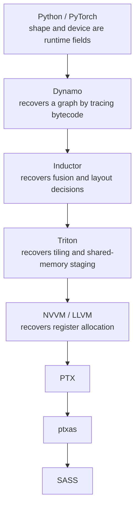



Windows 1.0 shipped in 1985 and asked for 256 KB of memory and two floppy drives.[^1] Windows 11 asks for 4 GB of memory and 64 GB of storage. That is a factor of sixteen thousand in memory and something north of eighty thousand in storage for a program whose basic job description a user from 1985 would still recognize: draw some windows, run some programs, find my files. The return on that expanded budget is real enough. Preemptive multitasking, a protected address space, Unicode, a network stack, a GPU compositor, full-disk encryption, and forty years of accumulated security work that 1985 did not know it needed. I would not give any of it up.

But none of it is sixteen thousand times of anything. Cold boot went from a couple of minutes to maybe fifteen seconds. Launching a text editor went from seconds to, on a bad day, seconds. That is roughly one order of magnitude of user-visible improvement against four orders of magnitude of hardware. The rest went into software. That complaint is not new.

## Wirth said this in 1995 and everyone agreed and nothing happened

Niklaus Wirth wrote "A Plea for Lean Software" for *IEEE Computer* in February 1995.[^2] He quoted Martin Reiser's formulation, which is still the sharpest version anyone has managed: software manages to outgrow hardware in size and sluggishness. Wirth's own phrasing became Wirth's law: software gets slower faster than hardware gets faster.

The paper is thirty-one years old and reads like it was written last week. Wirth blamed two things: features nobody asked for, and the fact that abundant memory removes the pressure that would otherwise force a design decision.

He was right about the phenomenon. I think he was wrong about the mechanism, and the part he missed is the part that matters now.

Wirth treated hardware as a single number getting bigger. It never was.

## Hardware did not scale. Some of it scaled.

Moore's law was a statement about transistor count, nothing else.[^3] Dennard scaling is what converted those transistors into free single-thread performance by letting voltage fall with feature size, and it stopped working around 2005.[^4] After that, the transistors kept coming and the free lunch did not. We ended up with multicore, and eventually with dark silicon, where you have more transistors than you have power budget to switch.[^5]

The subsystems of a computer scaled at wildly different rates, and they still do.

| Dimension | Direction over the last two decades |
| --- | --- |
| Peak server FLOPS | ~3.0x every two years[^6] |
| DRAM bandwidth | ~1.6x every two years[^6] |
| Interconnect bandwidth | ~1.4x every two years[^6] |
| DRAM latency | roughly flat in nanoseconds |
| Disk capacity | five to six orders of magnitude |
| Disk seek latency | under 2x[^7] |

Arithmetic got cheap at a rate nothing else in the machine came close to matching. Wulf and McKee called this disparity out in 1995 — the same year as Wirth's plea, which I find hard to read as coincidence — and the name they gave it has stuck: the memory wall.[^8]

Saying that software outpaced hardware is true but imprecise, and the imprecision hides the whole problem. Software did not outgrow some uniform resource called hardware. **Software grew along exactly the dimensions that scaled worst.** Every abstraction layer you add costs you footprint, indirection, and data movement. Those are the three axes where the hardware gave you the least. Meanwhile the axis that scaled beautifully, raw arithmetic, is the one layering barely touches.

We spent a forty-year bull market in floating-point operations buying things that cost memory traffic.

## The compounding is the mechanism

Leiserson and co-authors put a concrete number on this in *Science* in 2020, and the number is worse than you expect.[^9] They took one task — multiply two 4096-by-4096 matrices — and wrote it seven ways on the same 18-core machine.

| Version | Implementation | Running time (s) | GFLOPS | Speedup vs Python | Fraction of peak |
| --- | --- | --- | --- | --- | --- |
| 1 | Python | 25,552.48 | 0.005 | 1x | 0.00% |
| 2 | Java | 2,372.68 | 0.058 | 11x | 0.01% |
| 3 | C | 542.67 | 0.253 | 47x | 0.03% |
| 4 | Parallel loops | 69.80 | 1.969 | 366x | 0.24% |
| 5 | Parallel divide and conquer | 3.80 | 36.180 | 6,727x | 4.33% |
| 6 | plus vectorization | 1.10 | 124.914 | 23,224x | 14.96% |
| 7 | plus AVX intrinsics | 0.41 | 337.812 | 62,806x | 40.45% |

Sixty-two thousand times, on identical silicon, from nothing but telling the machine what you actually meant. The Python version reaches 0.0006% of the machine's peak.

The gap between the top and bottom row of that table is **larger than the entire Moore's law dividend over the period the table's hardware was built in.** This is not just leaving performance on the table. It is leaving more performance on the table than the semiconductor industry delivered in twenty years of heroic effort.

The mechanism is compounding reduction. You have problem A. Someone already solved problem B. You solve A by reducing it to B, because that is cheaper than solving A. Then B was itself solved by reduction to C, and C to D. Each reduction is individually reasonable, and each one costs you something:

$$0.8 \times 0.8 = 0.64$$

Two layers at a generous 80% efficiency leaves you 64%. Twenty-two layers leaves you under 1%:

$$0.8^{22} \approx 0.0074$$

Nobody chose a hundredfold slowdown. Twenty-two people each chose a 20% slowdown, and none of them was wrong.

This is why appeals to discipline do not work and never have. Wirth asked for discipline in 1995. The industry nodded and went on layering, because layering is not a lapse in judgment. It is the only way anyone ships anything on a schedule.

Jevons worked this out in 1865, about coal.[^10] Make a resource cheaper and consumption rises to absorb the savings. Cheap compute did not produce lean software; it produced more software, structured into deeper towers of abstraction. In traditional systems, that compounding took forty years. In the machine learning stack, where compute is more expensive than it has ever been, the exact same tower appeared in eight.

## The AI stack ran the same play in eight years

This is the path a matrix multiply takes to a GPU today.

Eight levels, and each one exists to recover information the level above threw away. Dynamo exists because Python has no graph. Inductor exists because PyTorch eager has no fusion. Triton exists because nobody wants to write SASS, and because the information a good tiling decision needs was never written down in the Python.[^11][^12]

I have walked through most of these individually: [what torch.compile sees](), [what Triton is actually doing](), and [what XLA buys and what it charges](). The pattern only shows up when you line them up. This is Leiserson's compounding reduction, built in eight years instead of forty, by people who knew the history.

They built it anyway. That is the evidence that matters. Not that naive programmers accidentally created a tower, but that the most performance-literate community in software, working on the most expensive compute on earth, with every incentive to keep it flat, produced an eight-layer tower regardless.

Which is why I do not believe this stops.

## Why accelerators make it worse

The optimistic story is that specialized hardware ends the problem. The accelerator does one thing, the layers collapse, and the tax goes away. I think every mechanism runs the other direction.

Specialization multiplies dialects. Hennessy and Patterson's Turing lecture argued we are entering a golden age for computer architecture, driven by domain-specific designs.[^13] They are right, and a golden age for architecture is a proliferation event for software. Every new architecture arrives with its own toolchain, its own intrinsics, and its own memory model. Look at what is shipping right now. Nvidia packages Grace and Blackwell into one coherent domain in GB200 NVL72. AWS runs Trainium and Inferentia alongside Graviton. Google has TPU, Microsoft has Maia and Cobalt, Meta has MTIA. BlueField DPUs handle networking, CXL pools memory across a rack, and single packages carry three or four tiers of memory. That is not a forecast. That is a purchase order. Software layers are no longer stacking vertically in a single tower. They are fanning out sideways, one tower per vendor, while the application on top is expected to be portable across all of them.

The scaling asymmetry widens. Compute scaling at 3.0x every two years against DRAM bandwidth at 1.6x and interconnect at 1.4x means the ratio deteriorates by roughly 1.9x and 2.1x per two-year step.[^6] Training compute for large models has been growing at something like 750x every two years, which no supply of bandwidth is going to meet.[^6] Every generation shifts the bottleneck further toward communication, while mainstream programming languages remain incapable of expressing data movement.

Hardware and runtime designers paper over this by hiding the transfers. An asynchronous copy, a unified-memory page fault, or a cache-coherent link between a CPU and an accelerator makes data movement invisible in the source text. None of them makes it free. A page fault across an interconnect is one of the most expensive events in the machine, but in the source it looks like an ordinary pointer dereference. [There is no address]() and [no such thing as a passive read]() describe the same failure from two directions: the abstraction that makes placement invisible is the abstraction that makes placement unmanageable.

## The variable that matters is the one we cannot name

The dominant cost in a modern system is where data lives and how often it moves. The hardware is getting more heterogeneous, multiplying both the physical tiers where data can reside and the varieties of interconnect between them. Because movement gets cheaper at roughly half the rate of arithmetic, placement is the performance variable. Not instruction selection, not register pressure, not even parallelism. Placement.

Leiserson's paper says this out loud, and the verb it uses is the one I keep coming back to: "architectures are likely to become increasingly heterogeneous, incorporating both general-purpose and special-purpose circuitry. To improve performance, programs will need to **expose** more parallelism and locality for the hardware to exploit."[^9]

Expose. Not *have inferred on their behalf*. Exposing is something a program does in its text, which makes it a language problem, and languages are the one layer of this stack nobody has been willing to touch.

The reply I get is that the compiler or the runtime will handle it. A runtime can handle it, in the sense that it can discover at execution time what the source refused to state. It then pays for that discovery on every run, forever, on every machine.

That bargain is exactly the one an out-of-order core already makes. I have [written at length]() about what it costs: most of a modern core's area and power goes to reconstructing facts that were free at the source level and got deleted on the way down. Doing it again at rack scale, for placement instead of for aliasing, is not a plan. It is the same mistake with a bigger power bill.

## Why now and not ten years ago

A decade ago, this argument would have failed on timing alone.

From roughly 2007 to 2015, heterogeneity looked like a transient phase. You could rationally bet that one vendor's dialect would win, learn it, and be done. That bet is closed. Four hyperscalers now design their own accelerators and none of them is going to stop, because the whole point of building your own silicon is that it is yours. Multi-vendor heterogeneity is a permanent feature of the landscape, which changes what a language is worth. A language that models placement abstractly only earns its keep when there is more than one place.

At the same time, the underlying economics inverted. When a machine cost four thousand dollars, programmer convenience dominated every other term. At the scale where a training cluster is a line item on an earnings call, a few percent of placement efficiency is worth more than a lot of convenience. That inversion is what makes an unfamiliar language a rational purchase rather than an indulgence.

The author of the code changed as well. Increasingly the implementation is written by a model, and a model's first draft is confident, plausible, and occasionally wrong in ways that code reviewers miss. I have argued that [a type system is a search oracle]() — that what you want from a language, when a generator produces the code, is the largest fraction of your specification the compiler can decide for you. Placement is part of that specification. If a model puts a tensor in the wrong memory, I want that to be a compile error, not a 40% regression someone discovers in a flame graph next quarter.

None of that was true in 2015. All of it is true now.

## What I did about it

I spent the last stretch building a language where a tensor's type carries its memory space, where crossing between spaces is an operation the compiler checks rather than a call into a vendor runtime, and where a host thread touching device memory fails at compile time. It is called Vx, it is at [vxlang.org](https://vxlang.org), and it is version 0.0.1 — the syntax is mostly settled, the standard library is thin, and there is no package manager yet.

I am not claiming it is the answer. Sequoia, X10, Chapel, and Legion all got the diagnosis right years ago, and none of them is what people write today. The historical base rate for this kind of project is unkind.

What I am claiming is that the diagnosis is correct and that the layer that needs the work is the language. Wirth's law is not going to be repealed by discipline; it was never a discipline problem. As hardware diverges across more tiers of memory and more vendors' silicon, the penalty for ignoring data movement will only compound. The only variable anyone actually controls is what the source text is permitted to say about where things live.

Right now it is permitted to say almost nothing. That is a choice, and it is old enough to revisit.

---

## References

[^1]: **Windows 1.0 system requirements.** Contemporary and retrospective accounts give 256 KB of RAM, two double-sided floppy drives, a graphics adapter and MS-DOS 2.0 or later, with 512 KB and a hard disk recommended for running multiple programs. Wikipedia gives 192 KB, which is an outlier against the other accounts; I have used the 256 KB figure and flag the discrepancy rather than resolving it. Windows 11's published floor is 4 GB of RAM, 64 GB of storage and TPM 2.0. ([Windows 1.0](https://en.wikipedia.org/wiki/Windows_1.0), [Windows 11 specifications](https://www.microsoft.com/en-us/windows/windows-11-specifications))

[^2]: **A Plea for Lean Software.** Niklaus Wirth, IEEE Computer 28(2), 64–68, February 1995. Source of what is now called Wirth's law, and of the quotation of Martin Reiser that software "manages to outgrow hardware in size and sluggishness." ([IEEE Computer](https://doi.org/10.1109/2.348001))

[^3]: **Cramming More Components onto Integrated Circuits.** Gordon E. Moore, Electronics 38(8), 114–117, 19 April 1965. The original observation concerns the number of components per integrated circuit at minimum cost, not clock speed or delivered performance. ([Intel archive](https://www.cs.utexas.edu/~fussell/courses/cs352h/papers/moore.pdf))

[^4]: **Design of Ion-Implanted MOSFET's with Very Small Physical Dimensions.** Robert H. Dennard, Fritz H. Gaensslen, Hwa-Nien Yu, V. Leo Rideout, Ernest Bassous and Andre R. LeBlanc, IEEE Journal of Solid-State Circuits 9(5), 256–268, 1974. The scaling relations whose breakdown in the mid-2000s ended frequency scaling. ([JSSC](https://doi.org/10.1109/JSSC.1974.1050511))

[^5]: **Dark Silicon and the End of Multicore Scaling.** Hadi Esmaeilzadeh, Emily Blem, Renée St. Amant, Karthikeyan Sankaralingam and Doug Burger, ISCA 2011. Projects the fraction of a chip that must stay dark once transistor count outruns the power budget. ([ISCA 2011](https://doi.org/10.1145/2000064.2000108))

[^6]: **AI and Memory Wall.** Amir Gholami, Zhewei Yao, Sehoon Kim, Coleman Hooper, Michael W. Mahoney and Kurt Keutzer, IEEE Micro 44(3), 2024. Source of the scaling rates used above: peak server FLOPS ~3.0x every two years against DRAM bandwidth ~1.6x and interconnect bandwidth ~1.4x, with large-model training compute growing on the order of 750x every two years. The paper traces the memory-wall framing to Wulf and McKee. ([arXiv:2403.14123](https://arxiv.org/abs/2403.14123), [IEEE Micro](https://doi.org/10.1109/MM.2024.3373763))

[^7]: **Disk capacity against disk latency.** These are vendor-datasheet-typical figures rather than a single published series. A 1990 desktop drive held tens of megabytes with an average seek on the order of 15 ms; a 2026 nearline drive holds roughly 30 TB with an average seek still in the 8 ms range, the floor being set by actuator mechanics and rotational latency rather than by areal density. Capacity therefore grew by five to six orders of magnitude while access latency improved by less than 2x. DRAM shows the same shape: CAS latency expressed in nanoseconds has been roughly flat across DDR generations, because each bandwidth increase has come with a proportional increase in cycle count.

[^8]: **Hitting the Memory Wall: Implications of the Obvious.** William A. Wulf and Sally A. McKee, ACM SIGARCH Computer Architecture News 23(1), 20–24, March 1995. ([SIGARCH](https://doi.org/10.1145/216585.216588))

[^9]: **There's Plenty of Room at the Top: What Will Drive Computer Performance After Moore's Law?** Charles E. Leiserson, Neil C. Thompson, Joel S. Emer, Bradley C. Kuszmaul, Butler W. Lampson, Daniel Sanchez and Tao B. Schardl, Science 368, eaam9744, 5 June 2020. Table 1 is reproduced above; the machine's peak is 835 GFLOPS across 18 cores, and the authors note that Python 3 takes about 9 hours for the same computation. The compounding-reductions argument and the quoted sentence on heterogeneity and exposing locality are both from the Software section. ([Science](https://doi.org/10.1126/science.aam9744))

[^10]: **The Coal Question.** William Stanley Jevons, Macmillan, 1865. The observation that improved efficiency in the use of a resource tends to increase rather than decrease total consumption of it. ([Project Gutenberg](https://www.gutenberg.org/ebooks/56217))

[^11]: **Triton: An Intermediate Language and Compiler for Tiled Neural Network Computations.** Philippe Tillet, Hsiang-Tsung Kung and David Cox, MAPL 2019. ([MAPL 2019](https://doi.org/10.1145/3315508.3329973))

[^12]: **PyTorch 2: Faster Machine Learning Through Dynamic Python Bytecode Transformation and Graph Compilation.** Jason Ansel et al., ASPLOS 2024. The TorchDynamo and TorchInductor design, including why graph capture from Python bytecode was necessary at all. ([ASPLOS 2024](https://doi.org/10.1145/3620665.3640366))

[^13]: **A New Golden Age for Computer Architecture.** John L. Hennessy and David A. Patterson, Communications of the ACM 62(2), 48–60, February 2019. The Turing lecture, arguing that domain-specific architectures are where the remaining performance is. ([CACM](https://doi.org/10.1145/3282307))

---

*Disclaimer: Researched and drafted with AI assistance (Claude Opus 5, Gemini 3.1 Pro). Direction, technical judgment, and final edits are mine; every claim is traceable to the sources cited above. The Windows and disk-drive figures are industry-typical rather than measurements I took, and footnotes 1 and 7 say so explicitly. Vx is my own project, so discount the closing section accordingly.*
