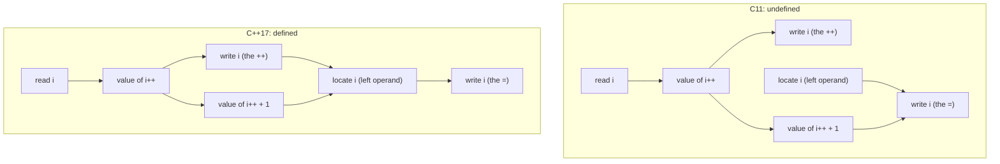
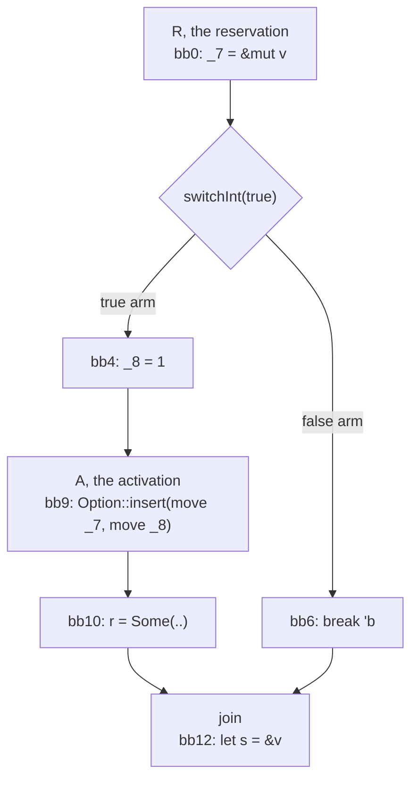
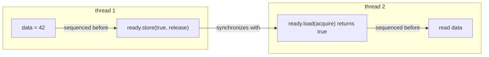

This program has no `unsafe` block. It compiles on stable Rust 1.95, and it prints a number from the wrong vector.

```rust
pub fn main() {
    let mut a: Vec<u64> = vec![1];
    let mut b: Vec<u64> = vec![2];
    let mut p: &mut Vec<u64> = &mut a;
    let s: &u64;
    // 1. `p.push(..)` reserves `&mut *p` before the argument runs. Right now `*p` is `a`.
    p.push({
        // 2. A shared borrow of `a[0]`. Allowed, because the `&mut` is only reserved.
        s = &p[0];
        // 3. Point `p` at `b`. The reserved borrow still refers to `a`.
        p = &mut b;
        0
    });
    // 4. The push went to `a`, which grew and freed its buffer. `s` still points into it.
    for _ in 0..64 { p.push(7); }
    println!("{}", *s);
}
```

Built with rustc 1.95 on aarch64 macOS, it prints `2`. Only `b` ever held a 2, so a reference created as `&a[0]` is reading `b`'s data. The allocator most likely reused `a`'s freed buffer. This is [rust-lang/rust#164163](https://github.com/rust-lang/rust/issues/164163), filed on October 11 and marked P-high three days later.[^1] A bisection in the thread finds it in the first nightlies that enabled two-phase borrows in 2018. Two months earlier, [rust-lang/rust#160598](https://github.com/rust-lang/rust/issues/160598) showed the same machinery accepting a shared borrow of an `Option` while a `&mut` into it was still live. The trigger was a `break` inside a method argument, and a variant in the thread segfaults.[^2]

Rust is the language that did what C and C++ argued about for thirty years. It has no `++` or `--`, and the old Rust FAQ explains why: "They require knowledge of evaluation order, and often lead to subtle bugs and undefined behavior in C and C++."[^3] Assignment returns `()`. Operands are evaluated left to right, as written. And both bugs are still about evaluation order. Not about the order the machine runs things in, because Rust specifies that. They are about which evaluations the borrow checker believes have happened at a given point.

That question is what sequence points were always for. A sequence point does not exist to tell the compiler which operand to evaluate first. It exists to establish a dominance relation among expressions. For any two evaluations that touch the same object, the program text decides which one is complete before the other starts. A fixed order is one way to get that relation. It is not the relation. Every language that treats the two as the same thing ends up with bugs in the gap.

## What a sequence point promises

C11 defines the relation in 5.1.2.3: "*Sequenced before* is an asymmetric, transitive, pair-wise relation between evaluations executed by a single thread, which induces a partial order among those evaluations. Given any two evaluations A and B, if A is sequenced before B, then the execution of A shall precede the execution of B."[^4] Section 6.5p2 says what happens when the relation is missing: "If a side effect on a scalar object is unsequenced relative to either a different side effect on the same scalar object or a value computation using the value of the same scalar object, the behavior is undefined."

Draw the evaluations of an expression as a graph. Each node is a value computation or a side effect. An edge from A to B means the language requires A to finish before B starts. Compiler engineers have a name for "every path that reaches B passes through A first": A *dominates* B. The standard's "sequenced before" is that relation on a graph the standard never draws. Two evaluations are *unsequenced* when neither dominates the other, so every order and every interleaving is allowed. *Indeterminately sequenced* means that one dominates the other in each execution, but the text does not say which.

With that vocabulary, 6.5p2 is a single rule. If two accesses conflict and neither dominates the other, the program has no meaning. That is the spirit of having sequence points. The language promises that conflicting accesses are ordered by dominance, or it disowns the program. Everything that asks "which of these came first?" depends on that promise: the code generator, the constant evaluator, the borrow checker, `-Wunsequenced`, and the person reading the code.

The graph for `i = i++ + 1` shows the difference between two languages that use the same words. C11 has no path between the two writes to `i`. C++17 has one.



The C11 side comes from two sentences. 6.5.2.4p2 says "The value computation of the result is sequenced before the side effect of updating the stored value of the operand." 6.5.16p3 says "The side effect of updating the stored value of the left operand is sequenced after the value computations of the left and right operands. The evaluations of the operands are unsequenced." Nothing orders the `++` write against the `=` write. The C++17 side has the extra edges because its assignment rule says "The right operand is sequenced before the left operand," and that covers every side effect of the right operand.[^5]

## Thirty years of adding edges

C89 and C99 did not have a relation. They had points. The main ones were the end of a full expression, the `&&`, `||`, `?:` and comma operators, and the moment before a function is called. Between two points, every evaluation sat in one unordered bag. That was coarse, but it was honest about the goal. A point is a cut through the evaluation graph, and everything before the cut dominates everything after it.

C++11 replaced the points with the relation. Clark Nelson's N1944 gave the reason in 2006: "A rigorous definition of sequencing in the context of a single thread is an essential prerequisite for any definition of concurrent semantics." Its revision, N2239, was voted into the working paper in April 2007.[^6] Happens-before, the core of the C++11 memory model, is built on top of sequenced-before. WG14 adopted the same model for C through Nelson's N1252, whose motivation reads "In a nutshell, the answer is parallel programming."[^7] C11 kept the old term as well. 5.1.2.3p3 says "The presence of a sequence point between the evaluation of expressions A and B implies that every value computation and side effect associated with A is sequenced before every value computation and side effect associated with B," and Annex C still lists the points.

One author, one vocabulary, and still two graphs. C11's footnote 84 says its rule "renders undefined statement expressions such as `i = ++i + 1;`". C++11 makes the same expression well defined. [CWG 222](https://cplusplus.github.io/CWG/issues/222.html) (opened in 1999) and [CWG 637](https://cplusplus.github.io/CWG/issues/637.html) settled it. In C++, assignment and prefix `++` yield lvalues, and C++11's [expr.ass] sequences the assignment "before the value computation of the assignment expression." The committee recorded that "There was no real support in the CWG for weakening the resolution of issue 222."[^8] C has no such clause. Same words, same author, different dominance relation.

C++17 added edges where idiomatic code kept breaking. P0145R3, by Gabriel Dos Reis, Herb Sutter and Jonathan Caves, opens with a chain from Stroustrup's *The C++ Programming Language*:[^9]

```cpp
s.replace(0, 4, "").replace(s.find("even"), 4, "only").replace(s.find(" don't"), 6, "");
```

The paper's comment is blunt: "This code has been reviewed by C++ experts world-wide, and published (The C++ Programming Language, 4th edition.) Yet, its vulnerability to unspecified order of evaluation has been discovered only recently by a tool." P0145 fixed `a.b`, `a->b`, `a->*b`, `a[b]`, `a << b` and `a >> b` as left to right, and `a = b` and `a @= b` as right to left. Function arguments did not get an order. The adopted wording, P0400R0, says only that "The postfix-expression is sequenced before each expression in the expression-list" and that each parameter's initialization is indeterminately sequenced with the others.[^10] Arguments could no longer interleave, but they could still run in any order. Two weeks later, Jason Merrill, who maintains GCC's C++ front end, wrote on gcc-patches that he had "convinced the committee to drop function arguments from the order of evaluation paper, so we don't have to worry about that hit on PUSH_ARGS_REVERSED targets."[^11] Code generation for one family of targets shaped the language rule.

Three months later, Hyman Rosen's P0431R0 named the cost in one line: "a() = b() and a().operator=(b()) are different."[^12] For the same function, the operator form evaluates `b()` first and the call form evaluates `a()` first. P0431 asked for strict left to right. It was not adopted.

The C++26 cycle kept going. [CWG 2867](https://cplusplus.github.io/CWG/issues/2867.html), accepted as a defect report in June 2024, orders the initialization of structured bindings. In November 2024, [CWG 2944](https://cplusplus.github.io/CWG/issues/2944.html) made a throw-expression indivisible relative to surrounding evaluations, the way a function call already was.[^13] And reflection forced the largest step. P2996R13 adds this to [intro.execution]: "During the evaluation of an expression as a core constant expression, suboperands and subexpressions that are otherwise unsequenced or indeterminately sequenced are evaluated in lexical order." The rationale says "Strengthening order of evaluation for core constant expressions removes the need for more IFNDR," and "All four major implementations already conform to this rule." [CWG 3176](https://cplusplus.github.io/CWG/issues/3176.html) then had to specify how default arguments fit into that lexical order and was accepted in June 2026.[^14]

Each revision added edges for the shapes that had hurt someone. The Stroustrup chain hurt someone. `std::cout << f() << g()` hurt nearly everyone. I don't fault the committee for picking those shapes first. But a relation assembled one idiom at a time has no invariant you can check. Compilers still fill in whatever freedom remains. One probe per expression form, run on the three compilers most people ship with, shows what they do with that freedom:

```cpp
static int trace;
static int step(int id) { trace = trace * 10 + id; return id; }

struct S {
  S& operator=(int) { return *this; }
  S& operator<<(int) { return *this; }
};
static S obj;
static S& get(int id) { step(id); return obj; }
static void take2(int, int) {}

int main() {
  // 1. Each probe resets `trace`, then runs two or three steps.
  // 2. The digits of `trace` are the order the steps ran in. 12 is left to right.
  trace = 0; get(1) = step(2);              // operator notation
  trace = 0; get(1).operator=(step(2));     // the same call, written as a call
  trace = 0; get(1) << step(2) << step(3);  // the std::cout idiom
  trace = 0; take2(step(1), step(2));       // function arguments
}
```

| Probe | Rule | GCC 15.2 | Clang 21.1 | MSVC 19.51 |
| --- | --- | --- | --- | --- |
| `a << b << c`, C++14 | unspecified | 123 | 123 | 321 |
| `a.operator=(b)`, C++14 | unspecified | 12 | 12 | 21 |
| `a << b << c`, C++17 | left to right | 123 | 123 | 123 |
| `a = b`, C++17 | right to left | 21 | 21 | 21 |
| `a.operator=(b)`, C++17 | left to right | 12 | 12 | 12 |
| `f(a, b)`, C++17 | indeterminate | 21 | 12 | 21 |

Every cell conforms. In C++14, GCC and MSVC printed a `std::cout` chain in opposite orders, and both were right. In C++17, all three agree on the shapes P0145 fixed, and all three show the defect P0431 described. `get(1) = step(2)` and `get(1).operator=(step(2))` call the same function and evaluate its operands in opposite orders.

## Rust paid for the order and kept the hole

The Rust Reference states the rule in one sentence: "The operands of these expressions are evaluated prior to applying the effects of the expression. Expressions taking multiple operands are evaluated left to right as written in the source code."[^15] Then come the exceptions. In assignment, "The assigned value operand is evaluated first, followed by the assignee expression." Compound assignment evaluates the right side first when both operands are primitive, and the left side first when the operator goes through a trait. The Reference adds a note, "This is unusual. Elsewhere left to right evaluation is the norm," and a warning: "Avoid writing code that depends on the evaluation order of operands in compound assignments as it can be unusual and surprising."[^16] When a language reference warns readers away from its own rule, the rule was written to match an implementation.

Those exceptions are cosmetic. The real tension is `vec.push(vec.len())`. Left to right means the receiver goes first, and the receiver of `push` is `&mut vec`. So the exclusive borrow exists while `vec.len()` runs, and plain exclusivity rejects an obviously correct program. Rust before 2018 did reject it. RFC 2025 fixed it with *two-phase borrows*.[^17] The autoref `&mut vec` is *reserved* when the receiver is evaluated, and it behaves like a shared borrow until the call. At the call it is *activated* and becomes a real `&mut`. rustc's source calls these two points R and A, and the rest of this post does too. The rustc dev guide lists the borrows that get this treatment: the autoref of a `&mut self` receiver, a mutable reborrow in function arguments, and the implicit `&mut` of an overloaded compound assignment.[^18]

The RFC considered the alternative of evaluating the receiver after the arguments. Backward compatibility ruled that out for code such as `a().foo(b())`. It was candid about the price of the design it chose: "this change slightly widens the gap between the surface language and the underlying 'desugared' view that MIR takes, and in general that is to be avoided."

In sequencing terms, a two-phase borrow splits one evaluation (the autoref of the receiver) into two events, with other evaluations running between them. That is an interleaving, which is exactly what C++17 banned between function arguments. Rust brought it back in one carefully chosen place for a good reason. Then the borrow checker had to answer "what has happened between the reservation and the activation?" The language had no rule that answered it.

## The diamond in `is_active`

rustc answers it with a dominator query. This is `rustc_borrowck::path_utils::is_active`, with its comment:[^19]

```rust
// Otherwise, it is active for every location *except* in between
// the reservation and the activation:
//
//       X
//      /
//     R      <--+ Except for this
//    / \        | diamond
//    \ /        |
//     A  <------+
//     |
//     Z
//
// Note that we assume that:
// - the reservation R dominates the activation A
// - the activation A post-dominates the reservation R (ignoring unwinding edges).
//
// This means that there can't be an edge that leaves A and
// comes back into that diamond unless it passes through R.

// ...

// If dominated by the activation A, then it is active. The
// activation occurs upon entering the point A, so this is
// also true if location == activation_location.
if activation_location.dominates(location, dominators) {
    return true;
}

// The reservation starts *on exiting* the reservation block,
// so check if the location is dominated by R.successor. If so,
// this point falls in between the reservation and location.
let reserve_location = borrow_data.reserve_location.successor_within_block();
if reserve_location.dominates(location, dominators) {
    false
} else {
    // Otherwise, this point is outside the diamond, so
    // consider the borrow active. ...
    true
}
```

Those two bullets state a sequencing rule as a dominance relation inside a comment. The Reference says the receiver is evaluated before the arguments and the arguments before the call. It never says what happens when an argument does not finish. In Rust an argument can leave halfway, because `break`, `continue`, `return` and `?` are all expressions. That is [#160598](https://github.com/rust-lang/rust/issues/160598):

```rust
#![forbid(unsafe_code)]
fn main() {
    let mut v = Some(0i32);
    let mut r: Option<&mut i32> = None;
    'b: {
        // 1. R: `&mut v` is reserved for the receiver of `insert`.
        // 2. The argument may `break 'b`, which leaves before the call (A).
        r = Some(v.insert(match true { false => break 'b, true => 1 }));
    }
    // 3. The join point. R dominates it and A does not, so `is_active`
    //    calls the loan "only reserved" and lets a shared borrow through.
    let s = &v;
    let before = *s;
    // 4. Write through the activated `&mut` while `s` is live.
    *r.unwrap() = 2;
    println!("{:?} {:?}", before, *s);
}
```

It compiles on 1.95 and prints `Some(1) Some(2)`. A shared reference watched its referent change. Move the `match` into a `let` above the call, and the same program gets E0502 at `let s = &v`. With the trivial blocks removed, the MIR that the borrow checker sees shows why:



The edge from `bb6` to `bb12` leaves the diamond without passing through the activation A in `bb9`. At the join in `bb12`, the reservation R dominates and A does not, so the query reports "between the two." But on the path through `bb10`, the `&mut` is active and stored in `r`. The `break` never has to execute. Its edge in the CFG is enough.

GCC's manual documents the same hole for GCC's own expression-level control flow. Of statement expressions, it says: "Jumping out of a statement expression is permitted, but if the statement expression is part of a larger expression then it is unspecified which other subexpressions of that expression have been evaluated."[^20] GCC chose "unspecified." Rust lets any expression jump, yet the borrow checker assumed an argument could not.

The write-up in the issue proposes replacing the second dominance test with a reachability test from A. That works. What bothers me is that the answer was available earlier for free. MIR building lowered the receiver, the argument subtree, and the call in that order. The window between R and A *is* the argument subtree. The dominator query rebuilds that fact from the CFG under an assumption that any control-flow expression in operand position can break.

## A place is not a value

[#164163](https://github.com/rust-lang/rust/issues/164163) has no interesting control flow. In its MIR, `p` is `_7`, the reservation is `_11 = &mut (*_7)`, and the call consumes `_11`. So codegen uses the address `*p` had at R, which is `a`. That matches the Reference.

The checker does something else at the activation. At A, `check_activations` calls `access_place` on `borrow.borrowed_place`, which is the path `(*p)`.[^21] Between R and A, the assignment `p = &mut b` ran, and the borrow dataflow handles an assignment to a whole local like this:

```rust
// If the borrowed place is a local with no projections, all other borrows of this
// local must conflict. This is purely an optimization so we don't have to call
// `places_conflict` for every borrow.
if place.projection.is_empty() {
    if !self.body.local_decls[place.local].is_ref_to_static() {
        state.kill_all(other_borrows_of_local);
    }
    return;
}
```

`s = &p[0]` went through `Index::index(&*p, 0)`, so `s` depends on a shared loan of `(*p)`. The assignment kills that loan. At A, the checker asks whether `(*p)` conflicts with anything, and `(*p)` now names `b`. Nothing conflicts. Killing those loans is sound for every access that evaluates `*p` again after the assignment. The activation does not evaluate it again. It uses a place that was evaluated at R.

So codegen evaluated the receiver once at R, and the checker evaluated it a second time at A. Two parts of one compiler disagree about when an operand was evaluated, and that disagreement is the entire bug. Two controls confirm it. Take the receiver borrow explicitly with `let recv = &mut *p; recv.push(..)`, and rustc reports E0502 at `&p[0]`. Delete the line `p = &mut b`, and rustc reports E0502 at the call.

This is not a Rust problem. GCC has the same bug, still open, in plain C++17:[^22]

```cpp
#include <cstdio>

int func(int &x, int *&y) {
   y = &x;   // 1. Re-point the caller's `c` at `a`.
   x++;
   return x;
}

int main() {
   int a = 4;
   int b = 9;
   int *c = &b;
   // 2. C++17: the right operand is sequenced before the left one, so
   //    `*c` must be computed after `func` has re-pointed `c`.
   *c = func(a, c);
   std::printf("%d%d%d\n", a, *c, b);
}
```

Clang 21.1 and MSVC 19.51 print `559`. GCC 15.2 prints `555` at `-O0` and `-O2` because it stores through the old `c`. On [GCC PR 119466](https://gcc.gnu.org/bugzilla/show_bug.cgi?id=119466), Jonathan Wakely diagnosed it: "It seems that GCC evaluates the left operand *c before the right operand func(a, c), so the assignment is done to the wrong location." Jakub Jelinek guessed the cause: "Bet this is just that *c has no side-effects." An older report, [PR 91987](https://gcc.gnu.org/bugzilla/show_bug.cgi?id=91987), showed `x << (x = 3, 2)` going wrong in 2019 because the left operand was gimplified "to a VAR_DECL which satisfies the predicate, yet is a user variable that can be overwritten in the expression that needs to be sequenced after it."[^23] That case is fixed in GCC 15.2. The report is still open for the cases that are not.

GCC and rustc made the same mistake in different layers. An operand that names a place has no side effects of its own, so each implementation treated its evaluation as something that could happen whenever convenient. GCC computed it too early. rustc's checker computed it too late. But a place has inputs. `*c` reads `c` and `(*p)` reads `p`, while another operand writes that input. A sequencing rule that orders only side effects misses this. The dominance relation has to cover the reads that compute a place, not only the writes.

There is a quieter cousin in Rust that is not a bug at all:

```rust
let mut p: &mut Vec<u64> = &mut a;
p.push({ p = &mut b; 0 });  // 1. Pushes into `a`. The receiver was evaluated first.
p.push(9);                  // 2. Pushes into `b`.
// prints: [1, 0] [2, 9]
```

That is sound, and it follows the Reference. I would still bet that most reviewers pick the wrong vector for the first push.

## Every consumer keeps its own copy

Every consumer of sequencing needs the same answer: given two evaluations, does one dominate the other? Codegen needs it to emit instructions. The constant evaluator needs it to fold. The borrow checker needs it to decide which loans are live. A warning needs it to tell you that two accesses race. When a language specifies its order in prose, idiom by idiom, each consumer rebuilds the relation for itself. Those copies drift apart.

They drift inside a single compiler:

```cpp
#include <cstdio>

constexpr int order() {
  int trace = 0;
  auto step = [&trace](int id) { trace = trace * 10 + id; return id; };
  auto take = [](int, int) {};
  take(step(1), step(2));
  return trace;  // 12: left to right. 21: right to left.
}

// 1. The constant evaluator, part of the front end, computes this one.
constexpr int folded = order();

int main() {
  // 2. A call through a volatile pointer makes generated code compute this one.
  int (*volatile fp)() = order;
  std::printf("constant evaluation: %d\nrun time: %d\n", folded, fp());
}
```

GCC 15.2 prints 12 and then 21. MSVC 19.51 does the same at `/Od` and at `/O2`. Clang 21.1 prints 12 twice on Linux. clang-cl 22.1, the same front end on the Microsoft ABI, prints 12 and then 21. One function, one compiler, one set of flags, two answers. Every one of them conforms. And since P2996, C++26 *requires* the 12 and still permits the 21. The standard now specifies two relations for one expression, one for each consumer.

Clang's source says plainly where the run-time order comes from. In `EmitCallArgs`: "We must evaluate arguments from right to left in the MS C++ ABI, because arguments are destroyed left to right in the callee." The constant evaluator in `ExprConstant.cpp` never asks which ABI it is on.[^24] The copies have not always agreed even on what the standard fixes. Before Clang 12, the constant evaluator did not fully implement P0145. Richard Smith reduced one report to `(res = 5) |= (res *= 2);`, "which returns 10 when constant-evaluated and 5 when code is generated." The fix landed as "[c++17] Implement P0145R3 during constant evaluation."[^25]

Warnings are a third copy. GCC's manual for `-Wsequence-point` says C++17 makes its own examples well defined, "But this option will still warn about them, to help people avoid writing code that is undefined in C and earlier revisions of C++." That is a defensible choice for a warning. It also means the diagnostic is built on a different graph from the one codegen uses. When GCC fixed braced-init-list ordering in [PR 51253](https://gcc.gnu.org/bugzilla/show_bug.cgi?id=51253), Wakely noted on the bug that G++ still warned about the test cases even though it now generated the right code.[^26]

I have made this mistake myself. In Vx, my own language, the two code generators disagreed on the order of indexed assignment and of struct literals. One test program printed `1 2 3 4 3 6 5` with one generator and `2 1 3 4 3 5 6` with the other. Meanwhile, the borrow checker carried a separate model of assignment order.[^27] Translating rustc's borrow-checker bug reports into Vx turned [#164163](https://github.com/rust-lang/rust/issues/164163) into [Vx #1800](https://github.com/vx-lang/Vx/issues/1800). There, a plain argument was enough to free a buffer under a live reference.[^28] Neither problem was a missing check. Each part of the compiler had its own copy of the relation.

## Every expression tree gets a sequence

I want one rule from a language: every possible expression tree has one well-defined sequence, and the language states it as a dominance relation, not as a list of idioms. The specification I have proposed for Vx in [#1846](https://github.com/vx-lang/Vx/pull/1846) is built on the same idea.

1. **The order is a function of the tree alone.** It does not depend on the ABI, the target, the optimization level, or whether the expression runs at compile time. Operands go left to right, each operand completes before the next starts, and the operation comes last. The operator form and the call form of an operation have the same order, which was P0431's point.
2. **A place has inputs, and they are part of the order.** Computing a place reads the pointers and indices it goes through. Those reads are sequenced like any other read, and a later operand that writes one of them conflicts with any pending use of the place.
3. **Control flow inside an operand is part of the rule.** When an operand completes abruptly with `break`, `return`, `?`, or a panic, the enclosing expression stops. Every operand to its left has finished, and nothing to its right has started. The specification says which accesses are abandoned, such as a reservation whose call never happens.
4. **A split access is a named interval in the tree.** A two-phase reservation covers the operands between the reservation and the operation, and nothing else. Swift's SE-0176 draws the same line between instantaneous and non-instantaneous accesses.[^29]
5. **Lowering computes the relation once and records it.** Codegen, the constant evaluator, the warnings, and the checker all read that record. None of them rebuild it from a CFG.

As-if optimization survives all of this. A compiler can still reorder operands when no program can tell the difference, which covers nearly every pure operand.

With rules 2 through 5, both Rust bugs become short, local checks. In rustc's terms, the shape is roughly this. It is a sketch, not a patch:

```rust
/// Recorded by MIR building while it lowers `recv.method(args..)`.
struct ReservationWindow<'tcx> {
    borrow: BorrowIndex,
    /// Every location lowered from the argument operands, and only those.
    /// A `break` out of an argument jumps to a location outside this set.
    inside: FxHashSet<Location>,
    /// The prefixes of the reserved place that end just before a `Deref`:
    /// `p` for `(*p)`, `x.f` for `(*x.f)`. The address was read from these.
    address_inputs: SmallVec<[PlaceRef<'tcx>; 2]>,
}

impl<'tcx> ReservationWindow<'tcx> {
    /// Replaces the dominator query in `is_active`.
    fn is_reserved_only(&self, loc: Location) -> bool {
        // 1. Membership comes from the tree, so it needs no assumption about
        //    post-dominance. The join after `break 'b` is outside the window,
        //    so the loan there is active and `let s = &v` is E0502. (#160598)
        self.inside.contains(&loc)
    }

    /// Called for every assignment inside the window.
    fn check_write(&self, written: Place<'tcx>, loc: Location) -> Result<(), Conflict> {
        // 2. The reserved place was computed at R from `address_inputs`.
        //    Overwriting one of them would make the activation check a
        //    different object than the call uses, so the write conflicts
        //    with the reservation. `p = &mut b` inside `p.push(..)` is an
        //    error. (#164163)
        if self.inside.contains(&loc)
            && self.address_inputs.iter().any(|input| written.as_ref().is_prefix_of(*input))
        {
            return Err(Conflict::WriteToReservedAddress(self.borrow));
        }
        Ok(())
    }
}
```

The first check is one set lookup per query instead of two dominator walks. The second is one pass over the assignments inside the argument operands, and in most calls there are none. Neither check needs to know that `break` exists because the tree already put the `break` target outside the window.

The second check also rejects the quieter cousin, `p.push({ p = &mut b; 0 })`. I count that as a feature. A program whose meaning depends on the reader remembering that the receiver went first is a program I want flagged in review anyway. If that proves too strict, the precise alternative is to keep loans that overlap the reservation alive through kills inside the window. That accepts the cousin and still rejects [#164163](https://github.com/rust-lang/rust/issues/164163).

## What a fixed evaluation order costs: registers, destructor order, threads, and rejected programs

Four objections come up whenever someone asks for a fixed order. Each one has a cost you can measure, and only one of them is large.

### Registers: one value has to survive a call

The classic argument is Sethi-Ullman. If the order is open, the compiler can evaluate the operand that needs more registers first. A fixed order keeps that freedom for every operand without side effects, because under as-if no program can see the difference. The freedom is lost only when an operand calls a function or writes memory. So that is the case to look at:

```c
int g(int *p);

// 1. Left to right, as a fixed order would require: load *p, then call g.
int load_first(int *p) { return *p + g(p); }

// 2. The other order, which C's open rule also allows: call g, then load *p.
int call_first(int *p) { return g(p) + *p; }
```

GCC 15.2 and Clang 21.1 at `-O2` compile both functions to the same shape:

```nasm
load_first:
        push    rbx
        mov     ebx, DWORD PTR [rdi]    ; keep *p alive across the call
        call    g
        add     eax, ebx
        pop     rbx
        ret
call_first:
        push    rbx
        mov     rbx, rdi                ; keep p alive across the call
        call    g
        add     eax, DWORD PTR [rbx]
        pop     rbx
        ret
```

Either way, one value has to survive the call, so either way the function saves one callee-saved register. The order changes which value is kept, not how many. And both compilers already evaluate `load_first` in source order, although C would let them call `g` first.

Java requires left-to-right evaluation, and it states the rule as an as-if guarantee: the operands "appear to be evaluated in a specific evaluation order, namely, from left to right."[^30] Nobody blames HotSpot's performance on that sentence.

### Destructor order: the Windows x64 ABI destroys arguments in the callee

This is the strongest objection. In the Microsoft x64 C++ ABI, the callee destroys its by-value arguments, left to right. Build the arguments right to left, and they are destroyed in reverse order of construction, as C++ programmers expect. Build them left to right, and they are destroyed in the order they were built.

A probe that prints every construction and destruction makes this visible:

```cpp
struct Noisy {
  int id;
  explicit Noisy(int i) : id(i) { std::printf("make %d\n", id); }
  Noisy(const Noisy&) = delete;  // 1. No copies, so the trace shows only these objects.
  ~Noisy() { std::printf("drop %d\n", id); }
};

void take(Noisy, Noisy);       // 2. A plain call. C++17 leaves the argument order open.
int operator<<(Noisy, Noisy);  // 3. A shift. C++17 requires left to right.

take(Noisy(1), Noisy(2));
(void)(Noisy(1) << Noisy(2));
```

| Compiler and ABI | `take(Noisy(1), Noisy(2))` | `Noisy(1) << Noisy(2)` |
| --- | --- | --- |
| GCC 15.2, Itanium | make 2 1, drop 1 2 | make 1 2, drop 2 1 |
| Clang 21.1, Itanium | make 1 2, drop 2 1 | make 1 2, drop 2 1 |
| clang-cl 22.1, Microsoft x64 | make 2 1, drop 1 2 | make 1 2, **drop 1 2** |
| MSVC 19.51, Microsoft x64 | make 2 1, drop 1 2 | **make 2 1**, drop 1 2 |

On the Itanium ABI the caller destroys the arguments, so every construction order gets reverse destruction. On the Microsoft ABI, the shift forces a choice, and the two compilers choose differently. clang-cl keeps the C++17 order and gives up reverse destruction. Richard Smith's 2016 commit says so directly: "Instead of ignoring the evaluation order rule, ignore the 'destroy parameters in reverse construction order' rule for the small number of problematic cases."[^31] MSVC keeps reverse destruction and builds the operands right to left, which C++17 does not allow. It does say so, with warning C4866, "compiler may not enforce left-to-right evaluation order for call to operator_name". But the warning is off by default.[^32]

Clang's choice is the right one. A destruction order that is not the reverse of construction surprises far fewer programs than an argument order that changes with the target. A language that fixes the order everywhere makes that trade once, in its specification, instead of once per compiler.

### Threads: sequenced-before is only the single-thread half

A total order inside one thread says nothing about two threads. It was never meant to. C++11 builds happens-before from two kinds of edges: sequenced-before inside a thread, and synchronizes-with between threads.



A fixed evaluation order adds edges inside each box. It cannot add or remove the arrow between the boxes. That arrow comes from the release store and the acquire load, and the evaluation order leaves it alone.

Parallel work inside one function is a different case, and it should be visible in the syntax. Rust already works this way:

```rust
let mut v = vec![5, 3, 9, 1, 7, 2];
let mid = v.len() / 2;
// 1. Split the vector into two disjoint `&mut` halves.
let (left, right) = v.split_at_mut(mid);
std::thread::scope(|s| {
    // 2. The two closures run at the same time, and the code says so.
    s.spawn(|| left.sort());
    // 3. The borrow checker accepts this because the halves cannot overlap.
    s.spawn(|| right.sort());
});
```

The program states where the parallelism is, and the checker proves the parts independent. Sequential code does not need an open order to allow any of this.

### Programs that become errors

This cost is real. Rule 2 rejects the quieter cousin from earlier, which compiles today:

```rust
// Rejected under rule 2: the argument re-points the receiver's base, `p`.
p.push({ p = &mut b; 0 });
```

The fix is to say which vector gets the push. This version compiles today and prints the same `[1, 0] [2, 9]`:

```rust
let first = &mut *p;  // 1. Name the vector that gets the push. It is `a`.
p = &mut b;           // 2. Re-point `p` in its own statement.
first.push(0);
p.push(9);
```

I think the trade is worth it. The alternative is what rustc has now: a comment that assumes post-dominance, two soundness holes where the assumption failed, and a fix that adds a reachability walk to every query inside the window.

## One relation, read from one place

C, C++ and Rust all tightened their evaluation order, and all three still ship bugs and errata about it. GCC still computes `*c` too early. The C++26 standard specifies one order for the constant evaluator and leaves another open for generated code. rustc's checker evaluates a receiver twice. Each of those is a second copy of the relation, built by a component that could have read the first one. Put the relation in the language, record it once during lowering, and the diamond in `is_active` becomes a set lookup.

## References

[^1]: **rust-lang/rust#164163: Unsound two-phase borrow accepted by compiler.** Filed 2026-10-11, labeled P-high on 2026-10-14. The bisection in the thread places it at the introduction of two-phase borrows in 2018. ([GitHub](https://github.com/rust-lang/rust/issues/164163))

[^2]: **rust-lang/rust#160598: is_active can be unsound when the activation does not dominate the reservation.** Filed 2026-08-06. The first comment has a variant that segfaults at run time. ([GitHub](https://github.com/rust-lang/rust/issues/160598))

[^3]: **Rust FAQ: "Why doesn't Rust have increment and decrement operators?"** From the archived rust-lang.org FAQ. ([GitHub](https://github.com/rust-lang/prev.rust-lang.org/blob/master/en-US/faq.md))

[^4]: **ISO/IEC 9899:201x, committee draft N1570.** §5.1.2.3, §6.5p2 and footnote 84, §6.5.2.4p2, §6.5.16p3, Annex C. ([PDF](https://www.open-std.org/jtc1/sc22/wg14/www/docs/n1570.pdf), [HTML](https://port70.net/~nsz/c/c11/n1570.html))

[^5]: **C++ working draft: [expr.assign] and [intro.execution].** ([expr.assign](https://eel.is/c++draft/expr.assign), [intro.execution](https://eel.is/c++draft/intro.execution))

[^6]: **N1944 and N2239: A finer-grained alternative to sequence points.** Clark Nelson, 2006 and 2007 (revised). Adopted at the April 2007 Oxford meeting, minutes N2266. ([N1944](https://www.open-std.org/jtc1/sc22/wg21/docs/papers/2006/n1944.htm), [N2239](https://www.open-std.org/jtc1/sc22/wg21/docs/papers/2007/n2239.html), [N2266](https://www.open-std.org/jtc1/sc22/wg21/docs/papers/2007/n2266.html))

[^7]: **WG14 N1252: A finer-grained specification of sequencing.** Clark Nelson, 2007. Adopted for the C working paper at the April 2008 Delft meeting, minutes N1343. ([N1252](https://www.open-std.org/jtc1/sc22/wg14/www/docs/n1252.htm), [N1343](https://www.open-std.org/jtc1/sc22/wg14/www/docs/n1343.pdf))

[^8]: **CWG 222 and CWG 637.** "Sequence points and lvalue-returning operators" and "Sequencing rules and example disagree", both voted into the working paper in September 2008. C++11 wording from N3337 [expr.ass]. ([CWG 222](https://cplusplus.github.io/CWG/issues/222.html), [CWG 637](https://cplusplus.github.io/CWG/issues/637.html), [N3337](https://www.open-std.org/jtc1/sc22/wg21/docs/papers/2012/n3337.pdf))

[^9]: **P0145R3: Refining Expression Evaluation Order for Idiomatic C++.** Gabriel Dos Reis, Herb Sutter, Jonathan Caves, 2016-06-23. ([PDF](https://www.open-std.org/jtc1/sc22/wg21/docs/papers/2016/p0145r3.pdf))

[^10]: **P0400R0: Wording for Order of Evaluation of Function Arguments.** William M. Miller, 2016-06-25. The current wording is in [expr.call]. ([P0400R0](https://www.open-std.org/jtc1/sc22/wg21/docs/papers/2016/p0400r0.html), [expr.call](https://eel.is/c++draft/expr.call))

[^11]: **Jason Merrill, gcc-patches, July 2016.** ([gcc.gnu.org](https://gcc.gnu.org/ml/gcc-patches/2016-07/msg00348.html))

[^12]: **P0431R0: Correcting Evaluation Order for C++.** Hyman Rosen, 2016-09-14. ([open-std.org](https://www.open-std.org/jtc1/sc22/wg21/docs/papers/2016/p0431r0.htm))

[^13]: **CWG 2867 and CWG 2944.** "Order of initialization for structured bindings" (DR, June 2024) and "Unsequenced throw-expressions" (DR, November 2024). ([CWG 2867](https://cplusplus.github.io/CWG/issues/2867.html), [CWG 2944](https://cplusplus.github.io/CWG/issues/2944.html))

[^14]: **P2996R13: Reflection for C++26, and CWG 3176.** P2996R13 adopted June 2025. CWG 3176 "Sequencing default arguments during constant evaluation" (DR, June 2026). ([P2996R13](https://www.open-std.org/jtc1/sc22/wg21/docs/papers/2025/p2996r13.html), [CWG 3176](https://cplusplus.github.io/CWG/issues/3176.html))

[^15]: **The Rust Reference: Evaluation order of operands.** ([doc.rust-lang.org](https://doc.rust-lang.org/reference/expressions.html#evaluation-order-of-operands))

[^16]: **The Rust Reference: Assignment and compound assignment expressions.** ([doc.rust-lang.org](https://doc.rust-lang.org/reference/expressions/operator-expr.html))

[^17]: **RFC 2025: Nested method calls.** Niko Matsakis, 2017. Introduces two-phase borrows. ([rust-lang.github.io](https://rust-lang.github.io/rfcs/2025-nested-method-calls.html))

[^18]: **rustc dev guide: Two-phase borrows.** ([rustc-dev-guide](https://rustc-dev-guide.rust-lang.org/borrow-check/two-phase-borrows.html))

[^19]: **rustc_borrowck/src/path_utils.rs, `is_active`.** At the commit linked from #160598. Elided lines are marked `...`. ([GitHub](https://github.com/rust-lang/rust/blob/26bfbf28f5f79dff333ce5a232f131b496ec9cfe/compiler/rustc_borrowck/src/path_utils.rs#L60-L120))

[^20]: **GCC manual: Statement Exprs.** ([gcc.gnu.org](https://gcc.gnu.org/onlinedocs/gcc/Statement-Exprs.html))

[^21]: **rustc_borrowck: `check_activations` in lib.rs and `kill_borrows_on_place` in dataflow.rs.** ([lib.rs](https://github.com/rust-lang/rust/blob/main/compiler/rustc_borrowck/src/lib.rs), [dataflow.rs](https://github.com/rust-lang/rust/blob/main/compiler/rustc_borrowck/src/dataflow.rs))

[^22]: **GCC PR 119466: Incorrect order of evaluation for assignment expression.** Filed 2025-03-25 against GCC 14.2, status NEW. The program above is adapted from Wakely's reduction. ([gcc.gnu.org](https://gcc.gnu.org/bugzilla/show_bug.cgi?id=119466))

[^23]: **GCC PR 91987: -fstrong-eval-order issues.** Filed 2019-10-04, status NEW, partially fixed. ([gcc.gnu.org](https://gcc.gnu.org/bugzilla/show_bug.cgi?id=91987))

[^24]: **clang/lib/CodeGen/CGCall.cpp, `EmitCallArgs`; clang/lib/AST/ExprConstant.cpp.** ([CGCall.cpp](https://github.com/llvm/llvm-project/blob/8cdfc2de74ce046bae08f3a423be85694f225f3b/clang/lib/CodeGen/CGCall.cpp#L5143-L5151), [ExprConstant.cpp](https://github.com/llvm/llvm-project/blob/8cdfc2de74ce046bae08f3a423be85694f225f3b/clang/lib/AST/ExprConstant.cpp))

[^25]: **LLVM PR47724 and commit 00d3e6c1.** "wrong calculation for fold expression in constexpr function", fixed in Clang 12. ([bugs.llvm.org](https://bugs.llvm.org/show_bug.cgi?id=47724), [commit](https://github.com/llvm/llvm-project/commit/00d3e6c1b4d0b7879afc6002b721111b49ecf755))

[^26]: **GCC manual: `-Wsequence-point`; GCC PR 51253.** PR 51253 is "Evaluation order (sequenced-before relation) among initializer-clauses in braced-init-list", fixed in 4.9.1. ([Warning Options](https://gcc.gnu.org/onlinedocs/gcc/Warning-Options.html#index-Wsequence-point), [PR 51253](https://gcc.gnu.org/bugzilla/show_bug.cgi?id=51253))

[^27]: **vx-lang/Vx#1848 and #1846.** "the two generators evaluate an assignment and a struct literal in different orders", and the proposed specification of evaluation order and sequence points. ([#1848](https://github.com/vx-lang/Vx/issues/1848), [#1846](https://github.com/vx-lang/Vx/pull/1846))

[^28]: **vx-lang/Vx#1800: a borrow made inside a method call's argument is not checked after the call.** ([GitHub](https://github.com/vx-lang/Vx/issues/1800))

[^29]: **SE-0176: Enforce Exclusive Access to Memory.** ([GitHub](https://github.com/swiftlang/swift-evolution/blob/main/proposals/0176-enforce-exclusive-access-to-memory.md))

[^30]: **The Java Language Specification, Java SE 21, §15.7: Evaluation Order.** ([docs.oracle.com](https://docs.oracle.com/javase/specs/jls/se21/html/jls-15.html#jls-15.7))

[^31]: **llvm-project commit a560ccf2 and Clang's C++17 status notes.** "Switch to a different workaround for unimplementability of P0145R3 in MS ABIs", Richard Smith, 2016-09-29. ([commit](https://github.com/llvm/llvm-project/commit/a560ccf2af7a19eeb065d0d8869f7b9378f6d1ff), [cxx_status](https://clang.llvm.org/cxx_status.html#p0145))

[^32]: **MSVC Compiler Warning (level 1) C4866.** ([learn.microsoft.com](https://learn.microsoft.com/en-us/cpp/error-messages/compiler-warnings/c4866))

---

*Disclaimer: Researched and drafted with AI assistance (Claude Opus 5.5, Gemini 4 Argon). Direction, technical judgment, and final edits are mine; every claim is traceable to the sources cited above. The Rust programs were compiled with rustc 1.95 on aarch64 macOS. The C++ probes ran on Compiler Explorer with GCC 15.2, Clang 21.1, clang-cl 22.1 and MSVC 19.51 for x86-64. Vx is my own project, so discount those paragraphs accordingly.*
