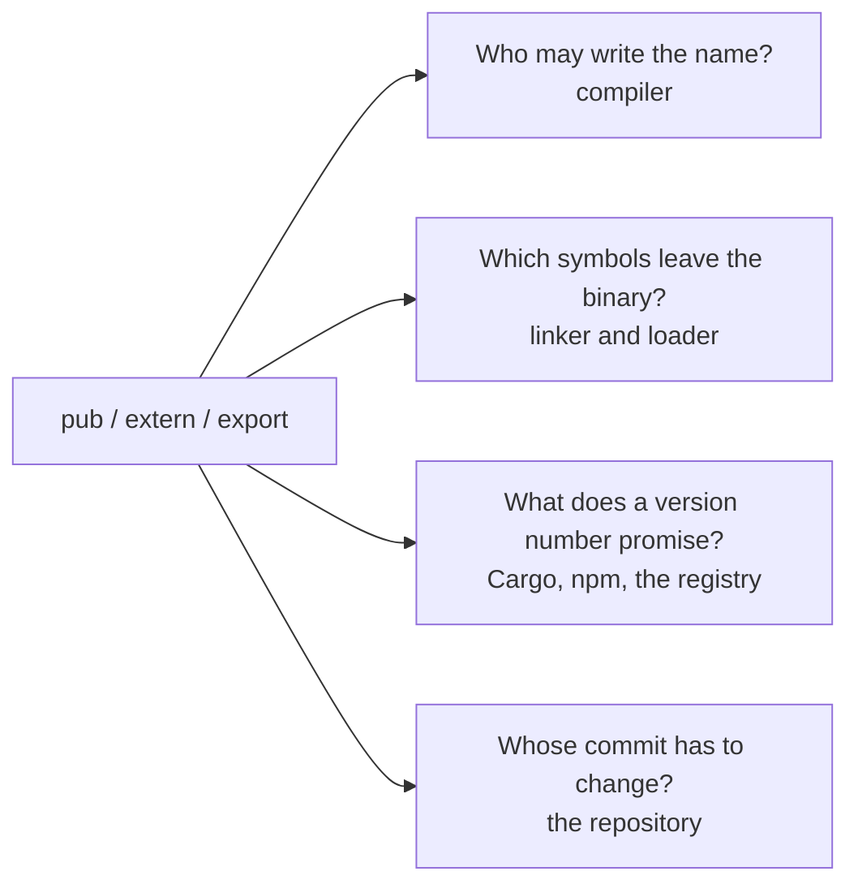

serde is one of the foundational crates in Rust. Its `serde_core/Cargo.toml` contains a dependency that can never be compiled.

```toml
# This cfg cannot be enabled, but it still forces Cargo to keep serde_derive's
# version in lockstep with serde's, even if someone depends on the two crates
# separately with serde's "derive" feature disabled. Every serde_derive release
# is compatible with exactly one serde release because the generated code
# involves nonpublic APIs which are not bound by semver.
[target.'cfg(any())'.dependencies]
serde_derive = { version = "=1.0.229", path = "../serde_derive" }
```

`cfg(any())` is an empty disjunction. It is always false, so nothing under that table ever builds. But Cargo's resolver still sees it, and the `=` pin forces exactly one `serde_derive` to sit beside each `serde`.[^1]

The pin turned out not to be enough. Since 1.0.225, serde's build script bakes the patch number into its private module name. In 1.0.229, that module is called `__private229`. The derive macro builds the matching identifier with `concat!("__private", env!("CARGO_PKG_VERSION_PATCH"))`. If you pair a derive from one patch release with serde from another, the generated code fails to resolve a path instead of quietly calling an internal function whose signature changed.

None of this is carelessness. A derive macro expands inside *your* crate. The code it writes has to call into serde's internals, so those internals cannot be private to serde. Rust has no visibility level that means "my other crate, but not yours." Instead, the internals are declared `pub` and hidden from rustdoc. The compiler sees public API. Cargo sees public API too. Under semver, it would happily let `serde 1.0.x` sit next to `serde_derive 1.0.y`. So the maintainers stacked three workarounds to express one requirement: a `#[doc(hidden)] pub` module, a dependency that cannot compile, and an identifier stamped with a version number by a build script. The two crates also live in one repository on one release train, because none of this works unless they ship together.

One missing visibility level forces a workaround that reaches into the language, the package manager, and the repository layout. I have watched this pattern repeat in C++ shared libraries, npm packages, and now Rust. A visibility qualifier answers one question: who may write this name. Every system downstream of the compiler treats that answer as if it settled three more.



Only the first arrow is a question the language designers set out to answer. The other three were inherited.

## What Rust's levels actually say

Rust has six spellings for four boundaries.[^2][^3]

| Qualifier | Who can name the item | Notes |
| --- | --- | --- |
| *(none)* | the defining module and its descendants | the default, except trait items and enum variants, which follow their parent |
| `pub(self)` | same as no qualifier | exists so macros can splice a visibility token |
| `pub(super)` | the parent module and its descendants | |
| `pub(in path)` | the named module and its descendants | `path` must be an ancestor, or you get E0742 |
| `pub(crate)` | the whole crate | |
| `pub` | anyone who can reach it through a chain of visible modules | not the same thing as exported |

The last row is where trouble starts. `pub` is only an upper bound. An item is part of a crate's API only if a chain of `pub` modules or `pub use` re-exports reaches it from the crate root. The compiler works that out from the whole module graph. A reader looking at one declaration cannot.

```rust
// lib.rs of a crate called `planner`
#![warn(unreachable_pub)]

mod plan {
    // 1. `plan` is a private module, so outside this crate nobody can
    //    write `planner::plan::Plan`. The `pub` here is a ceiling.
    pub struct Plan { pub steps: u32 }

    // 2. Same keyword, and nothing outside the crate can reach `make`.
    //    `unreachable_pub` flags this one, and only because we opted in.
    pub fn make() -> Plan { Plan { steps: 1 } }
}

// 3. This function is exported, and it returns `plan::Plan`. That drags
//    `Plan` into the public API. Downstream crates can hold one, read
//    `.steps`, and pass it around. They just cannot write its name.
//    Making `steps` private next month is now a breaking change.
pub fn build() -> plan::Plan { plan::make() }

struct Secret;

// 4. The opposite mistake: an exported function whose signature mentions
//    a crate-private type. Nobody downstream can construct the argument.
pub fn consume(_s: Secret) {}
```

rustc 1.95 reports:

```text
warning: type `Secret` is more private than the item `consume`
  |
  | pub fn consume(_s: Secret) {}
  | ^^^^^^^^^^^^^^^^^^^^^^^^^^ function `consume` is reachable at visibility `pub`
  |
note: but type `Secret` is only usable at visibility `pub(crate)`
  = note: `#[warn(private_interfaces)]` on by default

warning: unreachable `pub` item
  |
  |     pub fn make() -> Plan { Plan { steps: 1 } }
  |     ---^^^^^^^^^^^^^^^^^^
  |     |
  |     help: consider restricting its visibility: `pub(crate)`
```

The two lints point in opposite directions. `unreachable_pub` says a `pub` is wider than the path leading to it. `private_interfaces` says an exported signature exposes something narrower than itself. Both exist because the keyword states intent, while the compiler has to compute reachability. Before Rust 1.74, most private-in-public cases were hard errors. RFC 2145 relaxed them into lints. The rustc documentation also says it wants `unreachable_pub` to become warn-by-default eventually.[^4][^5]

`Plan` is the case that matters most for versioning, yet it produces no warning by default. Downstream crates can observe it in every way except by writing its name. Rust stabilized a lint for this in 1.79, `unnameable_types`, but left it allow-by-default.[^4]

I think this was the wrong default for a language whose package manager builds semver on top of that keyword. Grepping for `pub` in a Rust crate tells you almost nothing about its actual API.

## Where the model leaks

### There is no level between "this crate" and "everyone"

A crate is Rust's compilation unit, and `pub(crate)` is as wide as a restricted visibility can get. A Cargo workspace has no visibility semantics at all. `pub(in path)` only accepts ancestors, so you cannot name a sibling crate or even a cousin module. If two crates you own need to share an internal function, it must be `pub`. And `pub` means the world.

So the ecosystem converged on a convention:

```rust
// 1. `pub` so that sibling crates and macro-generated code can reach it.
// 2. `doc(hidden)` so it does not appear in rustdoc and readers do not
//    mistake it for supported API.
// 3. A double-underscore name, as a last warning to anyone who
//    autocompletes their way in here anyway.
#[doc(hidden)]
pub mod __private {
    pub use crate::rt::register_kernel;
}
```

None of the three markers is enforced by the compiler. It treats `__private` like any other public module, and any downstream crate can call into it. Whether that module counts as public API is left to external tools. The Cargo book's SemVer chapter does not mention `doc(hidden)` at all.[^6] Since v0.25, `cargo-semver-checks` has treated hidden items as outside the public API, unless an item is both hidden and deprecated.[^7] That is a sensible policy. But it is a policy one tool chose, layered over a language that says the opposite.

Other languages hit the same wall and added the missing level. Java's module system lets a module write `exports com.example.foo.internal to com.example.foo.probe;`, and the specification calls the listed modules *friends*.[^8] Swift 5.9 added a `package` access level. Its proposal describes serde's situation almost word for word: to be usable from other modules in a package, an API must be public, which "allows clients to form unwanted source dependencies on the API."[^9] Kotlin scopes `internal` to a compilation module, carving out an exception so a Gradle `test` source set can see the `internal` declarations of `main`. C# provides `InternalsVisibleTo` for friend assemblies.[^10] Go went the other way. Its `internal/` directories can only be imported from inside the tree rooted at their parent, and the design document notes that "by design, there is no ACL mechanism" for exceptions.[^11] Rust's answer is still a naming convention.

### Macros expand where they are called

A `macro_rules!` macro expands inside the caller's crate, and privacy is checked there. `$crate` tells the compiler which crate a path belongs to, but it does not grant the caller any of that crate's privileges.

```rust
// crate `kernels`
mod rt {
    pub(crate) fn register(name: &'static str) -> usize { name.len() }
}

#[macro_export]
macro_rules! kernel {
    // `$crate::rt::register` resolves to the right function, but the
    // privacy check runs in the crate that invoked `kernel!`.
    ($name:ident) => { $crate::rt::register(stringify!($name)) };
}
```

```text
error[E0603]: module `rt` is private
 --> src/main.rs:2:13
  |
2 |     let n = kernels::kernel!(matmul);
  |             ^^^^^^^^^^^^^^^^^^^^^^^^
  |             |
  |             private module
  |             function `register` is not publicly re-exported
```

The maintainer of `cargo-semver-checks` puts it in one line: "Code generated by macros is part of the consumer's crate, so it can only call pub code from the macro definition's crate."[^7] Everything a macro touches has to be `pub`, so most of it gets tucked into a `__private` module. Procedural macros are in the same boat. A proc-macro lives in a separate crate, and its output is just tokens pasted into yours.

The intended fix is definition-site hygiene in "macros 2.0", the `decl_macro` feature. It has been unstable since 2017.[^12] Even on nightly, it only goes halfway. Names in the macro body resolve at the definition site, so calling a private function by name works. But type privacy is still checked. A macro that constructs a private struct still fails, and the tracking issue still lists hygienic privacy as an open task. It would not let serde's derive reach serde's internals.

### Fields are all or nothing

Anyone can read and write a `pub` field. There is no read-only field, so a struct that wants to expose `len` without letting callers corrupt it has to hide the field and write `fn len(&self) -> u64`. That getter is a small cost. The versioning cost is not.

The Cargo book lists "adding a private struct field when all current fields are public" as a major change.[^6] Doing so breaks every struct literal and exhaustive pattern downstream. The standard mitigation is adding `#[non_exhaustive]` from day one, reserving the right to add fields later by giving up struct literal syntax outside the crate.[^13] You have to know when you first write the struct that you will want to change it later.

RFC 3323, accepted in 2022, proposes the missing piece: `pub mut(crate) len: u64` for a field anyone can read but only this crate can write, and `pub impl(crate) trait` for a trait anyone can use but only this crate can implement.[^14] Both landed on nightly in 2026 behind the `mut_restriction` and `impl_restriction` gates. Neither is stable.

### Using a trait and implementing it are the same permission

If a trait is `pub`, anyone can implement it for their own types. That makes adding a method without a default a major change, because some downstream `impl` will stop compiling.[^6] Stable Rust has no syntax to say "you may use this trait but not implement it," so the API guidelines document a workaround that exploits the gap between reachable and nameable items.[^15]

```rust
mod sealed {
    // 1. A `pub` trait in a private module. Reachable as a supertrait,
    //    but nobody outside this crate can write the path `sealed::Sealed`.
    pub trait Sealed {}
}

// 2. Downstream code can call `launch` and write `T: Backend` bounds.
pub trait Backend: sealed::Sealed {
    fn launch(&self, grid: [u32; 3]);
}

pub struct Cuda;
impl sealed::Sealed for Cuda {}
impl Backend for Cuda {
    fn launch(&self, _grid: [u32; 3]) { /* ... */ }
}

// 3. But `impl Backend for TheirType` requires `impl Sealed for TheirType`,
//    and they cannot name `Sealed`. So we are free to add methods to
//    `Backend` in a minor release.
```

The pattern works, and the Cargo book recommends it when you need to add trait methods later.[^6] It is common enough that rustc has a dedicated diagnostic for it. Try to implement `Backend` downstream and the error carries this note:

```text
error[E0277]: the trait bound `Mine: backends::sealed::Sealed` is not satisfied
   = note: `Backend` is a "sealed trait", because to implement it you also need to
           implement `backends::sealed::Sealed`, which is not accessible; this is
           usually done to force you to use one of the provided types that
           already implement it
```

The compiler recognizes an idiom that the language has no syntax for. The idiom is also an unnameable type used on purpose, the same mechanism that leaked `Plan` into the API in the first example. The language cannot tell the two apart. Once `impl(crate)` stabilizes, the pattern can retire.

### Tests and features become a back door

Integration tests in `tests/` compile as separate crates and "can only call functions that are part of your library's public API."[^16] Testing an internal invariant from there means making it `pub`. The usual escape hatch is a Cargo feature:

```rust
// 1. Compiled only when the `internals` feature is on, which the crate's
//    own test configuration enables.
#[cfg(feature = "internals")]
pub mod internals;
```

"When a dependency is used by multiple packages, Cargo will use the union of all features enabled on that dependency when building it."[^17] If any crate in the dependency graph enables `planner/internals`, every crate in that build depending on `planner` sees the module, including crates that never asked for it. Those crates compile today and break the day the first crate drops the feature. A feature is a global switch anyone in the graph can flip. It is not a visibility level. Using it as one creates the exact kind of accidental dependency semver is supposed to prevent.

## C++ has linkage, not visibility

C++ never had visibility qualifiers in the Rust sense. It has linkage, which decides whether a name in one translation unit refers to the same entity in another. And it has class access control, which is a separate mechanism altogether.[^18] The keywords are overloaded in ways that still trip up experienced engineers. `static` at namespace scope gives internal linkage. `static` inside a function gives static storage duration. `static` on a class member makes it per-class rather than per-object. An unnamed namespace also gives internal linkage, while `extern` declares something defined elsewhere. Everything else with external linkage is, as far as the language is concerned, visible to the whole program.

Shared libraries are where this model gets expensive. When you link a shared library on ELF, every symbol with external linkage lands in its dynamic symbol table by default. Putting internal helpers in a `detail` namespace does nothing to stop it.

```cpp
// plan.cpp
static int counter = 0;                                // 1. internal linkage: STB_LOCAL
namespace { int scratch(int x) { return x * 2; } }     // 2. unnamed namespace: also LOCAL

// 3. "detail" is a naming convention. To the linker this is an ordinary
//    global function, and it will be exported from the .so.
namespace detail { int tile(int x) { return x + scratch(x) + counter; } }

// 4. A second, non-standard visibility system bolted onto the first.
__attribute__((visibility("hidden")))  int cost(int x)    { return detail::tile(x); }
__attribute__((visibility("default"))) int compile(int x) { return cost(x); }

extern int launch(int);                                // 5. defined in some other module
int run(int x) { counter++; return launch(compile(x)); }
```

Compiled for x86-64 Linux with `-fPIC -O1 -fno-inline` (so `scratch` is not inlined into its caller) and linked with `-shared`, the object's symbol table and the library's dynamic symbol table look like this (columns trimmed):

```text
$ llvm-readelf -s plan.o
  FUNC    LOCAL  DEFAULT      _ZN12_GLOBAL__N_17scratchEi   # scratch
  OBJECT  LOCAL  DEFAULT      _ZL7counter                    # counter
  FUNC    GLOBAL DEFAULT      _ZN6detail4tileEi              # detail::tile
  FUNC    GLOBAL HIDDEN       _Z4costi                       # cost
  FUNC    GLOBAL DEFAULT      _Z7compilei                    # compile
  FUNC    GLOBAL DEFAULT      _Z3runi                        # run
  NOTYPE  GLOBAL DEFAULT  UND _Z6launchi                     # launch

$ llvm-readelf --dyn-syms libplan.so
  NOTYPE  GLOBAL DEFAULT  UND _Z6launchi
  FUNC    GLOBAL DEFAULT      _ZN6detail4tileEi
  FUNC    GLOBAL DEFAULT      _Z7compilei
  FUNC    GLOBAL DEFAULT      _Z3runi
```

`detail::tile` is exported. Any program can link against it, and once one does, removing it breaks that program at load time. The fix everyone eventually adopts is `-fvisibility=hidden` paired with an explicit export macro on every public declaration. GCC's visibility page lists what you gain: substantially faster DSO load times, better code from the optimizer, a DSO 5 to 20% smaller, and a much lower chance of symbol collisions.[^19] Drepper's *How To Write Shared Libraries* covers export control, export maps, and symbol versioning in depth, and remains the standard reference on the subject.[^20] That fix is a second visibility system, written in compiler attributes, because the language's own keywords stop at the translation unit.

Class access is the other trap. `private:` controls who may name a member in source code. It does not remove that member from the object's layout, and every caller that allocates the object or calls an inline member bakes that layout into *their* binary.

```cpp
struct StreamV1 { public: unsigned long len; private: void* buf; };
struct StreamV2 { public: unsigned long len; private: void* buf; unsigned long cursor; };

static_assert(sizeof(StreamV1) == 16);  // x86-64, LP64
static_assert(sizeof(StreamV2) == 24);  // one private field later: an ABI break
```

Adding a private field keeps C++ source compiling and breaks the binary. In Rust the same change breaks source, because downstream struct literals stop compiling. Either way, a field nobody outside can name is part of the contract. KDE's binary compatibility policy forbids adding data members to an exported class. Instead, it prescribes the d-pointer, or pimpl, calling it "a great trick to be able to add new private data members to a class without breaking binary compatibility."[^21] The same policy forbids changing a member's access from private to public, because some compilers encode access levels into the mangled signature. MSVC is one of them:

```text
private:  int Stream::step(int)  ->  ?step@Stream@@AEAAHH@Z    (Itanium: _ZN6Stream4stepEi)
public:   int Stream::step(int)  ->  ?step@Stream@@QEAAHH@Z    (Itanium: _ZN6Stream4stepEi)
```

The `A` and `Q` encode private and public. On Windows, widening a method's access renames its symbol. Pimpl exists because `private` is not private enough, and on one major ABI, making a member public is a binary break too.

C++20 modules finally gave the language an export list. A module interface marks with `export` what importers may name, while an unexported declaration attached to a named module gets module linkage instead of external linkage.[^18] That is a real improvement for names, but it does nothing for the dynamic symbol table. What a shared library exports is still decided by `-fvisibility`, compiler attributes, and linker version scripts. Modules also have no notion of a group of modules that share internals. All four questions from the top of this post remain open.

## Node got an export list, and adding it was a breaking change

CommonJS gave each file a `module.exports` object, which looks like an export list and is not one. `require('pkg')` returns whatever the main file exports, while `require('pkg/lib/bpe.js')` reaches in and returns whatever *that* file exports. Every file in the published tarball was reachable. For most of npm's history, a package's directory layout was its effective public API.

Node 12.7 added the `exports` field to `package.json`.[^22] Once present, it is the complete list of entry points:

```json
{
  "name": "tokenizer",
  "version": "3.0.0",
  "exports": { ".": "./lib/index.js" }
}
```

```text
$ node main.js
Error [ERR_PACKAGE_PATH_NOT_EXPORTED]: Package subpath './lib/bpe.js'
is not defined by "exports" in node_modules/tokenizer/package.json
```

That is the right design. And the Node documentation is plain about the cost of adopting it: existing packages that introduce the field "will prevent consumers of the package from using any entry points that are not defined, including the package.json... This will likely be a breaking change."[^22] The first time a package author declares what their API actually is, they have to cut a major version to do it.

Java went through the same transition on a much larger scale. When JDK 9 encapsulated the JDK's internal APIs, it deliberately left critical ones like `sun.misc.Unsafe` accessible "until supported replacements exist."[^23] JEP 471 is direct about why: use of its memory-access methods was "so widespread" that it could not be encapsulated along with everything else. Deprecating those methods for removal started in JDK 23, seven years later. Narrowing visibility is always a breaking change. Widening it is always a commitment. In every ecosystem I have worked in, visibility only ratchets outward.

Inside the code, the story repeats. TypeScript's `private` is checked by the type checker and then erased. The handbook calls those fields "soft private," still reachable with bracket notation. ECMAScript's `#field` syntax, standardized in ES2022, is "hard private" and enforced at run time.[^24] Two keywords for one idea, with different guarantees, often in the same file.

## Version control inherits the boundary

The serde pin has a consequence that never shows up in `Cargo.toml`. Two crates that must be released in lockstep also have to be developed in lockstep. They live in the same repository and change in the same commit. When the visibility boundary is narrower than the release boundary, the repository boundary has to grow until it covers both.

Many monorepo-versus-polyrepo debates are this argument in disguise. Potvin and Levenberg's account of Google's monorepo lists atomic changes and large-scale refactoring among its core benefits. Their example is a developer who can "rename a class or function in a single commit and yet not break any builds or tests."[^25] Atomic commits are what you need when an internal API has callers outside its own package. The same paper notes that in 2011 Google set "the default visibility of new APIs to 'private,'" forcing developers to mark explicitly what other teams may use. The languages in that repository cannot express "visible to these three teams." The build system can. Bazel's `visibility` attribute "controls who may depend on your target," fails the build in the analysis phase when violated, and defaults to private.[^26] It is a build-time visibility system, layered over languages that lack one at the granularity the organization needs.

Code review has a quieter version of the same problem, because effective visibility is not local. A diff that changes `mod plan;` to `pub mod plan;` in `lib.rs` exports every `pub` item inside `plan`, yet the reviewer sees only one line. A `pub use` re-export can add forty items to the API. Meanwhile, a `pub fn` inside a private module adds nothing. Nobody reviewing a pull request computes reachability in their head.

Projects that take this seriously check the API itself into the repository as text. Android's platform build keeps API signature files such as `current.txt`, generated by metalava, and fails if the code and the file disagree. Running `m update-api` updates the file, and the error message warns that submitting a revised `current.txt` requires approval.[^27] Kotlin's binary-compatibility-validator does the same with `.api` dump files, which its README says to commit to version control.[^28] In Rust, `cargo public-api` prints one line per public item and diffs the result between releases or commits.[^29] That snapshot turns an invisible, computed property into a diff a reviewer can read, and turns an API change into a file with an owner. If you maintain a library with more than a handful of downstream users and do not check in an API snapshot, you are reviewing API changes by accident.

## Package managers price every `pub` at full value

Semver is a promise about the public API, and every package manager I know of takes the language's definition of public at face value. In Rust, that means every reachable `pub` item, every `pub` field, the implementability of every `pub` trait, and every type that leaks through a signature. The `Plan` struct from earlier is covered by semver even though no one downstream can write its name.

Signatures pull in your dependencies, too. If `kernels` exports `fn launch(s: &tensor::Shape)`, the major version of `tensor` becomes part of the API of `kernels`. Take a build where the application has moved to `tensor 2.0` and `kernels` has not:

```text
error[E0308]: mismatched types
 --> src/main.rs:3:36
  |
3 |     println!("{}", kernels::launch(&s));
  |                    --------------- ^^ expected `tensor::Shape`, found `Shape`
  |
note: there are multiple different versions of crate `tensor` in the dependency graph
  = help: you can use `cargo tree` to explore your dependency tree
```

The two definitions of `Shape` are textually identical, yet they remain distinct types because crate identity includes the version. `kernels` cannot move to `tensor 2.0` without a major release of its own, even though nothing in `kernels` changed. Cargo has no way to know this ahead of time, because a dependency is just a dependency. RFC 1977 proposed marking dependencies as public or private so tooling could reason about this, and RFC 3516 later narrowed the design.[^30] On nightly, you can write `tensor = { version = "1", public = true }`, and rustc's `exported_private_dependencies` lint fires when a type from an unmarked dependency leaks through your API. Neither feature is stable, and the tracking issues have been open for years. The established workaround is dtolnay's semver trick: release one last version of the old major that depends on the new major and re-exports its types, so both majors share one definition.[^31] It is clever. But it is a package-level patch for a fact the language could have stated.

The three languages in this post fail on the same situation in three different ways.

| Same library, two versions in one program | What happens |
| --- | --- |
| Rust | Two distinct types. A compile error at the first place they meet. |
| C++ | One name. Inline functions with external linkage from both versions are merged, and the linker keeps one copy. The program is ill-formed, no diagnostic required, so whichever copy survived runs for every caller.[^32] |
| Node | Two module instances. `instanceof` across them returns `false` at run time. graphql-js detects it and throws, asking you to ensure "that there is only one instance" of the package in `node_modules`.[^33] |

Rust's answer is loud, and it catches the mismatch at compile time. I would rather have the compile error.

Hyrum's Law sits on top of all of this: "With a sufficient number of users of an API, it does not matter what you promise in the contract: all observable behaviors of your system will be depended on by somebody."[^34] Visibility qualifiers only control names. Layout, timing, error text, and iteration order leak regardless. But names are the part a compiler can actually check, which makes it worse that we draw that boundary so loosely.

The linker world settled one piece of this long ago. glibc exports a set of internal symbols under the version tag `GLIBC_PRIVATE`. They must be exported because glibc is split across several shared objects. Some functions live in the dynamic linker and are called from `libc.so`, so they have to cross a DSO boundary. A glibc maintainer put the contract plainly in 2005: "For @@GLIBC_PRIVATE symbols there are no ABI guarantees, they can be added or removed or change calling conventions at any time, as nothing outside of glibc itself should ever use it."[^35] That is `#[doc(hidden)] pub mod __private` expressed in the ELF symbol table, with one difference: glibc's own ABI tooling excludes that tag from its compatibility baselines, recording the promise where the tools can see it.

Elm shows what becomes possible when a language's notion of public is explicit. Its package tool diffs the API between two versions and computes the required version bump. If you try to publish a version that does not match the diff, `elm publish` rejects it. In the compiler's own words: "there cannot be MAJOR changes hiding in PATCH releases in Elm!"[^36] That check covers types rather than behavior, so a function that keeps its signature while changing its meaning still slips through. Even so, no mainstream systems language enforces this much.

## What I would build instead

Most of the fixes already exist somewhere. Nobody has put them together.

1. **`pub` should mean exported, and the compiler should enforce it.** An unreachable `pub` item should be an error, not an allow-by-default lint. Then a grep for `pub` gives you the API.
2. **A level for "my packages, not yours."** Swift's `package`, Java's qualified exports, and Go's `internal/` each cover part of this. Tie it to a release group declared in the manifest, so the package manager knows these packages move together without a `cfg(any())` dependency to tell it.
3. **Separate read and write visibility for fields, and separate use and implement permissions for traits.** That replaces getter boilerplate and the sealed-trait pattern with syntax a reader can see. RFC 3323 is the right shape.
4. **Macros and generated code get definition-site privileges for types as well as names,** so `__private` modules stop being necessary.
5. **Language visibility sets the ceiling on how far a symbol may be exported. The build mode can only narrow it.**

That last point is the one most languages skip, and it is where the linker comes back in. Swift's proposal says outright that "the ABI for package symbols is not different from the ABI for public symbols."[^9] A language can know a symbol is internal to a release group and still give the dynamic loader no way to tell. The mapping I would want:

| Language level | Object or static library | Shared library | Executable |
| --- | --- | --- | --- |
| private | internal linkage, `STB_LOCAL` | local | local |
| package | global, hidden | hidden | hidden, internalized by LTO |
| release group | global, hidden | exported under a private version tag, like `GLIBC_PRIVATE` | internalized |
| public | global, hidden | exported under a public version node | internalized unless marked as an entry point |

A linker enforces two boundaries: the translation unit and the linked module. Object files and static libraries are just bundles of translation units, and the same package can be built as any of these artifacts. So visibility cannot be defined by artifact type. It can only map onto it. That is also why the static-library column reads the same for every level above private: a hidden global resolves inside whatever links it and goes no further. The levels only diverge when a shared library is linked.

Public symbols in a shared library also need a stable ABI behind them, with stable mangling, a fixed calling convention, and either frozen or opaque layouts. Swift's library evolution model, with `@frozen`, `@inlinable`, and `@usableFromInline`, is the most thorough treatment of that half I know of. A `@usableFromInline` declaration is exported as a binary symbol but cannot be referenced by name outside its module. That is the exact split between the name and the binary this whole post is about.[^37]

I am working toward this design in Vx, the heterogeneous systems language I am building ([vxlang.org](https://vxlang.org)). Today, its compiler has the same three levels Rust has. The four-level version, with read and write visibility on fields and a manifest-declared release group, is still a design document, not shipped code.

Every ecosystem described here pays for the gap between "who may write this name" and "what have I promised." It pays in pinned versions, in build scripts that rename modules, in repositories that cannot be split, and in API snapshot files that exist because nobody can read the API off the source. The compiler is the only party that knows the answer, and it is the one place we never asked.

---

## References

[^1]: **serde-rs/serde.** `serde_core/Cargo.toml` holds the quoted `cfg(any())` pin; `serde/build.rs` and `serde_derive/src/lib.rs` generate the per-patch `__private` module name, introduced in 1.0.225 by PR #2980. ([serde_core/Cargo.toml](https://github.com/serde-rs/serde/blob/master/serde_core/Cargo.toml), [serde/build.rs](https://github.com/serde-rs/serde/blob/master/serde/build.rs), [PR #2980](https://github.com/serde-rs/serde/pull/2980))

[^2]: **The Rust Reference: Visibility and privacy.** Defines each qualifier; the `path` in `pub(in path)` "must be a simple path which resolves to an ancestor module." ([Rust Reference](https://doc.rust-lang.org/reference/visibility-and-privacy.html))

[^3]: **RFC 1422: `pub(restricted)`.** Stabilized in Rust 1.18.0. ([RFC 1422](https://rust-lang.github.io/rfcs/1422-pub-restricted.html))

[^4]: **RFC 2145: Type privacy.** Its lints replaced `private_in_public` in Rust 1.74.0 (#113126); `unnameable_types` was stabilized in 1.79.0 (#120144). ([RFC 2145](https://rust-lang.github.io/rfcs/2145-type-privacy.html), [release notes](https://github.com/rust-lang/rust/blob/master/RELEASES.md))

[^5]: **rustc lint listing: `unreachable_pub`.** ([rustc book](https://doc.rust-lang.org/rustc/lints/listing/allowed-by-default.html#unreachable-pub))

[^6]: **The Cargo Book: SemVer Compatibility.** Rules for private struct fields and non-defaulted trait items, with `#[non_exhaustive]` and sealed traits as mitigations. ([Cargo Book](https://doc.rust-lang.org/cargo/reference/semver.html))

[^7]: **Checking semver for `doc(hidden)` items.** Predrag Gruevski, November 2023. The v0.25 policy change in cargo-semver-checks, and the quote on macro-generated code. ([predr.ag](https://predr.ag/blog/checking-semver-for-doc-hidden-items/))

[^8]: **The Java Language Specification, SE 21, §7.7.2.** Qualified exports and the term *friends*. ([JLS](https://docs.oracle.com/javase/specs/jls/se21/html/jls-7.html#jls-7.7.2))

[^9]: **SE-0386: New access modifier: `package`.** Implemented in Swift 5.9. ([Swift Evolution](https://github.com/swiftlang/swift-evolution/blob/main/proposals/0386-package-access-modifier.md))

[^10]: **Kotlin visibility modifiers; .NET `InternalsVisibleToAttribute`.** ([Kotlin docs](https://kotlinlang.org/docs/visibility-modifiers.html#modules), [Microsoft Learn](https://learn.microsoft.com/en-us/dotnet/api/system.runtime.compilerservices.internalsvisibletoattribute))

[^11]: **Go 1.4 Internal Packages.** Russ Cox's design document. Enforced for the Go repository in 1.4 and for all repositories from 1.5. ([design doc](https://golang.org/s/go14internal), [Go 1.4 release notes](https://go.dev/doc/go1.4#internalpackages))

[^12]: **Tracking issue for `decl_macro`.** rust-lang/rust#39412, from RFC 1584. The compiler's `tests/ui/hygiene/` tests show definition-site name resolution with type privacy still enforced. ([#39412](https://github.com/rust-lang/rust/issues/39412), [RFC 1584](https://rust-lang.github.io/rfcs/1584-macros.html))

[^13]: **RFC 2008: `non_exhaustive`.** Stabilized in Rust 1.40.0. ([RFC 2008](https://rust-lang.github.io/rfcs/2008-non-exhaustive.html))

[^14]: **RFC 3323: Restrictions.** Merged November 2022; tracking issue rust-lang/rust#105077. ([RFC 3323](https://rust-lang.github.io/rfcs/3323-restrictions.html), [#105077](https://github.com/rust-lang/rust/issues/105077))

[^15]: **Rust API Guidelines: C-SEALED.** ([API Guidelines](https://rust-lang.github.io/api-guidelines/future-proofing.html#sealed-traits-protect-against-downstream-implementations-c-sealed))

[^16]: **The Rust Programming Language, 11.3 Test Organization.** ([Rust Book](https://doc.rust-lang.org/book/ch11-03-test-organization.html))

[^17]: **The Cargo Book: Feature unification.** ([Cargo Book](https://doc.rust-lang.org/cargo/reference/features.html#feature-unification))

[^18]: **C++ standard: [basic.link] and [module.interface].** Internal linkage, unnamed namespaces and module linkage. ([basic.link](https://eel.is/c++draft/basic.link), [module.interface](https://eel.is/c++draft/module.interface))

[^19]: **GCC Wiki: Visibility.** ([GCC Wiki](https://gcc.gnu.org/wiki/Visibility))

[^20]: **How To Write Shared Libraries.** Ulrich Drepper, version 4.1.2, 2011. Export control in section 2.2, ABI versioning in sections 3.3–3.5. ([PDF](https://www.akkadia.org/drepper/dsohowto.pdf))

[^21]: **KDE: Policies/Binary Compatibility Issues With C++.** ([KDE Community Wiki](https://community.kde.org/Policies/Binary_Compatibility_Issues_With_C%2B%2B))

[^22]: **Node.js documentation: Packages.** `"exports"` was added in v12.7.0. ([Node.js docs](https://nodejs.org/api/packages.html))

[^23]: **JEP 260 (JDK 9), JEP 403 (JDK 17) and JEP 471 (JDK 23).** ([JEP 260](https://openjdk.org/jeps/260), [JEP 403](https://openjdk.org/jeps/403), [JEP 471](https://openjdk.org/jeps/471))

[^24]: **TypeScript Handbook: Classes; ECMA-262 13th edition.** ([TypeScript Handbook](https://www.typescriptlang.org/docs/handbook/2/classes.html#caveats), [ECMA-262](https://262.ecma-international.org/13.0/))

[^25]: **Why Google Stores Billions of Lines of Code in a Single Repository.** Rachel Potvin and Josh Levenberg, Communications of the ACM 59(7), July 2016. ([CACM](https://doi.org/10.1145/2854146))

[^26]: **Bazel: Visibility.** Without a package `default_visibility`, a target is `//visibility:private`. ([Bazel docs](https://bazel.build/concepts/visibility))

[^27]: **AOSP: Java SDK library, Soong's API check and metalava.** ([source.android.com](https://source.android.com/docs/setup/build/java-library), [droidstubs.go](https://android.googlesource.com/platform/build/soong/+/refs/heads/main/java/droidstubs.go), [metalava](https://android.googlesource.com/platform/tools/metalava/+/refs/heads/main/README.md))

[^28]: **Kotlin binary-compatibility-validator.** Now in maintenance mode, with the feature moving into the Kotlin Gradle plugin. ([GitHub](https://github.com/Kotlin/binary-compatibility-validator))

[^29]: **cargo-public-api.** ([GitHub](https://github.com/Enselic/cargo-public-api))

[^30]: **RFC 1977 and RFC 3516: Public/private dependencies.** Cargo's `public-dependency` remains unstable; tracking issues rust-lang/rust#44663 and rust-lang/cargo#6129. ([RFC 3516](https://rust-lang.github.io/rfcs/3516-public-private-dependencies.html), [Cargo unstable features](https://doc.rust-lang.org/nightly/cargo/reference/unstable.html#public-dependency))

[^31]: **The semver trick.** David Tolnay. ([GitHub](https://github.com/dtolnay/semver-trick))

[^32]: **C++ standard: [basic.def.odr].** ([eel.is](https://eel.is/c++draft/basic.def.odr))

[^33]: **npm folders documentation; graphql-js `instanceOf`.** npm allows nested copies at different versions; graphql-js throws when a value comes from another copy. ([npm docs](https://docs.npmjs.com/cli/configuring-npm/folders), [instanceOf.ts](https://github.com/graphql/graphql-js/blob/16.x.x/src/jsutils/instanceOf.ts))

[^34]: **Hyrum's Law.** Hyrum Wright. ([hyrumslaw.com](https://www.hyrumslaw.com/))

[^35]: **GLIBC_PRIVATE.** Jakub Jelinek, Red Hat Bugzilla #145172, comment 1. glibc's `scripts/abilist.awk` omits the tag from the ABI baselines. ([Bugzilla #145172](https://bugzilla.redhat.com/show_bug.cgi?id=145172), [elf/Versions](https://sourceware.org/git/?p=glibc.git;a=blob;f=elf/Versions))

[^36]: **elm/compiler: `bump`, `diff` and `publish`.** ([Main.hs](https://github.com/elm/compiler/blob/master/terminal/src/Main.hs), [Publish.hs](https://github.com/elm/compiler/blob/master/terminal/src/Publish.hs))

[^37]: **SE-0193, SE-0260, and The Swift Programming Language: Attributes.** `@inlinable` and `@usableFromInline` arrived in Swift 4.2, library evolution and `@frozen` in Swift 5.1. ([SE-0193](https://github.com/swiftlang/swift-evolution/blob/main/proposals/0193-cross-module-inlining-and-specialization.md), [SE-0260](https://github.com/swiftlang/swift-evolution/blob/main/proposals/0260-library-evolution.md), [Swift book](https://docs.swift.org/swift-book/documentation/the-swift-programming-language/attributes/))

---

*Disclaimer: Researched and drafted with AI assistance (Claude Opus 5.5, Gemini 4 Argon). Direction, technical judgment, and final edits are mine; every claim is traceable to the sources cited above. The compiler diagnostics and symbol tables were produced with rustc 1.95, Node 26 and LLVM's clang and llvm-readelf targeting x86-64 Linux and Windows. Vx is my own project, so discount the closing section accordingly.*
