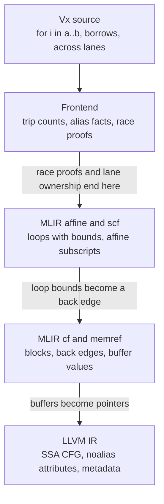

These two Rust loops differ by one element.

```rust
// 1. `0..n` visits 0, 1, ..., n - 1.
pub fn excl(n: u64) -> u64 {
    let mut s = 0u64;
    for i in 0..n {
        s = s.wrapping_add(i.wrapping_mul(i));
    }
    s
}

// 2. `0..=n` visits 0, 1, ..., n: the same loop with one more pass.
pub fn incl(n: u64) -> u64 {
    let mut s = 0u64;
    for i in 0..=n {
        s = s.wrapping_add(i.wrapping_mul(i));
    }
    s
}
```

With rustc 1.95 at `opt-level=3`, `excl` has no loop left in it. LLVM replaced the loop with a closed form for the sum of squares, a few multiplies in 65-bit arithmetic. `incl` runs all `n + 1` passes, one at a time. Give the two forms a slice to scale and the same split shows up: `for i in 0..n { a[i] *= s }` becomes a vector loop, while the inclusive form stays scalar.

The reason is in the loop variable. This is the loop in `incl` after optimization, with the value names shortened and the exit test left out:

```llvm
loop:
  %s      = phi i64 [ 0, %start ], [ %s.next, %loop ]
  %i      = phi i64 [ 0, %start ], [ %i.next, %loop ]
  %done   = icmp uge i64 %i, %n        ; 1. Is this the last element?
  %more   = xor i1 %done, true
  %step   = zext i1 %more to i64       ; 2. The step is 1 while iterating, 0 on the last pass.
  %i.next = add nuw i64 %i, %step      ; 3. So %i is not "start at 0, add 1".
  %sq     = mul i64 %i, %i
  %s.next = add i64 %s, %sq
  ...
```

In Rust 1.95, `RangeInclusive::next` moves `start` forward only while `start < end`. On the last element, it sets an `exhausted` flag instead.[^1] The range needs some extra state: `0..=u64::MAX` has 2⁶⁴ elements, and no `u64` can hold the end of that range as an exclusive bound. But with this encoding, the step is 0 or 1. LLVM's trip-count analysis wants a step that stays the same on every pass. It finds none, so there is no trip count. Without a trip count, there is no closed form and no vectorization.

The source said all of it. `0..=n` is a counted loop of `n + 1` passes, and the language knows that before it emits a single instruction. The fact was lost during lowering through the `Iterator` protocol, and nothing below that point could put it back.

The issue was filed in October 2017.[^2] The first fixes went into the library's internal iteration. `try_fold` was specialized in 2018 and again in 2019. Today it runs a plain `while start < end` loop and then handles the last element on its own. The 2019 pull request explains why the work stopped there: "LLVM has stubbornly refused to optimize external iteration appropriately."[^3] For years, the workaround was to write `(0..=n).for_each(..)`, or `0..n + 1`, which is wrong when `n` is the maximum.

The `for` loop was finally fixed in Rust 1.99, released on October 1. That fix was in the library too. `next` now always steps `start` forward by one and records overflow in the `exhausted` flag. That makes the loop variable a plain add-one recurrence again.[^4] The pull request merged on July 9, while rustc still used LLVM 22, and its codegen test checks that `for _ in s..=e { count += 1 }` becomes plain arithmetic. Rust moved to LLVM 23 on August 5. On rustc 1.99, both loops above get closed forms, and the slice loop vectorizes.

Nine years. None of the fixes that worked came from LLVM. Each one lived above it, in the code that decides what shape the loop has.

I see this pattern everywhere in compilers. A fact exists in the source. A lowering step drops it. A later pass needs that fact, so it has to rebuild it by analysis. That analysis recovers less than was there. My position: **do each optimization at the lowest level that still holds every fact it needs.** When a fact will not survive a lowering, either do the optimization before that lowering, or carry the fact across it as structure, not as a hint.

## Rebuilding a fact is an analysis, and analyses widen

The cost of losing a fact shows up cleanly in MLIR, because one tool can show the same loop before and after the fact disappears. Here is a loop with a branch that can never be taken, since `%i` never exceeds 99:

```mlir
func.func @f() {
  %c0 = arith.constant 0 : index
  %c1 = arith.constant 1 : index
  %c100 = arith.constant 100 : index
  %c200 = arith.constant 200 : index
  // 1. The bounds are operands of the loop, so %i is in [0, 100).
  scf.for %i = %c0 to %c100 step %c1 {
    // 2. The range analysis reads that off the loop and folds this to false.
    %big = arith.cmpi sgt, %i, %c200 : index
    scf.if %big {
      func.call @foo() : () -> ()
    }
  }
  return
}
```

`mlir-opt --int-range-optimizations --canonicalize` from LLVM 22.1.4 deletes both the call and the loop, leaving an empty function. The integer range analysis does not compute the range of `%i`. It reads it. When an operation implements `LoopLikeOpInterface`, the analysis takes the induction variable's range straight from the lower bound, the upper bound and the step.[^5]

Now run `--convert-scf-to-cf` first. The loop becomes blocks and a back edge, and `%i` becomes a block argument:

```mlir
  cf.br ^bb1(%c0 : index)
^bb1(%0: index):                       // 1. %0 arrives from the entry and from ^bb4.
  %1 = arith.cmpi slt, %0, %c100 : index
  cf.cond_br %1, ^bb2, ^bb5
^bb2:
  %2 = arith.cmpi sgt, %0, %c200 : index
  cf.cond_br %2, ^bb3, ^bb4
^bb3:
  call @foo() : () -> ()
  cf.br ^bb4
^bb4:
  %3 = arith.addi %0, %c1 : index       // 2. Each trip around grows the range by one.
  cf.br ^bb1(%3 : index)
```

Same analysis, same pass, same flags. The call stays.

The analysis now has to compute `%0` by iterating around the back edge until nothing changes. On intervals, that iteration does not have to end: `[0, 0]`, then `[0, 1]`, then `[0, 2]`, and so on. Every abstract interpreter faces this, and the standard answer is *widening*. After some number of steps, jump to a range that is sure to be stable.[^6] I covered the lattice side of this in [an earlier post on dataflow theory]().

MLIR's analysis in LLVM 22.1 widens hard. The first time a value flowing around a loop changes, the analysis widens it to the full range of its type. The debug log calls this "Loop variant loop result detected".[^5] Upstream `main` now allows 128 changes before doing the same.[^7] LLVM's SCCP has the same mechanism, and a comment that names it: "Simple form of widening. If a range is extended multiple times, go to overdefined."[^8]

Widening loses precision on purpose. The classic repair is *narrowing*: after the iteration stops, run it again and let the guards cut the range back down.[^9] With the guard `%0 < 100` on the edge into the body, narrowing would recover `[0, 99]`. Neither engine narrows, and MLIR's analysis does not refine a value along a `cf.cond_br` edge at all. And narrowing only goes so far. For `for i in 0..n`, the fact you need is `i < n`. That is a relation between two variables, which intervals cannot express. Relational domains can. Octagons track `±x ± y ≤ c` at a cost cubic in the number of variables.[^10] Polyhedra cost more. LLVM and GCC run neither by default.

So LLVM does not iterate to find induction variables. ScalarEvolution *recognizes* them. It matches a phi and its update against chains of recurrences such as `{0,+,1}`, which means start at 0 and add 1 on every pass.[^11] Recognition is cheap and exact on the shapes it knows. On a shape it does not know, it gives up. The 1.95 inclusive range was one of those shapes. Written in LLVM IR, the branch form of `@f` does lose its dead call at `-O1`. IndVarSimplify folds the compare once LoopSimplify and LCSSA have put the loop into the shape ScalarEvolution expects. Run SCCP, correlated value propagation, or constraint elimination alone on LLVM 22.1.4, and the call stays.

That leaves three ways to know an induction variable's range. Read it, which needs the loop to still be a loop. Recognize it, which works on the shapes someone taught the recognizer. Or compute it, which means widening and narrowing, and works only when you can afford a domain that holds the fact.

## Unrolling: read the bounds or prove them

Unrolling shows the gap more plainly. Here is a loop in the affine dialect, with a bound known only at run time:

```mlir
func.func @scale(%a: memref<?xf32>, %n: index, %s: f32) {
  affine.for %i = 0 to %n {
    %x = affine.load %a[%i] : memref<?xf32>
    %y = arith.mulf %x, %s : f32
    affine.store %y, %a[%i] : memref<?xf32>
  }
  return
}
```

`affine-loop-unroll{unroll-factor=4}` produces this, trimmed to the loop bounds:

```mlir
#map = affine_map<()[s0] -> ((s0 floordiv 4) * 4)>
// 1. The main loop runs to the largest multiple of 4 that is at most %n, four elements a pass.
affine.for %i = 0 to #map()[%n] step 4 {
  // ... four copies of the body, at %i, %i + 1, %i + 2 and %i + 3 ...
}
// 2. The cleanup loop takes the 0 to 3 elements that are left.
affine.for %i = #map()[%n] to %n {
  // ... one copy of the body ...
}
```

The pass proved nothing. The trip count is an affine map of the loop's operands, so the split point is one more affine map. The `scf.for` version, `mlir::loopUnrollByFactor`, is about 125 lines in LLVM 22.1.4.[^12] It reads the lower bound, upper bound and step off the op, builds the split point, and clones the body. It has a TODO about negative bounds and steps. It has nothing about finding the loop.

LLVM has to find the loop first. Before `tryToUnrollLoop` in LLVM 22.1.4 decides anything, the loop has to pass through these:[^13]

1. The loop must be in LoopSimplify form, with one preheader, one back edge and dedicated exit blocks. It must also be in LCSSA form. Separate passes put it into both.
2. ScalarEvolution is asked for a constant trip count at each exiting block. If it cannot find one, it is asked for a trip-count multiple, and then for a maximum trip count.
3. A convergent operation in the loop rules out a remainder loop.
4. A cost estimator runs over the body, and the profitability analysis may simulate a full unroll.
5. For a run-time trip count, the remainder code turns ScalarEvolution's trip-count expression back into instructions and builds a prologue or an epilogue loop around the unrolled body.

The epilogue code carries a comment that says a lot about working at the wrong level:[^14]

> At the epilog preheader, add an llvm.assume call that extra iters is non-zero. [...] If we later unroll the epilog loop, that llvm.assume call somehow enables ScalarEvolution to compute a epilog loop maximum trip count, which enables eliminating the branch at the end of the final unrolled epilog iteration.

The unroller knows the remainder loop runs fewer than `Count` times, because it just built that loop. It has nowhere to write the fact down except an `llvm.assume`, which a later run of ScalarEvolution then "somehow" picks up. The fact was in the unroller's hands, and it still had to be rebuilt.

Line counts are a blunt measure. LLVM's unroller also does peeling, full-unroll simulation and profile-guided decisions, which MLIR's unrollers do not try. With that caveat, here is the machinery a loop goes through before LLVM unrolls it:

| LLVM 22.1.4 source | Lines | What it is for |
| --- | --- | --- |
| `Analysis/ScalarEvolution.cpp` | 16,097 | Recognizing induction variables and trip counts, among much else |
| `Transforms/Scalar/LoopUnrollPass.cpp` | 1,705 | Deciding whether and how much to unroll |
| `Transforms/Utils/LoopUnroll.cpp` | 1,288 | Cloning the body and rewiring the loop |
| `Transforms/Utils/LoopUnrollRuntime.cpp` | 1,132 | Remainder loops for run-time trip counts |
| `Transforms/Utils/LoopSimplify.cpp` and `LCSSA.cpp` | 1,468 | Putting a loop into the shape the others expect |
| MLIR `mlir::loopUnrollByFactor` for `scf.for` | ~125 | Reading the bounds and cloning the body |

This is not a free win for MLIR, and I don't want to sell it as one. The `scf.for` unroller is short because someone emitted an `scf.for`. Hand MLIR a loop built from branches and it sits exactly where LLVM sits. MLIR has passes that raise branches back into loops: `lift-cf-to-scf` since 2023, and `scf.while`-to-`scf.for` uplifting since 2024.[^15] They are pattern matchers, and their failure messages read like LLVM's: "Loop body must have single op", "Didn't found suitable 'addi' op". Raising is reconstruction under a new name.

## The annotations are apologies

When the compiler cannot rebuild a fact, the programmer types it in again. This is the part of the cost that users pay.

The plainest case is aliasing. Clang 22.1.4 vectorizes this C loop for x86-64, but behind a guard:

```c
void add(float *a, const float *b, int n) {
  for (int i = 0; i < n; i++)
    a[i] += b[i];
}
```

```llvm
vector.memcheck:
  ; 1. Compare the address ranges of a[0..n) and b[0..n) at run time.
  %bound0 = icmp ult ptr %a, %scevgep9
  %bound1 = icmp ult ptr %b, %scevgep
  %found.conflict = and i1 %bound0, %bound1
  ; 2. If they overlap, run the scalar loop instead.
  br i1 %found.conflict, label %for.body.preheader13, label %vector.ph
```

The compiler cannot know whether `a` and `b` overlap, so it checks at run time and keeps both loops. Add `restrict` to both parameters and the check goes away. Write the same function in Rust with `a: &mut [f32]` and `b: &[f32]`, and the check goes away too, because rustc marks both pointers `noalias`. The borrow checker already proved that a live `&mut` overlaps nothing else. The type carried the fact down. The C programmer has to write it by hand, and gets undefined behavior if they are wrong.

Even the Rust case shows how fragile the channel is. rustc first stopped emitting `noalias` on `&mut` in February 2016, because LLVM miscompiled code with it. It turned `noalias` back on in May 2018, then off again that September after LLVM miscompiled nalgebra's `swap_rows`. The attribute came back for good in Rust 1.54 in 2021, once LLVM 12 had fixed the known bugs.[^16] For most of five years, the language had the fact, and the IR could not be trusted with it.

Once you look, hand-written restatements are everywhere:

| What the programmer writes | The fact it restates | Where the fact could have come from |
| --- | --- | --- |
| C `restrict` | These two pointers do not overlap | An ownership type, like `&mut` |
| Go `_ = b[7]` before reading `b[0]` to `b[7]`[^17] | `len(b) >= 8` | A length in the type, like `[8]byte` |
| Rust `assert!(n <= v.len())` before a loop, or `get_unchecked`[^18] | Every index in the loop is in bounds | Iterating the slice instead of indexing it |
| CUDA `#pragma unroll` on a loop over a per-thread array[^19] | Every index into the array is a constant | Loop bounds the compiler can read |
| C++23 `[[assume(expr)]]`, Clang `__builtin_assume`[^20] | Any condition at all | Anywhere, which is the problem |
| `#pragma omp simd reduction(+:s)`, or eight accumulators by hand | The order of the additions does not matter | Nowhere in C. The language cannot say it. |
| `0..n + 1` for `0..=n` in Rust before 1.99 | The loop runs `n + 1` times | The range itself |

Go's standard library carries one of these in `encoding/binary`: `_ = b[7] // bounds check hint to compiler; see golang.org/issue/14808`. At run time, that line does one bounds check and nothing else. It is there so the check dominates the eight reads after it, letting the compiler drop their checks. The requirement that `b` holds eight bytes is part of the function's contract, but the type `[]byte` has no room for it, so a person writes it in as a statement. The issue it points to, "unnecessary bounds checks are not removed", has been open since 2016.

The hints are not free either. LLVM's own reference warns about `llvm.assume`:[^21]

> Note that the optimizer might limit the transformations performed on values used by the `llvm.assume` intrinsic in order to preserve the instructions only used to form the intrinsic's input argument. This might prove undesirable if the extra information provided by the `llvm.assume` intrinsic does not cause sufficient overall improvement in code quality.

A hint is an instruction. Other passes must keep it alive, work around it, and keep its operands alive too. A fact carried as structure, such as a loop with bounds or a parameter with an ownership type, costs nothing to keep because it is the program.

Sometimes the language's own rules work against the fact. Travis Downs measured a loop that increments every element of a `std::vector<uint8_t>`. With Clang 8 it ran up to 8 times slower than the same loop over `uint32_t`.[^22] `uint8_t` is `unsigned char`, and C++ lets a `char` write alias any object, including the vector's own begin and end pointers. So the compiler reloads them after every store. Copying `size()` into a local is not enough, because `v[i]` still reloads the data pointer. What works is taking both iterators before the loop, or using a range-based `for`, which does that for you. The vector's storage never overlaps its bookkeeping. Anyone reading the code knows that, but nothing in the types says so.

A type can also say the wrong thing. In his CppCon 2016 talk, Chandler Carruth showed bzip2's inner loop indexing with 32-bit unsigned integers.[^23] Unsigned overflow is defined to wrap, so on x86-64 the compiler cannot fold the index into a 64-bit address. It has to keep the 32-bit wrap. Switching the two parameters to signed `int` removed that constraint. His count for the unsigned version was "over twice as many instructions as it needs". The code used unsigned to get what he called a wide contract: behavior defined for every input. The fast code needed a different fact, that the index never wraps. C has no type that says so, and the type the code did use promised a wrap the program never needed.

## Languages that stopped trusting the IR

Most language teams reached this conclusion before I did, and they answered it the same way. They put a level of their own in front of LLVM IR and ran the optimizations that need language facts there. The MLIR paper lists them: "many languages (including e.g. Swift, Rust, Julia, Fortran) develop their own IR in order to solve domain-specific problems, like language/library-specific optimizations".[^24] The CGO version of the paper puts one of its design principles in a single line: "Premature lowering is the root of all evil."

Swift's SIL is a well-documented case. Its 2015 introduction at the LLVM Developers' Meeting gives the reason as a "wide abstraction gap between source and LLVM IR".[^25] The authors were careful about where the line falls, which I respect. Generic specialization had to happen in SIL, because it "requires full source level type system". ARC optimization and devirtualization "could all be done on IR (with tradeoffs)". That is the same test I am arguing for: which facts does the transformation need, and where do they still exist?

Flang changed its mind once already. Its first lowering gave every array expression memory storage when translating to FIR. The design document for the second, HLFIR, explains what that cost: it "makes later optimization passes job harder since they present non-trivial patterns (with memory operations) and cannot be eliminated by naive dead code elimination when the result is unused". Recombining them later "requires the usage of non-trivial pattern matching and rewrites". One of its stated principles is "Do not materialize temporaries while lowering to FIR."[^26]

Polly, LLVM's polyhedral optimizer, shows the far end of reconstruction. A Fortran array, or a C99 array with run-time dimensions, has a shape. By the time it reaches LLVM IR, `A[i][j]` is `A + i * m + j`. Polly's delinearization tries to recover the dimensions from that flat expression. Its authors call the result "an educated guess", and when static information runs out, the algorithm emits "run-time checks" to confirm the guess.[^27] The Fortran front end knew the shape exactly, because the source declared it.

C++ never built a level of its own, and devirtualization shows what that costs. Once an object is constructed, and until its destruction begins, its vtable pointer does not change. LLVM IR cannot express that. Padlewski, Pszeniczny and Smith explain why: two equal pointers may still name objects with different lifetimes, "however, this information is not reflected in the LLVM IR, because equal values are interchangeable there."[^28] Their answer was new metadata and two new intrinsics. It is still behind a flag. In Clang 22.1.4, a function that calls `a->f()` twice loads the vtable pointer twice by default. With `-fstrict-vtable-pointers`, it loads the pointer once.

GPU code has the same problem with parallelism. When Moses and coauthors compiled CUDA to CPUs through MLIR, they kept parallel constructs and barriers as operations instead of lowering them early, because otherwise "any parallel construct also inadvertently acted as a barrier to optimization." They note that work at the LLVM IR level "extends significant effort to reconstruct high-level constructs, such as loops and kernel configurations."[^29]

## Where Vx draws the line

Vx is the language I am building. It lowers through MLIR to LLVM, and this month it had to answer the same question for its loops. The design note that settled it states the rule in two lines:[^30]

> - The frontend does a rewrite that needs a fact from the language: that two passes do not race, which lane owns which data, or what an `across` loop means.
> - MLIR and LLVM do a rewrite that a compiler can prove from the code alone: CSE, hoisting, fusion and tiling of affine loops, SROA, scheduling and register allocation.

Each level of the pipeline knows less than the one above it:



Three decisions in the note follow from that picture.

### Counted loops: emit the structure, do not raise it

On `main` today, Vx's flat code generator lowers `for i in 0..64` as branches between blocks, with the loop variable and the bound in stack slots:

```mlir
  memref.store %c0_i32, %alloca[] : memref<i32>
  cf.br ^bb1
^bb1:
  %0 = memref.load %alloca[] : memref<i32>
  %2 = arith.cmpi slt, %0, %1 : i32
  cf.cond_br %2, ^bb2, ^bb4
```

MLIR's loop passes work on `affine.for` and `scf.for`, so they see none of the loops a program writes. The only affine loops come from `linalg` ops. The note picks the loops in the frontend instead of raising them afterwards. The frontend knows that a `for i in a..b` loop counts. It knows whether a `break` or a `return` leaves the body, and whether each bound is computed before the loop. So it can emit `affine.for` directly when all of that holds, and emit the branch form otherwise.

The implementation is in review as [Vx#2049](https://github.com/vx-lang/Vx/pull/2049). A measurement for it compiled 988 test, benchmark and example programs at `-O2`. Of the 635 range loops outside `spawn` regions and the parallel pipeline, 555 became affine loops, or 87%.[^31] Only 34 stayed in branch form because a bound was computed inside an enclosing loop. With that change, both loops in this pair are affine. They fuse at `-O2`, and the square reads the sum straight from a register, with no load in between:

```vx
fn add_then_square(a: &Tensor<f32, [64]>, b: &mut Tensor<f32, [64]>, c: &mut Tensor<f32, [64]>) -> i32 {
  // 1. Each loop is a counted loop with constant bounds, so each becomes an affine.for.
  for i in 0..64 {
    b[i] = a[i] + 1.0;
  }
  // 2. Fusion puts this body in the same loop as the one above.
  for i in 0..64 {
    c[i] = b[i] * b[i];
  }
  return 0;
}
```

Raising has a cost that is easy to miss. A raised loop claims a structure, and later passes trust that claim. The note records one case. `affine-raise-from-memref` raised an access inside a region with several blocks. `affine-scalrep` assumes that no branch runs between the accesses it sees. Together, they reused a load across a store that sat in a branch. One library test printed the wrong hashes at `-O2`, and the small form of the bug printed 198 instead of 238. The fix keeps an access affine only when it reaches its `affine.for` through regions with a single block each. The loop itself came from the frontend, and it was right. The accesses were raised by a pass, and that is where the wrong claim came in. Vx still raises accesses, since an affine index is easy to recognize, but it now keeps the raised form only where the claim holds.

### Fusion: the borrow types are the alias analysis

MLIR's affine fusion decides which loops depend on each other by comparing memref values. Its dependence graph is a map keyed by the memref `Value`, and the access comparison carries a plain `TODO: this does not account for aliasing of memrefs.`[^32] Two different values are treated as two different buffers. That breaks as soon as a buffer is also read through a view, and Vx ran into exactly that. Fusion moved the loops that computed a matrix below the reads of its rows, and the program printed uninitialized memory.

The answer was not an alias analysis in MLIR. It was the borrow checker. Vx runs fusion and tiling only in a function where every buffer is a fresh allocation, a global, or an argument that is `noalias` (a `&mut`) or `readonly` (a `&`).[^33] Those attributes come straight from the parameter types. `add_then_square` qualifies because of its signature, not because a pass proved anything.

The limit is just as plain. In the same measurement, fusion skipped 392 of 1,298 loop nests (30%) because a buffer came from another value, usually a view. The borrow checker knows which tensor each view borrows from, and whether the borrow is shared or unique. After lowering, a view is a `memref.reinterpret_cast` of some other value, and that fact is gone. The next step in the plan is to pass alias facts for views down to fusion, not to teach MLIR to rediscover them.

### Lane loops and barriers: stay in the frontend

Vx's proposed `across` loops map a loop onto a GPU launch: blocks, subgroups and lanes. The end of a lane loop is a barrier. Here are two lane loops where the second reads only what the same lane wrote in the first. The syntax is proposed, not merged:

```vx
spawn on(Topology::Gpu) {
  for row in 0..rows across blocks {
    let mut h = unsafe { Tensor<f32, [256], Memory::SMEM>::uninit() };
    // 1. Lane t writes h[t] and nothing else in h.
    for t in 0..256 across lanes {
      h[t] = x[row][t] * w[t];
    }
    // 2. The end of a lane loop is a barrier for the whole block.
    // 3. Lane t reads h[t], which it wrote itself.
    for t in 0..256 across lanes {
      y[row][t] = h[t] + b[t];
    }
  }
}
```

The two loops can become one. Then the barrier goes away, and `h[t]` never has to leave a register. The frontend already has what it needs. The proposed checker's rule L4 accepts an `across` loop only if no pass touches a place that another pass writes. It proves that from the affine form of every index, so it already knows that both loops index `h` with `t` alone.[^34] Lower the region first, and what is left is `gpu.thread_id`, a store to `h[%tid]`, a `gpu.barrier`, and a load of `h[%tid]`. Removing that barrier means proving, from thread-indexed accesses, that no thread reads an element another thread wrote. That is a cross-thread dependence problem, and the affine passes do not model `gpu.barrier` at all. So lane-loop fusion stays in the frontend. It is planned, not shipped.

Per-lane arrays split across levels, and the split matters as much as the rest. CUDA puts a per-thread array in local memory, which lives in device memory, when the compiler "cannot determine that [it is] indexed with constant quantities".[^19] That is why CUDA code is full of `#pragma unroll`. Vx's plan gives each per-lane array its own stack space in its lane loop. The frontend knows the bounds of the loops over that array, so it unrolls them there. LLVM's SROA then moves the array into registers. SROA needs nothing from the language once every index is a constant, so it stays in LLVM.

## What should stay low

The rule has a second half, and it is why I say "the lowest level" and not "the highest". Most optimizations need no fact from the language. Common subexpression elimination, hoisting, SROA, instruction scheduling and register allocation work on the code as it stands. They do better after inlining, when they see more of it. Every frontend that targets LLVM shares them, and they have had decades of tuning. A frontend that does its own CSE does it on less code with less tuning, and then runs LLVM's anyway. Vx leaves those passes where they are. Its older AST code generator stays as a debugging oracle, and nobody tunes it for speed.

So the question for any optimization is not how high it can go. It is which facts it needs, and which is the last level that still has them. Lane-loop fusion needs a race proof, so it belongs in the frontend. Loop fusion needs counted loops and alias facts, so the frontend emits `affine.for` and `noalias`, and MLIR does the fusing. Register promotion needs constant indices, so the frontend unrolls and LLVM promotes. Register allocation needs nothing from above, so it stays at the bottom.

Rust's `0..=n` took nine years because its `for` loop is a call to `next()`. The count lived in the range, the range lived behind a trait, and by the time anything below could see the loop, its step was zero or one. Each fix rewrote the library's iteration code until LLVM could recognize the loop again. In Vx, a `for i in a..b` loop is not a call to `next()`. The frontend emits the loop with its bounds, so the count never has to be recovered.

## References

[^1]: **Rust 1.95.0, `library/core/src/iter/range.rs`.** `spec_next` and `spec_try_fold` for `RangeInclusive`. ([GitHub](https://github.com/rust-lang/rust/blob/1.95.0/library/core/src/iter/range.rs#L1162-L1206))

[^2]: **rust-lang/rust#45222: "Big performance problem with closed intervals looping".** Opened 2017-10-11, closed 2018-07-13 by #51622, reopened 2018-12-06, closed 2026-07-09 by #155114. ([GitHub](https://github.com/rust-lang/rust/issues/45222))

[^3]: **rust-lang/rust#48012 and #58122.** "Override try_[r]fold for RangeInclusive" (scottmcm, merged 2018-02-06) and "RangeInclusive internal iteration performance improvement" (matthieu-m, merged 2019-02-23). ([#48012](https://github.com/rust-lang/rust/pull/48012), [#58122](https://github.com/rust-lang/rust/pull/58122))

[^4]: **rust-lang/rust#155114: "Add `Step::forward/backward_overflowing` to enable RangeInclusive loop optimizations".** Peter Jaszkowiak, merged 2026-07-09, released in Rust 1.99.0 (2026-10-01). Rust moved to LLVM 23 in #158734 (2026-08-05). ([#155114](https://github.com/rust-lang/rust/pull/155114), [RELEASES.md](https://github.com/rust-lang/rust/blob/main/RELEASES.md), [#158734](https://github.com/rust-lang/rust/pull/158734), [new `next`](https://github.com/rust-lang/rust/blob/7b633cc303e9001faf92dc36233bf7c677ed2ffe/library/core/src/iter/range.rs#L1534-L1546))

[^5]: **MLIR `IntegerRangeAnalysis.cpp`, LLVM 22.1.4.** `visitNonControlFlowArguments` reads loop bounds through `LoopLikeOpInterface`; yielded values that change join the maximum range. ([GitHub](https://github.com/llvm/llvm-project/blob/llvmorg-22.1.4/mlir/lib/Analysis/DataFlow/IntegerRangeAnalysis.cpp#L93-L250))

[^6]: **Patrick Cousot and Radhia Cousot, "Abstract Interpretation: A Unified Lattice Model for Static Analysis of Programs by Construction or Approximation of Fixpoints".** POPL 1977. Introduces widening. ([ACM](https://dl.acm.org/doi/10.1145/512950.512973))

[^7]: **llvm/llvm-project#196616: "[mlir][dataflow] IntRange: Replace yield-based widening with per-state lattice budget".** Ivan Butygin, 2026-05-11. The budget is `kIntegerRangeWideningBudget = 128`. ([GitHub](https://github.com/llvm/llvm-project/pull/196616))

[^8]: **LLVM `ValueLattice.h` and `SCCPSolver.cpp`, LLVM 22.1.4.** The widening comment and `MaxNumRangeExtensions = 10`. ([ValueLattice.h](https://github.com/llvm/llvm-project/blob/llvmorg-22.1.4/llvm/include/llvm/Analysis/ValueLattice.h#L377-L380), [SCCPSolver.cpp](https://github.com/llvm/llvm-project/blob/llvmorg-22.1.4/llvm/lib/Transforms/Utils/SCCPSolver.cpp#L43-L51))

[^9]: **Patrick Cousot and Radhia Cousot, "Comparing the Galois Connection and Widening/Narrowing Approaches to Abstract Interpretation".** PLILP 1992. ([Springer](https://link.springer.com/chapter/10.1007/3-540-55844-6_142))

[^10]: **Antoine Miné, "The Octagon Abstract Domain".** Higher-Order and Symbolic Computation 19(1), 2006. ([Springer](https://doi.org/10.1007/s10990-006-8609-1))

[^11]: **Olaf Bachmann, Paul S. Wang and Eugene V. Zima, "Chains of Recurrences: A Method to Expedite the Evaluation of Closed-Form Functions".** ISSAC 1994. Cited, with Robert van Engelen's work, at the top of LLVM's `ScalarEvolution.cpp`. ([ACM](https://dl.acm.org/doi/10.1145/190347.190423), [ScalarEvolution.cpp](https://github.com/llvm/llvm-project/blob/llvmorg-22.1.4/llvm/lib/Analysis/ScalarEvolution.cpp#L1-L60))

[^12]: **MLIR `mlir::loopUnrollByFactor` for `scf.for`, LLVM 22.1.4.** ([GitHub](https://github.com/llvm/llvm-project/blob/llvmorg-22.1.4/mlir/lib/Dialect/SCF/Utils/Utils.cpp#L367-L492))

[^13]: **LLVM `tryToUnrollLoop` and `analyzeLoopUnrollCost`, LLVM 22.1.4.** ([LoopUnrollPass.cpp](https://github.com/llvm/llvm-project/blob/llvmorg-22.1.4/llvm/lib/Transforms/Scalar/LoopUnrollPass.cpp#L1157-L1300), [analysis preconditions](https://github.com/llvm/llvm-project/blob/llvmorg-22.1.4/llvm/lib/Transforms/Scalar/LoopUnrollPass.cpp#L495-L503))

[^14]: **LLVM `LoopUnrollRuntime.cpp`, `ConnectEpilog`, LLVM 22.1.4.** The comment came with llvm/llvm-project#156549 (Joel E. Denny, 2025). ([GitHub](https://github.com/llvm/llvm-project/blob/llvmorg-22.1.4/llvm/lib/Transforms/Utils/LoopUnrollRuntime.cpp#L235-L256), [#156549](https://github.com/llvm/llvm-project/pull/156549))

[^15]: **MLIR raising passes.** "[mlir][cf] Add ControlFlow to SCF lifting pass" (Markus Böck, 2023) and "[mlir][scf] Uplift `scf.while` to `scf.for`" (Ivan Butygin, #76108, 2024). ([ControlFlowToSCF.cpp](https://github.com/llvm/llvm-project/blob/llvmorg-22.1.4/mlir/lib/Conversion/ControlFlowToSCF/ControlFlowToSCF.cpp), [#76108](https://github.com/llvm/llvm-project/pull/76108))

[^16]: **rustc and `noalias` on `&mut`.** Disabled in #31545 (2016-02-12), re-enabled in #50744 (2018-05-19), disabled in #54639 (2018-09-30) for #54462, tracked in #54878, and re-enabled for LLVM 12 and later in #82834 (Rust 1.54). ([#31545](https://github.com/rust-lang/rust/pull/31545), [#50744](https://github.com/rust-lang/rust/pull/50744), [#54639](https://github.com/rust-lang/rust/pull/54639), [#54878](https://github.com/rust-lang/rust/issues/54878), [#82834](https://github.com/rust-lang/rust/pull/82834))

[^17]: **Go `encoding/binary` and golang/go#14808: "cmd/compile: unnecessary bounds checks are not removed".** Opened 2016-03-13, still open. ([binary.go](https://github.com/golang/go/blob/master/src/encoding/binary/binary.go), [#14808](https://github.com/golang/go/issues/14808))

[^18]: **Nicholas Nethercote, *The Rust Performance Book*, "Bounds Checks".** ([nnethercote.github.io](https://nnethercote.github.io/perf-book/bounds-checks.html))

[^19]: **NVIDIA, *CUDA Programming Guide*, §2.3.3.4 "Local Memory".** ([docs.nvidia.com](https://docs.nvidia.com/cuda/cuda-programming-guide/02-basics/writing-cuda-kernels.html#local-memory))

[^20]: **P1774R8: Portable assumptions.** Timur Doumler, 2022-06-14. Adopted into C++23 in July 2022. ([open-std.org](https://www.open-std.org/jtc1/sc22/wg21/docs/papers/2022/p1774r8.pdf))

[^21]: **LLVM Language Reference, `llvm.assume` intrinsic.** ([llvm.org](https://llvm.org/docs/LangRef.html#llvm-assume-intrinsic))

[^22]: **Travis Downs, "Incrementing Vectors".** 2019-08-26. ([travisdowns.github.io](https://travisdowns.github.io/blog/2019/08/26/vector-inc.html))

[^23]: **Chandler Carruth, "Garbage In, Garbage Out: Arguing about Undefined Behavior with Nasal Demons".** CppCon 2016. The bzip2 example runs from about 39:45 to 45:00. ([YouTube](https://www.youtube.com/watch?v=yG1OZ69H_-o))

[^24]: **Chris Lattner et al., "MLIR: Scaling Compiler Infrastructure for Domain Specific Computation".** CGO 2021. Preprint as "MLIR: A Compiler Infrastructure for the End of Moore's Law". ([IEEE](https://doi.org/10.1109/CGO51591.2021.9370308), [arXiv](https://arxiv.org/abs/2002.11054))

[^25]: **Joseph Groff and Chris Lattner, "Swift's High-Level IR: A Case Study of Complementing LLVM IR with Language-Specific Optimization".** 2015 LLVM Developers' Meeting. ([slides](https://llvm.org/devmtg/2015-10/slides/GroffLattner-SILHighLevelIR.pdf), [video](https://www.youtube.com/watch?v=Ntj8ab-5cvE))

[^26]: **Flang, "High-Level Fortran IR (HLFIR)".** Design document, first committed by Jean Perier in 2022. ([flang.llvm.org](https://flang.llvm.org/docs/HighLevelFIR.html))

[^27]: **Tobias Grosser, Sebastian Pop, J. Ramanujam and P. Sadayappan, "On Recovering Multi-Dimensional Arrays in Polly".** IMPACT 2015. ([PDF](https://impact-workshop.org/impact2015/papers/impact2015-grosser.pdf))

[^28]: **Piotr Padlewski, Krzysztof Pszeniczny and Richard Smith, "Modeling the Invariance of Virtual Pointers in LLVM".** 2020. ([arXiv](https://arxiv.org/abs/2003.04228))

[^29]: **William S. Moses, Ivan R. Ivanov, Jens Domke, Toshio Endo, Johannes Doerfert and Oleksandr Zinenko, "High-Performance GPU-to-CPU Transpilation and Optimization via High-Level Parallel Constructs".** PPoPP 2023. ([ACM](https://doi.org/10.1145/3572848.3577475), [arXiv](https://arxiv.org/abs/2207.00257))

[^30]: **Vx, "Loop optimizations in the frontend and in MLIR".** Design note, merged as Vx#2043 on 2026-10-21. ([GitHub](https://github.com/vx-lang/Vx/blob/77fe8611ebe1621c37de06166e2a8708e223fc1e/docs/discussions/loop_optimizations_in_the_frontend_and_in_mlir.md))

[^31]: **Vx#2042, measurement for the plan, and Vx#2049, "codegen: emit counted for loops as affine.for".** ([measurement](https://github.com/vx-lang/Vx/issues/2042#issuecomment-6333276217), [#2049](https://github.com/vx-lang/Vx/pull/2049))

[^32]: **MLIR affine analysis `Utils.cpp`, LLVM 22.1.4.** The dependence graph's `memrefAccesses` map and `MemRefAccess::operator==`. ([map](https://github.com/llvm/llvm-project/blob/llvmorg-22.1.4/mlir/lib/Dialect/Affine/Analysis/Utils.cpp#L190-L193), [TODO](https://github.com/llvm/llvm-project/blob/llvmorg-22.1.4/mlir/lib/Dialect/Affine/Analysis/Utils.cpp#L2074-L2082))

[^33]: **Vx `FuseAndTileLoopsPass`, `src/dialect/VxLowering.cpp`.** ([GitHub](https://github.com/vx-lang/Vx/blob/77fe8611ebe1621c37de06166e2a8708e223fc1e/src/dialect/VxLowering.cpp#L4877-L4888))

[^34]: **Vx#252, "Design: the launch shape of a `spawn on` region, on its loops (`across`)".** ([GitHub](https://github.com/vx-lang/Vx/issues/252#issuecomment-6321749893))

---

*Disclaimer: Researched and drafted with AI assistance (Claude Opus 5.5, Gemini 4 Argon). Direction, technical judgment, and final edits are mine; every claim is traceable to the sources cited above. The Rust programs were compiled with rustc 1.95 for aarch64 macOS and with rustc 1.98 and 1.99 on Compiler Explorer. The C and C++ programs were compiled with Clang 22.1.4 for x86-64 Linux, and the MLIR and LLVM IR experiments used `mlir-opt` and `opt` from LLVM 22.1.4. Vx is my own project, so discount those paragraphs accordingly.*
