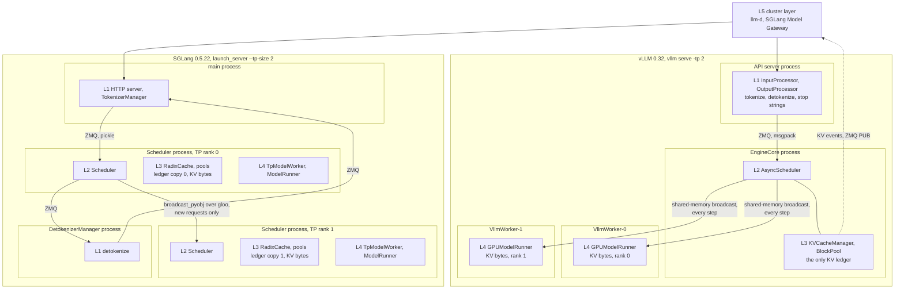

*Part 1 of a ten-part series on serving engines from the inside. Pinned to vLLM 0.32.0 ([`5df63a7`](https://github.com/vllm-project/vllm/tree/5df63a7203cdb9328d824a27b682e77c7b9928be)) and SGLang 0.5.22 ([`baa9bef`](https://github.com/sgl-project/sglang/tree/baa9befa381511cd4d56f83980951e5a45fffc6d)). Both projects ship every couple of weeks, so every file reference below points at those commits.*

Ask where the KV cache lives in a two-GPU vLLM deployment and the accurate answer names three processes. The engine core holds the ledger: which blocks belong to which request, which are free, which prefixes are already cached. Each GPU worker holds its shard of the bytes, a single `int8` allocation viewed as per-layer tensors. Ask SGLang the same question and the answer names two processes with a different shape. Each one holds a complete ledger next to its own shard of the bytes. The two ledgers stay identical because rank 0 broadcasts every incoming request to rank 1 before either one schedules anything.

Every LLM serving engine is the same five layers: an API frontend, a scheduler, a KV memory manager, a model executor, and a cluster layer above the engine that picks a replica. vLLM and SGLang do not differ in which layers they have. They differ in where they cut those layers into operating-system processes, and in which process owns memory. Those two choices decide where a request's latency goes, which component can see enough to make a decision, and how much of the engine a router has to understand.

## Five layers, named by what they decide

A layer is worth naming when it owns a decision and the state that decision needs. By that test there are five.

| Layer | Decides | Owns |
|---|---|---|
| **L1** API frontend | Which token IDs a request is, and what text its output tokens become | Chat template, tokenizer, per-request detokenizer state, stop strings |
| **L2** Scheduler | Which tokens go into the next forward pass | Waiting and running queues, the per-step token budget |
| **L3** KV memory manager | Where each token's keys and values live | Block or slot tables, the free list, the prefix index |
| **L4** Model executor | How to run one forward pass over the batch L2 picked, in the slots L3 assigned | Weights, the KV bytes, CUDA graphs, compiled kernels |
| **L5** Cluster layer | Which replica gets the request | Per-replica load and cache-hit estimates |

L2 and L3 are the pair people keep trying to separate, and can't. Admitting a request is a memory decision, because the scheduler is betting that the blocks the request needs later will still be free. Preemption is the scheduler calling that bet off. PagedAttention made the bet cheap to place by allocating KV in fixed-size blocks on demand,[^paged] and [Two Schedulers, One SLO]() covered how badly it goes when disaggregation puts the two halves on different machines. Inside one engine they always sit together. Both engines below put them in the same process.

L5 is the odd one out. It lives outside the engine, as llm-d for vLLM and the Rust Model Gateway for SGLang. But it needs to know what L3 knows, so both engines export KV state upward, and that export is where the cluster layer reaches back into the engine.

The quickest way to check that these are real layers and not vLLM's org chart is to read an engine small enough to hold in your head. nano-vllm is 1,195 lines of non-blank, non-comment Python under `nanovllm/`, against the "~ 1,200 lines" its README claims.[^nano] It has a `Scheduler`, a `BlockManager` with hash-based prefix caching, a `ModelRunner`, and an `LLMEngine` that tokenizes and detokenizes in its own process. It has no HTTP server and no cluster layer, because it is an offline engine. Mini-SGLang, the SGLang project's teaching implementation, has 5,972 such lines under `python/minisgl/` (its README says about 5,000). It runs the frontend in its own processes and keeps the scheduler and executor together in one process per GPU, as SGLang does.[^minisgl] Different authors, a 5× difference in size, and the same four boxes inside the engine.

| Layer | nano-vllm | Mini-SGLang | vLLM 0.32 | SGLang 0.5.22 |
|---|---|---|---|---|
| L1 frontend | `LLMEngine`, offline only | `FrontendManager`, `TokenizeManager`, `DetokenizeManager` | `InputProcessor`, `OutputProcessor`, `IncrementalDetokenizer` | `TokenizerManager`, `DetokenizerManager` |
| L2 scheduler | `Scheduler` | `Scheduler` | `AsyncScheduler` | `Scheduler` |
| L3 KV manager | `BlockManager` | `CacheManager`, `RadixPrefixCache` | `KVCacheManager`, `BlockPool` | `RadixCache`, `ReqToTokenPool`, `TokenToKVPoolAllocator` |
| L4 executor | `ModelRunner` | `Engine` | `Worker`, `GPUModelRunner` | `TpModelWorker`, `ModelRunner` |
| L5 cluster | None | None | llm-d, outside the repo | `sgl-model-gateway/` |

## The map

Every post in the rest of this series opens with the diagram below and marks the box it covers. Each box is a process, shown at two-way tensor parallelism, the smallest configuration where the two engines look different. Labels L1 to L5 are the layers from the table above.



In vLLM, the engine core sends the batch to the workers on every step. In SGLang, rank 0 sends rank 1 only the *new requests*, and each rank works out the batch on its own.

## vLLM: the engine core keeps the ledger, the workers keep the bytes

With the default single API server, the `vllm serve` process is the API server. Its `AsyncLLM` launches the engine core as a child process named `EngineCore`. The engine core's busy loop is short enough to describe in one line: drain the input queue, then call `step()`, which runs `scheduler.schedule()`, `model_executor.execute_model()`, and `scheduler.update_from_output()`.[^core] Everything that happens to a request between tokenization and detokenization happens inside that loop or below it.

The worker count depends on tensor parallelism, and here the docs and the code disagree. The architecture overview says "There is **1 worker process per GPU**" and gives the process total as `A + DP + N`.[^arch] But `ParallelConfig` picks the `uni` executor backend whenever `world_size == 1`, and `UniProcExecutor` builds the worker inside the engine core process. So a single-GPU `vllm serve` is two processes, not three. At `-tp 2` the backend becomes `mp`, `MultiprocExecutor` spawns `VllmWorker-0` and `VllmWorker-1`, and the count is four.[^exec]

This matters more than a process count suggests. At TP=1, vLLM's scheduler and its forward pass share an address space and a GIL, which is the SGLang arrangement. At TP=2 they don't. The same flag changes the engine's shape, not just its parallelism. A profile taken on one GPU tells you less about the two-GPU deployment than it seems.

The two hops carry different traffic and use different transports:

- **API server to engine core:** ZMQ, with `ROUTER`/`DEALER` sockets for requests going in and `PUSH`/`PULL` for outputs coming back, and msgspec msgpack on the wire. The engine core runs socket I/O on two dedicated threads that feed `queue.Queue`s, so deserializing a large prompt does not stall the busy loop.
- **Engine core to workers:** `MessageQueue` in `shm_broadcast.py`, a shared-memory ring buffer with one writer and many readers. The engine core writes each step's `SchedulerOutput` once and every worker reads the same bytes. Each worker answers on its own one-to-one queue, and only one rank returns the `execute_model` result.[^ipc]

KV memory follows the same split, and the startup sequence shows it most clearly. Condensed from `EngineCore._initialize_kv_caches`, with the elastic-EP and non-causal-attention branches removed:

```python
# Condensed from vllm/v1/engine/core.py @ 5df63a7. Runs in the EngineCore process.
def _initialize_kv_caches(self, vllm_config):
    # 1. Ask every worker what each attention layer needs per token
    #    (full attention, sliding window, MLA, Mamba state, ...).
    kv_cache_specs = self.model_executor.get_kv_cache_specs()

    # 2. Each worker profiles a dummy forward pass and reports the bytes left
    #    for KV: ceil(total * gpu_memory_utilization) - non-KV memory - the
    #    CUDA graph estimate. This is a collective RPC, so with -tp 2 the
    #    result is a list with one entry per worker.
    available_gpu_memory = self.model_executor.determine_available_memory()

    # 3. Bytes become blocks here, in the engine core. Every rank is cut down
    #    to the smallest rank's block count, so block ID 4711 names the same
    #    slot on every GPU.
    kv_cache_configs = get_kv_cache_configs(
        vllm_config, kv_cache_specs, available_gpu_memory
    )
    scheduler_kv_cache_config = generate_scheduler_kv_cache_config(kv_cache_configs)
    vllm_config.cache_config.num_gpu_blocks = scheduler_kv_cache_config.num_blocks

    # 4. Only now do the workers allocate: one int8 buffer per GPU, viewed as
    #    per-layer KV tensors. torch.compile and CUDA graph capture run after.
    self.model_executor.initialize_from_config(kv_cache_configs)
    self.model_executor.compile_or_warm_up_model()
    return scheduler_kv_cache_config
```

After step 4 the workers never make another memory decision. The `BlockPool` in the engine core holds the free-block queue and the block-hash map that prefix caching queries. On every step the scheduler sends block IDs down inside `SchedulerOutput`: `NewRequestData.block_ids` for requests scheduled for the first time, and `CachedRequestData.new_block_ids` for running requests that grew past a block boundary. The model runner writes keys and values wherever those IDs point.[^kv] The worker has the memory. The engine core decides what it means.

The KV connector, the interface that disaggregated deployments use to move KV between engines, is split along the same line. `KVConnectorRole.SCHEDULER` is commented "Connector running in the scheduler process" and `KVConnectorRole.WORKER` "Connector running in the worker process". The two halves talk through `SchedulerOutput.kv_connector_metadata` going down and the connector output coming back.[^events] A connector author writes both halves and keeps them consistent across a process boundary. That contract sits on top of the byte-layout problem in [The KV Cache Has No ABI]().

L1 lives entirely in the API server process. Chat-template rendering goes to an executor so it doesn't block the event loop, `InputProcessor` turns the result into an `EngineCoreRequest`, and on the way back `OutputProcessor` runs an `IncrementalDetokenizer` per request.[^fe] Stop strings are checked there too. That creates the first leak in the layering.

A stop string is defined on text, and only the frontend has text. When `OutputProcessor` matches one, the engine core doesn't know yet. It still holds the request's blocks and may schedule another step for it. The frontend has to send an abort back across ZMQ (step 3 in the output handler's loop) before the scheduler frees anything.[^stop] Stop *tokens* don't have this problem, because the engine core sees token IDs and can finish the request itself. In a high-concurrency deployment, where the blocks held by a finished request could go to another request, prefer stop tokens whenever the model's vocabulary allows it.

## SGLang: every tensor-parallel rank runs the whole engine

SGLang's launcher describes its own layout in one docstring: "Launch the TokenizerManager in the main process, the Scheduler in a subprocess, and the DetokenizerManager in another subprocess."[^sgl-launch] The HTTP server shares the main process with `TokenizerManager`. There is one scheduler process per tensor-parallel rank. So `--tp-size 1` is three processes and `--tp-size 2` is four. `--dp-size 2` adds a `DataParallelController` process, which launches the per-rank schedulers itself.

What matters is what sits inside a scheduler process. The class docstring reads "A scheduler that manages a tensor parallel GPU worker", and it builds that worker in-process: `Scheduler` constructs a `TpModelWorker`, which constructs a `ModelRunner`.[^sgl-sched] L2, L3 and L4 share one process per GPU. Nothing crosses a process boundary between deciding on a batch and running it.

That means tensor parallelism replicates the scheduler. Each rank's `Scheduler.__init__` builds its own `ReqToTokenPool`, its own `TokenToKVPoolAllocator` and its own `RadixCache`. Only rank 0 has ZMQ sockets. When requests arrive, rank 0 receives them and calls `broadcast_pyobj`, which pickles them into a byte tensor and runs `dist.broadcast` over a gloo CPU group to every other rank.[^sgl-bcast] From there, every rank runs the same scheduling code on the same inputs and reaches the same decision without being told. No batch is sent per step. The ledgers agree because the computation is deterministic, and a `rank_consensus_checker` exists for when it isn't.

The memory pool has two levels of indirection, which the module header lays out: "ReqToTokenPool maps a request to its token locations. TokenToKVPoolAllocator manages the indices to kv cache data. KVCache actually holds the physical kv cache."[^sgl-pool] The radix tree sits on top and maps token prefixes to slots in that pool.[^sglang-paper] Part 7 argues that the tree is a scheduling policy and not just a cache. For this post the point is ownership. The ledger and the bytes live in the same process, and there are as many copies of the ledger as there are GPUs.

Memory sizing differs in a way that catches anyone moving between the two engines. vLLM's `--gpu-memory-utilization` is a ceiling on everything vLLM allocates, and KV gets whatever is left after weights, activations, and the CUDA graph estimate. SGLang's `--mem-fraction-static` is the share for *static* memory, meaning weights plus the KV pool. The rest is held back as runtime slack, `slack_gb = pre_model_load_memory * (1 - mem_fraction_static)`, and the KV pool gets the free memory left after the model loads, minus that slack.[^sgl-size] Setting both knobs to 0.9 does not give you the same KV pool. The two engines agree on one thing: the pool is sized to the poorest GPU, taking the minimum across ranks.

Detokenization runs in its own process. The source gives no reason, so this is my reading: it keeps per-request decode state and `batch_decode` calls off both the HTTP event loop and the scheduler loop. vLLM does the same work on the API server's event loop, in chunks with an `await asyncio.sleep(0)` between them so a large output batch doesn't starve other requests.

The overlap scheduler is where SGLang's arrangement pays off. `event_loop_overlap` launches batch N on the GPU, then processes batch N−1's results on the CPU while N runs.[^sgl-overlap] Because the scheduler and the model runner share a process, the mechanism is two CUDA streams and a future map, not a protocol. vLLM 0.32 gets a similar overlap from `AsyncScheduler`, its default scheduler, but past TP=1 it has to do so across a process boundary. Part 3 measures what that costs.

## Two answers to who owns memory

| | vLLM 0.32 | SGLang 0.5.22 |
|---|---|---|
| Processes at TP=1 / TP=2 | 2 / 4 | 3 / 4 |
| Scheduler copies at TP=2 | 1, in the engine core | 2, one per rank |
| KV ledger copies at TP=2 | 1 | 2, identical by determinism |
| KV bytes live in | each worker process | each scheduler process |
| How ranks agree on a batch | Engine core writes `SchedulerOutput` to shared memory every step | Rank 0 broadcasts new requests, each rank schedules on its own |
| Detokenization | API server event loop | Separate process |
| Memory knob | `--gpu-memory-utilization`, a total ceiling | `--mem-fraction-static`, a static share |

Each design pays somewhere. vLLM pays for serialization and a shared-memory hop on every step once TP is above 1, and its scheduler can never touch a GPU tensor directly. SGLang pays CPU time for N copies of the scheduler, and it stakes correctness on N processes making bit-identical decisions. A tie-break that iterates a `set` of request-ID strings would be enough to break it. SGLang starts its schedulers with the `spawn` method, so each is a fresh interpreter, and CPython randomizes string hashes per interpreter unless `PYTHONHASHSEED` is pinned. Any policy that reads the wall clock has the same problem. Neither raises an error. The ranks hang in a collective, or each rank's attention heads quietly read keys from a different request.

I prefer vLLM's split as architecture, because it gives the KV ledger exactly one owner per data-parallel rank. That owner is also the natural place to tell a router what is cached, and vLLM uses it that way. `BlockPool` queues `BlockStored` and `BlockRemoved` events, and `Scheduler.update_from_output` publishes them on a ZMQ PUB socket when `--kv-events-config` turns them on.[^events] One ledger, one event stream, one thing for llm-d to subscribe to.[^llmd] SGLang's single-process loop is easier to make fast. vLLM's split is easier to reason about when the cluster layer starts asking questions.

## Where one request's time goes

This experiment stays at low load: one request at a time, with the engine idle in between. In that regime throughput isn't the interesting question. The question is how much of a request's latency is spent outside the engine core, in L1 and the hops around it.

vLLM exposes enough per-request histograms to answer that, as long as you know what each one measures. The definitions are in `vllm/v1/metrics/stats.py`:[^stats]

- `vllm:request_queue_time_seconds` is first `SCHEDULED` minus `QUEUED`. Both are engine-core monotonic timestamps.
- `vllm:request_prefill_time_seconds` is first token minus first `SCHEDULED`.
- `vllm:request_decode_time_seconds` is last token minus first token.
- `vllm:request_inference_time_seconds` is last token minus first `SCHEDULED`, so it equals prefill plus decode.
- `vllm:e2e_request_latency_seconds` is frontend wall-clock time from `arrival_time` to the moment the frontend dequeues the final output batch. `arrival_time` is stamped when rendering starts, before tokenization.

The code and the docs disagree on one definition. The code keeps the *first* `SCHEDULED` event (the comment says `# ignore preemptions`), while `docs/design/metrics.md` says "most recent `SCHEDULED`". So the time a preempted request spends waiting again counts as prefill or decode, not queue. And e2e stops before the final batch is detokenized, so it excludes the last detokenization and the HTTP response write.

That yields two residuals, each covering a different stretch of the path:

- **e2e − queue − inference** covers tokenization and input processing, msgpack and ZMQ in both directions, and the time a request sits in the engine core's input queue until the busy loop drains it. That last part is up to one step.
- **client wall time − e2e** covers HTTP parsing before rendering, the final detokenization, writing the response, and the loopback socket.

Prometheus histograms aggregate observations, so a single scrape can't give per-request values. With exactly one request in flight, though, the change in a histogram's `_sum` between two scrapes *is* that request's value, and the change in `_count` proves exactly one observation landed:

```python
#!/usr/bin/env python3
"""Split single-request latency on a running vLLM 0.32 server into the
engine core's share and the two residuals around it.

Usage: python split_latency.py --model <served-model-name>
"""
import argparse
import json
import statistics
import time
import urllib.request

from prometheus_client.parser import text_string_to_metric_families

# 1. Queue, prefill, decode and inference come from engine-core timestamps.
#    e2e comes from the API server's wall clock.
HISTOGRAMS = {
    "queue": "vllm:request_queue_time_seconds",
    "prefill": "vllm:request_prefill_time_seconds",
    "decode": "vllm:request_decode_time_seconds",
    "inference": "vllm:request_inference_time_seconds",
    "e2e": "vllm:e2e_request_latency_seconds",
}

# 2. (prompt tokens, output tokens). One output token leaves little besides
#    prefill and overhead. 256 output tokens show how far decode outweighs it.
SHAPES = [(128, 1), (2048, 1), (128, 256), (2048, 256)]
REPS = 20


def scrape(base):
    # 3. Read every histogram's _sum and _count. Summing across label sets
    #    folds in the model_name and engine labels.
    text = urllib.request.urlopen(f"{base}/metrics").read().decode()
    out = {}
    for family in text_string_to_metric_families(text):
        for sample in family.samples:
            for suffix in ("_sum", "_count"):
                if sample.name.endswith(suffix):
                    key = (sample.name[: -len(suffix)], suffix)
                    out[key] = out.get(key, 0.0) + sample.value
    return out


def one_request(base, model, prompt_len, max_tokens):
    # 4. /v1/completions skips the chat template, so L1's input side is
    #    tokenization alone. " the" is close to one token per repeat on
    #    Llama- and Qwen-family tokenizers. The usage field has the exact count.
    body = {
        "model": model,
        "prompt": " the" * prompt_len,
        "max_tokens": max_tokens,
        "temperature": 0.0,
        "ignore_eos": True,  # 5. vLLM extension: pin the output length.
    }
    req = urllib.request.Request(
        f"{base}/v1/completions",
        data=json.dumps(body).encode(),
        headers={"Content-Type": "application/json"},
    )
    t0 = time.perf_counter()
    with urllib.request.urlopen(req) as resp:
        usage = json.loads(resp.read())["usage"]
    return time.perf_counter() - t0, usage


def main():
    ap = argparse.ArgumentParser()
    ap.add_argument("--base", default="http://localhost:8000")
    ap.add_argument("--model", required=True)
    args = ap.parse_args()

    # 6. One warm-up request, so lazy imports and allocator growth stay out of
    #    the first shape's numbers.
    one_request(args.base, args.model, 128, 8)

    for prompt_len, max_tokens in SHAPES:
        rows = []
        for _ in range(REPS):
            before = scrape(args.base)
            client_s, usage = one_request(args.base, args.model, prompt_len, max_tokens)
            # 7. The response can go out before the stats logger records the
            #    finished request. Wait briefly, then prove one observation landed.
            time.sleep(0.2)
            after = scrape(args.base)
            for m in HISTOGRAMS.values():
                n = after.get((m, "_count"), 0) - before.get((m, "_count"), 0)
                assert n == 1, f"{m}: {n} observations between scrapes"
            d = {k: after.get((m, "_sum"), 0.0) - before.get((m, "_sum"), 0.0)
                 for k, m in HISTOGRAMS.items()}
            # 8. Tokenization, msgpack and ZMQ both ways, engine input-queue wait.
            d["frontend_ipc"] = d["e2e"] - d["queue"] - d["inference"]
            # 9. HTTP parsing, final detokenization, response write, socket.
            d["http_detok"] = client_s - d["e2e"]
            d["client"] = client_s
            rows.append(d)
        med = {k: statistics.median(r[k] for r in rows) * 1e3 for k in rows[0]}
        print(json.dumps({
            "prompt_tokens": usage["prompt_tokens"],
            "completion_tokens": usage["completion_tokens"],
            **{f"{k}_ms": round(v, 3) for k, v in med.items()},
        }))


if __name__ == "__main__":
    main()
```

The code makes one prediction before any numbers come in. Only the input side and the final output's trip back sit inside the frontend-plus-IPC residual. Every earlier output crosses ZMQ and gets detokenized while the engine is already computing the next token. So that residual should stay flat as the output grows from 1 to 256 tokens, and grow only slightly with prompt length, because tokenizing 2,048 tokens costs more than tokenizing 128. If it grows with output length, the frontend's event loop is falling behind the engine even at a concurrency of one. That is the failure Part 2 goes looking for under load.

<!-- TODO(A100 run): replace this table with split_latency.py medians. Record the model, dtype and launch command beside it. -->

| Prompt / output tokens | Queue | Prefill | Decode | Frontend + IPC | HTTP + final detok | Client total |
|---|---|---|---|---|---|---|
| 128 / 1 | TBD | TBD | TBD | TBD | TBD | TBD |
| 2048 / 1 | TBD | TBD | TBD | TBD | TBD | TBD |
| 128 / 256 | TBD | TBD | TBD | TBD | TBD | TBD |
| 2048 / 256 | TBD | TBD | TBD | TBD | TBD | TBD |

SGLang records `sglang:queue_time_seconds` in the scheduler process and its TTFT, inter-token and end-to-end histograms in the main process. That is enough for a coarser version of the same split. The head-to-head comparison belongs in Part 9, where both engines run the same workloads.

## The frontend is the layer that moves

If this model is right, the layers should hold still while process boundaries move. October 2026 gives an unusually clean test: both engines now ship experimental Rust frontends, and they built them in opposite directions.

vLLM's `vllm-frontend-rs`, moved into the main repository from Inferact's, aims "to rebuild the northbound serving layer in Rust while still talking to the core Python vLLM engine process(es) via ZMQ over the existing engine boundary." The crates in its architecture diagram are L1, piece by piece: an axum HTTP server, chat-template rendering with reasoning and tool parsing, a tokenizer and incremental detokenizer, and a ZMQ and MessagePack client for the engine. `VLLM_USE_RUST_FRONTEND=1` turns it on, and the README calls it experimental and not feature-complete.[^vllm-rs] The process boundary stays exactly where it was. Only the language above it changes.

SGLang's version deletes the boundary instead. With `SGLANG_RUST_SERVER=1`, "The embedded Rust server (started inside the rank-0 scheduler) owns the API server, tokenization, and detokenization." The scheduler code puts the consequence plainly: "The rust server *is* the ingress source", and the request receiver drains an in-process ring buffer instead of a ZMQ socket.[^sgl-rs] L1 moves into the same process as L2, L3 and L4. The Python `TokenizerManager` and the detokenizer process are not started at all.

Then the Model Gateway, in gRPC mode, moves L1 up a level: "The gRPC router tokenizes inputs locally, supports tool-call parsing, and streams responses."[^gateway] Now tokenization happens in L5, before the request reaches any engine.

So in SGLang 0.5.22 the same layer runs in one of three processes, depending on two settings: the main process by default, the rank-0 scheduler with the embedded Rust server, or the gateway in gRPC mode. The layer's job and state are the same each time. What changes is which other layers it shares an address space with, and which hops a request pays for. That is the decision each engine is actually making, and it is the axis the rest of this series follows.

Part 2 takes vLLM's arrangement apart one process at a time: one streamed chat request, every process it crosses, and the point at which `--api-server-count` starts to matter.

## References

[^paged]: **Kwon et al., "Efficient Memory Management for Large Language Model Serving with PagedAttention," SOSP 2023.** The paper behind vLLM's block-based KV allocation. ([arXiv](https://arxiv.org/abs/2309.06180))

[^nano]: **nano-vllm @ `bb823b3`.** README feature list ("~ 1,200 lines of Python code") and `nanovllm/engine/model_runner.py`, which sizes and allocates the KV cache in the same process as the scheduler at TP=1. Line count is non-blank, non-comment-only lines across the 19 files in `nanovllm/`. ([README](https://github.com/GeeeekExplorer/nano-vllm/blob/bb823b3e06983d71485a8e1f23715ebd87d98ef8/README.md), [model_runner.py#L113](https://github.com/GeeeekExplorer/nano-vllm/blob/bb823b3e06983d71485a8e1f23715ebd87d98ef8/nanovllm/engine/model_runner.py#L113))

[^minisgl]: **Mini-SGLang @ `9a91cfa`.** README ("~5,000 lines of Python"), `docs/structures.md` ("several independent processes", ZMQ for control and NCCL for tensors), and `server/launch.py`, which starts the per-GPU scheduler, detokenizer and tokenizer processes. Line count covers `python/minisgl/` excluding `benchmark/`. ([README](https://github.com/sgl-project/mini-sglang/blob/9a91cfafe754aa85daee49998176275667eb58f2/README.md), [structures.md](https://github.com/sgl-project/mini-sglang/blob/9a91cfafe754aa85daee49998176275667eb58f2/docs/structures.md), [launch.py](https://github.com/sgl-project/mini-sglang/blob/9a91cfafe754aa85daee49998176275667eb58f2/python/minisgl/server/launch.py))

[^core]: **vLLM `EngineCoreProc.run_busy_loop` and `EngineCore.step`, `vllm/v1/engine/core.py`.** ([run_busy_loop](https://github.com/vllm-project/vllm/blob/5df63a7203cdb9328d824a27b682e77c7b9928be/vllm/v1/engine/core.py#L1547), [step](https://github.com/vllm-project/vllm/blob/5df63a7203cdb9328d824a27b682e77c7b9928be/vllm/v1/engine/core.py#L657))

[^arch]: **vLLM docs, "Architecture Overview," `docs/design/arch_overview.md`.** The worker-per-GPU statement and the process-count table. ([L91](https://github.com/vllm-project/vllm/blob/5df63a7203cdb9328d824a27b682e77c7b9928be/docs/design/arch_overview.md#L91), [L113](https://github.com/vllm-project/vllm/blob/5df63a7203cdb9328d824a27b682e77c7b9928be/docs/design/arch_overview.md#L113))

[^exec]: **vLLM executor selection.** `ParallelConfig` sets `distributed_executor_backend = "uni"` when `world_size == 1`, and `UniProcExecutor` builds the worker in-process. ([parallel.py#L1080](https://github.com/vllm-project/vllm/blob/5df63a7203cdb9328d824a27b682e77c7b9928be/vllm/config/parallel.py#L1080), [uniproc_executor.py#L51](https://github.com/vllm-project/vllm/blob/5df63a7203cdb9328d824a27b682e77c7b9928be/vllm/v1/executor/uniproc_executor.py#L51), [multiproc_executor.py](https://github.com/vllm-project/vllm/blob/5df63a7203cdb9328d824a27b682e77c7b9928be/vllm/v1/executor/multiproc_executor.py))

[^ipc]: **vLLM IPC.** The client binds ZMQ sockets in `core_client.py`, the engine core's I/O threads start in `core.py`, and the engine-to-worker broadcast is `MessageQueue` in `shm_broadcast.py`. ([core_client.py#L642](https://github.com/vllm-project/vllm/blob/5df63a7203cdb9328d824a27b682e77c7b9928be/vllm/v1/engine/core_client.py#L642), [core.py#L1218](https://github.com/vllm-project/vllm/blob/5df63a7203cdb9328d824a27b682e77c7b9928be/vllm/v1/engine/core.py#L1218), [shm_broadcast.py#L484](https://github.com/vllm-project/vllm/blob/5df63a7203cdb9328d824a27b682e77c7b9928be/vllm/distributed/device_communicators/shm_broadcast.py#L484))

[^kv]: **vLLM KV sizing and ownership.** `_initialize_kv_caches` in the engine core, the worker's available-memory formula, the min-across-ranks step, the single `int8` allocation, `BlockPool`, and the block-ID fields of `SchedulerOutput`. ([core.py#L261](https://github.com/vllm-project/vllm/blob/5df63a7203cdb9328d824a27b682e77c7b9928be/vllm/v1/engine/core.py#L261), [gpu_worker.py#L740](https://github.com/vllm-project/vllm/blob/5df63a7203cdb9328d824a27b682e77c7b9928be/vllm/v1/worker/gpu_worker.py#L740), [kv_cache_utils.py#L2662](https://github.com/vllm-project/vllm/blob/5df63a7203cdb9328d824a27b682e77c7b9928be/vllm/v1/core/kv_cache_utils.py#L2662), [worker/utils.py#L596](https://github.com/vllm-project/vllm/blob/5df63a7203cdb9328d824a27b682e77c7b9928be/vllm/v1/worker/utils.py#L596), [block_pool.py#L136](https://github.com/vllm-project/vllm/blob/5df63a7203cdb9328d824a27b682e77c7b9928be/vllm/v1/core/block_pool.py#L136), [sched/output.py#L47](https://github.com/vllm-project/vllm/blob/5df63a7203cdb9328d824a27b682e77c7b9928be/vllm/v1/core/sched/output.py#L47))

[^events]: **vLLM KV events and connector roles.** Events queue in `BlockPool` and are published from `Scheduler.update_from_output`. `ZmqEventPublisher` is in `kv_events.py`, and the connector's scheduler and worker roles are in `kv_connector/v1/base.py`. ([block_pool.py#L191](https://github.com/vllm-project/vllm/blob/5df63a7203cdb9328d824a27b682e77c7b9928be/vllm/v1/core/block_pool.py#L191), [scheduler.py#L2371](https://github.com/vllm-project/vllm/blob/5df63a7203cdb9328d824a27b682e77c7b9928be/vllm/v1/core/sched/scheduler.py#L2371), [kv_events.py#L306](https://github.com/vllm-project/vllm/blob/5df63a7203cdb9328d824a27b682e77c7b9928be/vllm/distributed/kv_events.py#L306), [base.py#L138](https://github.com/vllm-project/vllm/blob/5df63a7203cdb9328d824a27b682e77c7b9928be/vllm/distributed/kv_transfer/kv_connector/v1/base.py#L138))

[^fe]: **vLLM frontend classes.** `InputProcessor`, `OutputProcessor.process_outputs`, and `IncrementalDetokenizer`. ([input_processor.py#L41](https://github.com/vllm-project/vllm/blob/5df63a7203cdb9328d824a27b682e77c7b9928be/vllm/v1/engine/input_processor.py#L41), [output_processor.py#L681](https://github.com/vllm-project/vllm/blob/5df63a7203cdb9328d824a27b682e77c7b9928be/vllm/v1/engine/output_processor.py#L681), [detokenizer.py#L31](https://github.com/vllm-project/vllm/blob/5df63a7203cdb9328d824a27b682e77c7b9928be/vllm/v1/engine/detokenizer.py#L31))

[^stop]: **vLLM stop-string abort, `AsyncLLM` output handler.** "Abort any reqs that finished due to stop strings." ([async_llm.py#L887](https://github.com/vllm-project/vllm/blob/5df63a7203cdb9328d824a27b682e77c7b9928be/vllm/v1/engine/async_llm.py#L887))

[^stats]: **vLLM per-request interval definitions.** `RequestStateStats` handling in `vllm/v1/metrics/stats.py`, and the design doc's "most recent `SCHEDULED`" wording. ([stats.py#L590](https://github.com/vllm-project/vllm/blob/5df63a7203cdb9328d824a27b682e77c7b9928be/vllm/v1/metrics/stats.py#L590), [metrics.md#L212](https://github.com/vllm-project/vllm/blob/5df63a7203cdb9328d824a27b682e77c7b9928be/docs/design/metrics.md#L212))

[^vllm-rs]: **vLLM `vllm-frontend-rs`, `rust/README.md`.** Architecture, goal statement, and the `VLLM_USE_RUST_FRONTEND` switch. ([README](https://github.com/vllm-project/vllm/blob/5df63a7203cdb9328d824a27b682e77c7b9928be/rust/README.md), [envs.py#L1475](https://github.com/vllm-project/vllm/blob/5df63a7203cdb9328d824a27b682e77c7b9928be/vllm/envs.py#L1475))

[^sgl-launch]: **SGLang `Engine._launch_subprocesses` and `launch_server`.** The process-layout docstrings, and the `spawn` start method. ([engine.py#L1964](https://github.com/sgl-project/sglang/blob/baa9befa381511cd4d56f83980951e5a45fffc6d/python/sglang/srt/entrypoints/engine.py#L1964), [engine.py#L1136](https://github.com/sgl-project/sglang/blob/baa9befa381511cd4d56f83980951e5a45fffc6d/python/sglang/srt/entrypoints/engine.py#L1136), [http_server.py#L2921](https://github.com/sgl-project/sglang/blob/baa9befa381511cd4d56f83980951e5a45fffc6d/python/sglang/srt/entrypoints/http_server.py#L2921))

[^sgl-sched]: **SGLang `Scheduler`, `TpModelWorker`, `ModelRunner`.** ([scheduler.py#L450](https://github.com/sgl-project/sglang/blob/baa9befa381511cd4d56f83980951e5a45fffc6d/python/sglang/srt/managers/scheduler.py#L450), [scheduler.py#L994](https://github.com/sgl-project/sglang/blob/baa9befa381511cd4d56f83980951e5a45fffc6d/python/sglang/srt/managers/scheduler.py#L994), [tp_worker.py#L279](https://github.com/sgl-project/sglang/blob/baa9befa381511cd4d56f83980951e5a45fffc6d/python/sglang/srt/managers/tp_worker.py#L279), [model_runner.py#L311](https://github.com/sgl-project/sglang/blob/baa9befa381511cd4d56f83980951e5a45fffc6d/python/sglang/srt/model_executor/model_runner.py#L311))

[^sgl-bcast]: **SGLang per-rank cache construction and request broadcast.** Each rank builds its own KV cache, and rank 0 broadcasts received requests with `broadcast_pyobj`. ([scheduler.py#L570](https://github.com/sgl-project/sglang/blob/baa9befa381511cd4d56f83980951e5a45fffc6d/python/sglang/srt/managers/scheduler.py#L570), [request_receiver.py#L206](https://github.com/sgl-project/sglang/blob/baa9befa381511cd4d56f83980951e5a45fffc6d/python/sglang/srt/managers/scheduler_components/request_receiver.py#L206), [common.py#L2647](https://github.com/sgl-project/sglang/blob/baa9befa381511cd4d56f83980951e5a45fffc6d/python/sglang/srt/utils/common.py#L2647))

[^sgl-pool]: **SGLang memory pool module header, `mem_cache/memory_pool.py`.** ([memory_pool.py#L17](https://github.com/sgl-project/sglang/blob/baa9befa381511cd4d56f83980951e5a45fffc6d/python/sglang/srt/mem_cache/memory_pool.py#L17))

[^sglang-paper]: **Zheng et al., "SGLang: Efficient Execution of Structured Language Model Programs," NeurIPS 2024.** Introduces RadixAttention. ([arXiv](https://arxiv.org/abs/2312.07104))

[^sgl-size]: **SGLang KV pool sizing, `KVCacheConfigurator._profile_available_bytes`.** ([kv_cache_configurator.py#L2688](https://github.com/sgl-project/sglang/blob/baa9befa381511cd4d56f83980951e5a45fffc6d/python/sglang/srt/mem_cache/kv_cache_configurator.py#L2688), [L2719](https://github.com/sgl-project/sglang/blob/baa9befa381511cd4d56f83980951e5a45fffc6d/python/sglang/srt/mem_cache/kv_cache_configurator.py#L2719))

[^sgl-overlap]: **SGLang `Scheduler.event_loop_overlap`.** "A scheduler loop that overlaps the CPU processing and GPU computation." ([scheduler.py#L1975](https://github.com/sgl-project/sglang/blob/baa9befa381511cd4d56f83980951e5a45fffc6d/python/sglang/srt/managers/scheduler.py#L1975))

[^llmd]: **vLLM docs, "llm-d."** How llm-d deploys vLLM and consumes its KV-cache events for prefix-aware routing. ([docs.vllm.ai](https://docs.vllm.ai/en/stable/deployment/integrations/llm-d/))

[^sgl-rs]: **SGLang embedded Rust server.** The launch-path comment and the scheduler's ingress switch. ([engine.py#L1292](https://github.com/sgl-project/sglang/blob/baa9befa381511cd4d56f83980951e5a45fffc6d/python/sglang/srt/entrypoints/engine.py#L1292), [scheduler.py#L2354](https://github.com/sgl-project/sglang/blob/baa9befa381511cd4d56f83980951e5a45fffc6d/python/sglang/srt/managers/scheduler.py#L2354), [request_receiver.py#L117](https://github.com/sgl-project/sglang/blob/baa9befa381511cd4d56f83980951e5a45fffc6d/python/sglang/srt/managers/scheduler_components/request_receiver.py#L117))

[^gateway]: **SGLang Model Gateway README, `sgl-model-gateway/README.md`.** Load-balancing policies and gRPC-mode tokenization. ([L30](https://github.com/sgl-project/sglang/blob/baa9befa381511cd4d56f83980951e5a45fffc6d/sgl-model-gateway/README.md#L30), [L228](https://github.com/sgl-project/sglang/blob/baa9befa381511cd4d56f83980951e5a45fffc6d/sgl-model-gateway/README.md#L228))

---

*Disclaimer: Researched and drafted with AI assistance (Claude Opus 5.5, Gemini 4 Argon). Direction, technical judgment, and final edits are mine; every claim is traceable to the sources cited above. Process layouts, code paths and line counts come from reading vLLM 0.32.0, SGLang 0.5.22, Mini-SGLang and nano-vllm at the commits cited.*
