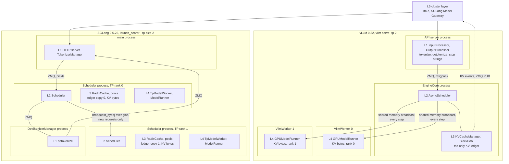

*Part 1 of a ten-part series on serving engines from the inside. Pinned to vLLM 0.32.0 ([`5df63a7`](https://github.com/vllm-project/vllm/tree/5df63a7203cdb9328d824a27b682e77c7b9928be)) and SGLang 0.5.22 ([`baa9bef`](https://github.com/sgl-project/sglang/tree/baa9befa381511cd4d56f83980951e5a45fffc6d)). Both projects ship every couple of weeks, so every file reference below points at those commits.*

Ask where the KV cache lives in a two-GPU vLLM deployment and the accurate answer names three processes. The engine core holds the ledger: which blocks belong to which request, which are free, which prefixes are already cached. Each GPU worker holds its shard of the bytes, a single `int8` allocation viewed as per-layer tensors. Ask SGLang the same question and the answer names two processes with a different shape. Each one holds a complete ledger next to its own shard of the bytes. The two ledgers stay identical because rank 0 broadcasts every incoming request to rank 1 before either one schedules anything.

Every LLM serving engine is the same five layers: an API frontend, a scheduler, a KV memory manager, a model executor, and a cluster layer above the engine that picks a replica. vLLM and SGLang do not differ in which layers they have. They differ in where they cut those layers into operating-system processes, and in which process owns memory. Those two choices decide where a request's latency goes, which component can see enough to make a decision, and how much of the engine a router has to understand.

## Five layers, named by what they decide

A layer is worth naming when it owns a decision and the state that decision needs. By that test there are five.

| Layer | Decides | Owns |
|---|---|---|
| **L1** API frontend | Which token IDs a request is, and what text its output tokens become | Chat template, tokenizer, per-request detokenizer state, stop strings |
| **L2** Scheduler | Which tokens go into the next forward pass | Waiting and running queues, the per-step token budget |
| **L3** KV memory manager | Where each token's keys and values live | Block or slot tables, the free list, the prefix index |
| **L4** Model executor | How to run one forward pass over the batch L2 picked, in the slots L3 assigned | Weights, the KV bytes, CUDA graphs, compiled kernels |
| **L5** Cluster layer | Which replica gets the request | Per-replica load and cache-hit estimates |

L2 and L3 are the pair people keep trying to separate, and can't. Admitting a request is a memory decision, because the scheduler is betting that the blocks the request needs later will still be free. Preemption is the scheduler calling that bet off. PagedAttention made the bet cheap to place by allocating KV in fixed-size blocks on demand,[^paged] and [Two Schedulers, One SLO]() covered how badly it goes when disaggregation puts the two halves on different machines. Inside one engine they always sit together. Both engines below put them in the same process.

L5 is the odd one out. It lives outside the engine, as llm-d for vLLM and the Rust Model Gateway for SGLang. But it needs to know what L3 knows, so both engines export KV state upward, and that export is where the cluster layer reaches back into the engine.

The quickest way to check that these are real layers and not vLLM's org chart is to read an engine small enough to hold in your head. nano-vllm is 1,195 lines of non-blank, non-comment Python under `nanovllm/`, against the "~ 1,200 lines" its README claims.[^nano] It has a `Scheduler`, a `BlockManager` with hash-based prefix caching, a `ModelRunner`, and an `LLMEngine` that tokenizes and detokenizes in its own process. It has no HTTP server and no cluster layer, because it is an offline engine. Mini-SGLang, the SGLang project's teaching implementation, has 5,972 such lines under `python/minisgl/` (its README says about 5,000). It runs the frontend in its own processes and keeps the scheduler and executor together in one process per GPU, as SGLang does.[^minisgl] Different authors, a 5× difference in size, and the same four boxes inside the engine.

| Layer | nano-vllm | Mini-SGLang | vLLM 0.32 | SGLang 0.5.22 |
|---|---|---|---|---|
| L1 frontend | `LLMEngine`, offline only | `FrontendManager`, `TokenizeManager`, `DetokenizeManager` | `InputProcessor`, `OutputProcessor`, `IncrementalDetokenizer` | `TokenizerManager`, `DetokenizerManager` |
| L2 scheduler | `Scheduler` | `Scheduler` | `AsyncScheduler` | `Scheduler` |
| L3 KV manager | `BlockManager` | `CacheManager`, `RadixPrefixCache` | `KVCacheManager`, `BlockPool` | `RadixCache`, `ReqToTokenPool`, `TokenToKVPoolAllocator` |
| L4 executor | `ModelRunner` | `Engine` | `Worker`, `GPUModelRunner` | `TpModelWorker`, `ModelRunner` |
| L5 cluster | None | None | llm-d, outside the repo | `sgl-model-gateway/` |

## The map

Every post in the rest of this series opens with the diagram below and marks the box it covers. Each box is a process, shown at two-way tensor parallelism, the smallest configuration where the two engines look different. Labels L1 to L5 are the layers from the table above.



In vLLM, the engine core sends the batch to the workers on every step. In SGLang, rank 0 sends rank 1 only the *new requests*, and each rank works out the batch on its own.

Cutting those five layers into operating-system processes is not cosmetic packaging. In a Python and CUDA runtime, a process boundary is three boundaries at once: a GIL boundary, an address-space boundary that turns pointer passes into serialization or shared-memory copies, and an authority boundary that decides whether two GPUs are steered by one controller or have to compute identical schedules independently.

## vLLM: the engine core keeps the ledger, the workers keep the bytes

With the default single API server, the `vllm serve` process is the API server. Its `AsyncLLM` launches the engine core as a child process named `EngineCore`. The engine core's busy loop fits in one line: drain the input queue, then call `step()`, which runs `scheduler.schedule()`, `model_executor.execute_model()`, and `scheduler.update_from_output()`.[^core] Everything that happens to a request between tokenization and detokenization happens inside that loop or below it.

The worker count depends on tensor parallelism, and here the docs and the code disagree. The architecture overview says "There is **1 worker process per GPU**" and gives the process total as `A + DP + N`.[^arch] But `ParallelConfig` picks the `uni` executor backend whenever `world_size == 1`, and `UniProcExecutor` builds the worker inside the engine core process. So a single-GPU `vllm serve` is two processes, not three. At `-tp 2` the backend becomes `mp`, `MultiprocExecutor` spawns `VllmWorker-0` and `VllmWorker-1`, and the count jumps to four.[^exec]

This is a classic benchmarking trap. At TP=1, vLLM's scheduler and its forward pass share an address space and a GIL—the same arrangement SGLang uses. At TP=2 they do not. Passing `-tp 2` changes the engine's process topology, not just its tensor parallelism. A CPU profile taken on one GPU misses the entire engine-to-worker IPC path that appears the moment you add a second GPU.

At TP≥2, a request crosses two process boundaries on its way to the GPU, and the two hops use different transports because their traffic has different shapes:

- **API server to engine core:** ZMQ `ROUTER`/`DEALER` sockets for requests going in, `PUSH`/`PULL` sockets for outputs coming back, and `msgspec` msgpack on the wire. Because prompts can be tens of thousands of tokens, the engine core runs socket I/O on two dedicated background threads that feed `queue.Queue`s, keeping msgpack deserialization off the scheduling loop.
- **Engine core to workers:** `MessageQueue` in `shm_broadcast.py`, a shared-memory ring buffer with one writer and $N$ readers. The engine core writes each step's `SchedulerOutput` once and every worker reads the same bytes. Each worker answers on its own one-to-one queue, and only one rank returns the `execute_model` result.[^ipc]

KV memory follows the same process split, and `EngineCore._initialize_kv_caches` shows who owns what as the engine comes up (condensed below with the elastic-EP and non-causal-attention branches removed):

```python
# Condensed from vllm/v1/engine/core.py @ 5df63a7. Runs in the EngineCore process.
def _initialize_kv_caches(self, vllm_config):
    # 1. Ask every worker what each attention layer needs per token
    #    (full attention, sliding window, MLA, Mamba state, ...).
    kv_cache_specs = self.model_executor.get_kv_cache_specs()

    # 2. Each worker profiles a dummy forward pass and reports the bytes left
    #    for KV: ceil(total * gpu_memory_utilization) - non-KV memory - the
    #    CUDA graph estimate. This is a collective RPC, so with -tp 2 the
    #    result is a list with one entry per worker.
    available_gpu_memory = self.model_executor.determine_available_memory()

    # 3. Bytes become blocks here, in the engine core. Every rank is cut down
    #    to the smallest rank's block count, so block ID 4711 names the same
    #    slot on every GPU.
    kv_cache_configs = get_kv_cache_configs(
        vllm_config, kv_cache_specs, available_gpu_memory
    )
    scheduler_kv_cache_config = generate_scheduler_kv_cache_config(kv_cache_configs)
    vllm_config.cache_config.num_gpu_blocks = scheduler_kv_cache_config.num_blocks

    # 4. Only now do the workers allocate: one int8 buffer per GPU, viewed as
    #    per-layer KV tensors. torch.compile and CUDA graph capture run after.
    self.model_executor.initialize_from_config(kv_cache_configs)
    self.model_executor.compile_or_warm_up_model()
    return scheduler_kv_cache_config
```

After step 4 the workers never make another memory decision. The `BlockPool` in the engine core holds the free-block queue and the block-hash map that prefix caching queries. On every step the scheduler sends block IDs down inside `SchedulerOutput`: `NewRequestData.block_ids` for newly admitted requests, and `CachedRequestData.new_block_ids` for running requests that grew past a block boundary. The model runner writes keys and values wherever those IDs point.[^kv] The worker has the memory. The engine core decides what it means.

Putting process boundaries between layers has a direct consequence: **whenever a feature needs state from two layers that live in different processes, either the component splits in half or it pays a round-trip delay.** Two places in vLLM show both outcomes:

1. **Splitting a component across the engine-to-worker boundary (`KVConnector`).** Moving KV between disaggregated engines requires knowing *which* logical blocks to transfer (L3 state in `EngineCore`) and *where* the GPU memory pointers live (L4 state in `VllmWorker`). Because neither process has both, vLLM splits the interface in two: `KVConnectorRole.SCHEDULER` runs in the scheduler process, `KVConnectorRole.WORKER` runs in the worker process, and the two halves talk on every step through `SchedulerOutput.kv_connector_metadata`.[^events] Every connector author writes both halves and keeps them consistent across a process boundary, on top of the byte-layout mismatches in [The KV Cache Has No ABI]().
2. **Paying a round-trip delay across the frontend-to-engine boundary (stop strings vs. stop tokens).** L1 lives in the API server process: chat-template rendering runs on an executor, `InputProcessor` builds an `EngineCoreRequest`, and on the way back `OutputProcessor` runs an `IncrementalDetokenizer` per request.[^fe] Stop *tokens* are cheap because `EngineCore` sees token IDs as soon as sampling finishes and frees the request's blocks immediately. Stop *strings* are defined on text, and only `OutputProcessor` in the API server has text. When `OutputProcessor` matches a stop string, `EngineCore` doesn't know yet—it still holds the request's blocks and may schedule another step before the API server's abort arrives over ZMQ (step 3 in `async_llm.py`'s output handler).[^stop] In a high-concurrency deployment, where blocks freed by a finished request immediately unblock waiting requests, prefer stop tokens whenever the model's vocabulary allows it.

## SGLang: every tensor-parallel rank runs the whole engine

SGLang makes the opposite cut. Its launcher starts `TokenizerManager` (and the HTTP server) in the main process, one `Scheduler` subprocess per tensor-parallel rank, and a `DetokenizerManager` subprocess.[^sgl-launch] So `--tp-size 1` is three processes and `--tp-size 2` is four (`--dp-size 2` adds a `DataParallelController` parent that launches the per-rank schedulers).

What matters is what sits inside each scheduler process. The class docstring reads `"A scheduler that manages a tensor parallel GPU worker"`, and it builds that worker in-process: `Scheduler` constructs a `TpModelWorker`, which constructs a `ModelRunner`.[^sgl-sched] L2, L3, and L4 share one process per GPU. Nothing crosses a process boundary between choosing a batch, allocating KV slots, and launching the CUDA kernels.

Why co-locate all three layers in one process? Because it turns CPU-GPU overlap from an IPC protocol into local state. In `Scheduler.event_loop_overlap`, the scheduler launches batch $N$ on a compute stream and immediately processes batch $N-1$'s results on the CPU while batch $N$ runs on the GPU.[^sgl-overlap] Because the scheduler and the model runner share an address space, the mechanism is two CUDA streams and an in-process future map, not a serialization boundary. vLLM 0.32 gets a similar overlap from `AsyncScheduler`, its default scheduler, but past TP=1 it has to pipeline across the shared-memory ring buffer.

The price of co-locating the scheduler with each GPU worker is **state replication**. Each rank's `Scheduler.__init__` builds its own `ReqToTokenPool` (mapping requests to token locations), its own `TokenToKVPoolAllocator` (managing indices into physical KV data), and its own `RadixCache` prefix tree on top.[^sgl-pool][^sglang-paper] Only rank 0 binds ZMQ sockets to the frontend. When requests arrive, rank 0 receives them and calls `broadcast_pyobj`, which pickles them into a byte tensor and runs `dist.broadcast` over a Gloo CPU group to every other rank.[^sgl-bcast] After that ingress broadcast, no batch is sent per step. Every rank runs the same scheduling code on its local copy of the queues and radix tree, relying on determinism to reach the exact same batch and slot assignments (with a `rank_consensus_checker` for when it doesn't).

Even the one piece of work SGLang pushes into a sidecar process—`DetokenizerManager`—follows from co-locating L2 and L4. Because the scheduler process is on the critical path of kernel launch and rank consensus, running per-request decode state and `batch_decode` string calls inside it would jitter the GPU overlap loop. Moving detokenization to its own subprocess keeps string work off both the scheduler loop and the HTTP event loop (whereas vLLM runs detokenization on the API server's event loop, yielding with `await asyncio.sleep(0)` between chunks).

One operational trap catches anyone moving configurations between the two engines: memory sizing. Both engines size their KV pool to the poorest GPU across ranks, but their flags measure different denominators:

- **vLLM's `--gpu-memory-utilization`** is a ceiling on *everything* vLLM allocates; KV gets whatever is left after weights, profiled activations, and the CUDA graph estimate.
- **SGLang's `--mem-fraction-static`** is the target share for *static* memory only (weights plus the KV pool). The rest is held back as runtime slack, `slack_gb = pre_model_load_memory * (1 - mem_fraction_static)`, and the KV pool gets the free memory left after the model loads minus that slack.[^sgl-size]

Setting both knobs to `0.9` on the same machine does not give you the same KV pool.

## Two answers to who owns memory

| | vLLM 0.32 | SGLang 0.5.22 |
|---|---|---|
| Processes at TP=1 / TP=2 | 2 / 4 | 3 / 4 |
| Scheduler copies at TP=2 | 1, in the engine core | 2, one per rank |
| KV ledger copies at TP=2 | 1 | 2, identical by determinism |
| KV bytes live in | each worker process | each scheduler process |
| How ranks agree on a batch | Engine core writes `SchedulerOutput` to shared memory every step | Rank 0 broadcasts new requests, each rank schedules on its own |
| Detokenization | API server event loop | Separate process |
| Memory knob | `--gpu-memory-utilization`, a total ceiling | `--mem-fraction-static`, a static share |

Each design pays somewhere. vLLM pays for serialization and a shared-memory hop on every step once TP is above 1, and its scheduler can never touch a GPU tensor directly. SGLang pays CPU time for $N$ copies of the scheduler, and it stakes correctness on $N$ processes making bit-identical decisions. A tie-break that iterates a `set` of request-ID strings is enough to break it. SGLang starts its schedulers with the `spawn` method, so each is a fresh interpreter, and CPython randomizes string hashes per interpreter unless `PYTHONHASHSEED` is pinned. Any policy that reads the wall clock has the same bug. Neither raises an error: the ranks hang in a collective, or each rank's attention heads quietly read keys from a different request.

I prefer vLLM's split as architecture, because it gives the KV ledger a single authoritative owner per data-parallel rank. That owner is also the natural place to tell a cluster router what is cached, and vLLM uses it that way. `BlockPool` queues `BlockStored` and `BlockRemoved` events, and `Scheduler.update_from_output` publishes them on a ZMQ PUB socket when `--kv-events-config` turns them on.[^events] One ledger, one event stream, one source for llm-d to subscribe to.[^llmd] SGLang's single-process loop is easier to make fast on one node. vLLM's split is easier to reason about when the cluster layer starts asking questions.

## Where one request's time goes

Having L1 and L2 in separate processes raises an immediate question: how much of a request's wall-clock latency is spent outside the engine core—in tokenization, ZMQ sockets, msgpack serialization, and detokenization?

At low load (one request in flight at a time, with the server idle in between), you do not need to patch vLLM to measure this. vLLM's Prometheus histograms in `vllm/v1/metrics/stats.py` expose enough internal timestamps to isolate the process-boundary overhead from the outside:[^stats]

- `vllm:request_queue_time_seconds` is first `SCHEDULED` minus `QUEUED`. Both are engine-core monotonic timestamps.
- `vllm:request_prefill_time_seconds` is first token minus first `SCHEDULED`.
- `vllm:request_decode_time_seconds` is last token minus first token.
- `vllm:request_inference_time_seconds` is last token minus first `SCHEDULED`, so it equals prefill plus decode.
- `vllm:e2e_request_latency_seconds` is frontend wall-clock time from `arrival_time` (stamped when chat-template rendering starts, before tokenization) to the moment the frontend dequeues the final output batch from ZMQ.

Reading `stats.py` next to `docs/design/metrics.md` turns up two subtleties that matter whenever you interpret these metrics in production:

1. **Preemption hides inside inference time, not queue time.** The code keeps only the *first* `SCHEDULED` event (with an explicit `# ignore preemptions` comment), whereas `docs/design/metrics.md` says "most recent `SCHEDULED`". If a request is preempted mid-generation and sits in the waiting queue again before resuming, that second wait is billed to prefill or decode, not queue time.
2. **`e2e` stops before the final detokenization and HTTP write.** Because `e2e_request_latency_seconds` stops the clock as soon as the frontend dequeues the final batch from the engine core, it excludes the last `IncrementalDetokenizer` pass and writing the HTTP response.

Prometheus histograms aggregate observations across requests, so a single scrape cannot report per-request latency. With a single request in flight, however, the delta in each histogram's `_sum` between two scrapes *is* that request's exact observation (verified by asserting each `_count` increased by `1`). That splits client wall time into engine-core work and two outer residuals (full harness in `~/go/utils/vllm/split_latency.py`):

```python
# Differential scrape across one in-flight request (see ~/go/utils/vllm/split_latency.py)
d = {k: after[m, "_sum"] - before[m, "_sum"] for k, m in HISTOGRAMS.items()}

# 1. Input tokenization, msgpack + ZMQ both ways, and up to one step waiting
#    for EngineCore's busy loop to drain its input queue.
frontend_ipc = d["e2e"] - d["queue"] - d["inference"]

# 2. HTTP request parsing before rendering, final detokenization, response write, socket.
http_detok = client_s - d["e2e"]
```

Tracing which operations sit inside `frontend_ipc` gives a sharp, testable invariant. Only the prompt's trip *in* and the final token's trip *out* sit inside `frontend_ipc`. Every earlier token crosses ZMQ and gets detokenized on the API server's event loop *while the engine core is already running the next forward pass on the GPU*.

At a concurrency of one, `frontend_ipc` should therefore stay flat as output length grows from 1 to 256 tokens, and grow only slightly with prompt length (tokenizing 2,048 tokens takes longer than tokenizing 128). If `frontend_ipc` ever grows with output length, the frontend's asyncio event loop is falling behind the GPU decode step rate and queueing ZMQ chunks in memory. That exact bottleneck is why vLLM v0.6.0 moved the HTTP API server into its own process in the first place—after a profile of Llama 3 8B on one H100 showed the API server taking 33% of wall time against 29% for scheduling and 38% for GPU execution[^perf060]—and why high-throughput deployments scale `--api-server-count` independently of the engine core.

## The frontend is the layer that moves

If this five-layer model is right, the layers should hold still while process boundaries move around them. Recent work in both repositories gives a clean test: both engines now ship experimental Rust frontends, and they used Rust to move the L1 boundary in opposite directions.

vLLM's `vllm-frontend-rs`, moved into the main repository from Inferact's, aims "to rebuild the northbound serving layer in Rust while still talking to the core Python vLLM engine process(es) via ZMQ over the existing engine boundary." Every crate in its architecture diagram maps to L1: an `axum` HTTP server, chat-template rendering with reasoning and tool parsing, a tokenizer and incremental detokenizer, and a ZMQ + MessagePack client for the engine (`VLLM_USE_RUST_FRONTEND=1`).[^vllm-rs] The process boundary stays where it was. Only the language above the ZMQ socket changes so L1 stops contending on Python's GIL and asyncio loop.

SGLang used Rust to delete the process boundary instead. With `SGLANG_RUST_SERVER=1`, "The embedded Rust server (started inside the rank-0 scheduler) owns the API server, tokenization, and detokenization." As the scheduler source puts it, "The rust server *is* the ingress source", and the request receiver drains an in-process ring buffer instead of a ZMQ socket.[^sgl-rs] L1 collapses into the same OS process as L2, L3, and L4. The Python `TokenizerManager` and the detokenizer subprocess are not started at all.

Then the Model Gateway, in gRPC mode, pulls L1 in the other direction—up into L5: "The gRPC router tokenizes inputs locally, supports tool-call parsing, and streams responses."[^gateway] Tokenization now happens in the cluster router before the request reaches any engine replica.

Depending on two settings, SGLang 0.5.22 runs the exact same L1 logic in the main process, inside the rank-0 scheduler process, or up in the gateway. The layer's job and state never change. What changes is which other layers share its address space, and which IPC hops a request pays for on the critical path. That is the architectural decision each engine is making, and it is the axis the rest of this series follows.

## References

[^paged]: **Kwon et al., "Efficient Memory Management for Large Language Model Serving with PagedAttention," SOSP 2023.** The paper behind vLLM's block-based KV allocation. ([arXiv](https://arxiv.org/abs/2309.06180))

[^nano]: **nano-vllm @ `bb823b3`.** README feature list ("~ 1,200 lines of Python code") and `nanovllm/engine/model_runner.py`, which sizes and allocates the KV cache in the same process as the scheduler at TP=1. Line count is non-blank, non-comment-only lines across the 19 files in `nanovllm/`. ([README](https://github.com/GeeeekExplorer/nano-vllm/blob/bb823b3e06983d71485a8e1f23715ebd87d98ef8/README.md), [model_runner.py#L113](https://github.com/GeeeekExplorer/nano-vllm/blob/bb823b3e06983d71485a8e1f23715ebd87d98ef8/nanovllm/engine/model_runner.py#L113))

[^minisgl]: **Mini-SGLang @ `9a91cfa`.** README ("~5,000 lines of Python"), `docs/structures.md` ("several independent processes", ZMQ for control and NCCL for tensors), and `server/launch.py`, which starts the per-GPU scheduler, detokenizer and tokenizer processes. Line count covers `python/minisgl/` excluding `benchmark/`. ([README](https://github.com/sgl-project/mini-sglang/blob/9a91cfafe754aa85daee49998176275667eb58f2/README.md), [structures.md](https://github.com/sgl-project/mini-sglang/blob/9a91cfafe754aa85daee49998176275667eb58f2/docs/structures.md), [launch.py](https://github.com/sgl-project/mini-sglang/blob/9a91cfafe754aa85daee49998176275667eb58f2/python/minisgl/server/launch.py))

[^core]: **vLLM `EngineCoreProc.run_busy_loop` and `EngineCore.step`, `vllm/v1/engine/core.py`.** ([run_busy_loop](https://github.com/vllm-project/vllm/blob/5df63a7203cdb9328d824a27b682e77c7b9928be/vllm/v1/engine/core.py#L1547), [step](https://github.com/vllm-project/vllm/blob/5df63a7203cdb9328d824a27b682e77c7b9928be/vllm/v1/engine/core.py#L657))

[^arch]: **vLLM docs, "Architecture Overview," `docs/design/arch_overview.md`.** The worker-per-GPU statement and the process-count table. ([L91](https://github.com/vllm-project/vllm/blob/5df63a7203cdb9328d824a27b682e77c7b9928be/docs/design/arch_overview.md#L91), [L113](https://github.com/vllm-project/vllm/blob/5df63a7203cdb9328d824a27b682e77c7b9928be/docs/design/arch_overview.md#L113))

[^exec]: **vLLM executor selection.** `ParallelConfig` sets `distributed_executor_backend = "uni"` when `world_size == 1`, and `UniProcExecutor` builds the worker in-process. ([parallel.py#L1080](https://github.com/vllm-project/vllm/blob/5df63a7203cdb9328d824a27b682e77c7b9928be/vllm/config/parallel.py#L1080), [uniproc_executor.py#L51](https://github.com/vllm-project/vllm/blob/5df63a7203cdb9328d824a27b682e77c7b9928be/vllm/v1/executor/uniproc_executor.py#L51), [multiproc_executor.py](https://github.com/vllm-project/vllm/blob/5df63a7203cdb9328d824a27b682e77c7b9928be/vllm/v1/executor/multiproc_executor.py))

[^ipc]: **vLLM IPC.** The client binds ZMQ sockets in `core_client.py`, the engine core's I/O threads start in `core.py`, and the engine-to-worker broadcast is `MessageQueue` in `shm_broadcast.py`. ([core_client.py#L642](https://github.com/vllm-project/vllm/blob/5df63a7203cdb9328d824a27b682e77c7b9928be/vllm/v1/engine/core_client.py#L642), [core.py#L1218](https://github.com/vllm-project/vllm/blob/5df63a7203cdb9328d824a27b682e77c7b9928be/vllm/v1/engine/core.py#L1218), [shm_broadcast.py#L484](https://github.com/vllm-project/vllm/blob/5df63a7203cdb9328d824a27b682e77c7b9928be/vllm/distributed/device_communicators/shm_broadcast.py#L484))

[^kv]: **vLLM KV sizing and ownership.** `_initialize_kv_caches` in the engine core, the worker's available-memory formula, the min-across-ranks step, the single `int8` allocation, `BlockPool`, and the block-ID fields of `SchedulerOutput`. ([core.py#L261](https://github.com/vllm-project/vllm/blob/5df63a7203cdb9328d824a27b682e77c7b9928be/vllm/v1/engine/core.py#L261), [gpu_worker.py#L740](https://github.com/vllm-project/vllm/blob/5df63a7203cdb9328d824a27b682e77c7b9928be/vllm/v1/worker/gpu_worker.py#L740), [kv_cache_utils.py#L2662](https://github.com/vllm-project/vllm/blob/5df63a7203cdb9328d824a27b682e77c7b9928be/vllm/v1/core/kv_cache_utils.py#L2662), [worker/utils.py#L596](https://github.com/vllm-project/vllm/blob/5df63a7203cdb9328d824a27b682e77c7b9928be/vllm/v1/worker/utils.py#L596), [block_pool.py#L136](https://github.com/vllm-project/vllm/blob/5df63a7203cdb9328d824a27b682e77c7b9928be/vllm/v1/core/block_pool.py#L136), [sched/output.py#L47](https://github.com/vllm-project/vllm/blob/5df63a7203cdb9328d824a27b682e77c7b9928be/vllm/v1/core/sched/output.py#L47))

[^events]: **vLLM KV events and connector roles.** Events queue in `BlockPool` and are published from `Scheduler.update_from_output`. `ZmqEventPublisher` is in `kv_events.py`, and the connector's scheduler and worker roles are in `kv_connector/v1/base.py`. ([block_pool.py#L191](https://github.com/vllm-project/vllm/blob/5df63a7203cdb9328d824a27b682e77c7b9928be/vllm/v1/core/block_pool.py#L191), [scheduler.py#L2371](https://github.com/vllm-project/vllm/blob/5df63a7203cdb9328d824a27b682e77c7b9928be/vllm/v1/core/sched/scheduler.py#L2371), [kv_events.py#L306](https://github.com/vllm-project/vllm/blob/5df63a7203cdb9328d824a27b682e77c7b9928be/vllm/distributed/kv_events.py#L306), [base.py#L138](https://github.com/vllm-project/vllm/blob/5df63a7203cdb9328d824a27b682e77c7b9928be/vllm/distributed/kv_transfer/kv_connector/v1/base.py#L138))

[^fe]: **vLLM frontend classes.** `InputProcessor`, `OutputProcessor.process_outputs`, and `IncrementalDetokenizer`. ([input_processor.py#L41](https://github.com/vllm-project/vllm/blob/5df63a7203cdb9328d824a27b682e77c7b9928be/vllm/v1/engine/input_processor.py#L41), [output_processor.py#L681](https://github.com/vllm-project/vllm/blob/5df63a7203cdb9328d824a27b682e77c7b9928be/vllm/v1/engine/output_processor.py#L681), [detokenizer.py#L31](https://github.com/vllm-project/vllm/blob/5df63a7203cdb9328d824a27b682e77c7b9928be/vllm/v1/engine/detokenizer.py#L31))

[^stop]: **vLLM stop-string abort, `AsyncLLM` output handler.** "Abort any reqs that finished due to stop strings." ([async_llm.py#L887](https://github.com/vllm-project/vllm/blob/5df63a7203cdb9328d824a27b682e77c7b9928be/vllm/v1/engine/async_llm.py#L887))

[^stats]: **vLLM per-request interval definitions.** `RequestStateStats` handling in `vllm/v1/metrics/stats.py`, and the design doc's "most recent `SCHEDULED`" wording. ([stats.py#L590](https://github.com/vllm-project/vllm/blob/5df63a7203cdb9328d824a27b682e77c7b9928be/vllm/v1/metrics/stats.py#L590), [metrics.md#L212](https://github.com/vllm-project/vllm/blob/5df63a7203cdb9328d824a27b682e77c7b9928be/docs/design/metrics.md#L212))

[^vllm-rs]: **vLLM `vllm-frontend-rs`, `rust/README.md`.** Architecture, goal statement, and the `VLLM_USE_RUST_FRONTEND` switch. ([README](https://github.com/vllm-project/vllm/blob/5df63a7203cdb9328d824a27b682e77c7b9928be/rust/README.md), [envs.py#L1475](https://github.com/vllm-project/vllm/blob/5df63a7203cdb9328d824a27b682e77c7b9928be/vllm/envs.py#L1475))

[^sgl-launch]: **SGLang `Engine._launch_subprocesses` and `launch_server`.** The process-layout docstrings, and the `spawn` start method. ([engine.py#L1964](https://github.com/sgl-project/sglang/blob/baa9befa381511cd4d56f83980951e5a45fffc6d/python/sglang/srt/entrypoints/engine.py#L1964), [engine.py#L1136](https://github.com/sgl-project/sglang/blob/baa9befa381511cd4d56f83980951e5a45fffc6d/python/sglang/srt/entrypoints/engine.py#L1136), [http_server.py#L2921](https://github.com/sgl-project/sglang/blob/baa9befa381511cd4d56f83980951e5a45fffc6d/python/sglang/srt/entrypoints/http_server.py#L2921))

[^sgl-sched]: **SGLang `Scheduler`, `TpModelWorker`, `ModelRunner`.** ([scheduler.py#L450](https://github.com/sgl-project/sglang/blob/baa9befa381511cd4d56f83980951e5a45fffc6d/python/sglang/srt/managers/scheduler.py#L450), [scheduler.py#L994](https://github.com/sgl-project/sglang/blob/baa9befa381511cd4d56f83980951e5a45fffc6d/python/sglang/srt/managers/scheduler.py#L994), [tp_worker.py#L279](https://github.com/sgl-project/sglang/blob/baa9befa381511cd4d56f83980951e5a45fffc6d/python/sglang/srt/managers/tp_worker.py#L279), [model_runner.py#L311](https://github.com/sgl-project/sglang/blob/baa9befa381511cd4d56f83980951e5a45fffc6d/python/sglang/srt/model_executor/model_runner.py#L311))

[^sgl-bcast]: **SGLang per-rank cache construction and request broadcast.** Each rank builds its own KV cache, and rank 0 broadcasts received requests with `broadcast_pyobj`. ([scheduler.py#L570](https://github.com/sgl-project/sglang/blob/baa9befa381511cd4d56f83980951e5a45fffc6d/python/sglang/srt/managers/scheduler.py#L570), [request_receiver.py#L206](https://github.com/sgl-project/sglang/blob/baa9befa381511cd4d56f83980951e5a45fffc6d/python/sglang/srt/managers/scheduler_components/request_receiver.py#L206), [common.py#L2647](https://github.com/sgl-project/sglang/blob/baa9befa381511cd4d56f83980951e5a45fffc6d/python/sglang/srt/utils/common.py#L2647))

[^sgl-pool]: **SGLang memory pool module header, `mem_cache/memory_pool.py`.** ([memory_pool.py#L17](https://github.com/sgl-project/sglang/blob/baa9befa381511cd4d56f83980951e5a45fffc6d/python/sglang/srt/mem_cache/memory_pool.py#L17))

[^sglang-paper]: **Zheng et al., "SGLang: Efficient Execution of Structured Language Model Programs," NeurIPS 2024.** Introduces RadixAttention. ([arXiv](https://arxiv.org/abs/2312.07104))

[^sgl-size]: **SGLang KV pool sizing, `KVCacheConfigurator._profile_available_bytes`.** ([kv_cache_configurator.py#L2688](https://github.com/sgl-project/sglang/blob/baa9befa381511cd4d56f83980951e5a45fffc6d/python/sglang/srt/mem_cache/kv_cache_configurator.py#L2688), [L2719](https://github.com/sgl-project/sglang/blob/baa9befa381511cd4d56f83980951e5a45fffc6d/python/sglang/srt/mem_cache/kv_cache_configurator.py#L2719))

[^sgl-overlap]: **SGLang `Scheduler.event_loop_overlap`.** "A scheduler loop that overlaps the CPU processing and GPU computation." ([scheduler.py#L1975](https://github.com/sgl-project/sglang/blob/baa9befa381511cd4d56f83980951e5a45fffc6d/python/sglang/srt/managers/scheduler.py#L1975))

[^perf060]: **vLLM blog, "vLLM v0.6.0: 2.7x Throughput Improvement and 5x Latency Reduction," 2024-09-05.** The profile that put the HTTP API server at 33%, scheduling at 29% and GPU execution at 38% of execution time, and the decision to split the API server into its own process connected over ZMQ. ([vllm.ai](https://vllm.ai/blog/2024-09-05-perf-update))
[^llmd]: **vLLM docs, "llm-d."** How llm-d deploys vLLM and consumes its KV-cache events for prefix-aware routing. ([docs.vllm.ai](https://docs.vllm.ai/en/stable/deployment/integrations/llm-d/))

[^sgl-rs]: **SGLang embedded Rust server.** The launch-path comment and the scheduler's ingress switch. ([engine.py#L1292](https://github.com/sgl-project/sglang/blob/baa9befa381511cd4d56f83980951e5a45fffc6d/python/sglang/srt/entrypoints/engine.py#L1292), [scheduler.py#L2354](https://github.com/sgl-project/sglang/blob/baa9befa381511cd4d56f83980951e5a45fffc6d/python/sglang/srt/managers/scheduler.py#L2354), [request_receiver.py#L117](https://github.com/sgl-project/sglang/blob/baa9befa381511cd4d56f83980951e5a45fffc6d/python/sglang/srt/managers/scheduler_components/request_receiver.py#L117))

[^gateway]: **SGLang Model Gateway README, `sgl-model-gateway/README.md`.** Load-balancing policies and gRPC-mode tokenization. ([L30](https://github.com/sgl-project/sglang/blob/baa9befa381511cd4d56f83980951e5a45fffc6d/sgl-model-gateway/README.md#L30), [L228](https://github.com/sgl-project/sglang/blob/baa9befa381511cd4d56f83980951e5a45fffc6d/sgl-model-gateway/README.md#L228))

---

*Disclaimer: Researched and drafted with AI assistance (Claude Opus 5.5, Claude Sonnet 5.5, Gemini 4 Argon). Direction, technical judgment, and final edits are mine; every claim is traceable to the sources cited above.*
