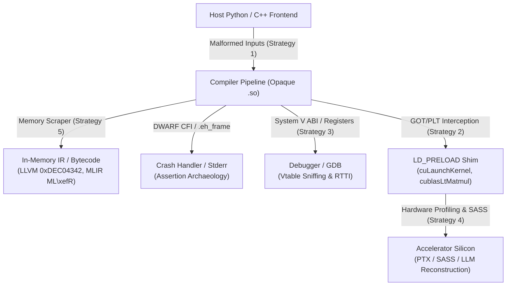

You hit a four-fold performance drop in a production LLM pipeline. The profiler points straight at a closed-source binary blob: `libtpu.so`, a proprietary MLIR accelerator plugin, or a closed routine in cuBLASLt. You file a support ticket with the hardware vendor. Their portal demands a minimal standalone reproducer. But your computation graph uses proprietary model weights, your company's legal team refuses to share the code, and the vendor's engineering turnaround takes six months.

You have no source code. You have a stripped `.so` file, a core dump, and an SLA to hit.

The standard response is to treat the compiler as an inscrutable black box and resort to superstitious trial-and-error—tweaking batch sizes, inserting dummy operations, or padding tensor shapes in the dark. I hate guessing at compiler heuristics. Superstition has no place in systems engineering.

Compilers cannot hide their true behavior. A compiler is a deterministic state machine that must allocate host memory, emit hardware-specific instructions, conform to operating system calling conventions, and enforce thousands of internal invariant assertions. Even when a vendor strips `.symtab`, disables debug logging, and packs its backend into a monolithic shared library, the binary remains physically bound to the machine it runs on.

When an opaque compiler refuses to tell you how it works, you break it on purpose. You feed it malformed inputs to trigger its internal assertions, intercept its dynamic symbols, sniff its vtables in a debugger, extract its in-memory IR bytecodes, and disassemble its hardware kernels.



## Strategy 1: Deliberate Malformations and Assertion Archaeology

Compilers are assert-driven software. A modern optimizing compiler like LLVM, XLA, or a proprietary device backend runs hundreds of transformation passes. Each pass relies on rigid preconditions: tensor dimensions must be non-zero, memory strides must be multiples of the vector register width, and induction variables must not overflow.

When an opaque compiler is running normally, it runs silent. It swallows its intermediate representations, runs its internal heuristics, and emits machine code. You learn nothing.

When you intentionally violate one of its invariants, that abstraction collapses.

In C and C++ compiler codebases, assertions are built with macros: standard `assert()`, Google's `CHECK()` and `DCHECK()` in Abseil, or LLVM's `llvm_unreachable()` and `report_fatal_error()`. When one of these checks fails, the macro formats a diagnostic string containing the source file name (`__FILE__`), line number (`__LINE__`), failing condition, and function signature (`__PRETTY_FUNCTION__`), writes it directly to `stderr`, and calls `abort()`.

Vendors run `strip --strip-debug` or `strip --strip-all` on their release binaries to remove the symbol table (`.symtab`) and debug information (`.debug_*`). But `strip` cannot touch string literals in `.rodata`. Those strings are program data, directly referenced by code pointers in the text segment. Every assertion message, file path, pass name, and internal type name remains embedded in the executable image.

```text
# Exposing .rodata strings from a stripped vendor ML compiler blob
$ strings -a libproprietary_compiler.so | grep -E "Pass|Assertion|Pattern" | head -n 8
/workspace/src/compiler/transforms/gemm_fusion_pass.cc:342
Assertion `operand->layout().is_strided_row_major()` failed in GemmFusionPass::RunOnBlock
/workspace/src/compiler/ir/tile_scheduler.cc:118
CHECK(tile_m % 16 == 0) failed: Tile M dimension must be aligned to 16 for Tensor Core MMA
ProprietaryTritonEmitter::EmitAsyncCopyGlobalToShared
MultiBufferingPass: pipeline depth must not exceed 4 stages
```

To weaponize this, you craft malformed computation graphs designed to probe edge cases:

1. **Non-contiguous strides:** Instead of standard contiguous tensors, feed inputs with negative strides, prime-number leading dimensions, or transposed views without a contiguous copy.
2. **Dimension boundaries:** Feed tensors with shape `[1, 0, 128]`, batch sizes that are large prime numbers, or shapes that exceed 32-bit integer limits (`2^31 - 1` elements).
3. **Illegal dtype combinations:** In modern mixed-precision pipelines, supply an FP8 E4M3 tensor to an operation that natively expects FP8 E5M2 or BF16 without inserting an explicit conversion cast.
4. **Cyclic or illegal dependencies:** In JIT runtimes that support custom fusion, construct an operation that consumes its own output across a broadcast boundary.

When the binary aborts, it produces a stack trace. On Linux, the 64-bit System V ABI requires unwind information in the `.eh_frame` and `.eh_frame_hdr` sections for C++ exception handling. This unwind table cannot be stripped without breaking language semantics.

```text
[FATAL] Assertion `tile_k % 16 == 0` failed at /build/backend/gpu/mma_emitter.cc:512
Function: proprietary::gpu::MmaEmitter::EmitWarpMma(proprietary::ir::GemmTileNode*)
Stack trace:
  #0 0x00007ff1a2b04192 in __GI_abort () from /lib/x86_64-linux-gnu/libc.so.6
  #1 0x00007ff198124b80 in proprietary::logging::LogMessageFatal::~LogMessageFatal()
  #2 0x00007ff198452c11 in proprietary::gpu::MmaEmitter::EmitWarpMma(proprietary::ir::GemmTileNode*)
  #3 0x00007ff198458920 in proprietary::gpu::passes::TmaLoweringPass::RunOnBlock(proprietary::ir::Block*)
  #4 0x00007ff198460144 in proprietary::gpu::PassManager::Run(proprietary::ir::Module*)
  #5 0x00007ff19841029a in proprietary_compile_graph_entry ()
```

From a single deliberate failure, the architecture of the opaque compiler is laid bare:
- We have the exact C++ namespaces (`proprietary::gpu::passes`).
- We know the pass ordering: `TmaLoweringPass` executes before `MmaEmitter`.
- We learn that the hardware lowering uses Tensor Memory Accelerator (TMA) and Warp-Level Matrix Multiply (MMA).
- We extract the exact architectural constraint: the inner loop tiles the $K$ dimension in multiples of 16, and our non-standard reduction dimension broke the unrolled accumulator lowering.

## Strategy 2: Dynamic Interception via GOT/PLT and Driver Shims

Proprietary ML runtimes and compilers are distributed as shared libraries (`.so` on Linux, `.dylib` on macOS). These libraries do not execute in a vacuum. To interact with host memory, launch kernels, or invoke math routines, they must link against shared system libraries.

This linkage creates a clean interception boundary.

In the ELF format, position-independent code resolves external function calls through two tables: the Procedure Linkage Table (PLT) and the Global Offset Table (GOT). By default, dynamic symbols use lazy binding: the PLT stub calls into the runtime dynamic linker (`ld-linux.so`), which resolves the symbol address, writes it into the GOT, and jumps to the target code. Subsequent calls jump directly through the GOT.

By setting the `LD_PRELOAD` environment variable, we force the dynamic linker to bind our custom symbols ahead of any standard libraries.

Instead of writing a generic shim for `malloc` or `free`, we target domain-specific runtime interfaces. If the opaque compiler invokes Nvidia's cuBLAS or cuBLASLt for GEMMs, we can intercept `cublasLtMatmul`[^1]. If it generates and launches custom GPU kernels, it must ultimately call the CUDA Driver API: `cuLaunchKernel` or `cuLaunchKernelEx`[^2].

Even when a vendor statically links the high-level CUDA Runtime library (`libcudart_static.a`) into their proprietary `.so`, they cannot statically link the CUDA Driver (`libcuda.so.1`). The driver talks directly to the kernel-mode driver (`/dev/nvidiactl` and `/dev/nvidia*`). Every kernel launch, without exception, must pass through `cuLaunchKernel`.

Here is an interception shim that hooks `cuLaunchKernel`, unpacks its launch bounds, inspects the parameter buffer, and checks pointer alignment:

```c
// shim_cuda_launch.c
// Compile: gcc -O3 -shared -fPIC -o shim_cuda_launch.so shim_cuda_launch.c -ldl

#define _GNU_SOURCE
#include <stdio.h>
#include <dlfcn.h>
#include <stdint.h>
#include <cuda.h>

// 1. Function pointer signature matching the CUDA Driver API.
static CUresult (*real_cuLaunchKernel)(
    CUfunction f,
    unsigned int gridDimX, unsigned int gridDimY, unsigned int gridDimZ,
    unsigned int blockDimX, unsigned int blockDimY, unsigned int blockDimZ,
    unsigned int sharedMemBytes,
    CUstream hStream,
    void **kernelParams,
    void **extra) = NULL;

CUresult cuLaunchKernel(
    CUfunction f,
    unsigned int gridDimX, unsigned int gridDimY, unsigned int gridDimZ,
    unsigned int blockDimX, unsigned int blockDimY, unsigned int blockDimZ,
    unsigned int sharedMemBytes,
    CUstream hStream,
    void **kernelParams,
    void **extra) {

    // 2. Resolve the real symbol from libcuda.so via RTLD_NEXT on first invocation.
    if (!real_cuLaunchKernel) {
        real_cuLaunchKernel = (CUresult (*)(CUfunction, unsigned int, unsigned int, unsigned int,
                                            unsigned int, unsigned int, unsigned int,
                                            unsigned int, CUstream, void **, void **))
                              dlsym(RTLD_NEXT, "cuLaunchKernel");
        if (!real_cuLaunchKernel) {
            fprintf(stderr, "[SHIM ERROR] Failed to resolve real cuLaunchKernel: %s\n", dlerror());
            return CUDA_ERROR_UNKNOWN;
        }
    }

    // 3. Log execution parameters.
    fprintf(stderr, "\n[INTERCEPT] cuLaunchKernel: Grid=(%u,%u,%u) Block=(%u,%u,%u) SharedMem=%u bytes\n",
            gridDimX, gridDimY, gridDimZ, blockDimX, blockDimY, blockDimZ, sharedMemBytes);

    // 4. Inspect kernel arguments if passed via the standard kernelParams array.
    if (kernelParams) {
        fprintf(stderr, "  Parameters:\n");
        for (int i = 0; i < 6; ++i) {
            void *param_ptr = kernelParams[i];
            if (!param_ptr) break;

            uintptr_t val = *(uintptr_t *)param_ptr;
            // 5. Check if the parameter is a device memory address (typically 47-bit on Linux x86-64).
            if (val > 0x1000000000ULL) {
                // Check pointer alignment: 16 bytes for float4/LDG.128, 128 bytes for L2 cache lines.
                unsigned int align = (val & 0x7f) == 0 ? 128 : ((val & 0xf) == 0 ? 16 : 1);
                fprintf(stderr, "    Arg[%d]: Device Ptr 0x%lx (Alignment: %u bytes)\n", i, val, align);
            } else {
                fprintf(stderr, "    Arg[%d]: Scalar / Offset 0x%lx (%lu)\n", i, val, val);
            }
        }
    }

    // 6. Forward execution to the hardware driver.
    return real_cuLaunchKernel(f, gridDimX, gridDimY, gridDimZ,
                              blockDimX, blockDimY, blockDimZ,
                              sharedMemBytes, hStream, kernelParams, extra);
}
```

Run your workload with the shim injected:

```bash
$ LD_PRELOAD=./shim_cuda_launch.so python run_inference.py
```

The output immediately exposes the lowering decisions of the black box:
- **Grid and Block Dimensions:** A grid of `(64, 1, 1)` with a block of `(128, 1, 1)` means the compiler mapped each tile to a single warp group (4 warps = 128 threads) across 64 Streaming Multiprocessors.
- **Dynamic Shared Memory:** Allocating exactly `98304` bytes (96 KB) reveals that the compiler is targeting a multi-stage pipeline designed to fit within the L1/shared memory boundary of an NVIDIA Ampere or Ada Lovelace SM (typically 100 KB or 128 KB configured capacity).
- **Device Pointer Alignment:** Every pointer argument has a 128-byte alignment, confirming that the compiler relies on vector load instructions (`LDG.E.128`) and expects data buffers to be aligned to hardware cache sector boundaries.

### The Dynamic Linking Pitfall: `RTLD_LOCAL` and `dlopen` Shims

Some opaque frameworks guard against `LD_PRELOAD` by opening their backends at runtime using `dlopen("backend.so", RTLD_NOW | RTLD_LOCAL)`.

Symbols loaded with `RTLD_LOCAL` are not added to the global symbol search list, meaning their internal cross-calls do not resolve against your preloaded library.

To defeat this, preload `dlopen` itself:

```c
void *dlopen(const char *filename, int flags) {
    static void *(*real_dlopen)(const char *, int) = NULL;
    if (!real_dlopen) real_dlopen = dlsym(RTLD_NEXT, "dlopen");

    // Force all dynamically loaded libraries into the global symbol table
    int forced_flags = (flags & ~RTLD_LOCAL) | RTLD_GLOBAL;
    fprintf(stderr, "[SHIM] Intercepted dlopen(%s), forcing RTLD_GLOBAL\n", filename ? filename : "self");
    return real_dlopen(filename, forced_flags);
}
```

By flipping `RTLD_LOCAL` to `RTLD_GLOBAL`, every dynamically loaded library is pulled into the global scope where your shims can intercept its PLT stubs.

## Strategy 3: ABI Archaeology, Vtable Sniffing, and Hardware PMUs

When an opaque compiler calls internal functions across module boundaries, arguments are passed in physical hardware registers according to the Application Binary Interface (ABI).

On x86-64 Linux, the System V AMD64 ABI[^3] dictates:
- First six integer or pointer arguments are passed in `%rdi`, `%rsi`, `%rdx`, `%rcx`, `%r8`, `%r9`.
- Floating-point arguments are passed in `%xmm0` through `%xmm7`.
- For C++ non-static member functions, `%rdi` holds the implicit `this` pointer.

If you set a breakpoint at an unstripped entry point in GDB (or attach to a JIT process during execution), inspecting `%rdi` gives you direct access to the compiler's internal object model.

### Vtable Sniffing under the Itanium C++ ABI

Almost all C++ compilers on Linux follow the Itanium C++ ABI[^4]. According to the specification, any polymorphic C++ class (a class with at least one virtual function) begins with an 8-byte pointer to its virtual method table (`vptr`):

```text
Object in Memory:
[ %rdi + 0x00 ] -> points to vtable entry 0 (first virtual method)
[ %rdi - 0x08 ] -> points to std::type_info for the class (RTTI)
[ %rdi - 0x10 ] -> offset-to-top (distance from this pointer to start of most-derived object)
```

At index `-1` (8 bytes before the first virtual function address), the vtable stores a pointer to the class's `std::type_info` structure. Under the Itanium ABI, the `std::type_info` structure contains a pointer to an internal null-terminated byte string holding the mangled type name at offset `+0x08`:

```c
// std::type_info internal layout (Itanium ABI)
struct type_info {
    void *vptr;              // Virtual table for std::type_info
    const char *__type_name; // Mangled type name (e.g., "N14xla_compiler14TritonFusionOpE")
};
```

This layout allows us to write a GDB Python script that sniffs any opaque object in `%rdi`, traverses its vtable backwards, extracts the mangled RTTI string, and demangles it using `c++filt`:

```python
# vtable_sniffer.py
# Usage in GDB: source vtable_sniffer.py; sniff $rdi

import gdb
import subprocess

class SniffObjectCommand(gdb.Command):
    """Sniff the true C++ runtime type of an object pointer in memory."""
    def __init__(self):
        super(SniffObjectCommand, self).__init__("sniff", gdb.COMMAND_USER)

    def invoke(self, arg, from_tty):
        # 1. Evaluate the pointer expression (e.g., $rdi)
        ptr = gdb.parse_and_eval(arg)
        ptr_val = int(ptr)
        if ptr_val == 0:
            print("[SNIFF] Null pointer.")
            return

        try:
            # 2. Dereference the object to get the vtable pointer (first 8 bytes)
            vptr = int(gdb.parse_and_eval(f"*(unsigned long*){ptr_val}"))

            # 3. Read the type_info pointer at vptr - 8 bytes
            typeinfo_ptr = int(gdb.parse_and_eval(f"*(unsigned long*)({vptr} - 8)"))

            # 4. Read the mangled name string pointer at typeinfo_ptr + 8 bytes
            mangled_name_ptr = int(gdb.parse_and_eval(f"*(unsigned long*)({typeinfo_ptr} + 8)"))

            # 5. Read the null-terminated string from target process memory
            mangled_name = gdb.selected_inferior().read_memory(mangled_name_ptr, 128).tobytes().split(b'\x00')[0].decode('utf-8')

            # 6. Demangle the symbol using c++filt
            demangled = subprocess.check_output(["c++filt", "-t", mangled_name]).decode('utf-8').strip()
            print(f"[SNIFF] Object at {hex(ptr_val)} has true type: {demangled} (mangled: {mangled_name})")
        except Exception as e:
            print(f"[SNIFF ERROR] Failed to traverse vtable: {e}")

SniffObjectCommand()
```

When you hit a breakpoint inside an opaque pass:

```text
(gdb) sniff $rdi
[SNIFF] Object at 0x7fffdb108a40 has true type: xla::gpu::TritonFusionAnalysis (mangled: _ZN3xla3gpu20TritonFusionAnalysisE)
```

Without seeing a single line of vendor source code, you have recovered the exact polymorphic class hierarchy, allowing you to deduce the data structure that represents the optimization state.

### Hardware Performance Counters and SASS Archaeology

Host-side debugging tells you how the compiler organizes its data. To see how it schedules code for execution on physical hardware, we use vendor hardware performance counters via NVIDIA Nsight Compute (`ncu`) or AMD Omnitrace.

When a compiler targets modern hardware like an NVIDIA Hopper (H100) or Ada Lovelace GPU, it faces three critical physical constraints:
1. **Register Pressure vs. Occupancy:** An SM has 64K 32-bit registers. If the compiler allocates 255 registers per thread, it can schedule at most 256 threads (2 warps) per SM, slashing theoretical occupancy to 12.5%. If it drops to 64 registers, occupancy can hit 50%.
2. **Shared Memory Bank Conflicts:** Shared memory has 32 banks, each 4 bytes wide. If 32 threads in a warp access the same bank at different addresses, the transaction serializes 32-way, turning a 1-cycle access into a 32-cycle pipeline stall.
3. **Warp Scheduler Stalls:** Is the kernel memory-bound (waiting on long-scoreboard loads from HBM/DRAM) or latency-bound (waiting on short-scoreboard arithmetic dependencies)?

Profile the generated kernel:

```bash
$ ncu --metrics smsp__pipe_shared_cycles_active.avg.pct_of_peak_sustained_elapsed,\
l1tex__data_bank_conflicts_pipe_lsu_mem_shared_op_ld.sum,\
smsp__warp_issue_stalled_wait_pct \
python run_inference.py
```

If `l1tex__data_bank_conflicts` drops to zero on a non-transposed matrix multiplication, the compiler implemented either:
- **Shared memory padding:** Padding the leading dimension of the tile allocation by 1 or 2 elements (e.g., `__shared__ half tile[16][16 + 1]`).
- **XOR swizzling:** Applying a bitwise XOR between the row index and column bits when computing the shared memory offset (`offset = row ^ (col >> 3)`).

By looking at hardware counters, you reverse the compiler's heuristics directly from physical execution invariants.

## Strategy 4: Disassembly, ISA Semantics, and LLM Reconstruction

When dynamic analysis is impractical, static disassembly is the alternative. But reading raw x86-64 assembly from a stripped compiler binary is grueling. Decades of legacy x86 cruft, register renaming, and compiler scheduling obfuscate high-level program intent.

Accelerator ISAs are different.

Unlike general-purpose CPUs, accelerator ISAs—like NVIDIA PTX (Parallel Thread Execution)[^5], NVIDIA SASS (Streaming Assembler), and AMD CDNA/RDNA assembly—are designed specifically for linear algebra and structured tensor memory operations. Their instructions operate directly on matrix tiles, warp groups, barrier synchronizations, and asynchronous copy pipelines. Because these instructions are semantically rich, reconstructing them into high-level source code is remarkably straightforward.

### Extracting Device Binaries

NVIDIA device binaries are embedded inside host `.so` files within ELF sections named `.nv_fatbin` or `.nvFatBin*`.

Extract them with NVIDIA's binary utilities:

```bash
# Dump the high-level PTX intermediate representation (if preserved)
$ cuobjdump --dump-ptx libopaque_backend.so > kernels.ptx

# Disassemble the native machine instructions (SASS) from the compiled cubin
$ nvdisasm -g -c libopaque_backend.so > kernels.sass
```

Consider this disassembled PTX snippet extracted from an opaque matrix multiplication kernel:

```assembly
// Extracted from an opaque kernel targeting SM80+ (Ampere/Hopper)
.visible .entry gemm_kernel_m16n16k16(
    .param .u64 A_ptr,
    .param .u64 B_ptr,
    .param .u64 C_ptr,
    .param .u64 D_ptr
) {
    .reg .b64   %rd<5>;
    .reg .b32   %r<5>;
    .reg .f32   %f<5>;

    ld.param.u64    %rd1, [A_ptr];
    ld.param.u64    %rd2, [B_ptr];
    ld.param.u64    %rd3, [C_ptr];
    ld.param.u64    %rd4, [D_ptr];

    // 1. Asynchronous copy from global memory to shared memory bypassing registers
    cp.async.ca.shared.global [%r1], [%rd1], 16;
    cp.async.commit_group;
    cp.async.wait_group 0;
    bar.sync 0;

    // 2. Warp-Level Matrix Multiply-Accumulate (WMMA)
    wmma.load.a.sync.aligned.m16n16k16.f16.col  %r1, [%rd1];
    wmma.load.b.sync.aligned.m16n16k16.f16.row  %r2, [%rd2];
    wmma.load.c.sync.aligned.m16n16k16.f32.row  %r3, [%rd3];
    wmma.mma.sync.aligned.m16n16k16.al.f32.f16.f16.f32 %r4, %r1, %r2, %r3;
    wmma.store.d.sync.aligned.m16n16k16.f32.row [%rd4], %r4;

    ret;
}
```

Notice what is happening in this assembly:
1. `cp.async.ca.shared.global`: The kernel uses asynchronous copy instructions to stream 16-byte chunks directly from HBM into shared memory without burning register file bandwidth.
2. `wmma.load.*.m16n16k16`: The warp synchronizes to load $16 \times 16 \times 16$ tile fragments. Matrix A is column-major (`.col`), Matrix B is row-major (`.row`), and the inputs are FP16 (`.f16`).
3. `wmma.mma.sync.*`: The warp-level tensor core instruction computes $D = A \times B + C$, accumulating into 32-bit floats (`.f32`).

### LLM Reconstruction Workflow

Because accelerator instructions enforce strict algebraic contracts, large language models can decompile them with near-perfect fidelity.

Feed the raw assembly to an LLM with the launch parameters obtained in Strategy 2:

> **System Prompt:** You are a senior systems and GPU compiler engineer. Decompile the following PTX snippet into equivalent, idiomatic CUDA C++ using WMMA primitives. Maintain all memory layouts, tile dimensions, and synchronization boundaries.

The LLM reconstructs the clean CUDA source:

```cpp
#include <mma.h>
#include <cuda_fp16.h>

using namespace nvcuda;

__global__ void gemm_kernel_m16n16k16(
    const half *__restrict__ A,
    const half *__restrict__ B,
    const float *__restrict__ C,
    float *__restrict__ D) {

    // 1. Declare WMMA fragments matching the m16n16k16 shape and datatypes
    wmma::fragment<wmma::matrix_a, 16, 16, 16, half, wmma::col_major> frag_a;
    wmma::fragment<wmma::matrix_b, 16, 16, 16, half, wmma::row_major> frag_b;
    wmma::fragment<wmma::accumulator, 16, 16, 16, float> frag_c;
    wmma::fragment<wmma::accumulator, 16, 16, 16, float> frag_d;

    // 2. Load operands from memory into fragment registers
    wmma::load_matrix_sync(frag_a, A, 16);
    wmma::load_matrix_sync(frag_b, B, 16);
    wmma::load_matrix_sync(frag_c, C, 16, wmma::mem_row_major);

    // 3. Perform the warp-synchronous matrix multiply-accumulate
    wmma::mma_sync(frag_d, frag_a, frag_b, frag_c);

    // 4. Store the resulting accumulator tile back to global memory
    wmma::store_matrix_sync(D, frag_d, 16, wmma::mem_row_major);
}
```

The loop is closed: we took a stripped binary, intercepted its launch parameters via `cuLaunchKernel`, extracted the SASS/PTX, and reconstructed human-readable CUDA C++ that can be modified, optimized, and recompiled without the vendor's proprietary library.

## Strategy 5: Dormant Registries and In-Memory Bytecode Sniffing

Every compiler team leaves debug backdoors in production binaries. Building a complex compiler without intermediate print statements, pass dumps, and verification flags is impossible.

When vendors ship production binaries, they often strip CLI flags from their public documentation or disable user-facing `--verbose` arguments. But ripping out the actual internal debug printing infrastructure is risky—it creates conditional compilation divergence between debug and release builds. Consequently, the diagnostic flags are usually left compiled into the binary, waiting to be turned on.

### The Global Option Registry in LLVM and MLIR

Most modern compilers—including XLA, PyTorch Inductor backends, Triton, and proprietary vendor runtimes—are built on LLVM or MLIR.

LLVM uses the `llvm::cl::opt` mechanism for command-line option registration[^6]. When an LLVM file defines a flag:

```cpp
static llvm::cl::opt<bool> PrintAfterAll(
    "print-after-all",
    llvm::cl::desc("Print IR after each pass"),
    llvm::cl::init(false));
```

This constructor registers the flag into a global static map (`llvm::cl::TopLevelSubCommand->OptionsMap`) at library load time.

Even if the vendor's top-level CLI strips `--print-after-all`, the flag registration still exists in memory. If the framework initializes LLVM using `llvm::cl::ParseCommandLineOptions`, it often reads the standard `LLVM_OPTIONS` environment variable.

Beyond generic LLVM options, frameworks expose their own environment variable escape hatches:
- **XLA:** `XLA_FLAGS="--xla_dump_to=/tmp/xla_dump --xla_dump_hlo_as_text"`
- **Triton:** `TRITON_PRINT_IR=1`
- **PyTorch Inductor:** `TORCH_COMPILE_DEBUG=1`

Patrick Toulmé used these exact dormant XLA flags to dump undocumented TPU VLIW machine instructions directly from JAX[^7]. By passing undocumented backend flags, the closed runtime happily wrote thousands of lines of low-level instruction bundles to `/tmp/`, exposing hardware capabilities that the vendor had never publicly documented.

### Scraping Bytecode from Process Memory

What if the vendor explicitly compiled out all text-dumping logic?

They still cannot avoid constructing the Intermediate Representation (IR) in memory. A compiler cannot optimize a computation graph without holding the graph in memory. In modern architectures, that IR is represented as binary bytecode: LLVM Bitcode or MLIR Bytecode[^8].

These bytecodes begin with well-known magic numbers:
- **LLVM Bitcode:** Begins with the 4-byte ASCII signature `BC\xc0\xde` (little-endian unsigned 32-bit integer `0xDEC04342`).
- **MLIR Bytecode:** Begins with the 4-byte signature `ML\xefR` (`0x4D 0x4C 0xEF 0x52`).

If you attach a debugger to the compiler process while it is running an optimization pass, or scan the process's anonymous memory pages (`/proc/<pid>/mem`), you can search for these magic signatures:

```python
# dump_in_memory_ir.py
# Scans an active compiler process memory space for LLVM bitcode or MLIR bytecode payloads.

import re
import sys

LLVM_BC_MAGIC = b"\xde\xc0\x43\x42"  # 0xDEC04342
MLIR_BC_MAGIC = b"\x4d\x4c\xef\x52"  # ML\xefR

def scan_process_memory(pid):
    maps_path = f"/proc/{pid}/maps"
    mem_path = f"/proc/{pid}/mem"

    # 1. Parse readable memory regions from /proc/<pid>/maps
    regions = []
    with open(maps_path, 'r') as f:
        for line in f:
            parts = line.strip().split()
            addr_range, perms = parts[0], parts[1]
            if 'r' in perms and ('heap' in line or 'anon' in line or len(parts) == 5):
                start, end = [int(x, 16) for x in addr_range.split('-')]
                regions.append((start, end))

    print(f"[*] Scanning {len(regions)} memory regions in PID {pid}...")

    # 2. Open /proc/<pid>/mem to search for bytecode signatures
    with open(mem_path, 'rb', 0) as mem:
        for start, end in regions:
            try:
                mem.seek(start)
                chunk = mem.read(end - start)
            except (IOError, OSError):
                continue

            # Check for LLVM bitcode
            for match in re.finditer(re.escape(LLVM_BC_MAGIC), chunk):
                offset = match.start()
                payload_addr = start + offset
                print(f"[+] Found LLVM Bitcode magic at virtual address {hex(payload_addr)}")

                # Dump 64KB following the magic header
                data = chunk[offset:offset + 65536]
                filename = f"dump_{pid}_llvm_{hex(payload_addr)}.bc"
                with open(filename, "wb") as out:
                    out.write(data)
                print(f"    Dumped bitcode to {filename}")

            # Check for MLIR bytecode
            for match in re.finditer(re.escape(MLIR_BC_MAGIC), chunk):
                offset = match.start()
                payload_addr = start + offset
                print(f"[+] Found MLIR Bytecode magic at virtual address {hex(payload_addr)}")

                data = chunk[offset:offset + 65536]
                filename = f"dump_{pid}_mlir_{hex(payload_addr)}.mlirbc"
                with open(filename, "wb") as out:
                    out.write(data)
                print(f"    Dumped MLIR bytecode to {filename}")

if __name__ == "__main__":
    if len(sys.argv) != 2:
        print("Usage: python dump_in_memory_ir.py <PID>")
        sys.exit(1)
    scan_process_memory(int(sys.argv[1]))
```

Once you dump the memory buffer to disk, you run standard open-source tools:

```bash
# Disassemble the dumped LLVM bitcode into human-readable LLVM IR
$ llvm-dis dump_1234_llvm_0x7fffdb108000.bc -o dump.ll

# Or translate the dumped MLIR bytecode into high-level text format
$ mlir-translate --mlir-to-text dump_1234_mlir_0x7fffdb205000.mlirbc -o dump.mlir
```

The proprietary optimization pipeline vanishes. You are no longer dealing with a stripped binary; you have the complete, annotated Single Static Assignment (SSA) form of the program, complete with loop bounds, memory access indices, vector widths, and custom compiler attributes.

## The Systems Takeaway

Vendors distribute closed-source compilers and proprietary backend blobs to protect intellectual property and lock developers into specific hardware ecosystems.

That opacity is an illusion.

A compiler cannot execute without anchoring itself to physical reality. It must conform to host calling conventions. It must link against shared operating system libraries. It must structure its memory to avoid hardware stalls. And it must emit machine instructions that obey the physical constraints of silicon registers and memory buses.

When an opaque compiler misbehaves:
1. Don't guess. Force internal assertions by supplying deliberately malformed bounds and strides.
2. Intercept its dynamic calls to `cuLaunchKernel` or `cublasLtMatmul` using `LD_PRELOAD` to capture exact execution shapes and memory alignments.
3. Sniff polymorphic class hierarchies through Itanium ABI vtables and correlate them with hardware performance counters.
4. Extract stripped accelerator binaries and use the semantic density of matrix instructions to decompile them with an LLM.
5. Search process memory for LLVM (`0xDEC04342`) or MLIR (`ML\xefR`) bytecode signatures to recover the raw intermediate representation.

Treat opaque compilers not as black boxes, but as distributed systems waiting to be instrumented.

## References

[^1]: **NVIDIA cuBLASLt Library Documentation:** High-level APIs for flexible GEMM executions, epilogues, and matrix descriptors. ([Link](https://docs.nvidia.com/cuda/cublas/index.html#cublaslt-matmul))
[^2]: **CUDA Driver API Reference - Kernel Execution:** `cuLaunchKernel` and execution parameter specifications. ([Link](https://docs.nvidia.com/cuda/cuda-driver-api/group__CUDA__EXEC.html))
[^3]: **System V Application Binary Interface AMD64 Architecture Processor Supplement:** Defines standard register usage, calling conventions, and stack layout for x86-64 UNIX systems. ([Link](https://gitlab.com/x86-psabis/x86-64-ABI))
[^4]: **Itanium C++ ABI Specification:** The industry-standard specification for virtual table layouts, RTTI structures, and exception unwinding on Linux x86-64. ([Link](https://itanium-cxx-abi.github.io/cxx-abi/abi.html))
[^5]: **NVIDIA PTX ISA Reference Manual:** Documentation on Warp-Level Matrix Multiply-Accumulate (WMMA/MMA) instructions and asynchronous copy primitives. ([Link](https://docs.nvidia.com/cuda/parallel-thread-execution/index.html))
[^6]: **LLVM CommandLine 2.0 Reference Manual:** Implementation details of `llvm::cl::opt` and global option registration. ([Link](https://llvm.org/docs/CommandLine.html))
[^7]: **Patrick Toulmé, "From JAX to VLIW: Tracing a Computation":** Using undocumented XLA flags to extract TPU machine instructions and VLIW execution bundles. ([Link](https://patricktoulme.substack.com/p/from-jax-to-vliw-tracing-a-computation))
[^8]: **MLIR Bytecode Format Specification:** Binary encoding format and magic signature definitions for MLIR bytecode. ([Link](https://mlir.llvm.org/docs/BytecodeFormat/))

---

*Disclaimer: Researched and drafted with AI assistance (Gemini 3.1 Pro, Gemini 3.8 Flash). Direction, technical judgment, and final edits are mine; every claim is traceable to the sources cited above.*
