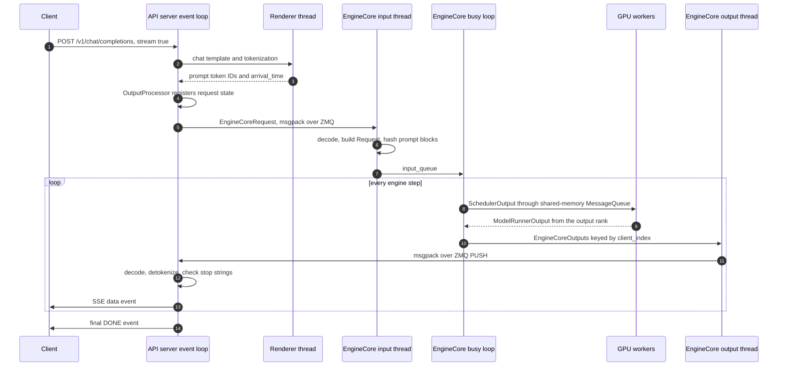

*Part 2 of a ten-part series on serving engines from the inside. Pinned to vLLM 0.32.0 ([`5df63a7`](https://github.com/vllm-project/vllm/tree/5df63a7203cdb9328d824a27b682e77c7b9928be)). [Part 1]() named the five layers and where vLLM and SGLang cut them into processes. This part follows one streamed chat request through vLLM's cut.*

vLLM V1 keeps its busy loop away from HTTP. API server processes own the request from the socket to the last SSE event, and they do the tokenizing. One engine-core process per data-parallel rank runs the scheduler and owns the KV ledger. One worker process per GPU runs the model. The consequence is easy to miss: every per-token cost that isn't the forward pass is paid in the API server, on a single asyncio event loop per process. That covers msgpack decoding, detokenization, stop-string checks, JSON encoding and the socket write. And nothing in the path pushes back on the engine when that loop falls behind. Against a mock engine, one Python API server ran out of CPU at about 37,000 streamed tokens per second. Past that point the engine's batch stopped growing, and the cost landed in time to first token, a number most people read as an engine problem.

## The process tree, four ways

Before tracing a request, count the processes it can cross. vLLM's architecture overview gives a formula: `A + DP + N` processes, plus one when DP > 1, where A is the API server count, DP the data-parallel size and N the GPU count.[^arch] The code at the pinned commit disagrees with it in two places, and Part 1 covered a third.

| Launch flags | Processes vLLM starts | Docs formula | Process titles |
|---|---|---|---|
| `-tp 1` | 2 | 3 | `vllm serve` (API server), `VLLM::EngineCore` (worker inside) |
| `-tp 2` | 4 | 4 | `vllm serve`, `VLLM::EngineCore`, `VLLM::Worker_TP0`, `VLLM::Worker_TP1` |
| `-tp 1 -dp 2` | 8 | 7 | `vllm serve` (supervisor), `VLLM::APIServer_0` and `_1`, `VLLM::DPCoordinator`, `VLLM::EngineCore_DP0` and `_DP1`, `VLLM::Worker_DP0` and `_DP1` |
| `-tp 2 -dp 2` | 10 | 9 | supervisor, two API servers, coordinator, two engine cores, `VLLM::Worker_DP0_TP0` through `VLLM::Worker_DP1_TP1` |

The titles come from `set_process_title`, which prefixes `VLLM::` and appends the parallel ranks that are larger than one.[^titles] The counts are what the launch code creates. A `ps` listing can also show helper processes that libraries start on their own, so match processes by these titles rather than by count.

The first disagreement is the `-tp 1` row, which Part 1 traced to the `uni` executor running the worker inside the engine core. The second is new: `-dp 2` takes that arrangement away even at TP=1. `ParallelConfig` picks the `mp` backend whenever `world_size_across_dp > 1`, and that check runs before the `world_size == 1` check that would pick `uni`.[^backend] So the in-process worker exists only when the whole deployment has one GPU.

The third is the supervisor. With internal load balancing, `--api-server-count` defaults to the data-parallel size, so `-dp 2` means two API servers.[^serve-default] Any count above one sends `vllm serve` down `run_multi_api_server`. That process binds the HTTP socket and every API server's ZMQ listeners, launches the engine cores and the DP coordinator, and spawns the API servers with the `spawn` start method. Then it waits. It serves no HTTP itself, and the docs formula leaves it out.[^multi] The coordinator appears whenever DP > 1, unless an external load balancer fronts a dense model.[^coord]

## One streamed chat request

Take the simplest real case: `vllm serve` at TP=2 with one API server, and a client that posts `/v1/chat/completions` with `"stream": true`. The request crosses the API server's event loop, a renderer thread, three threads in the engine core and the GPU workers.



**Into the API server.** uvicorn runs on `uvloop`, and the chat route lands in `OpenAIServingChat.create_chat_completion`. Rendering comes first. `render_chat_async` stamps `arrival_time`, then runs the chat template and the tokenizer on the renderer's thread pool so they don't block the event loop.[^render] That pool has one worker by default (`--renderer-num-workers`), so every request's template and tokenization in one API server goes through a single thread.[^renderer-workers] The thread keeps that work off the event loop's call stack. It does not take it off the GIL, because a Jinja chat template is Python.

**Across to the engine.** `AsyncLLM.generate` calls `add_request` to build the `EngineCoreRequest` and register the request with `OutputProcessor`. That happens before `add_request` reaches its first `await`, so every other task on the loop sees the request at once. Then `add_request_async` encodes the request with msgspec and calls `send_multipart` on the client's ZMQ socket, with the engine's identity as the first frame.[^add] The API server's job for this request is now to wait.

**Inside the engine core.** Part 1 described the two I/O threads. The input thread does more than decode. It calls `preprocess_add_request`, which turns the wire struct into the scheduler's `Request` and computes the prompt's block hashes for prefix caching. The docstring says why: so "request initialization [runs] in parallel with Model forward".[^input] Aborts take a fast path. The input thread puts each abort on both the ordinary input queue and a separate `aborts_queue`, and the busy loop drains `aborts_queue` right after each forward pass, before it processes that pass's output.[^aborts] With async scheduling, which is on unless the configuration rules it out, the busy loop runs `step_with_batch_queue` and keeps up to two batches in flight.[^batchq] Part 3 takes that loop apart.

**Down to the GPUs and back.** `MultiprocExecutor.execute_model` enqueues the step on the shared-memory `MessageQueue`. Each worker's `worker_busy_loop` dequeues it and runs it, and only the output rank answers: TP rank 0 of the last pipeline stage.[^exec] `update_from_output` then returns a dict of `EngineCoreOutputs` keyed by `client_index`. That key is the API server the request came from. The output thread encodes each entry into a reused buffer and sends it on that client's PUSH socket.[^output-thread]

**Back out through the API server.** This half is where the per-token work lives. A task named `EngineCoreOutputQueueTask` reads the PULL socket, decodes the frames and puts the batch on `outputs_queue`. A second task, the output handler, takes batches off that queue and turns engine outputs into `RequestOutput`s:[^handler]

```python
# Condensed from AsyncLLM._run_output_handler, vllm/v1/engine/async_llm.py @ 5df63a7.
# Runs as one asyncio task on the API server's event loop.
async def output_handler():
    while True:
        # 1. One EngineCoreOutputs per engine step, already msgpack-decoded by
        #    the socket task. outputs_queue is an unbounded asyncio.Queue.
        outputs = await engine_core.get_output_async()

        # 2. Process at most 128 requests' outputs at a time
        #    (VLLM_V1_OUTPUT_PROC_CHUNK_SIZE). Each one gets an incremental
        #    detokenizer step and a stop-string check, and its RequestOutput is
        #    put into that request's collector.
        for start in range(0, len(outputs.outputs), chunk_size):
            processed = output_processor.process_outputs(
                outputs.outputs[start:start + chunk_size], outputs.timestamp, ...
            )

            # 3. Yield the event loop between chunks so HTTP handlers and the
            #    socket task get a turn during a large batch.
            if start + chunk_size < len(outputs.outputs):
                await asyncio.sleep(0)

            # 4. A stop string matched in text. Only now does the engine hear
            #    about it, through an ABORT on the input socket.
            if processed.reqs_to_abort:
                await engine_core.abort_requests_async(processed.reqs_to_abort)

        # 5. Prometheus bookkeeping runs on the same loop, once per engine step.
        logger_manager.record(...)
```

Each request's `generate()` coroutine waits on its collector and yields the `RequestOutput` to `chat_completion_stream_generator`. That generator builds a `ChatCompletionStreamResponse`, calls `model_dump_json`, and yields `data: {...}\n\n` for uvicorn to write. After the last token comes `data: [DONE]`.[^sse]

Count what ran on the event loop for one token of one request: a share of a msgpack decode, a detokenizer step, a stop-string scan, a Pydantic object, a JSON dump and a socket write. None of that depends on the model. All of it scales with output tokens per second across every stream the process holds.

## Nothing pushes back

Follow a token batch out of the engine and look for the place where a slow API server could make the engine wait. There isn't one.

- **The ZMQ sockets.** `make_zmq_socket` sets `SNDHWM` and `RCVHWM` to 0, which means no high-water mark. A PUSH socket never blocks its sender, so the engine's output thread never stalls on a slow reader.[^hwm]
- **`outputs_queue`.** An unbounded `asyncio.Queue`. The socket task can decode faster than the output handler processes, and the backlog grows in the API server's memory.[^outq]
- **The per-request collector.** `RequestOutputCollector` holds one output. When a new one arrives before `generate()` has taken the last one, it merges the two instead of queueing:[^collector]

```python
# Condensed from RequestOutputCollector.put, vllm/v1/engine/output_processor.py @ 5df63a7.
def put(self, output):
    if self.output is None:
        # 1. The consumer is keeping up: park this output and wake generate().
        self.output = output
        self.ready.set()
    else:
        # 2. The consumer is behind: fold the new token delta into the one
        #    still waiting. Streaming clients get fewer, larger chunks, never
        #    a longer queue.
        self.output.add(output, aggregate=self.aggregate)
```

I think this is the right design for a machine where the GPU costs more than the CPU feeding it. A frontend process that falls behind should never stall a batch on the GPU. But it turns frontend saturation into a quiet failure. The engine's step rate stays the same and its own metrics look healthy. What changes is on the client side, and it takes one of two shapes. A backlog that spans several engine steps comes out as clumps of several tokens in one SSE event. A loop that is simply out of CPU keeps streaming to the requests it already has and makes new ones wait, so the engine's batch stops growing. A latency dashboard that reports time per output token will miss both.

The lag also feeds itself through stop strings. A stop string is matched in the output handler, so the ABORT leaves the API server only after every batch queued ahead of it has been processed. If `outputs_queue` is k steps deep, the engine has already decoded k more steps for a request the client is finished with. Those tokens come back over ZMQ and add to the backlog. Stop tokens don't have this problem, because the engine sees them as soon as it samples them.

There is a cheap way to see the clumping from outside. Send `"return_token_ids": true` with a streaming chat request and each SSE event carries the token IDs in that delta.[^token-ids] Without speculative decoding, the engine produces one token per request per step. So an event with more than one token ID means the collector merged outputs. Either the API server's event loop was behind the engine at that moment, or that client's connection was slow to drain and held up its own `generate()` loop. Events from many connections at once point at the loop. With speculative decoding, several tokens per step is normal, so compare against the accepted-tokens-per-step rate instead.

## Two API servers, one socket

`--api-server-count` is the knob for a frontend that can't keep up. What it actually balances is worth reading before you turn it.

The supervisor creates one listening socket, with `SO_REUSEPORT` set, and passes the same socket object to every API server it spawns.[^multi] Each server runs a `NoSignalServer`, a uvicorn subclass that replaces uvicorn's accept loop when there are several workers. Every worker publishes its number of open connections into a shared array. When the socket becomes readable, a worker that isn't the least loaded waits up to five times 1 ms for the count to change, then tries `accept()` anyway, and moves on if another worker won.[^accept]

```python
# Condensed from NoSignalServer._accept, vllm/entrypoints/launchers/launcher.py @ 5df63a7.
async def _accept(self, sock):
    while True:
        await _readable(loop, sock)
        # 1. Publish this worker's open-connection count, idle keep-alive
        #    connections included.
        self._publish_load()
        # 2. Defer to a less loaded peer for up to _ACCEPT_DEFER_CHECKS (5) ms.
        for _ in range(_ACCEPT_DEFER_CHECKS):
            if self._least_loaded():
                break
            await asyncio.sleep(0.001)
        # 3. Race for the connection. A peer may already have taken it.
        try:
            conn, _ = sock.accept()
        except (BlockingIOError, InterruptedError, ConnectionAbortedError):
            continue
        # 4. From here the connection, and every request on it, belongs to
        #    this API server.
        self._track(self._connect(loop, conn))
```

This is a trap for benchmarks and for proxies. The unit of balance is a TCP connection, decided once at accept time. Every request on a keep-alive connection goes to the API server that accepted it, however many tokens it streams. Open connections count as load even when they are idle. A load generator that reuses a small connection pool, or an L7 proxy with a few long-lived upstream connections, can leave one API server doing most of the per-token work while the other sits mostly idle. Check the per-process CPU, not the request count, before deciding that a second API server didn't help.

Each API server is also its own engine client. The supervisor gives each one its own pair of ZMQ listeners and a `client_index`. Every `EngineCoreRequest` carries that index, and the engine's output thread routes each request's tokens back to the API server holding its HTTP connection.[^multi-client] Prometheus switches to multiprocess mode so the `vllm:` metrics aggregate across servers.

With data parallelism, every API server can send to every engine core. `DPLBAsyncMPClient` picks an engine for each new request by score. For each engine, the score takes the coordinator's latest `waiting + running` count, or this client's own in-flight count to that engine multiplied by the number of clients, whichever is larger. Waiting requests add a penalty that grows from zero at 50% KV-cache usage to three times the waiting count at 100%.[^dplb] The coordinator publishes those counts no more often than once every 100 ms.[^coord-interval] Nothing in that score knows which engine already holds a request's prefix in its cache. Prefix-aware routing is the cluster layer's job, and it is why llm-d subscribes to the KV events from Part 1.

The Rust frontend changes this picture. With `VLLM_USE_RUST_FRONTEND`, `vllm serve` ignores `--api-server-count` and starts one frontend process, because, in the code's own comment, it is "multithreaded".[^serve-default] Part 1 described where that frontend sits. The per-token work is the same. The difference is that it is no longer pinned to one event loop per process.

## Where the frontend runs out

The trace above gives a prediction that a GPU isn't needed to test. The API server's cost splits into two parts:

| Paid once per request | Paid once per output token |
|---|---|
| HTTP parsing, chat template, tokenization on the renderer thread | Share of a msgpack decode on the socket task |
| `EngineCoreRequest` encode and ZMQ send | Incremental detokenizer step and stop-string scan |
| Collector, request state and `generate()` coroutine setup | `RequestOutput`, chunk object, `model_dump_json`, SSE write |

An engine's output rate grows with batch size. The per-token column doesn't shrink as the batch grows. So each API server process has an output rate in tokens per second above which its event loop can't keep up. That ceiling depends on the CPU, not the GPU. My prediction was that tokens per SSE event would rise above one at the same point.

vLLM's repository already has most of what it takes to measure the ceiling. `rust/src/mock-engine` is "a small engine-side process for frontend stress testing". It joins the frontend's startup handshake, treats prefill as instant and returns random tokens until each request reaches `max_tokens`, and its README documents running it behind the Python frontend.[^mock] As shipped, it steps as fast as it can, which no GPU does. A 19-line patch adds a fixed step clock.[^patch] At 10 ms per step, every running request gets exactly 100 tokens per second, and the engine's output rate is its batch size times 100. `vllm-bench`, the Rust load generator in the same tree, drives the frontend in a closed loop.[^bench]

```bash
# 1. Python frontend only: --data-parallel-size-local 0 starts no engine and
#    waits for one on the handshake port. No weights load, so the model
#    directory needs only Qwen3-0.6B's config and tokenizer files.
vllm serve ./Qwen3-0.6B --served-model-name qwen3 \
  --data-parallel-address 127.0.0.1 --data-parallel-rpc-port 29550 \
  --data-parallel-size 1 --data-parallel-size-local 0 \
  --api-server-count 1

# 2. From vllm/rust with the patch applied: one engine step every 10 ms.
cargo run --release -p vllm-mock-engine -- \
  --handshake-address tcp://127.0.0.1:29550 --vocab-size 32000 \
  --step-interval-us 10000

# 3. Closed loop at 512 clients, 256 prompt and 256 output tokens per
#    streamed chat request. --request-rate only spreads out the first
#    connections; the concurrency cap does the rest.
cargo run --release -p vllm-bench -- --backend openai-chat \
  --base-url http://127.0.0.1:8000 --model qwen3 --tokenizer ./Qwen3-0.6B \
  --dataset-name random --random-input-len 256 --random-output-len 256 \
  --ignore-eos --max-concurrency 512 --num-prompts 3072 --request-rate 400
```

The runs used one Apple M4 (four performance cores, six efficiency cores, 32 GB) with vLLM built for CPU from the pinned commit on Python 3.13. The frontend, the mock engine and the load generator shared the machine. Each point sends six times its concurrency in requests, and throughput is counted over the window where at least 95% of the target concurrency was in flight. The driver and the probe are published next to the patch.[^sweep]

Two properties of a laptop shaped the setup. macOS caps the listen backlog at 128 connections (`kern.ipc.somaxconn`), so a closed loop that opens a thousand connections in the same instant is refused by the kernel before any frontend sees most of them. Arrivals are spread over about two seconds instead. And CPU time on Apple silicon isn't a fixed unit of work, because the scheduler moves threads between core types and changes clocks with load. So the per-token costs below are quoted only where the API server's thread was saturated. A first pass that ran while the machine idled toward sleep put the ceiling at less than half the figure below. Hold the machine awake with `caffeinate` before you trust a laptop benchmark.

Here is one Python API server:

| Clients | Client tokens/s | Engine batch | TTFT p50 | Mean TPOT | Tokens per SSE event | API server CPU |
|---|---|---|---|---|---|---|
| 128 | 12,784 | 128 | 11 ms | 10.00 ms | 1.0 | 0.53 cores |
| 256 | 25,545 | 255 | 11 ms | 10.00 ms | 1.0 | 0.57 cores |
| 384 | 36,502 | 365 | 165 ms | 10.01 ms | 1.0 | 0.90 cores |
| 512 | 37,346 | 373 | 827 ms | 10.36 ms | 1.0 | 1.01 cores |
| 1,024 | 34,746 | 347 | 4,431 ms | 11.78 ms | 1.0 | 1.03 cores |

The engine batch is the client's token rate divided by 100. Every token the engine makes reaches the client eventually, so in steady state the two rates match. At 1,024 clients, 19% of requests failed to connect, because the saturated loop accepted too slowly and the 128-entry backlog overflowed. Two more passes over the same points landed within 2% of these throughputs.

One Python API server tops out at about 37,000 streamed tokens per second on this machine, or 27 µs of API server CPU time per token at saturation. An M4 performance core is fast per thread, so treat that as an optimistic figure for a server CPU. Below the ceiling the frontend is invisible: an 11 ms TTFT, a token every 10 ms, one token per event.

The prediction held for throughput and failed for the symptom. Tokens per event never left 1.0, and the `return_token_ids` probe running alongside the load agreed. The saturated server kept streaming to the requests it already had at almost exactly the engine's pace. New requests paid instead. TTFT went from 11 ms to 827 ms at 512 clients and 4.4 s at 1,024. The engine's batch stopped growing at about 370, however many clients were waiting.

vLLM's own TTFT histogram saw almost all of that wait. In a pass that scraped `/metrics`, its mean at 512 clients was 658 ms against the client's 678 ms. That metric runs from the `arrival_time` stamp at the top of `render_chat_async` to the moment the output handler starts on the batch carrying the first token.[^ttft-metric] So the wait happened after the request was accepted and parsed and before its first token was processed. The first place I'd look is the single renderer thread, which needs the GIL that the busy event loop holds. I haven't instrumented it further.

This is the failure I'd worry about on a GPU. The engine isn't stalled. It's starved. A batch capped at 370 by the frontend is throughput the GPU could have had, and the evidence lands in TTFT, the metric everyone reads as prefill and scheduling. The engine's waiting queue won't show it, because the waiting requests haven't reached the engine. The ceiling is a token rate, so the batch it allows scales with step time: about 370 running requests at 10 ms per step, about 1,100 at 30 ms. Small models with fast steps hit it first.

Clumps need something else: a backlog that spans several small steps. With the step clock off, the mock engine finishes requests almost as fast as it admits them. Every probe request then got its whole response as one SSE event carrying all 256 token IDs, with a median TTFT of 15 ms at 64 clients. The cause is in asyncio. `Queue.get()` returns at once when the queue has items, without yielding to the event loop.[^queue-get] The output handler yields only between 128-request chunks of one step and when the queue runs empty. So when the queued steps are small, the handler drains them back to back, and each request's collector merges them before its `generate()` gets a turn. A real engine produces the same shape whenever the API server's loop stalls for several steps while batches are small.

More frontend fixes the ceiling. Here are the three frontends at 1,024 clients:

| Frontend | Client tokens/s | Engine batch | TTFT p50 | Failed to connect | Frontend CPU |
|---|---|---|---|---|---|
| One Python API server | 34,746 | 347 | 4,431 ms | 19% | 1.03 cores |
| Two Python API servers | 62,960 | 630 | 1,308 ms | 6% | 1.91 cores |
| Rust frontend | 102,211 | 1,022 | 10 ms | 0% | 1.53 cores |

Two API servers kept up through 512 clients, at 51,000 tokens per second with an 18 ms median TTFT, and reached 63,000 at 1,024. That's 1.7 times one server's ceiling, on a machine with four performance cores that was also running the load generator and the mock engine. `vllm-bench` holds one connection per in-flight request, which is the easy case for connection-level balancing. From 32 clients up, the two servers' CPU time stayed within 1.5% of each other.

The Rust frontend never reached a ceiling. It held a 10 ms median TTFT and one token per event up to 2,048 clients and 204,000 tokens per second. It used 2.4 cores spread across its threads, while the load generator used 1.6. That's about 12 µs of CPU per token, against 27 µs for the Python server. The sweep stopped at 2,048 clients, so its ceiling on this machine is somewhere above that.

So count API servers the way you count GPUs, from a ceiling measured on your own CPU with the mock engine, and watch TTFT rather than inter-token latency for the symptom. Or move to the Rust frontend, if your flags allow it. At the pinned commit it refuses 57 `vllm serve` flags, among them `--tokenizer`, `--middleware`, `--otlp-traces-endpoint` and the external and hybrid DP load-balancing modes. It accepts and ignores nine more.[^rs-unsupported]

## References

[^arch]: **vLLM docs, "Architecture Overview," process count summary.** The `A + DP + N` formula and its worked examples. ([arch_overview.md#L103](https://github.com/vllm-project/vllm/blob/5df63a7203cdb9328d824a27b682e77c7b9928be/docs/design/arch_overview.md#L103))

[^titles]: **vLLM process titles.** `set_process_title` and its callers for API servers, engine cores and workers. ([system_utils.py#L180](https://github.com/vllm-project/vllm/blob/5df63a7203cdb9328d824a27b682e77c7b9928be/vllm/utils/system_utils.py#L180), [v1/utils.py#L524](https://github.com/vllm-project/vllm/blob/5df63a7203cdb9328d824a27b682e77c7b9928be/vllm/v1/utils.py#L524), [core.py#L1408](https://github.com/vllm-project/vllm/blob/5df63a7203cdb9328d824a27b682e77c7b9928be/vllm/v1/engine/core.py#L1408), [multiproc_executor.py#L1088](https://github.com/vllm-project/vllm/blob/5df63a7203cdb9328d824a27b682e77c7b9928be/vllm/v1/executor/multiproc_executor.py#L1088))

[^backend]: **vLLM executor backend selection, `ParallelConfig.__post_init__`.** The `mp` default when `world_size_across_dp > 1`, and the later `uni` default when `world_size == 1`. ([parallel.py#L1035](https://github.com/vllm-project/vllm/blob/5df63a7203cdb9328d824a27b682e77c7b9928be/vllm/config/parallel.py#L1035), [parallel.py#L1079](https://github.com/vllm-project/vllm/blob/5df63a7203cdb9328d824a27b682e77c7b9928be/vllm/config/parallel.py#L1079))

[^serve-default]: **vLLM `ServeSubcommand.cmd`.** The `--api-server-count` defaults per load-balancing mode, the Rust frontend override, and the dispatch to `run_server`, `run_multi_api_server` or `run_headless`. ([serve.py#L107](https://github.com/vllm-project/vllm/blob/5df63a7203cdb9328d824a27b682e77c7b9928be/vllm/entrypoints/cli/serve.py#L107))

[^multi]: **vLLM `run_multi_api_server` and `APIServerProcessManager`.** The supervisor path, the shared listening socket with `reuse_port`, and the spawned API server processes. ([serve.py#L269](https://github.com/vllm-project/vllm/blob/5df63a7203cdb9328d824a27b682e77c7b9928be/vllm/entrypoints/cli/serve.py#L269), [v1/utils.py#L167](https://github.com/vllm-project/vllm/blob/5df63a7203cdb9328d824a27b682e77c7b9928be/vllm/v1/utils.py#L167))

[^coord]: **vLLM DP coordinator launch.** `VllmConfig.needs_dp_coordinator` and the `run_coordinator` condition in `launch_core_engines`. ([vllm.py#L843](https://github.com/vllm-project/vllm/blob/5df63a7203cdb9328d824a27b682e77c7b9928be/vllm/config/vllm.py#L843), [engine/utils.py#L1227](https://github.com/vllm-project/vllm/blob/5df63a7203cdb9328d824a27b682e77c7b9928be/vllm/v1/engine/utils.py#L1227))

[^render]: **vLLM chat rendering.** `render_chat_async` stamps `arrival_time` and offloads template rendering and tokenization to the renderer's executor. ([renderers/base.py#L1327](https://github.com/vllm-project/vllm/blob/5df63a7203cdb9328d824a27b682e77c7b9928be/vllm/renderers/base.py#L1327), [renderers/base.py#L142](https://github.com/vllm-project/vllm/blob/5df63a7203cdb9328d824a27b682e77c7b9928be/vllm/renderers/base.py#L142))

[^renderer-workers]: **vLLM `ModelConfig.renderer_num_workers`.** Defaults to 1: "Number of worker threads in the renderer thread pool." ([model.py#L408](https://github.com/vllm-project/vllm/blob/5df63a7203cdb9328d824a27b682e77c7b9928be/vllm/config/model.py#L408))

[^add]: **vLLM `AsyncLLM.generate` and `_add_request`, and the client's ZMQ send.** Registration with `OutputProcessor` before the first `await`, then `send_multipart` with the engine identity frame. ([async_llm.py#L698](https://github.com/vllm-project/vllm/blob/5df63a7203cdb9328d824a27b682e77c7b9928be/vllm/v1/engine/async_llm.py#L698), [async_llm.py#L572](https://github.com/vllm-project/vllm/blob/5df63a7203cdb9328d824a27b682e77c7b9928be/vllm/v1/engine/async_llm.py#L572), [core_client.py#L1250](https://github.com/vllm-project/vllm/blob/5df63a7203cdb9328d824a27b682e77c7b9928be/vllm/v1/engine/core_client.py#L1250))

[^input]: **vLLM engine-core input thread.** `process_input_sockets` decodes each request and calls `preprocess_add_request`, which builds the `Request` with the block hasher. ([core.py#L1831](https://github.com/vllm-project/vllm/blob/5df63a7203cdb9328d824a27b682e77c7b9928be/vllm/v1/engine/core.py#L1831), [core.py#L1089](https://github.com/vllm-project/vllm/blob/5df63a7203cdb9328d824a27b682e77c7b9928be/vllm/v1/engine/core.py#L1089))

[^aborts]: **vLLM abort fast path.** "Aborts are added to *both* queues, allows us to eagerly process aborts while also ensuring ordering in the input queue." ([core.py#L1928](https://github.com/vllm-project/vllm/blob/5df63a7203cdb9328d824a27b682e77c7b9928be/vllm/v1/engine/core.py#L1928))

[^batchq]: **vLLM batch queue and async scheduling.** `step_with_batch_queue`, `max_concurrent_batches` returning 2 under async scheduling, and the default that turns async scheduling on unless a listed feature rules it out. ([core.py#L698](https://github.com/vllm-project/vllm/blob/5df63a7203cdb9328d824a27b682e77c7b9928be/vllm/v1/engine/core.py#L698), [vllm.py#L577](https://github.com/vllm-project/vllm/blob/5df63a7203cdb9328d824a27b682e77c7b9928be/vllm/config/vllm.py#L577), [vllm.py#L1585](https://github.com/vllm-project/vllm/blob/5df63a7203cdb9328d824a27b682e77c7b9928be/vllm/config/vllm.py#L1585))

[^exec]: **vLLM `MultiprocExecutor`.** `worker_busy_loop` and `_get_output_rank` ("the first TP worker of the last PP stage"). ([multiproc_executor.py#L1037](https://github.com/vllm-project/vllm/blob/5df63a7203cdb9328d824a27b682e77c7b9928be/vllm/v1/executor/multiproc_executor.py#L1037), [multiproc_executor.py#L548](https://github.com/vllm-project/vllm/blob/5df63a7203cdb9328d824a27b682e77c7b9928be/vllm/v1/executor/multiproc_executor.py#L548))

[^output-thread]: **vLLM engine-core output thread.** `process_output_sockets` encodes each `(client_index, outputs)` pair and sends it on that client's socket. ([core.py#L1933](https://github.com/vllm-project/vllm/blob/5df63a7203cdb9328d824a27b682e77c7b9928be/vllm/v1/engine/core.py#L1933))

[^handler]: **vLLM `AsyncLLM._run_output_handler` and the output chunk size.** ([async_llm.py#L825](https://github.com/vllm-project/vllm/blob/5df63a7203cdb9328d824a27b682e77c7b9928be/vllm/v1/engine/async_llm.py#L825), [envs.py#L1495](https://github.com/vllm-project/vllm/blob/5df63a7203cdb9328d824a27b682e77c7b9928be/vllm/envs.py#L1495))

[^sse]: **vLLM `chat_completion_stream_generator`.** Chunk construction, `model_dump_json`, and the final `data: [DONE]`. ([serving.py#L466](https://github.com/vllm-project/vllm/blob/5df63a7203cdb9328d824a27b682e77c7b9928be/vllm/entrypoints/openai/chat_completion/serving.py#L466), [serving.py#L933](https://github.com/vllm-project/vllm/blob/5df63a7203cdb9328d824a27b682e77c7b9928be/vllm/entrypoints/openai/chat_completion/serving.py#L933))

[^hwm]: **vLLM `make_zmq_socket`.** `RCVHWM` and `SNDHWM` set to 0 on every receiving and sending socket type. ([network_utils.py#L372](https://github.com/vllm-project/vllm/blob/5df63a7203cdb9328d824a27b682e77c7b9928be/vllm/utils/network_utils.py#L372))

[^outq]: **vLLM `AsyncMPClient` output path.** The unbounded `outputs_queue` and the `process_outputs_socket` task. ([core_client.py#L1131](https://github.com/vllm-project/vllm/blob/5df63a7203cdb9328d824a27b682e77c7b9928be/vllm/v1/engine/core_client.py#L1131), [core_client.py#L1171](https://github.com/vllm-project/vllm/blob/5df63a7203cdb9328d824a27b682e77c7b9928be/vllm/v1/engine/core_client.py#L1171))

[^collector]: **vLLM `RequestOutputCollector`.** "When streaming deltas, RequestOutputs are merged if the producer gets ahead of the consumer." ([output_processor.py#L53](https://github.com/vllm-project/vllm/blob/5df63a7203cdb9328d824a27b682e77c7b9928be/vllm/v1/engine/output_processor.py#L53))

[^token-ids]: **vLLM chat request `return_token_ids`.** "In streaming mode ... token_ids contains the delta tokens for each chunk." ([protocol.py#L423](https://github.com/vllm-project/vllm/blob/5df63a7203cdb9328d824a27b682e77c7b9928be/vllm/entrypoints/openai/chat_completion/protocol.py#L423))

[^accept]: **vLLM `NoSignalServer`.** Least-loaded accept across API servers on one shared socket. ([launcher.py#L45](https://github.com/vllm-project/vllm/blob/5df63a7203cdb9328d824a27b682e77c7b9928be/vllm/entrypoints/launchers/launcher.py#L45), [launcher.py#L101](https://github.com/vllm-project/vllm/blob/5df63a7203cdb9328d824a27b682e77c7b9928be/vllm/entrypoints/launchers/launcher.py#L101), [v1/utils.py#L218](https://github.com/vllm-project/vllm/blob/5df63a7203cdb9328d824a27b682e77c7b9928be/vllm/v1/utils.py#L218))

[^multi-client]: **vLLM per-client routing.** `client_index` in each API server's client config, and the engine's per-client output sockets. ([v1/utils.py#L167](https://github.com/vllm-project/vllm/blob/5df63a7203cdb9328d824a27b682e77c7b9928be/vllm/v1/utils.py#L167), [core.py#L1933](https://github.com/vllm-project/vllm/blob/5df63a7203cdb9328d824a27b682e77c7b9928be/vllm/v1/engine/core.py#L1933))

[^dplb]: **vLLM `DPLBAsyncMPClient.get_core_engine_for_request`.** The load score, the KV-pressure penalty, and the local count bump between coordinator updates. ([core_client.py#L1642](https://github.com/vllm-project/vllm/blob/5df63a7203cdb9328d824a27b682e77c7b9928be/vllm/v1/engine/core_client.py#L1642))

[^coord-interval]: **vLLM `DPCoordinator`.** `min_stats_update_interval_ms` defaults to 100. ([coordinator.py#L154](https://github.com/vllm-project/vllm/blob/5df63a7203cdb9328d824a27b682e77c7b9928be/vllm/v1/engine/coordinator.py#L154))

[^mock]: **vLLM mock engine, `rust/src/mock-engine/README.md`.** Purpose, flags, and the Python-frontend setup with `--data-parallel-size-local 0`. ([README](https://github.com/vllm-project/vllm/blob/5df63a7203cdb9328d824a27b682e77c7b9928be/rust/src/mock-engine/README.md))

[^patch]: **Step-clock patch for the mock engine.** Adds `--step-interval-us`, a tokio interval with `MissedTickBehavior::Delay` in place of the `yield_now()` between steps. Applies to vLLM at `5df63a7`. ([mock-engine-step-interval.patch](https://github.com/hiraditya/hiraditya.github.io/blob/main/assets/code/mock-engine-step-interval.patch))

[^bench]: **`vllm-bench`, `rust/src/bench/README.md`.** Closed-loop and rate-controlled load, per-request ITL arrays with `--save-detailed`, and the steady-state window. ([README](https://github.com/vllm-project/vllm/blob/5df63a7203cdb9328d824a27b682e77c7b9928be/rust/src/bench/README.md))

[^sweep]: **Sweep driver and SSE probe for this post.** The driver starts a frontend and the mock engine, runs one `vllm-bench` point per concurrency, and records process CPU, vLLM's TTFT histogram and plateau throughput. The probe counts `token_ids` per SSE event. ([frontend_ceiling_sweep.py](https://github.com/hiraditya/hiraditya.github.io/blob/main/assets/code/frontend_ceiling_sweep.py), [sse_token_probe.py](https://github.com/hiraditya/hiraditya.github.io/blob/main/assets/code/sse_token_probe.py))

[^ttft-metric]: **vLLM TTFT metric.** `first_token_latency` is `iteration_timestamp - arrival_time`. `arrival_time` is stamped at the top of `render_chat_async`, and `iteration_timestamp` when the output handler creates the batch's `IterationStats`. ([renderers/base.py#L1336](https://github.com/vllm-project/vllm/blob/5df63a7203cdb9328d824a27b682e77c7b9928be/vllm/renderers/base.py#L1336), [stats.py#L478](https://github.com/vllm-project/vllm/blob/5df63a7203cdb9328d824a27b682e77c7b9928be/vllm/v1/metrics/stats.py#L478), [stats.py#L521](https://github.com/vllm-project/vllm/blob/5df63a7203cdb9328d824a27b682e77c7b9928be/vllm/v1/metrics/stats.py#L521))

[^queue-get]: **CPython `asyncio.Queue.get`.** It waits only `while self.empty()`, and otherwise returns `get_nowait()` without suspending. ([queues.py#L172](https://github.com/python/cpython/blob/v3.13.7/Lib/asyncio/queues.py#L172))

[^rs-unsupported]: **vLLM Rust frontend `UnsupportedArgs`.** 57 `Unsupported` fields that stop `vllm-rs serve` with an error, and nine `Noop` fields it accepts with a warning, `api_server_count` among them. ([unsupported.rs#L91](https://github.com/vllm-project/vllm/blob/5df63a7203cdb9328d824a27b682e77c7b9928be/rust/src/cmd/src/cli/unsupported.rs#L91))

---

*Disclaimer: Researched and drafted with AI assistance (Claude Opus 5.5, Gemini 4 Argon). Direction, technical judgment, and final edits are mine; every claim is traceable to the sources cited above.*
