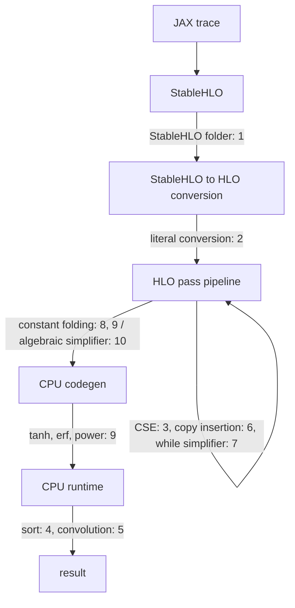

This line of JAX has three outcomes on jax 0.11.0, depending on the machine it runs on:

```python
import jax, jax.numpy as jnp
from jax import lax

# 1. Both operands are literals, so the division happens inside the compiler.
f = jax.jit(lambda: lax.div(jnp.int32(7), jnp.int32(0)))
print(f())
```

On an x86-64 Linux box the process dies before anything executes:

```text
Floating point exception (core dumped)
```

On an Apple-silicon Mac it prints `0`. Pass the 7 and the 0 in as arguments instead of literals, and both machines print `-1`.

That's one integer division with three answers: a crash, zero and minus one. It's also a fair summary of how XLA breaks. It almost never breaks because one component is careless. It breaks at the seams, where two components that each look reasonable disagree about who checks what. Each of the ten cases below has an input you can paste and the output it produced.

The JAX outputs come from jax 0.11.0, which pins XLA `131bf41` (2026-07-16), on an Apple-silicon Mac and on an x86-64 Ubuntu 26.04 machine. The HLO outputs come from `hlo-opt` and `run_hlo_module` built from source at XLA `907e39b` (2026-11-04), the build described in [Hacking on XLA]().[^xla-src] Running both shows which cases have since been fixed and what the fix looked like. The [XLA review]() covers what each stage of the compiler is for. This post is about its edges.



## 1. Divide a constant by zero

Here is the backtrace of the x86 crash:

```text
Thread 1 "python" received signal SIGFPE, Arithmetic exception.
#0  llvm::APInt::udiv(llvm::APInt const&) const
#1  llvm::APInt::sdiv(llvm::APInt const&) const
#2  mlir::stablehlo::(anonymous namespace)::FoldDivOpPattern::FoldDivide::foldSint(llvm::APInt, llvm::APInt)
...
#11 mlir::stablehlo::StablehloTargetIndependentOptimizationPass::runOnOperation()
...
#18 xla::(anonymous namespace)::ConvertStablehloToHloProtoInternal(...)
...
#23 xla::PjRtCpuClient::CompileAndLoad(...)
```

None of XLA's HLO passes ever ran. The crash is in StableHLO's constant folder, which runs while the StableHLO module is converted to HLO. The folder found `divide(7, 0)` with two constant operands and computed it with `APInt::sdiv`. LLVM's `APInt` doesn't define division by zero, and for a single-word value it performs a native integer divide. x86's `idiv` traps on a zero divisor, and AArch64's `sdiv` returns zero. So the host CPU's arithmetic decides whether the compiler crashes or quietly produces 0.

XLA's own semantics say integer division by zero "produces an implementation defined value."[^opsem-div] The CPU backend picked -1, and its emitter says so in a comment:

```cpp
// From ElementalIrEmitter::EmitIntegerDivide, xla/service/elemental_ir_emitter.cc.
// Integer division overflow behavior:
//
// X / 0 == -1
// INT_SMIN /s -1 = INT_SMIN
```

XLA's HLO evaluator, which does XLA's own constant folding, agrees and returns -1 for a signed zero divisor.[^evaluator-div] The StableHLO folder was the odd one out. StableHLO fixed it on 2026-07-07 with a guard that refuses to fold an integer division when any divisor element is zero. The comment on the guard is candid about what it prevents:[^shlo-fix]

```cpp
// Returns true if the divisor (second operand) of `op` is a constant integer
// tensor with any zero element. Integer udiv/sdiv/urem/srem by zero would crash
// the constant folder (APInt asserts in debug, SIGFPE in release), so such ops
// must not be folded.
```

jax 0.11.0 doesn't have the guard, because its XLA pin carries StableHLO `c2ceaecc9e`, five commits before the fix. XLA at `907e39b` does. Fed the same division as a StableHLO module, it leaves the folding to the HLO evaluator and agrees with the runtime:

```text
$ run_hlo_module --platform=cpu --input_format=stablehlo --print_literals div0.stablehlo
** Result with test runner HloRunner **
s32[] -1
```

The lesson isn't about division. A constant folder is a second implementation of every operation it folds. It runs on the build machine's hardware, inside the compiler's process, with the compiler's undefined behavior.

## 2. Compare a float6 value with zero

```python
import numpy as np, ml_dtypes, jax, jax.numpy as jnp

x = jnp.asarray(np.array([0.5, 0.0, 1.0], dtype=ml_dtypes.float6_e2m3fn))
print(jax.jit(lambda v: v != 0)(x))
```

The process aborts on both machines:

```text
F1104 23:06:04.111857 31090120 array.h:316] Check failed: std::distance(std::begin(container), std::end(container)) == num_elements() (0 vs. 3)
    xla::Array<>::SetValues<>()
    mlir::mhlo::ArrayFromDenseElementsAttr<>()
    mlir::mhlo::CreateLiteralFromAttribute()
    mlir::(anonymous namespace)::ConvertToHloModule::Lower()
    ...
    xla::MlirToXlaComputation()
    xla::PjRtCpuClient::CompileAndLoad()
```

The `0` becomes a float6 constant broadcast to the input's shape. Converting that constant from an MLIR attribute to an XLA literal produces zero elements where three were expected. JAX lets you create the array, and MLIR represents it without complaint. The literal converter is the first layer that doesn't understand it, and it responds with `CHECK`, not an error. The issue is still open. The report was filed against a newer build and shows a different abort (`Unhandled primitive type F6E2M3FN`) one layer further along the same path.[^i51829] New narrow types get added one layer at a time, and the process dies in whichever layer hasn't caught up.

## 3. Give a pass a module the verifier accepts

This module is valid. The verifier accepts it, and the module says only that `c` has to run after `b`:

```text
HloModule m
ENTRY e {
  a = f32[] constant(2)
  b = f32[] constant(2)
  p = f32[] parameter(0)
  // 1. A control edge: c must run after b, though no data flows between them.
  c = f32[] negate(p), control-predecessors={b}
  ROOT t = (f32[], f32[], f32[]) tuple(a, b, c)
}
```

Here is the CPU pipeline at `907e39b`:

```text
$ hlo-opt --platform=cpu --stage=hlo cse.hlo
E0000 ... status_macros.cc:58] INTERNAL: RET_CHECK failure (xla/hlo/ir/hlo_computation.cc:862) ignore_safety_check || IsSafelyRemovable(instruction) cannot remove instruction: %b = f32[] constant(2)
F0000 ... hlo_cse.cc:92] Check failed: computation->RemoveInstruction(instruction) is OK (INTERNAL: RET_CHECK failure ...)
```

Common-subexpression elimination sees two identical constants. It rewires every use of `b` to `a` and then deletes `b`:[^cse]

```cpp
// xla/service/hlo_cse.cc
if (match != nullptr) {
  // Match found, replace this instruction with the one in the set.
  CHECK_OK(instruction->ReplaceAllUsesWith(match));
  CHECK_OK(computation->RemoveInstruction(instruction));
  ++combined;
}
```

But `b` still has a control successor, and `RemoveInstruction` refuses to delete an instruction that has control edges. That refusal is a proper `Status`. The caller wraps it in `CHECK_OK`, which turns a recoverable "no" into a dead process. Control edges aren't exotic. Seventeen non-test files under `xla/service` and `xla/hlo/transforms` add them, including copy insertion and the collective pipeliner. The issue is open.[^i50549]

## 4. Write `<=` in a sort comparator

XLA's `sort` takes a comparator computation. For ascending order, the operation semantics say only that "the comparator should perform a less-than comparison."[^opsem-sort] The StableHLO spec doesn't add a requirement either.[^shlo-sort] So here is a comparator that uses `<=`:

```text
HloModule sort_le

le {
  a = f32[] parameter(0)
  b = f32[] parameter(1)
  // 1. "<=" where the contract wants "<".
  ROOT r = pred[] compare(a, b), direction=LE
}

ENTRY e {
  x = f32[1024] parameter(0)
  zero = f32[] constant(0)
  z = f32[1024] broadcast(zero), dimensions={}
  // 2. Multiplying by zero isn't folded for floats (NaN * 0 is NaN),
  //    so this stays a run-time all-zero array.
  zeros = f32[1024] multiply(x, z)
  ROOT s = f32[1024] sort(zeros), dimensions={0}, to_apply=le
}
```

Compiled through jaxlib 0.11.0 on x86, this sort segfaults on an all-zero array once it has 17 or more elements. A comparator that always returns `true` makes sorts of 17 or more elements hang. Below 17 elements both finish. On the Mac the always-true comparator works up to 23 elements and hangs from 24. The `<=` comparator aborts at 64 elements inside absl's `StatusOr` with "Attempting to fetch value instead of handling error", and it hangs at 1024.

The CPU runtime hands the comparator straight to the standard library:[^sort-lib]

```cpp
// xla/backends/cpu/runtime/sort_lib.cc
if (is_stable) {
  std::stable_sort(data, data + n, comp);
} else {
  std::sort(data, data + n, comp);
}
```

C++ requires the comparator passed to `std::sort` to induce a strict weak ordering.[^cpp-sort] `<=` doesn't, because it says an element is less than itself. libstdc++'s introsort switches to insertion sort below `_S_threshold = 16` elements, which is why 16 elements survive and 17 don't. Above that size it partitions without bounds checks:[^libstdcxx]

```cpp
// libstdc++ bits/stl_algo.h, __unguarded_partition
while (__comp(__first, __pivot))
  ++__first;
--__last;
while (__comp(__pivot, __last))
  --__last;
```

The pivot is meant to stop the first loop, because `comp(pivot, pivot)` is false for any valid comparator. With `<=` on equal elements it's true, so `__first` walks off the end of the buffer. The always-true comparator never reads its operands, so the same loop increments an index forever without touching memory. That's why it hangs instead of segfaulting. A backtrace of the hung process shows `std::__introsort_loop` called from `xla::cpu::internal::SortInplace`, which is called from `xla::cpu::SortThunk::Execute`.

The from-source build at `907e39b` links LLVM's libc++, not libstdc++, and gives a third outcome:

```text
sort_true.hlo      run_hlo_module --platform=cpu   timed out after 60 s
sort_le_zeros.hlo  run_hlo_module --platform=cpu   completes
```

Undefined behavior means the outcome is whatever the standard library happens to do. Nothing in the stack checks the comparator. Checking it would be hard, because strict weak ordering is a property of a function, not of its type. XLA's position is defensible. But the documentation doesn't say that a bad comparator is undefined behavior, and that is exactly what it is.

## 5. Crop a convolution with negative padding

Negative padding is legal in XLA convolutions, and JAX emits it in convolution gradients. This convolution crops all 15 rows of a 15-row input and adds one row of zero padding, so every output value should be 0:

```python
import numpy as np, jax, jax.numpy as jnp
from jax import lax

C, H, W = 17, 15, 6
x = jnp.asarray(np.arange(H * W * C).reshape(1, H, W, C), jnp.float32)
k = jnp.asarray(np.eye(C).reshape(1, 1, C, C), jnp.float32)
dn = lax.ConvDimensionNumbers((0, 3, 1, 2), (3, 2, 0, 1), (0, 3, 1, 2))
# 1. Low padding of -15 on H crops the whole input; high padding of 1 adds a zero row.
f = lambda u, v: lax.conv_general_dilated(u, v, (1, 1), [(-15, 1), (0, 0)],
                                          dimension_numbers=dn)
print(jax.jit(f)(x, k))
```

On jax 0.11.0, 17 channels segfault on both machines. 16 channels run. The Mac returns all zeros, and the x86 box returns values up to `7.6e31`, which is memory from outside the input buffer read as floats. The issue was closed on 2026-10-05 by a fix to the Eigen convolution path, whose padding check had considered only positive padding.[^i48713]

At `907e39b` the 16-channel case matches the interpreter. The 17-channel case still segfaults:

```text
Thread 1 "run_hlo_module-" received signal SIGSEGV, Segmentation fault.
#0  __memcpy_avx512_unaligned_erms
#1  slinky::for_each_element<slinky::(anonymous namespace)::copy_impl(...)::$_2, ...>
...
#4  slinky::copy(slinky::raw_buffer const&, slinky::raw_buffer const&, slinky::raw_buffer const&)
...
#8  ynn_runtime::invoke()
#9  xla::cpu::YnnFusionThunk::YnnExecutable::Invoke(...)
#11 xla::cpu::YnnFusionThunk::Execute(xla::cpu::Thunk::ExecuteParams const&)
```

The two channel counts take different paths. With 16 channels the optimized module keeps a plain `convolution`, which runs on Eigen. With 17 the CPU backend wraps the convolution in a `__ynn_fusion` and hands it to the YNNPACK library. jax 0.11.0 makes the same split. The fix changed only `eigen_spatial_convolutions-inl.h`, so it repaired the wrong values at 16 channels and left the crash at 17 in a different library. The YNNPACK path handles most negative padding. Cropping 1, 8 or 14 rows matches the interpreter. So does a one-row output taken from a real input row, or two rows of pure padding. Of the paddings tried, the only ones that crash leave a single output row made entirely of padding, as in this six-line module:

```text
HloModule ynn_pad
ENTRY e {
  u = f32[1,15,6,17]{3,2,1,0} parameter(0)
  v = f32[1,1,17,17]{3,2,1,0} parameter(1)
  ROOT c = f32[1,1,6,17]{3,2,1,0} convolution(u, v), window={size=1x1 pad=-15_1x0_0}, dim_labels=b01f_01io->b01f
}
```

This is the most serious entry here. A segfault is at least loud. An out-of-bounds read that returns plausible floats isn't. Both came from a code path that gradient computations reach without anyone writing negative padding by hand. A backend with two convolution implementations needs every convolution fix applied twice.

## 6. Turn off copy insertion

`--xla_disable_hlo_passes` takes a comma-separated list of pass names, and it is the standard first step in bisecting a miscompile. Most passes are optimizations, so disabling one costs speed. A few establish invariants that later stages rely on, and the flag doesn't tell the two kinds apart. Here is a three-iteration `fori_loop` with copy insertion disabled:

```python
import jax, jax.numpy as jnp

def loop(y):
    return jax.lax.fori_loop(0, 3, lambda i, a: a * 0.5 + y[i], y[0])

# XLA_FLAGS=--xla_disable_hlo_passes=copy-insertion
print(jax.jit(loop)(jnp.ones((8, 16))))
```

It compiles in 20 ms and never returns, on jax 0.11.0 and at `907e39b` alike. The buffer assignment dump shows why. Copy insertion normally gives the loop its own copy of the initial counter, `constant(0)`. Without it, the counter, its update and the loop state all share the constant's allocation:

```text
allocation 3: size 4, constant:
 value: <19 wrapped_add @0> (size=4,offset=0): s32[]
 value: <27 constant.13 @0> (size=4,offset=0): s32[]
 value: <36 arg_tuple.6{0} (phi) @0> (size=4,offset=0): s32[]
 value: <40 while.2{0} (phi) @0> (size=4,offset=0): s32[]
```

The CPU backend compiles this small loop into a single LLVM function, and it emits the constant allocation as an LLVM `constant` global. LLVM then does what it should with loads from constant memory. It folds every read of the counter to 0, deletes the stores, and proves the loop never exits:

```llvm
; 1. The loop counter now lives in read-only, zero-initialized memory.
@wrapped_add = private unnamed_addr constant [4 x i8] zeroinitializer, align 4

; 2. LLVM inferred that the kernel cannot return.
; Function Attrs: nofree norecurse noreturn nosync nounwind ...
define noalias noundef nonnull ptr @call_kernel(ptr nofree readonly captures(none) %0) {
  ...
while.2.header.i:
  ...
  ; 3. No exit test is left. The back-edge is unconditional.
  br label %while.2.header.i
}
```

Copy insertion isn't an optimization. It's how XLA turns a functional program into one that can update buffers in place, and every later stage assumes it ran. A misspelled name is the opposite trap. `--xla_disable_hlo_passes=copy-insertoin` disables nothing and warns about nothing, so the loop finishes in 19 ms.

## 7. Write an infinite loop that does nothing

This loop's condition is the constant `true`, and its body sets the only state element to the value it already has:[^i47354]

```text
HloModule Test, entry_computation_layout={()->(s32[1]{0})}
Body {
  param = (s32[1]{0}) parameter(0)
  a = s32[1]{0} constant({0})
  ROOT tuple = (s32[1]{0}) tuple(a)
}
Cond {
  param.1 = (s32[1]{0}) parameter(0)
  ROOT cond = pred[] constant(true)
}
ENTRY Loop {
  a.1 = s32[1]{0} constant({0})
  init = (s32[1]{0}) tuple(a.1)
  ROOT while = (s32[1]{0}) while(init), condition=Cond, body=Body
}
```

It should never finish. At `907e39b` it finishes in 5 ms:

```text
$ run_hlo_module --platform=cpu --print_literals loop.hlo
... compiled and ran in 0.00525393s.
** Result with test runner HloRunner **
(
s32[1] {0}
)
```

The pass dumps show the while-loop simplifier removing the loop in the first simplification iteration. It notices that every element of the loop state is the same constant on entry and after the body. Then it applies a special case that its comment states plainly:[^while-simp]

```cpp
// xla/service/while_loop_simplifier.cc, TryRemoveConstantParams
// Special case: constant_tuple_indices covers the whole while parameter, so
// the new while shape is the empty tuple.  In this case, the value of the
// while loop is simply equal to the value of `init`.
if (ShapeUtil::IsEmptyTuple(new_while_shape)) {
  ABSL_RETURN_IF_ERROR(computation->ReplaceInstruction(while_op, while_init));
  return true;
}
```

"The value of the while loop is simply equal to the value of `init`" holds only if the loop terminates. C++ makes that assumption explicit: an implementation may assume every thread eventually terminates or performs I/O, a volatile access, or a synchronization or atomic operation.[^cpp-progress] XLA's semantics don't state it, but this pass relies on it. The issue reports that the same program converted to StableHLO hangs on the CPU backend. So whether this program terminates depends on which format it arrived in.

## 8. Multiply two integer constants

Constant folding trades compile time for run time. XLA bounds that trade by size, not by cost:[^fold-limit]

```cpp
// xla/hlo/transforms/simplifiers/hlo_constant_folding.cc
static const int64_t kMaximumConstantSizeElements = 45 * 1000 * 1000;
if (std::max(elements_in_constant, elements_in_operands) >
    kMaximumConstantSizeElements) {
  return false;
}
```

A 2048×2048 int32 matmul has 4.2 million output elements, 8.4 million operand elements and 17 billion multiply-adds. It is well under the limit. If both operands are literals, the folder does all that work at compile time:

```python
import numpy as np, jax, jax.numpy as jnp

A = np.random.default_rng(0).integers(-3, 3, (2048, 2048)).astype(np.int32)
# 1. No arguments: A is baked into the program, so the dot can be folded.
f = jax.jit(lambda: jnp.asarray(A) @ jnp.asarray(A))
f.lower().compile()
```

On the Mac, compiling takes 28.4 seconds. The same matmul with `A` passed as an argument runs in 38.5 ms. So the fold costs about 740 times the work it saves, paid again on every cold compile. The f32 version folds quickly, because the evaluator sends rank-2 dots that compute in F32 to Eigen. The int32 version takes the evaluator's generic element-by-element path. XLA prints a warning while it works:

```text
E1104 22:53:10.583574 slow_operation_alarm.cc:73] Constant folding an instruction is taking > 1s:
  %dot_general.1 = s32[2048,2048]{1,0} dot(%constant.1, %constant.1), lhs_contracting_dims={1}, rhs_contracting_dims={0}
This isn't necessarily a bug; constant-folding is inherently a trade-off between compilation time and speed at runtime. XLA has some guards that attempt to keep constant folding from taking too long, but fundamentally you'll always be able to come up with an input program that takes a long time.
E1104 22:53:37.960311 slow_operation_alarm.cc:140] The operation took 28.381784s
```

`907e39b` behaves the same way. A 1024×1024 version passed to `hlo-opt --stage=hlo` trips the same alarm and spends 3.0 seconds folding. The warning is honest, and the fix is in your hands: pass the constant as an argument, or wrap it in `lax.optimization_barrier`. A size limit is cheap to check and easy to explain. It just doesn't measure cost, and an issue about slow folding of large integer arrays has been open since 2023.[^i1652]

## 9. Ask two evaluators the same question

Case 1 had three implementations of integer division. Floating-point math has the same split between the folder and the runtime, and here it shows up without a crash. The table below covers 200,001 evenly spaced float32 values in [-20, 20], each computed once as a jit argument and once as a literal that gets folded. Errors are measured on the Mac against the correctly rounded float64 result:

| Function | Values that differ | Max error, runtime (ulp) | Max error, folded (ulp) |
|---|---|---|---|
| `tanh` | 58,664 | 4 | 0 |
| `erf` | 24,280 | 5 | 1 |
| `exp` | 19,064 | 1 | 0 |

x86 gives the same numbers except for `erf`, where 24,248 values differ and the folded side is exact. The folded side is the accurate one, because the evaluator calls `std::tanh`.[^evaluator-tanh] The CPU runtime uses XLA's own vectorized approximation, which clamps its input and returns exactly ±1 outside the clamp:[^tanh]

```cpp
// xla/codegen/intrinsic/tanh.cc, EmitFastTanh
const float plus_clamp =
    with_fma ? 7.99881172180175781f : 7.90531110763549805f;
// We choose 'plus_clamp' in a way that the
// tanh approximation on that input is exactly 1.0.
```

So `tanh(-8.0378)` is `-0.99999976` when folded (the correctly rounded answer) and `-1.0` when computed at run time. Four ulp is a reasonable price for a fast vectorized kernel. But turning an argument into a literal can change a model's output in the last bits, and a bitwise regression test will notice.

Integer power is a larger version of the same split. `run_hlo_module` checks the CPU backend against the interpreter, which shares its evaluator with the constant folder:

```text
$ run_hlo_module --platform=cpu --reference_platform=interpreter --input_literals_file=pow.lit pow.hlo
** Argument 0 **
u32[4] {3, 2, 3, 1}
** Argument 1 **
u32[4] {64, 64, 65, 100}
** Result with test runner HloRunner **
u32[4] {1, 0, 3, 1}
** Result with reference runner HloRunner **
u32[4] {2038349057, 0, 1820079875, 1}
INVALID_ARGUMENT: first mismatch at array index {0}:
  expected value: 2038349057
  actual value:   1
```

The CPU emitter caps exponentiation by squaring at six iterations. It ignores exponent bits above bit 5, so `3^64` comes out as `3^0`. The interpreter computes the full wrapped product. The issue was closed as working as intended, on the spec's own terms: "integer overflows result in implementation-defined behavior."[^i50550] That reasoning is correct. It also guarantees that the folder and the runtime will disagree whenever a power overflows, because each implementation defines the result differently.

## 10. Trust the algebra

The algebraic simplifier rewrites expressions into cheaper equivalents. An identity that holds over the reals doesn't necessarily hold over IEEE floats or clamped integer indices. jax 0.11.0 shows three cases:

```text
log(exp(x)) at x = 89.0           jit: 89.0           eager: inf
(a + 3e38) + 3e38 at a = -3e38    jit: [inf]          eager: [3.e+38]
dynamic_slice(roll(x, 4), [12])   jit: [50 60 70 80]  eager: [10 20 30 40]
```

`exp(89)` overflows float32, so `log(exp(89))` is `inf`. But the simplifier rewrote `log(exp(x))` to `x` first.[^i42732] `(a + C1) + C2` was reassociated to `a + (C1 + C2)`, and `3e38 + 3e38` overflows even though both of the original additions are finite.[^i50214] The `dynamic_slice` case merged a nested slice into one without clamping the outer start index. XLA clamps every out-of-range start, so the merged slice reads a different window.[^i49121]

All three are fixed at `907e39b`. Replayed through `run_hlo_module` with the same inputs, the CPU backend returns `inf`, `3e+38` and `{10, 20, 30, 40}`, matching the interpreter. The fixes have a shape. Four commits since late July gate a float rewrite behind fast-math: inverse functions on 2026-07-27, exponentials on 2026-09-02, add and multiply reassociation on 2026-10-13, and `log(pow(a, b))` on 2026-10-17.[^fastmath-gates] The simplifier is being brought back to IEEE semantics one rule at a time. Each rule needed its own bug report first.

One related case is still open at `907e39b`. An in-place `dynamic_update_slice` fusion reads its own output when the update is a shifted slice of the same buffer:[^i49176]

```python
def f(x):
    base = x + np.int32(1)
    # 1. Write base[0:3] into base starting at row 1: a shift by one row.
    return lax.dynamic_update_slice(base, base[:3], (1, 0, 0)).reshape((1, 4, 1))

x = np.arange(4, dtype=np.int32).reshape(4, 1, 1)
# jit: [1 1 1 1]   eager: [1 1 2 3]
```

At `907e39b` the CPU result still differs from the interpreter at index 2 (expected 2, actual 1). An in-place update is only correct if every element is read before it's overwritten, and a shifted copy into the same buffer breaks that ordering.

## The pattern

Put the ten side by side and three seams keep coming up.

**More than one evaluator per operation.** XLA effectively has three implementations of integer division: the StableHLO folder, the HLO evaluator and the CPU emitter. Each was written against the same specification. The specification says "implementation-defined" at the edges, and each implementation defines the edges differently. Cases 1, 8 and 9 come from this. I don't think the fix is a stricter specification. Approximate math and wrapping arithmetic are where the speed comes from. The fix is for folders to refuse what they can't reproduce. The StableHLO guard in case 1 is exactly that kind of fix, and it does more good than any tightened sentence in a spec.

**`CHECK` as the error path.** Cases 2 and 3 die on assertions. So did three HLO parser bugs fixed this autumn, which now return parse errors instead.[^parser-fixes] Maintainers draw a clear line here. On a report about an experimental feature, one wrote: "This is not a safety issue as it fails cleanly with a CHECK failure."[^i47385] That's fair for a compiler that trusts its input. For the Python process that embeds it, a clean `CHECK` failure is still a dead interpreter.

**Contracts that live in prose, or nowhere.** The comparator in case 4, the passes that `--xla_disable_hlo_passes` must never touch in case 6, and the termination assumption in case 7 are all requirements that nothing in the stack writes down where a tool can see them. Some of them can't be checked cheaply. All of them can be documented, and the checkable ones belong in the verifier. Case 5 adds a fourth seam, smaller and more specific: a backend with two kernel libraries for one operation needs each fix in both.

## When XLA breaks on you

- **Diff against the interpreter.** `run_hlo_module --platform=cpu --reference_platform=interpreter` runs the module on both and reports mismatches. The interpreter shares the HLO evaluator with the constant folder, so it catches the backend-versus-folder splits in cases 9 and 10 without extra work.
- **Disable the simplifier first.** `XLA_FLAGS=--xla_disable_hlo_passes=algsimp` is the cheapest bisect step for a wrong answer. Check the spelling, because an unrecognized name is silently ignored.
- **Stop the folding.** If compile time explodes or a constant gives a different answer than an argument, pass the value as an argument or wrap it in `lax.optimization_barrier`.
- **Dump around the suspect pass.** `--xla_dump_to=DIR` with `--xla_dump_hlo_pass_re=<pass>` writes the module before and after each matching pass.
- **Check the pin before filing.** jax 0.11.0 is almost four months of fixes behind XLA's main branch. A fix is in your jaxlib only if its commit is an ancestor of the XLA commit your jaxlib pins. Compare the two on GitHub before assuming a bug is still live.

## References

[^xla-src]: **openxla/xla at `907e39b`.** The source tree used for the `hlo-opt` and `run_hlo_module` builds. ([Link](https://github.com/openxla/xla/tree/907e39b762e0f97937e72b62f37486e82ee01cac))

[^opsem-div]: **XLA operation semantics: element-wise binary arithmetic.** "Integer division overflow (signed/unsigned division/remainder by zero or signed division/remainder of `INT_SMIN` with `-1`) produces an implementation defined value." ([Link](https://github.com/openxla/xla/blob/907e39b762e0f97937e72b62f37486e82ee01cac/docs/operation_semantics.md?plain=1#L2250-L2252))

[^evaluator-div]: **`HloEvaluatorTypedVisitor::HandleDivide`.** Returns -1 for a signed zero divisor and `INT_MIN` for `INT_MIN / -1`. ([Link](https://github.com/openxla/xla/blob/907e39b762e0f97937e72b62f37486e82ee01cac/xla/hlo/evaluator/hlo_evaluator_typed_visitor.h#L525-L547))

[^shlo-fix]: **StableHLO: "Guard against integer division-by-zero in stablehlo transforms (#2971)".** Commit `402df0a`, 2026-07-07. The guard, as pinned by XLA `907e39b`, is in `StablehloAggressiveFolder.cpp`. ([Commit](https://github.com/openxla/stablehlo/commit/402df0aca1e420c4c6186a1444f0516d2934b6e1), [guard](https://github.com/openxla/stablehlo/blob/c42e496021bbb4c438adf372d64d4c850ad3f8c5/stablehlo/transforms/optimization/StablehloAggressiveFolder.cpp#L1044-L1071))

[^i51829]: **openxla/xla#51829.** "float6_e2m3fn / float6_e3m2fn: comparing with a constant aborts the process; convert and arithmetic fail to compile." Open. ([Link](https://github.com/openxla/xla/issues/51829))

[^cse]: **`xla/service/hlo_cse.cc`.** The `CHECK_OK` around `RemoveInstruction`. ([Link](https://github.com/openxla/xla/blob/907e39b762e0f97937e72b62f37486e82ee01cac/xla/service/hlo_cse.cc#L88-L94))

[^i50549]: **openxla/xla#50549.** "HloCSE CHECK-fails combining a duplicate constant that has control successors." Open. ([Link](https://github.com/openxla/xla/issues/50549))

[^opsem-sort]: **XLA operation semantics: Sort.** ([Link](https://github.com/openxla/xla/blob/907e39b762e0f97937e72b62f37486e82ee01cac/docs/operation_semantics.md?plain=1#L5374-L5390))

[^shlo-sort]: **StableHLO specification: sort.** ([Link](https://github.com/openxla/stablehlo/blob/c42e496021bbb4c438adf372d64d4c850ad3f8c5/docs/spec.md#sort))

[^sort-lib]: **`xla/backends/cpu/runtime/sort_lib.cc`.** The CPU runtime calls `std::sort` or `std::stable_sort` with the compiled comparator. ([Link](https://github.com/openxla/xla/blob/907e39b762e0f97937e72b62f37486e82ee01cac/xla/backends/cpu/runtime/sort_lib.cc#L283-L294))

[^cpp-sort]: **C++ working draft, [alg.sorting.general].** Algorithms that take a `Compare` require it to induce a strict weak ordering on the values. ([Link](https://eel.is/c++draft/alg.sorting.general))

[^libstdcxx]: **libstdc++ `bits/stl_algo.h` (GCC 15.1.0).** `_S_threshold = 16` and `__unguarded_partition`. ([Link](https://github.com/gcc-mirror/gcc/blob/releases/gcc-15.1.0/libstdc%2B%2B-v3/include/bits/stl_algo.h#L1807-L1845))

[^i48713]: **openxla/xla#48713.** "Wrong results / out-of-bounds read in f32 convolution with negative low padding." Closed by `21996a8a`, "Fix out-of-bounds read and crash in spatial convolution with negative padding", 2026-10-05, which changes `xla/tsl/framework/convolution/eigen_spatial_convolutions-inl.h`. ([Issue](https://github.com/openxla/xla/issues/48713), [fix](https://github.com/openxla/xla/commit/21996a8a6ea3083e43c94b024ab163867a381bef))

[^i47354]: **openxla/xla#47354.** "Lifting bug: hang/timeout on CPU after HLO-to-StableHLO conversion." Open. The HLO module above is the issue's reproducer. ([Link](https://github.com/openxla/xla/issues/47354))

[^while-simp]: **`xla/service/while_loop_simplifier.cc`, `TryRemoveConstantParams`.** ([Link](https://github.com/openxla/xla/blob/907e39b762e0f97937e72b62f37486e82ee01cac/xla/service/while_loop_simplifier.cc#L1061-L1074))

[^cpp-progress]: **C++ working draft, [intro.progress].** The forward-progress assumption. ([Link](https://eel.is/c++draft/intro.progress))

[^fold-limit]: **`xla/hlo/transforms/simplifiers/hlo_constant_folding.cc`.** The 45M-element limit. ([Link](https://github.com/openxla/xla/blob/907e39b762e0f97937e72b62f37486e82ee01cac/xla/hlo/transforms/simplifiers/hlo_constant_folding.cc#L348-L366))

[^i1652]: **openxla/xla#1652.** "Very slow constant folding of very-large integer arrays." Open since 2023. ([Link](https://github.com/openxla/xla/issues/1652))

[^evaluator-tanh]: **`HloEvaluatorTypedVisitor::HandleTanh`.** Calls `std::tanh`. ([Link](https://github.com/openxla/xla/blob/907e39b762e0f97937e72b62f37486e82ee01cac/xla/hlo/evaluator/hlo_evaluator_typed_visitor.h#L473-L479))

[^tanh]: **`xla/codegen/intrinsic/tanh.cc`.** `EmitFastTanh` and its clamp constants. ([Link](https://github.com/openxla/xla/blob/907e39b762e0f97937e72b62f37486e82ee01cac/xla/codegen/intrinsic/tanh.cc#L48-L75))

[^i50550]: **openxla/xla#50550.** "[XLA:CPU] Integer power ignores all exponent bits above bit 5." Closed on 2026-11-02 with "Closing as working as intended." ([Link](https://github.com/openxla/xla/issues/50550))

[^i42732]: **openxla/xla#42732.** "XLA algebraic simplifier folds inverse function pairs, ignoring IEEE 754 intermediate overflow/underflow." Fixed by `6a6c5cb3`, 2026-07-27. ([Issue](https://github.com/openxla/xla/issues/42732), [fix](https://github.com/openxla/xla/commit/6a6c5cb3b99c46c89bda2df75bc88b5009404650))

[^i50214]: **openxla/xla#50214.** "AlgebraicSimplifier reassociates finite float ops into constant({inf})." Still open. The add and multiply rules were gated by `84b7c7f5` on 2026-10-13. ([Issue](https://github.com/openxla/xla/issues/50214), [fix](https://github.com/openxla/xla/commit/84b7c7f54a39aabeaa441ed7d579f032065c0178))

[^i49121]: **openxla/xla#49121.** "AlgebraicSimplifier folds nested dynamic-slice / dynamic-update-slice without clamping the outer start." Still open. The dynamic-slice fold was fixed by `d1e07464` on 2026-09-23 and the dynamic-update-slice fold by `c70b1b19` on 2026-10-01. ([Issue](https://github.com/openxla/xla/issues/49121), [fix](https://github.com/openxla/xla/commit/d1e0746498882d17bc0fd19a0c16c1a4a5d84652))

[^fastmath-gates]: **Fast-math gates in `AlgebraicSimplifier`.** `6a6c5cb3` (inverse functions), `ac12f341` (exponential rewrites), `84b7c7f5` (add and multiply reassociation), `9cb4e200` (`log(pow(a, b))`). ([6a6c5cb3](https://github.com/openxla/xla/commit/6a6c5cb3b99c46c89bda2df75bc88b5009404650), [ac12f341](https://github.com/openxla/xla/commit/ac12f341f5b692466ffe8e76b842723c38407ba7), [84b7c7f5](https://github.com/openxla/xla/commit/84b7c7f54a39aabeaa441ed7d579f032065c0178), [9cb4e200](https://github.com/openxla/xla/commit/9cb4e2005f963acc873dc95facd3b7d134dbf108))

[^i49176]: **openxla/xla#49176.** "In-place dynamic-update-slice fusion reads its own output when the update is a shifted slice of the operand." Open. ([Link](https://github.com/openxla/xla/issues/49176))

[^parser-fixes]: **HLO parser fixes.** `11aea702` (reshape element-count mismatch, 2026-08-12), `7a1a71db` (sugared async-start, 2026-10-30) and `e088f08d` (shape-less get-tuple-element, 2026-11-02) each replace a crash with a parse error. ([11aea702](https://github.com/openxla/xla/commit/11aea70249fd01207251a495c0c2b8d542251be8), [7a1a71db](https://github.com/openxla/xla/commit/7a1a71db9725a864a667b2f79e5451cc3df0f9a8), [e088f08d](https://github.com/openxla/xla/commit/e088f08d25a2e7f16ca7350615df9292a27a8715))

[^i47385]: **openxla/xla#47385.** A `cannot remove instruction` crash at `hlo_computation.cc:808` in experimental CPU multi-output fusion, closed 2026-09-03 with the quoted comment. ([Link](https://github.com/openxla/xla/issues/47385))

---

*Disclaimer: Researched and drafted with AI assistance (Claude Opus 5.5, Gemini 4 Argon). Direction, technical judgment, and final edits are mine; every claim is traceable to the sources cited above.*
