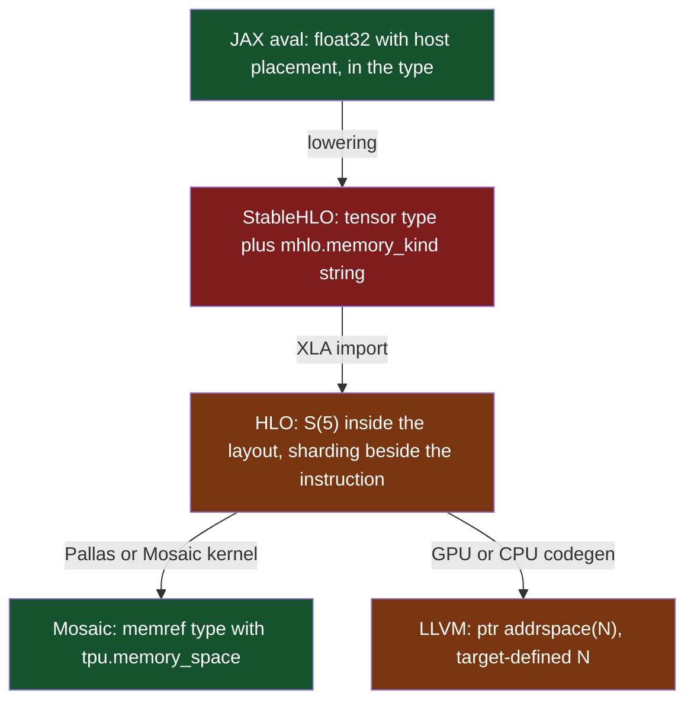

Here is the first data movement call most GPU programmers learn:[^cudamemcpy]

```c
// 1. Two untyped pointers. One is in GPU memory, one is in host memory,
//    and the declaration cannot say which.
__host__ cudaError_t cudaMemcpy(void *dst, const void *src,
                                size_t count, enum cudaMemcpyKind kind);

// 2. So the direction travels as a run-time enum next to them.
cudaMemcpy(d_x, h_x, n * sizeof(float), cudaMemcpyHostToDevice);
```

Both pointers are `void*`. NVIDIA's documentation is blunt about what happens when the enum disagrees with the pointers: "Calling cudaMemcpy() with dst and src pointers that do not match the direction of the copy results in an undefined behavior." It also recommends `cudaMemcpyDefault`, "in which case the type of transfer is inferred from the pointer values." So the runtime can work out where a pointer lives. The type system can't. The earliest anyone can find out is at run time.

This isn't carelessness on NVIDIA's part. The API is a faithful reflection of the language it is embedded in. C has one notion of pointer, and that notion doesn't include the question "which memory?" The type system was never given the vocabulary, so the API asks at run time.

I think this is structural, not a local mistake. It comes from the way two communities split the work of computing between them, and the job they left in the gap. Compiler engineers live in that gap.

## The languages side: precise about what, silent about where

The programming languages community has built fifty years of serious machinery: parametric polymorphism, algebraic data types, Hindley–Milner inference, effect systems, ownership and borrowing, refinement and dependent types. If you want to know *what* a value is, *how* it may be used, *who* may alias it and *when* it dies, there is a proof-carrying literature for you.

Ask where the value is, and the room goes quiet.

Nothing in Haskell's `Int` says where the machine word lives. A Java reference says nothing about NUMA nodes. NumPy bolted strides and dtypes onto Python as a library because the language offered nowhere to put them. That is a design commitment, not an oversight. Abstracting the machine away is what made these results portable. A theorem about the simply typed lambda calculus shouldn't have to mention cache lines.

Rust comes closest among the mainstream languages, and the near miss is instructive. Its type system tracks ownership, aliasing and lifetimes, and enforces them. That is a checked memory discipline about *when* memory is valid and *who* may touch it. `Box` even has an allocator parameter: the declaration is `Box<T, A = Global> where A: Allocator`, with custom allocators still behind the nightly `allocator_api` feature.[^rust-box] So `Box<T, A>` names which allocator. But the `Allocator` contract requires that an allocated block "points to valid memory," and `Box` dereferences on whatever core runs the code. There is no sound `Box<T, DeviceMemory>`. Rust closed the temporal and aliasing holes and left the spatial one open.

C++ tried the type-level version and backed out of it on purpose. `std::vector<T, Allocator>` makes the allocator a type parameter. `std::pmr` then made it a run-time value, and the reason is in the proposal. Pablo Halpern's N3916 says allocator template parameters "inhibit the use of vocabulary types by altering the type of specializations that would otherwise be the same."[^pmr] Two `std::basic_string`s with different allocators are different types, so they can't cross an interface between separately compiled modules. Keep that cost in mind. Any design that puts place in the type has to answer it.

But **the PL community did solve this, more than once.**

- **Chapel** has `locale` as a type. The spec says "The identifier `locale` is a type that abstracts a locale," and "Both data and tasks can be associated with a value of locale type."[^chapel] It goes further for arrays: "Each domain type has a distribution associated with it," so `domain(2) dmapped new blockDist(...)` carries its distribution policy in its type.[^chapel-dm]
- **X10** built its model on *places*. The OOPSLA 2005 paper creates remote work with `async (P) S`, "where P is a place expression."[^x10]
- **Sequoia** "abstractly exposes hierarchical memory in the programming model," with tasks that localize computation to a level of the hierarchy. The binding to a real machine is written separately.[^sequoia]
- **Halide** separates the algorithm from the schedule, so locality and ordering are written as their own artifact.[^halide]

These are serious, well-published systems. None displaced C, C++, Python or Java for the workloads in question, and the mainstream languages that won absorbed none of their placement ideas.

Even the ones that went furthest stop at the same spot. Chapel's distribution policy lives in the domain's type. But which locales it covers, and the target of an `on` statement, are run-time values. The spec says the `on` statement "controls on which locale a block of code should be executed or data should be placed." That is a statement wrapped around code, not a constraint a function signature can demand.

X10's paper is more candid than any critic could be. The authors write: "We had originally intended to design and implement a technically sophisticated type system that would statically determine whether an activity was accessing non-local data. We soon realized that such a system would take much too long to realize." So they "turned instead to the idea of using runtime checks which throw exceptions (e.g. BadPlaceExceptions)."[^x10] A static place type system was the plan, and run-time exceptions shipped instead.

## The hardware side: precise about where, indifferent to what

Come at the machine from below and the polarity flips.

A register is a bit container. `mov` doesn't care whether it is moving a probability, an array index or the low half of a pointer. PTX looks more typed than it is. `.u32`, `.f32` and `.b64` are widths and interpretations for one instruction. They say a value is 32 bits wide, never that it is a sequence length rather than a byte offset. Verilog gives you `wire [31:0]`, a bundle of bits whose meaning lives in a comment, if you are lucky.

C is where the two meet, and where most of the damage comes from. It is the language both communities agreed to use. One pointer type for every address in the machine. Implicit conversions through `void*`. When CUDA extended C for GPUs it inherited all of that: a host `float*` and a device `float*` are the same type. Pass either where the other is expected and the compiler accepts it. Whether it works depends on the system's memory model, and you find out at run time.

The sharpest exception on this side is **OpenCL C, which put address spaces in the type system.** The spec "extends the C syntax to allow an address space name as a valid type qualifier," with "disjoint named address spaces" spelled `__global`, `__local`, `__constant` and `__private`.[^opencl] The conversion rules are stricter than most people remember:

```c
__kernel void k(__global int *gp, __local int *lp) {
  // 1. Implicit conversion between disjoint named spaces is an error.
  gp = lp;                      // error

  // 2. So is an explicit cast. The spec: "casting between pointers to
  //    non-overlapping address spaces is illegal in OpenCL."
  gp = (__global int *)lp;      // error

  // 3. OpenCL C 2.0, or 3.0 with __opencl_c_generic_address_space, adds an
  //    unnamed generic space. Named spaces convert into it, never back out.
  int *p = gp;                  // ok: p points into the generic space
}
```

That is the tool the PL community would have recommended, and it works. The hardware-adjacent community, faced with a machine that had four memories, reached for a type qualifier and got compile-time errors for it.

Look at where it stops, though. The qualifiers exist inside kernel code. Cross into the host program and you are back to `cl_mem` handles and `clSetKernelArg(kernel, index, size, ptr)`. The correspondence between a host-side buffer and a device-side qualified pointer is kept by convention and by argument index. The type discipline exists on one side of a wall and disappears at the wall, which is where the interesting bugs live.

## Single-source C++ gets the closest

SYCL and Kokkos took the next step. Both are single-source C++: host and device code in one translation unit, type-checked by one compiler front end. Both are the first thing an HPC reader raises against an argument like this one.

### SYCL types the region, not the device

SYCL 2020 keeps OpenCL's spaces as a template parameter: `multi_ptr<ElementType, access::address_space Space, access::decorated DecorateAddress>`, with `global_space`, `local_space`, `private_space`, `generic_space` and the now-deprecated `constant_space`.[^sycl-multiptr] A pointer's region within a device can be part of its type, statically, today.

The device is a different matter. The spec defines a device selector as "a ranking function that will give an integer ranking value to all the devices on the system": any callable taking `const device &` and returning something convertible to `int`.[^sycl-selector] Allocation returns a plain pointer: `template <typename T> T* sycl::malloc_device(std::size_t count, const queue& syclQueue, ...)`.[^sycl-usm] And the accessibility rule for that pointer is written as a relationship between two run-time values. A USM device allocation is accessible from a kernel submitted to device _D2_ "if _D1_ and _D2_ compare equal." The next sentence: "Violations of these requirements result in undefined behavior."[^sycl-usm-rules]

Here is the bug that falls out, in the ordinary shape of multi-GPU code:

```cpp
// 1. Two queues bound to two different GPUs.
auto gpus = sycl::device::get_devices(sycl::info::device_type::gpu);
sycl::queue q0(gpus[0]), q1(gpus[1]);

// 2. Two device allocations. Both declared types are `float *`. They are
//    assignable to each other and to any host `float *`.
float *a = sycl::malloc_device<float>(n, q0);
float *b = sycl::malloc_device<float>(n, q1);

// 3. A kernel on q0 reads `b`, which belongs to gpus[1]. The spec calls this
//    undefined behavior. The compiler can see both allocations and the
//    submission, and has nowhere in the type to record any of it.
q0.parallel_for(sycl::range<1>(n), [=](sycl::id<1> i) { a[i] += b[i]; }).wait();
```

So the precise gap is narrower than "SYCL doesn't type memory," which is false. SYCL types where memory lives *within* a device. It doesn't type *which* device, because a device is a run-time property of a queue rather than a static property of a value.

### Kokkos types the memory space, then aborts at run time anyway

Kokkos is the harder objection. A `View` takes its memory space as a template parameter. The Kokkos documentation says the `MemorySpace` argument "Controls the storage location of the View."[^kokkos-view] `View<double*, CudaSpace>` and `View<double*, HostSpace>` are different types, in production C++.

The assignment check is real and static. The converting constructor is enabled only when `MemorySpaceAccess<Dst, Src>::assignable` holds. The primary template defines that trait as `std::is_same_v<DstMemorySpace, SrcMemorySpace>`, which is false for two distinct spaces.[^kokkos-assign] Write `h = d;` across spaces and the program doesn't compile. The rejection is an overload-resolution failure rather than a Kokkos message, but it happens at compile time.

Element access is where it gets interesting. Every `View::operator()` call routes through this, abbreviated from `Kokkos_ViewAccessPreconditionsCheck.hpp`:[^kokkos-check]

```cpp
// 1. The primary template is selected when the memory IS accessible from the
//    execution space. Its constructor is empty, so the check costs nothing.
template <class MemorySpace, class AccessSpace,
          bool = SpaceAccessibility<AccessSpace, MemorySpace>::accessible>
struct RuntimeCheckBasicViewMemoryAccessViolation {
  KOKKOS_FUNCTION RuntimeCheckBasicViewMemoryAccessViolation(
      Kokkos::Impl::SharedAllocationTracker const &) {}
};

// 2. The specialization for accessible == false. That value is a compile-time
//    constant, so by the time the compiler picks this branch it has already
//    proven the access illegal. What it emits is a run-time abort.
template <class MemorySpace, class AccessSpace>
struct RuntimeCheckBasicViewMemoryAccessViolation<MemorySpace, AccessSpace,
                                                  false> {
  KOKKOS_FUNCTION RuntimeCheckBasicViewMemoryAccessViolation(
      Kokkos::Impl::SharedAllocationTracker const &tracker) {
    // builds "Kokkos::View ERROR: attempt to access inaccessible memory
    // space (label=...)" and calls Kokkos::abort(err)
  }
};
```

The information is static. The diagnostic is deferred to run time anyway, and not only in debug builds: `Kokkos_BasicView.hpp` calls the check from `operator()` in both the bounds-checking and the default configuration.[^kokkos-basicview]

This isn't Kokkos being careless. It is the only thing a C++ library can do. CUDA's own guide files `__host__` and `__device__` under "Function and Variable Annotations," and says "Functions declared with multiple execution spaces (for example, `__host__ __device__`) are compiled for each context," with `__CUDA_ARCH__` to tell the paths apart.[^cuda-exec] `KOKKOS_FUNCTION` expands to that pair under CUDA.[^kokkos-macro] So the body of a function that only ever runs inside a GPU kernel is still compiled for the host. A `static_assert` would fire in that host compilation and reject a correct program. The library did all the reasoning correctly and the language forced it down to an abort.

**The obstacle is that where a function runs is not part of its type.** Memory space can be a template parameter because it is a property of data. Execution place is a property of a call, and a C++ function type has no slot for it. A library can't add a static property that the host language has nowhere to record.

## JAX moved place into the type, inside the trace

The most interesting recent movement isn't in C++ at all. Every traced array in JAX 0.11.0 carries a `ShapedArray`, the abstract value that JAX treats as a type. It has these slots:[^jax-shapedarray]

```python
__slots__ = ['shape', 'dtype', 'weak_type', 'sharding', 'manual_axis_type',
             'memory_space', '_stripped_weak_type', '__weakref__']
```

Both `sharding` and `memory_space` sit next to `shape` and `dtype`, and they print as part of the type. On a CPU backend with eight virtual devices, the captured output reads:[^jax-env]

```text
typeof a:         float32[8@x,16@y]
typeof b:         float32[16@x,4]
typeof host x:    float32<host>[4,4]
```

The checks read like type errors because they are. In `a @ b`, the contracting dimensions are sharded over different mesh axes. The product fails at trace time, before anything is compiled:

```text
ShardingTypeError: dot_general requires contracting dimensions to have
consistent sharding, got ('y',) and ('x',).
```

Adding a device array to a host array fails the same way, phrased in the user's types:[^jax-memspace-check]

```text
ValueError: memory_space of all inputs passed to `add` must be the same.
Got one operand with type: float32[4,4] and another operand with type:
float32<host>[4,4]
```

That is the shape of the thing I have been asking for, in a mainstream ML framework. The [sharding post]() traces how it got there and what it still leaves out, divisibility arithmetic in particular. Two limits matter here.

First, the type exists only inside a trace. A Python function signature `def step(params, batch)` carries none of it, so the outer program that builds meshes and moves arrays is as untyped as ever.

Second, the type doesn't survive the first lowering. Here is the StableHLO signature for a function over each of those values:

```text
func.func public @main(%arg0: tensor<8x16xf32>
    {sdy.sharding = #sdy.sharding<@mesh, [{"x"}, {"y"}]>}) -> ...

func.func public @main(%arg0: tensor<4x4xf32>
    {mhlo.memory_kind = "pinned_host", ...}) -> ...
```

`float32[8@x,16@y]` became `tensor<8x16xf32>` plus a dictionary attribute on the argument. `float32<host>[4,4]` became `tensor<4x4xf32>` plus a string. The tensor type, the thing MLIR's verifier checks, has neither.

## Below the language, each layer reinvents place

So the compiler engineer's situation is this. You get a program from a language whose types have little or no place information. Even in the best case, that information exists only inside the trace. You must emit code for a machine where place is the dominant performance fact. Every layer in between invents its own vocabulary for the missing concept.

**LLVM IR** puts place in the pointer type: `ptr addrspace(N)`. The verifier enforces it. `bitcast` can only convert between pointers "with the same address space," so crossing spaces takes an explicit `addrspacecast`.[^llvm-bitcast] But `N` is an integer, and the LangRef says "The semantics of non-zero address spaces are target-specific."[^llvm-addrspace] `addrspace(7)` is a 160-bit buffer fat pointer on AMDGPU and cluster shared memory on NVPTX.[^amdgpu-as] [^nvptx-as] The type system can't tell you which, because it doesn't know.

**MLIR** goes further. A `memref`'s memory space "is specified by a target-specific attribute. It might be an integer value, string, dictionary or custom dialect attribute; no restriction is placed on the kind of attribute used."[^mlir-memref] The meaning is open, and so is the kind of thing a memory space is.

**XLA's HLO** splits place in two. A `Shape` carries an optional `Layout` (`std::optional<Layout> layout`, with `has_layout()` and `clear_layout()`), and the layout carries a memory space.[^xla-shape] It prints as `S(n)`: `kGenericFastMemorySpace` is 1, `kHostMemorySpace` is 5, and the proto comment says the integer "is interpreted in a backend-specific manner."[^xla-layout] So memory space is in the shape. Mesh placement isn't. Sharding is a nullable `std::shared_ptr<const HloSharding>` on the *instruction*, tested with `has_sharding()` and serialized as an `OpSharding` proto.[^xla-sharding] The [XLA review]() covers what the partitioner does with it.

**Mosaic**, the TPU dialect, finally gets semantic. It defines a `MemorySpace` enum with eight named cases (`vmem`, `smem`, `hbm`, `cmem`, `semaphore_mem`, `vmem_shared`, `host`, and the wildcard `any`), used as the memory-space parameter of the memref type, `memref<..., #tpu.memory_space<vmem>>`.[^mosaic-enum] Pallas carries it in the reference's abstract value too: `AbstractRef` has a `memory_space` slot.[^pallas-ref] Here is what that buys when a kernel asks the TPU's scalar memory for a vector:

```python
# 1. The input block is placed in SMEM, the TPU's scalar memory.
f = pl.pallas_call(kernel, out_shape=jax.ShapeDtypeStruct((8, 128), jnp.float32),
                   in_specs=[pl.BlockSpec(memory_space=pltpu.SMEM)],
                   out_specs=pl.BlockSpec(memory_space=pltpu.VMEM))

# 2. The kernel reads the whole block as an (8, 128) vector.
def kernel(x_ref, o_ref):
    o_ref[...] = x_ref[...] * 2.0
```

```text
ValueError: Can only load scalars from SMEM
```

JAX deserves credit here: its stack trace points at the kernel's `x_ref[...]` line. But look at where the error comes from. It is raised by `_load_lowering_rule` while lowering to Mosaic, which happens at export with no TPU attached. And the neighbouring branch decides whether a ref is in vector memory with `str(ref_type.memory_space) != "#tpu.memory_space<vmem>"`.[^pallas-lowering] The memory space is in the type, and the check is a string comparison in a lowering rule.

The further down you go, the more precise the description of place becomes: an anonymous integer, an open attribute, a backend-interpreted integer inside a layout, a named enum. None of these vocabularies agree:

| Number | XLA `Layout` | LLVM AMDGPU | LLVM NVPTX | Mosaic `MemorySpace` |
|---|---|---|---|---|
| 1 | generic fast memory | global | global | `smem` |
| 3 | (unnamed) | local (LDS) | shared | `cmem` |
| 5 | host | private (scratch) | local | `vmem_shared` |
| 7 | collective | buffer fat pointer | shared cluster | (none) |



Green is a checked type, red is an attribute, amber is a type slot whose meaning someone else defines. Every arrow is hand-written lowering code that translates one vocabulary into the next. Nothing checks that the translations agree.

## What the gap costs

It would be easy to leave this as an aesthetic complaint. It isn't one.

**Errors arrive at different times, in different vocabularies.** Put the errors above side by side. JAX's `ShardingTypeError` comes at trace time and talks about mesh axes, which is what you wrote. Pallas's SMEM error comes from a lowering rule and talks about loads, while what you wrote was a `BlockSpec`. Kokkos aborts at run time with a label. SYCL's cross-device read is undefined behavior with no diagnostic at all. Same kind of mistake, four different moments of discovery.

**Because place isn't declared, it must be inferred, and inference is heuristic.** Layout assignment, memory-space assignment, LLVM's `infer-address-spaces` pass, fusion decisions that depend on where operands live: all of these are the compiler *recovering* something the programmer knew and had no way to state. Recovery is approximate, which makes it unpredictable. Performance becomes something you discover by dumping IR rather than something you reason about from source. Every "why is this kernel slow" investigation that ends at a layout copy is this cost being paid.

**The same fact gets re-derived at every level.** In the JAX case above, the programmer said `<host>`. The aval recorded it. StableHLO demoted it to a string. HLO rebuilt it as `S(5)` in a layout. Each backend then maps `S(5)` to its own notion of host memory. One fact, known at the top, re-encoded four times by four pieces of code that have to agree.

**And there is a human cost.** The compiler engineer is the only participant who has to hold both models at once: the semantics the language promises and the machine the hardware built. They get criticized from both directions for it. Language people object to the inelegant attribute smuggled into a clean IR. Hardware people object to the compiler missing the instruction any assembly programmer would have written. Both critiques are locally fair. Both miss that the attribute exists because neither community handed down a type for it.

## Why the split was reasonable, and why it expired

I don't think either community was foolish. The division was rational, and it stayed rational for a long time.

Programming languages grew out of logic and semantics, where abstracting the machine is the method. That abstraction paid off: results about type safety hold across every architecture precisely because they refuse to mention any.

Systems and hardware programming grew out of making one machine do one thing fast, in a world where every layer of abstraction was overhead until proven otherwise. Types looked like a tax.

And for about thirty years the premise held: memory was close to uniform, there was one processor, and there was effectively one place. **When there is only one place, place isn't worth talking about.** A type system that stayed silent about location was correctly factored for that machine.

That premise is gone. One training job today spans host DRAM, HBM, on-chip scratchpads with hand-managed lifetimes, and a mesh of devices whose interconnect topology sets the throughput. Place is now the first-order performance fact, and the source language is the one layer that can't state it.

## Where the line sits today

Lay the systems side by side on the three questions that matter: is the memory region typed, is the device typed, and is the place a function runs typed?

| System | Region within a device | Which device | Where a function runs | A violation is caught |
|---|---|---|---|---|
| CUDA C++ | no (`float*` for both) | run-time `int` | annotation, checked at call sites | at run time, if at all |
| OpenCL C | qualifier in the pointer type | run-time `cl_device_id` | separate kernel source | compile time in kernels, run time at the host API |
| SYCL 2020 | `multi_ptr` template parameter | run-time queue | lambda passed to a queue | undefined behavior |
| Kokkos | `View` template parameter | not in the type | `KOKKOS_FUNCTION` macros | assignment at compile time, access at run time |
| Chapel | distribution in the domain type | run-time locale values | `on` statement | run time |
| JAX 0.11 | `memory_space` in the aval | mesh axes in the aval, devices at run time | follows its inputs | trace time, inside `jit` |

Every column has a working answer somewhere. Chapel showed a distribution can live in a type. OpenCL showed address spaces can be checked. Kokkos showed memory space can be a C++ type with compile-time assignment rules. JAX showed sharding and memory space can be part of an array's type with error messages people can read. Mosaic showed a real accelerator's hierarchy fits in a named enum on its IR type.

Two things are still missing everywhere. The first is execution place as part of a function's type, which is the wall Kokkos hit. The second is a place type that survives lowering, instead of being demoted to an attribute at the first IR boundary and re-derived by every layer below.

And whoever builds that inherits the cost N3916 was written to escape. If place is in the type, a `vector` in HBM and a `vector` in host memory are different types, and every interface has to say which it takes. The answer can't be one more type per memory. It has to be code that is polymorphic over places, checked where it is called. That is a language problem, and libraries have shown how far they can get without one.

## References

[^cudamemcpy]: **CUDA Runtime API: `cudaMemcpy`.** Signature, the five `cudaMemcpyKind` values, the recommendation to pass `cudaMemcpyDefault` under unified virtual addressing, and the statement that mismatched pointers and direction "results in an undefined behavior." ([Link](https://docs.nvidia.com/cuda/cuda-runtime-api/group__CUDART__MEMORY.html#_CPPv410cudaMemcpyPvPKv6size_t14cudaMemcpyKind))

[^rust-box]: **Rust `std::boxed::Box` and `std::alloc::Allocator`.** `pub struct Box<T, A = Global> where A: Allocator, T: ?Sized`. `Box::new_in` is "a nightly-only experimental API (allocator_api #32838)." The `Allocator` safety section requires that an allocated block "points to valid memory, until that memory block is invalidated." ([Box](https://doc.rust-lang.org/std/boxed/struct.Box.html), [Allocator](https://doc.rust-lang.org/std/alloc/trait.Allocator.html))

[^pmr]: **N3916, "Polymorphic Memory Resources - r2."** Pablo Halpern, 2014. Section 3: allocator template parameters "inhibit the use of vocabulary types by altering the type of specializations that would otherwise be the same." ([Link](https://www.open-std.org/jtc1/sc22/wg21/docs/papers/2014/n3916.pdf))

[^chapel]: **Chapel language specification: Locales.** "The identifier `locale` is a type that abstracts a locale," and "The on statement controls on which locale a block of code should be executed or data should be placed." ([Spec](https://chapel-lang.org/docs/language/spec/locales.html), [source @ 434aa7b, L49-50 and L240-241](https://github.com/chapel-lang/chapel/blob/434aa7bfe4886eeaa076ce3973b780ef1c9aa303/doc/rst/language/spec/locales.rst#L49-L50))

[^chapel-dm]: **Chapel language specification: Domain Maps.** "Each domain type has a distribution associated with it," with `dmapped` declarations such as `domain(2) dmapped new blockDist(...)`. ([Spec](https://chapel-lang.org/docs/language/spec/domain-maps.html), [source @ 434aa7b, L58](https://github.com/chapel-lang/chapel/blob/434aa7bfe4886eeaa076ce3973b780ef1c9aa303/doc/rst/language/spec/domain-maps.rst#L58))

[^x10]: **X10: An Object-Oriented Approach to Non-Uniform Cluster Computing.** Charles, Grothoff, Saraswat, Donawa, Kielstra, Ebcioglu, von Praun, Sarkar. OOPSLA 2005, pp. 519-538. Section 3.2 defines `async (P) S`. Page 522 describes dropping a static place type system in favor of run-time `BadPlaceException`s. ([ACM](https://dl.acm.org/doi/10.1145/1094811.1094852), [author PDF](https://grothoff.org/christian/x10.pdf))

[^sequoia]: **Sequoia: Programming the Memory Hierarchy.** Fatahalian, Knight, Houston, Erez, Horn, Leem, Park, Ren, Aiken, Dally, Hanrahan. SC 2006. The abstract describes a model that "abstractly exposes hierarchical memory in the programming model." ([ACM](https://dl.acm.org/doi/10.1145/1188455.1188543), [PDF](https://graphics.stanford.edu/papers/sequoia/sequoia_sc06.pdf))

[^halide]: **Halide: A Language and Compiler for Optimizing Parallelism, Locality, and Recomputation in Image Processing Pipelines.** Ragan-Kelley, Barnes, Adams, Paris, Durand, Amarasinghe. PLDI 2013. Implementations are synthesized "from a Halide algorithm and a schedule." ([ACM](https://dl.acm.org/doi/10.1145/2491956.2462176))

[^opencl]: **The OpenCL C Specification: Address Space Qualifiers and Address Space Conversions.** Address space names as type qualifiers, the four disjoint named spaces, the generic space for OpenCL C 2.0 or 3.0 with `__opencl_c_generic_address_space`, and "casting between pointers to non-overlapping address spaces is illegal in OpenCL." ([OpenCL-Docs @ 0027b7f, L2622-2661](https://github.com/KhronosGroup/OpenCL-Docs/blob/0027b7f1a5e97b1bf5256888757479e012a5cb59/OpenCL_C.txt#L2622-L2661), [L3143-3190](https://github.com/KhronosGroup/OpenCL-Docs/blob/0027b7f1a5e97b1bf5256888757479e012a5cb59/OpenCL_C.txt#L3143-L3190))

[^sycl-multiptr]: **SYCL 2020 `multi_ptr` and `access::address_space`.** `template <typename ElementType, access::address_space Space, access::decorated DecorateAddress = access::decorated::legacy> class multi_ptr`, and the address space enum with `constant_space` marked deprecated. ([SYCL-Docs @ 8668b19, L7-38](https://github.com/KhronosGroup/SYCL-Docs/blob/8668b19899216e2d68a140fa3c45886bbe371e08/adoc/headers/multipointer.h#L7-L38))

[^sycl-selector]: **SYCL 2020 device selectors.** "a ranking function that will give an integer ranking value to all the devices on the system," defined as any `Callable` taking `const device &` and returning a value implicitly convertible to `int`. ([SYCL-Docs @ 8668b19, L767-783](https://github.com/KhronosGroup/SYCL-Docs/blob/8668b19899216e2d68a140fa3c45886bbe371e08/adoc/chapters/programming_interface.adoc#L767-L783))

[^sycl-usm]: **SYCL 2020 `malloc_device`.** The typed overloads return `T*`, taking either a device and context or a queue. ([SYCL-Docs @ 8668b19, L11551-11600](https://github.com/KhronosGroup/SYCL-Docs/blob/8668b19899216e2d68a140fa3c45886bbe371e08/adoc/chapters/programming_interface.adoc#L11551-L11600))

[^sycl-usm-rules]: **SYCL 2020 USM accessibility rules.** A device allocation associated with device _D1_ is accessible from a kernel submitted to _D2_ only "if _D1_ and _D2_ compare equal," and "Violations of these requirements result in undefined behavior." ([SYCL-Docs @ 8668b19, L11255-11272](https://github.com/KhronosGroup/SYCL-Docs/blob/8668b19899216e2d68a140fa3c45886bbe371e08/adoc/chapters/programming_interface.adoc#L11255-L11272))

[^kokkos-view]: **Kokkos `View`.** `template <class DataType, class... Properties> class View`. The `MemorySpace` property "Controls the storage location of the View." ([Kokkos documentation](https://kokkos.org/kokkos-core-wiki/API/core/view/view.html), [source @ 528ace2, L23-27](https://github.com/kokkos/kokkos/blob/528ace27057f1417ba293bddf23d6afebfabf5ad/core/src/Kokkos_View.hpp#L23-L27))

[^kokkos-assign]: **Kokkos `MemorySpaceAccess` and View conversion.** `assignable = std::is_same_v<DstMemorySpace, SrcMemorySpace>` in the primary template, and a converting constructor constrained on it through `SpaceAwareAccessor`. ([Concepts @ 528ace2, L305-325](https://github.com/kokkos/kokkos/blob/528ace27057f1417ba293bddf23d6afebfabf5ad/core/src/Kokkos_Concepts.hpp#L305-L325), [Accessor, L53-62](https://github.com/kokkos/kokkos/blob/528ace27057f1417ba293bddf23d6afebfabf5ad/core/src/View/MDSpan/Kokkos_MDSpan_Accessor.hpp#L53-L62), [View, L917-936](https://github.com/kokkos/kokkos/blob/528ace27057f1417ba293bddf23d6afebfabf5ad/core/src/Kokkos_View.hpp#L917-L936))

[^kokkos-check]: **Kokkos View access check.** `RuntimeCheckBasicViewMemoryAccessViolation`, selected on `SpaceAccessibility<AccessSpace, MemorySpace>::accessible`, whose `false` specialization builds "Kokkos::View ERROR: attempt to access inaccessible memory space" and calls `Kokkos::abort`. ([Source @ 528ace2, L19-66](https://github.com/kokkos/kokkos/blob/528ace27057f1417ba293bddf23d6afebfabf5ad/core/src/View/Kokkos_ViewAccessPreconditionsCheck.hpp#L19-L66))

[^kokkos-basicview]: **Kokkos `BasicView::operator()`.** `KOKKOS_IMPL_BASICVIEW_OPERATOR_VERIFY` calls the access check in both the `KOKKOS_ENABLE_DEBUG_BOUNDS_CHECK` branch and the default branch. ([Source @ 528ace2, L26-56](https://github.com/kokkos/kokkos/blob/528ace27057f1417ba293bddf23d6afebfabf5ad/core/src/View/Kokkos_BasicView.hpp#L26-L56), [L695-705](https://github.com/kokkos/kokkos/blob/528ace27057f1417ba293bddf23d6afebfabf5ad/core/src/View/Kokkos_BasicView.hpp#L695-L705))

[^cuda-exec]: **CUDA Programming Guide §5.4.1.1, Execution Space Specifiers.** Listed under "Function and Variable Annotations." Functions with multiple execution spaces "are compiled for each context," with `__CUDA_ARCH__` used to separate the paths. ([Link](https://docs.nvidia.com/cuda/cuda-programming-guide/05-appendices/cpp-language-extensions.html#execution-space-specifiers))

[^kokkos-macro]: **Kokkos CUDA function macro.** `#define KOKKOS_IMPL_FUNCTION __device__ __host__`, which `KOKKOS_FUNCTION` expands to. ([Kokkos_Setup_Cuda.hpp @ 528ace2, L55-59](https://github.com/kokkos/kokkos/blob/528ace27057f1417ba293bddf23d6afebfabf5ad/core/src/setup/Kokkos_Setup_Cuda.hpp#L55-L59))

[^jax-shapedarray]: **JAX `ShapedArray`.** The `__slots__` declaration including `sharding` and `memory_space`. ([jax-v0.11.0, `jax/_src/core.py` L2448-2453](https://github.com/jax-ml/jax/blob/jax-v0.11.0/jax/_src/core.py#L2448-L2453))

[^jax-env]: **Reproduction environment for the JAX and Pallas output.** JAX and jaxlib 0.11.0 on CPU, with `--xla_force_host_platform_device_count=8` for the mesh examples and `jax.make_mesh((4, 2), ("x", "y"))`, whose axes default to `Explicit`. The StableHLO is from `jax.jit(f).lower(...).as_text()`, trimmed to the function signatures. The Pallas error is from `jax.export.export(jax.jit(f), platforms=["tpu"])` on the same CPU machine. ([Link](https://pypi.org/project/jax/0.11.0/))

[^jax-memspace-check]: **JAX memory-space and sharding checks.** The memory-space check in `jax/_src/lax/utils.py` L140-147 and the `dot_general` sharding rule in `jax/_src/lax/lax.py` L5725-5727. ([utils.py](https://github.com/jax-ml/jax/blob/jax-v0.11.0/jax/_src/lax/utils.py#L140-L147), [lax.py](https://github.com/jax-ml/jax/blob/jax-v0.11.0/jax/_src/lax/lax.py#L5725-L5727))

[^llvm-bitcast]: **LLVM Language Reference: `bitcast`.** Pointer types "may only be converted to other pointer (or vector of pointers) types with the same address space," and `addrspacecast` is the instruction for crossing spaces. ([LangRef.md @ 3a39a23, L13645-13648](https://github.com/llvm/llvm-project/blob/3a39a236f04a21580604ed7f6e209aec1a6737bb/llvm/docs/LangRef.md#L13645-L13648))

[^llvm-addrspace]: **LLVM Language Reference: Pointer Type.** "Pointer types may have an optional address space attribute defining the numbered address space where the pointed-to object resides," and "The semantics of non-zero address spaces are target-specific." ([LangRef.md @ 3a39a23, L4835-4856](https://github.com/llvm/llvm-project/blob/3a39a236f04a21580604ed7f6e209aec1a6737bb/llvm/docs/LangRef.md#L4835-L4856))

[^amdgpu-as]: **LLVM AMDGPU address spaces.** Global 1, Region 2, Local (LDS) 3, Constant 4, Private (scratch) 5, Constant 32-bit 6, Buffer Fat Pointer 7 (160 bits). ([AMDGPUUsage.md @ 3a39a23](https://github.com/llvm/llvm-project/blob/3a39a236f04a21580604ed7f6e209aec1a6737bb/llvm/docs/AMDGPUUsage.md#L1677-L1745))

[^nvptx-as]: **LLVM NVPTX address spaces.** Generic 0, Global 1, Internal Use 2, Shared 3, Constant 4, Local 5, Shared Cluster 7. ([NVPTXUsage.md @ 3a39a23, L141-149](https://github.com/llvm/llvm-project/blob/3a39a236f04a21580604ed7f6e209aec1a6737bb/llvm/docs/NVPTXUsage.md#L141-L149))

[^mlir-memref]: **MLIR builtin `MemRefType`.** "The memory space of a memref is specified by a target-specific attribute. It might be an integer value, string, dictionary or custom dialect attribute; no restriction is placed on the kind of attribute used." ([BuiltinTypes.td @ 3a39a23, L896-899](https://github.com/llvm/llvm-project/blob/3a39a236f04a21580604ed7f6e209aec1a6737bb/mlir/include/mlir/IR/BuiltinTypes.td#L896-L899))

[^xla-shape]: **XLA `Shape`.** `has_layout()`, `clear_layout()`, and `std::optional<Layout> layout` in the array state. ([shape.h @ 907e39b, L386-418](https://github.com/openxla/xla/blob/907e39b762e0f97937e72b62f37486e82ee01cac/xla/shape.h#L386-L418), [L580-593](https://github.com/openxla/xla/blob/907e39b762e0f97937e72b62f37486e82ee01cac/xla/shape.h#L580-L593))

[^xla-layout]: **XLA `Layout` memory space.** `kDefaultMemorySpace = 0`, `kGenericFastMemorySpace = 1`, `kHostMemorySpace = 5`, `kUnpinnedHostMemorySpace = 6`, `kCollectiveMemorySpace = 7`, and the proto field "interpreted in a backend-specific manner." ([layout.h @ 907e39b, L412-421](https://github.com/openxla/xla/blob/907e39b762e0f97937e72b62f37486e82ee01cac/xla/layout.h#L412-L421), [xla_data.proto, L322-325](https://github.com/openxla/xla/blob/907e39b762e0f97937e72b62f37486e82ee01cac/xla/xla_data.proto#L322-L325))

[^xla-sharding]: **XLA `HloInstruction` sharding.** `has_sharding()` and the member `std::shared_ptr<const HloSharding> sharding_`. `OpSharding` is the serialized form in `HloInstructionProto`. ([hlo_instruction.h @ 907e39b, L1746-1785](https://github.com/openxla/xla/blob/907e39b762e0f97937e72b62f37486e82ee01cac/xla/hlo/ir/hlo_instruction.h#L1746-L1785), [L2842-2846](https://github.com/openxla/xla/blob/907e39b762e0f97937e72b62f37486e82ee01cac/xla/hlo/ir/hlo_instruction.h#L2842-L2846))

[^mosaic-enum]: **Mosaic TPU `MemorySpace`.** The eight-case `I32EnumAttr` and the `memory_space` attribute that wraps it. The dialect moved from jax-ml/jax into openxla/xla in 2026. ([tpu_enums.td @ 907e39b, L108-117](https://github.com/openxla/xla/blob/907e39b762e0f97937e72b62f37486e82ee01cac/xla/mosaic/dialect/tpu/tpu_enums.td#L108-L117), [tpu_ops.td, L115-129](https://github.com/openxla/xla/blob/907e39b762e0f97937e72b62f37486e82ee01cac/xla/mosaic/dialect/tpu/tpu_ops.td#L115-L129))

[^pallas-ref]: **Pallas `AbstractRef`.** `__slots__ = ["inner_aval", "memory_space", "kind"]`. ([jax/_src/state/types.py @ a194ad5, L476-485](https://github.com/jax-ml/jax/blob/a194ad5365ce849bd7078297ecb4ff4ca9c472ea/jax/_src/state/types.py#L476-L485))

[^pallas-lowering]: **Pallas Mosaic load lowering.** `_load_lowering_rule` raises "Can only load scalars from SMEM" and tests vector memory with `str(ref_type.memory_space) != "#tpu.memory_space<vmem>"`. ([jax-v0.11.0, `jax/_src/pallas/mosaic/lowering.py` L2264-2283](https://github.com/jax-ml/jax/blob/jax-v0.11.0/jax/_src/pallas/mosaic/lowering.py#L2264-L2283))

---

*Disclaimer: Researched and drafted with AI assistance (Claude Opus 5, Claude Opus 5.5, Gemini 4 Argon). Direction, technical judgment, and final edits are mine; every claim is traceable to the sources cited above.*
