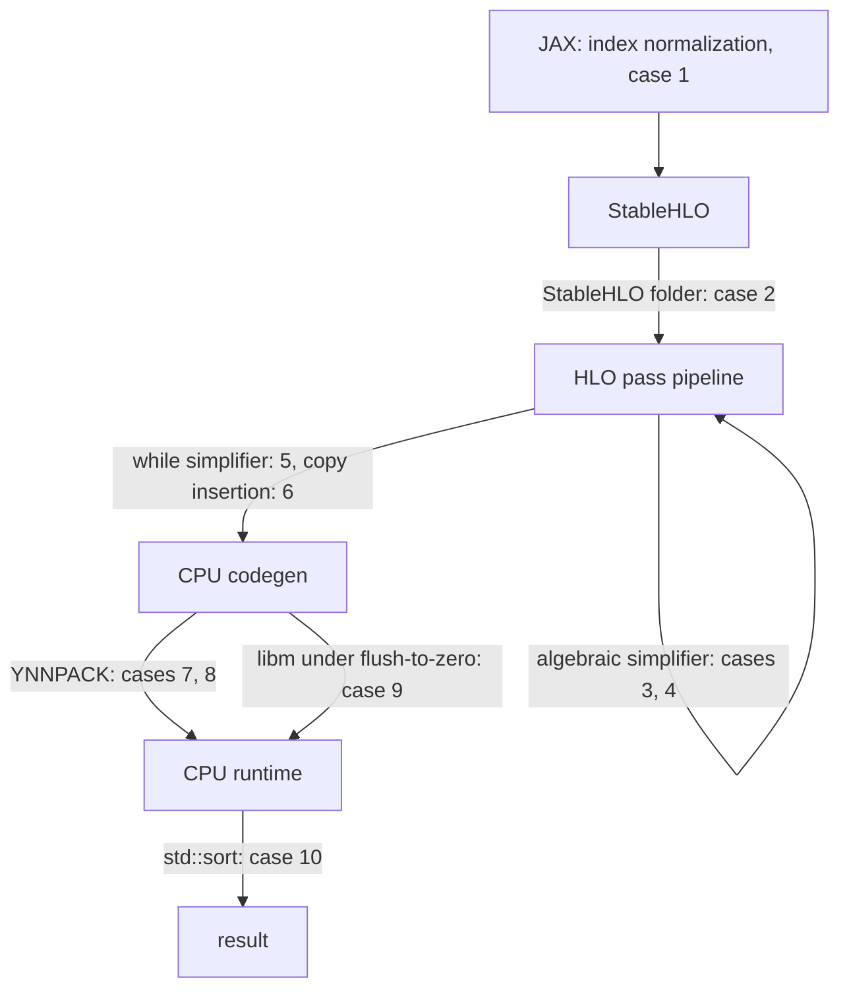

Here is jax 0.12.0.1, the current release, taking the arctangent of a very small number:

```python
import numpy as np, jax, jax.numpy as jnp

x = np.float32(1e-40)                         # 1. A subnormal float32.
print(jax.jit(jnp.arctan)(x))                 # 2. The value on its own.
print(jax.jit(jnp.arctan)(np.full(8, x)))     # 3. The same value, eight times.
print(np.arctan(x))                           # 4. NumPy, for reference.
```

```text
nan
[1.e-40 1.e-40 1.e-40 1.e-40 1.e-40 1.e-40 1.e-40 1.e-40]
1e-40
```

The value gets printed as NaN. But in the array of eight it comes back right. Only the shape changed.

That's one arctangent with two answers. It's also a fair summary of how XLA breaks. It almost never breaks because one component is careless. It breaks at the seams, where two components that each look reasonable disagree about who checks what. Here the scalar goes through glibc's `atan2f` in a floating-point mode glibc doesn't handle. The vector takes a different path (case 9). Each of the ten cases below has an input you can paste and the output it produced. Case 2 is fixed in the current release. The other nine are open issues on openxla/xla or jax-ml/jax. Eight of them were filed on 2026-11-05 with the reproducers shown here.

All JAX outputs come from that release on an x86-64 Ubuntu 26.04 machine. It pins XLA `d867969` (2026-10-15). Where a case changed since jax 0.11.0, both versions are shown. The HLO outputs come from `hlo-opt` and `run_hlo_module` built from source at XLA `907e39b` (2026-11-04), the build described in [Hacking on XLA]().[^xla-src] Throughout, XLA's own interpreter serves as the reference. `run_hlo_module --reference_platform=interpreter` runs a module on the CPU backend and on the interpreter and reports where they disagree. The [XLA review]() covers what each stage of the compiler is for. This post is about its edges.



## 1. Index with an int8

The first one never reaches XLA. JAX lets you index with any integer type, and it accepts negative indices the way NumPy does:

```python
import numpy as np, jax, jax.numpy as jnp
from jax import lax

x = jnp.arange(300)
i = jnp.int8(-1)
print(x[i], jnp.take(x, i), lax.dynamic_index_in_dim(x, i, keepdims=False))
print(lax.dynamic_slice(x, [i], [5]))
print(np.arange(300)[np.int8(-1)])
x.at[i].set(-5)
```

```text
43 43 43
[43 44 45 46 47]
299
OverflowError: Python integer 300 out of bounds for int8
```

Reading `x[-1]` returns element 43 with no error and no warning. It does the same under `jit` and in eager mode, on jax 0.11.0 and 0.12.0.1. Writing through `.at` raises. An int16 or int32 index gives 299 everywhere.

To turn -1 into 299, JAX adds the axis size to the index, and it computes that sum in the index's own dtype:[^jax-slicing]

```python
# jax/_src/lax/slicing.py, _dynamic_slice_indices
if allow_negative_index:
  d_arr = lax.convert_element_type(d, _dtype(i))    # 1. 300 in int8 is 44
  result.append(lax.select(i < 0, i + d_arr, i))    # 2. -1 + 44 = 43
```

`jnp` indexing has its own copy of the same logic in `_normalize_index` using `lax._const(index, axis_size)`. The `.at` path builds the same constant through `normalize_indices`. There, NumPy refuses to put 300 in an int8 and raises, which is why reading and writing fail differently.[^jax-indexing] JAX already knows how to guard this. `jnp.ravel_multi_index` checks that its index dtype can hold the flattened size and says so: "dtype=dtype('int8') not large enough to hold flattened index". The normalization paths don't. Reported as [jax-ml/jax#42354](https://github.com/jax-ml/jax/issues/42354).[^jax42354]

Narrow index types aren't exotic. They come out of quantized lookup tables and compressed token streams, and unsigned ones are fine because they skip normalization. A silently wrong element is the worst way this could fail.

## 2. Divide a constant by zero

jax 0.12.0.1 fixed this one. On jax 0.11.0, this program has three outcomes depending on the machine it runs on:

```python
import jax, jax.numpy as jnp
from jax import lax

# 1. Both operands are literals, so the division happens inside the compiler.
f = jax.jit(lambda: lax.div(jnp.int32(7), jnp.int32(0)))
print(f())
```

On an x86-64 Linux box the process dies before anything executes:

```text
Floating point exception (core dumped)
```

On an Apple-silicon Mac it prints `0`. Pass the 7 and the 0 in as arguments instead of literals, and both machines print `-1`. Here is the backtrace of the x86 crash:

```text
Thread 1 "python" received signal SIGFPE, Arithmetic exception.
#0  llvm::APInt::udiv(llvm::APInt const&) const
#1  llvm::APInt::sdiv(llvm::APInt const&) const
#2  mlir::stablehlo::(anonymous namespace)::FoldDivOpPattern::FoldDivide::foldSint(llvm::APInt, llvm::APInt)
...
#11 mlir::stablehlo::StablehloTargetIndependentOptimizationPass::runOnOperation()
...
#18 xla::(anonymous namespace)::ConvertStablehloToHloProtoInternal(...)
...
#23 xla::PjRtCpuClient::CompileAndLoad(...)
```

None of XLA's HLO passes ever ran. The crash is in StableHLO's constant folder, which runs while the StableHLO module is converted to HLO. The folder found `divide(7, 0)` with two constant operands and computed it with `APInt::sdiv`. LLVM's `APInt` doesn't define division by zero. For a single-word value, it performs a native integer divide. x86's `idiv` traps on a zero divisor, and AArch64's `sdiv` returns zero. So the host CPU's arithmetic decides whether the compiler crashes or quietly produces 0.

XLA's own semantics say integer division by zero "produces an implementation defined value."[^opsem-div] The CPU backend picked -1, and its emitter says so in a comment:

```cpp
// From ElementalIrEmitter::EmitIntegerDivide, xla/service/elemental_ir_emitter.cc.
// Integer division overflow behavior:
//
// X / 0 == -1
// INT_SMIN /s -1 = INT_SMIN
```

XLA's HLO evaluator, which does XLA's own constant folding, agrees and returns -1 for a signed zero divisor.[^evaluator-div] The StableHLO folder was the odd one out. StableHLO fixed it on 2026-07-07 with a guard that refuses to fold an integer division when any divisor element is zero. The comment on the guard is candid about what it prevents:[^shlo-fix]

```cpp
// Returns true if the divisor (second operand) of `op` is a constant integer
// tensor with any zero element. Integer udiv/sdiv/urem/srem by zero would crash
// the constant folder (APInt asserts in debug, SIGFPE in release), so such ops
// must not be folded.
```

jax 0.11.0 doesn't have the guard, because its XLA pin carries StableHLO `c2ceaecc9e`, five commits before the fix. jax 0.12.0.1 does, and the same program prints `-1` there.

The lesson isn't about division. A constant folder is a second implementation of every operation it folds. It runs on the build machine's hardware, inside the compiler's process, with the compiler's undefined behavior.

## 3. Compare a NaN with zero

```python
import numpy as np, jax, jax.numpy as jnp

x = jnp.float32(np.nan)
for name, f in [("exp(x) >= 0", lambda v: jnp.exp(v) >= 0),
                ("x * x >= 0", lambda v: v * v >= 0),
                ("0 <= abs(x)", lambda v: 0 <= jnp.abs(v))]:
    print(f"{name:12s} eager={bool(f(x))}  jit={bool(jax.jit(f)(x))}")
```

```text
exp(x) >= 0  eager=False  jit=True
x * x >= 0   eager=False  jit=True
0 <= abs(x)  eager=False  jit=True
```

Under IEEE comparison every ordered comparison with NaN is false. Eager mode and NumPy agree. Under `jit`, the algebraic simplifier decides the answer at compile time:[^cmp-fold]

```cpp
// xla/hlo/transforms/simplifiers/algebraic_simplifier.cc, HandleCompare
} else if (compare->comparison_direction() == ComparisonDirection::kGe &&
           IsNonNegative(lhs, options_) && IsAll(rhs, 0)) {
  return ReplaceInstruction(compare, MakeScalarLike(compare, true));
```

`IsNonNegative` returns true for `exp`, for `abs` of a float, and for `x * x` of a float.[^isnonneg] Each of those is "not negative", and NaN is not negative. The same predicate guards the `sqrt`, `pow` and `rsqrt` rewrites, where "not negative" is the right question. Folding a comparison to `true` asks a different one: "is this greater than or equal to zero?" NaN fails it. At `907e39b`, with `x = {nan, 1, -1, -inf}`, the CPU backend returns `{1, 1, 1, 1}` for `exp(x) >= 0` and the interpreter returns `{0, 1, 1, 1}`.

This bites code that uses a comparison as a validity check, like `jnp.all(jnp.exp(logits) >= 0)` or a mask built from `v * v >= 0`. Under `jit`, the NaNs pass. Two open pull requests, [#51911](https://github.com/openxla/xla/pull/51911) and [#51912](https://github.com/openxla/xla/pull/51912), extend `IsNonNegative` and add more comparison folds on top of it. Reported as [openxla/xla#52417](https://github.com/openxla/xla/issues/52417).[^i52417]

## 4. Divide by a power

```python
import numpy as np, jax, jax.numpy as jnp

f = lambda a, b: a / jnp.power(a, b)
for a in (3e38, 2e38, 1e38, 2.0):
    a32, b32 = np.float32(a), np.float32(1.0)    # exponent passed at run time
    print(f"x={a:g}: jit={float(jax.jit(f)(a32, b32))}  eager={float(f(jnp.float32(a32), jnp.float32(b32)))}")
```

```text
x=3e+38: jit=0.0  eager=1.0
x=2e+38: jit=0.0  eager=1.0
x=1e+38: jit=0.0  eager=1.0
x=2: jit=1.0  eager=1.0
```

`x / x` is 1, and `jit` says 0. `hlo-opt --passes=algsimp` shows what happened:

```text
%negate = f32[3]{0} negate(%b)
%power = f32[3]{0} power(%a, %negate)
ROOT %multiply = f32[3]{0} multiply(%a, %power)
```

The simplifier rewrote `A / pow(B, C)` as `A * pow(B, -C)`. For `B = 3e38` that turns a quotient of two normal numbers into a product with `pow(3e38, -1)`. That value is about 3.3e-39, below the smallest normal float32. XLA:CPU flushes subnormal results to zero (which comes back in case 9), so the product is 0. The rewrite is guarded only against integer types:[^divpow]

```cpp
// xla/hlo/transforms/simplifiers/algebraic_simplifier.cc, HandleDivide
// A/pow(B,C) => A*pow(B,-C), never for integers: there pow(B,-C) is 0 for
// |B| > 1 (or a wrapped exponent), not a reciprocal.
if (!ShapeUtil::ElementIsIntegral(divide->shape()) &&
    Match(divide, m::Divide(m::Op(&a), m::Power(m::Op(&b), m::Op(&c))))) {
```

Its neighbor, `A / exp(B) => A * exp(-B)`, has the same overflow-and-underflow problem and was put behind `enable_fast_math()` on 2026-09-02.[^fastmath-gates] This one was missed. Reported as [openxla/xla#52418](https://github.com/openxla/xla/issues/52418).[^i52418]

## 5. Write an infinite loop that does nothing

This loop's condition is the constant `true`, and its body sets the only state element to the value it already has:[^i47354]

```text
HloModule Test, entry_computation_layout={()->(s32[1]{0})}
Body {
  param = (s32[1]{0}) parameter(0)
  a = s32[1]{0} constant({0})
  ROOT tuple = (s32[1]{0}) tuple(a)
}
Cond {
  param.1 = (s32[1]{0}) parameter(0)
  ROOT cond = pred[] constant(true)
}
ENTRY Loop {
  a.1 = s32[1]{0} constant({0})
  init = (s32[1]{0}) tuple(a.1)
  ROOT while = (s32[1]{0}) while(init), condition=Cond, body=Body
}
```

It should never finish. At `907e39b` it finishes in 5 ms:

```text
$ run_hlo_module --platform=cpu --print_literals loop.hlo
... compiled and ran in 0.00525393s.
** Result with test runner HloRunner **
(
s32[1] {0}
)
```

The pass dumps show the while-loop simplifier removing the loop in the first simplification iteration. It notices that every element of the loop state is the same constant on entry and after the body. Then it applies a special case that its comment states plainly:[^while-simp]

```cpp
// xla/service/while_loop_simplifier.cc, TryRemoveConstantParams
// Special case: constant_tuple_indices covers the whole while parameter, so
// the new while shape is the empty tuple.  In this case, the value of the
// while loop is simply equal to the value of `init`.
if (ShapeUtil::IsEmptyTuple(new_while_shape)) {
  ABSL_RETURN_IF_ERROR(computation->ReplaceInstruction(while_op, while_init));
  return true;
}
```

"The value of the while loop is simply equal to the value of `init`" holds only if the loop terminates. C++ makes that assumption explicit: an implementation may assume every thread eventually terminates or performs I/O, a volatile access, or a synchronization or atomic operation.[^cpp-progress] XLA's semantics don't state it, but this pass relies on it. The issue was filed in August with a different symptom: the same program converted to StableHLO hangs. So whether it terminates depends on which format it arrived in. The root cause above is now [posted on the issue](https://github.com/openxla/xla/issues/47354#issuecomment-6662218722).

## 6. Turn off copy insertion

`--xla_disable_hlo_passes` takes a comma-separated list of pass names, and it is the standard first step in bisecting a miscompile. Most passes are optimizations, so disabling one costs speed. A few establish invariants that later stages rely on, and the flag doesn't tell the two kinds apart. Here is a three-iteration `fori_loop` with copy insertion disabled:

```python
import jax, jax.numpy as jnp

def loop(y):
    return jax.lax.fori_loop(0, 3, lambda i, a: a * 0.5 + y[i], y[0])

# XLA_FLAGS=--xla_disable_hlo_passes=copy-insertion
print(jax.jit(loop)(jnp.ones((8, 16))))
```

It compiles in 20 ms and never returns, on jax 0.11.0 and at `907e39b` alike. The buffer assignment dump shows why. Copy insertion normally gives the loop its own copy of the initial counter, `constant(0)`. Without it, the counter, its update and the loop state all share the constant's allocation:

```text
allocation 3: size 4, constant:
 value: <19 wrapped_add @0> (size=4,offset=0): s32[]
 value: <27 constant.13 @0> (size=4,offset=0): s32[]
 value: <36 arg_tuple.6{0} (phi) @0> (size=4,offset=0): s32[]
 value: <40 while.2{0} (phi) @0> (size=4,offset=0): s32[]
```

The CPU backend compiles this small loop into a single LLVM function, and it emits the constant allocation as an LLVM `constant` global. LLVM then does what it should with loads from constant memory. It folds every read of the counter to 0, deletes the stores, and proves the loop never exits:

```llvm
; 1. The loop counter now lives in read-only, zero-initialized memory.
@wrapped_add = private unnamed_addr constant [4 x i8] zeroinitializer, align 4

; 2. LLVM inferred that the kernel cannot return.
; Function Attrs: nofree norecurse noreturn nosync nounwind ...
define noalias noundef nonnull ptr @call_kernel(ptr nofree readonly captures(none) %0) {
  ...
while.2.header.i:
  ...
  ; 3. No exit test is left. The back-edge is unconditional.
  br label %while.2.header.i
}
```

Copy insertion isn't an optimization. It's how XLA turns a functional program into one that can update buffers in place, and every later stage assumes it ran. A misspelled name is the opposite trap. `--xla_disable_hlo_passes=copy-insertoin` disables nothing and warns about nothing, so the loop finishes in 19 ms. That one is reported as [openxla/xla#52413](https://github.com/openxla/xla/issues/52413).[^i52413]

## 7. Cast to int8 before a sum

Fake quantization rounds values to a narrow integer type and back before using them. Put a sum after it:

```python
import numpy as np, jax, jax.numpy as jnp

for n in (1024, 4096):
    x = np.full(n, 3.7, np.float32)
    for dt in (jnp.int8, jnp.uint8, jnp.int32):
        s = jax.jit(lambda v, dt=dt: jnp.sum(v.astype(dt).astype(jnp.float32)))(x)
        print(f"n={n} {jnp.dtype(dt).name:5s} sum = {float(s):.1f}   (expected {3 * n})")
x = np.full(4096, 3.7, np.float32); x[0] = -300.0
print("min over uint8 cast:", float(jax.jit(lambda v: jnp.min(v.astype(jnp.uint8).astype(jnp.float32)))(x)))
```

```text
n=1024 int8  sum = 3072.0   (expected 3072)
n=1024 uint8 sum = 3072.0   (expected 3072)
n=1024 int32 sum = 3072.0   (expected 3072)
n=4096 int8  sum = 15155.2   (expected 12288)
n=4096 uint8 sum = 15155.2   (expected 12288)
n=4096 int32 sum = 12288.0   (expected 12288)
min over uint8 cast: -300.0
```

`15155.2` is `3.7 * 4096`, the sum with no conversion at all. The minimum of an array cast to uint8 is -300, which no uint8 can hold. The switch happens at 4,096 elements, because that is where the CPU backend starts handing reductions and their elementwise inputs to the YNNPACK library:[^ynn-threshold]

```cpp
// xla/backends/cpu/ynn_support.cc, IsInstructionPreferredByYnn
constexpr int64_t kMinElements = 4096;
if (HasAtLeastMinElements(instr->shape(), kMinElements)) {
  return true;
}
```

Inside the YNNPACK fusion, the round trip through int8 or uint8 disappears, so neither the truncation nor the saturation happens. int16 isn't a YNNPACK type and stays on XLA's own emitter. int32 is a YNNPACK type, and its round trip survives. At `907e39b` the HLO version of the int8 sum gives 15155.2 on the CPU backend and 12288 on the interpreter. Removing `reduce` from `--xla_cpu_experimental_ynn_fusion_type` brings back the right answer. An open issue, [#49978](https://github.com/openxla/xla/issues/49978), reports the same fusion dropping a bf16 round trip. That one can be argued as excess precision. Dropping an integer cast can't, since it changes integer semantics. Reported as [openxla/xla#52419](https://github.com/openxla/xla/issues/52419).[^i52419]

## 8. Crop a convolution with negative padding

Negative padding is legal in XLA convolutions, and JAX emits it in convolution gradients. This convolution crops all 15 rows of a 15-row input and adds one row of zero padding, so every output value should be 0:

```python
import numpy as np, jax, jax.numpy as jnp
from jax import lax

C, H, W = 17, 15, 6
x = jnp.asarray(np.arange(H * W * C).reshape(1, H, W, C), jnp.float32)
k = jnp.asarray(np.eye(C).reshape(1, 1, C, C), jnp.float32)
dn = lax.ConvDimensionNumbers((0, 3, 1, 2), (3, 2, 0, 1), (0, 3, 1, 2))
# 1. Low padding of -15 on H crops the whole input; high padding of 1 adds a zero row.
f = lambda u, v: lax.conv_general_dilated(u, v, (1, 1), [(-15, 1), (0, 0)],
                                          dimension_numbers=dn)
print(jax.jit(f)(x, k))
```

On jax 0.11.0, 17 channels segfault on both an Apple-silicon Mac and the x86 machine. 16 channels run. The Mac returns all zeros, and the x86 box returns values up to `7.6e31`, which is memory from outside the input buffer read as floats. The issue for that was closed on 2026-10-05 by a fix to the Eigen convolution path, whose padding check had considered only positive padding.[^i48713] In jax 0.12.0.1 and at `907e39b`, 16 channels are correct, and 17 channels still segfault:

```text
Thread 1 "run_hlo_module-" received signal SIGSEGV, Segmentation fault.
#0  __memcpy_avx512_unaligned_erms
#1  slinky::for_each_element<slinky::(anonymous namespace)::copy_impl(...)::$_2, ...>
...
#4  slinky::copy(slinky::raw_buffer const&, slinky::raw_buffer const&, slinky::raw_buffer const&)
...
#8  ynn_runtime::invoke()
#9  xla::cpu::YnnFusionThunk::YnnExecutable::Invoke(...)
#11 xla::cpu::YnnFusionThunk::Execute(xla::cpu::Thunk::ExecuteParams const&)
```

The two channel counts take different paths. With 16 channels the optimized module keeps a plain `convolution`, which runs on Eigen. With 17 the CPU backend wraps the convolution in a `__ynn_fusion` and hands it to YNNPACK. The fix changed only `eigen_spatial_convolutions-inl.h`, so it repaired the wrong values at 16 channels and left the crash at 17 in a different library. The YNNPACK path handles most negative padding. Cropping 1, 8 or 14 rows matches the interpreter. So does a one-row output taken from a real input row, or two rows of pure padding. Of the paddings tried, the only ones that crash leave a single output row made entirely of padding, as in this six-line module:

```text
HloModule ynn_pad
ENTRY e {
  u = f32[1,15,6,17]{3,2,1,0} parameter(0)
  v = f32[1,1,17,17]{3,2,1,0} parameter(1)
  ROOT c = f32[1,1,6,17]{3,2,1,0} convolution(u, v), window={size=1x1 pad=-15_1x0_0}, dim_labels=b01f_01io->b01f
}
```

A segfault is at least loud. An out-of-bounds read that returns plausible floats isn't. Both came from a code path that gradient computations reach without anyone writing negative padding by hand. A backend with two convolution implementations needs every convolution fix applied twice. Reported as [openxla/xla#52411](https://github.com/openxla/xla/issues/52411).[^i52411]

## 9. Take the arctangent of a tiny number

XLA:CPU runs its kernels with subnormal floats flushed to zero. `1e-40 * 2` under `jit` is 0. Most functions are consistent with that and treat a subnormal input as zero. The arctangent from the top of this post doesn't, and it has company:

```python
import numpy as np, jax, jax.numpy as jnp
from jax import lax

x = np.float32(1e-40)                 # subnormal; the smallest normal f32 is ~1.18e-38
v = np.full(8, x, np.float32)
for name, f in [("arctan(x)", jnp.arctan),
                ("arcsin(x)", jnp.arcsin),
                ("arctan2(x, 1)", lambda a: jnp.arctan2(a, 1.0)),
                ("arctan2(x, 0)", lambda a: jnp.arctan2(a, 0.0)),
                ("pow(x, 0.5)", lambda a: lax.pow(a, jnp.float32(0.5)))]:
    print(f"{name:14s} scalar: {jax.jit(f)(x)!s:>12}   8-vector: {jax.jit(f)(v)[0]!s:>12}")
```

```text
arctan(x)      scalar:          nan   8-vector:        1e-40
arcsin(x)      scalar:          nan   8-vector:          nan
arctan2(x, 1)  scalar:          nan   8-vector:        1e-40
arctan2(x, 0)  scalar:          nan   8-vector:          nan
pow(x, 0.5)    scalar: 2.646978e-23   8-vector:          0.0
```

Either answer would be defensible: the true value, or the value with the input flushed to zero. NaN isn't one of those, and neither is `2.6e-23` for the square root of 1e-40. The functions that misbehave also feed others. `jnp.angle` and `jnp.log` of a purely imaginary subnormal such as `1e-45j` come back with NaN imaginary parts.

On the scalar path, the CPU backend emits a call to the C library. `EmitAtan2` declares `atan2f`, and XLA's JIT binds both `atan2f` and `powf` to libm.[^atan2-emit] glibc's implementations misbehave in the floating-point mode the kernel runs in. A short C program on the same machine shows it, with no XLA involved:

```c
volatile float x = 1e-40f;
// FTZ+DAZ off: atan2f(x,1)=9.99995e-41 atan2f(x,0)=1.5708 powf(x,0.5)=9.99997e-21
_MM_SET_FLUSH_ZERO_MODE(_MM_FLUSH_ZERO_ON);
_MM_SET_DENORMALS_ZERO_MODE(_MM_DENORMALS_ZERO_ON);
// FTZ+DAZ on:  atan2f(x,1)=-nan        atan2f(x,0)=-nan   powf(x,0.5)=2.64698e-23
```

`2.64698e-23` is exactly what XLA returned. `atanf` and `asinf` return 0 under the same mode, but JAX never calls them. It lowers `arctan(x)` to the HLO `atan2(x, 1)` and `arcsin(x)` to `atan2(x, sqrt(...))`, so both inherit the NaN. At `907e39b`, the HLO `atan2(1e-40, 1)` returns `-nan` on the CPU backend and `9.99995e-41` on the interpreter. The flush-to-zero mode itself is deliberate, and a 2025 request for an option to disable it was closed.[^ftz-request] The bug is in calling code that wasn't built for that mode. Reported as [openxla/xla#52420](https://github.com/openxla/xla/issues/52420).[^i52420]

## 10. Write `<=` in a sort comparator

XLA's `sort` takes a comparator computation. For ascending order, the operation semantics say only that "the comparator should perform a less-than comparison."[^opsem-sort] The StableHLO spec doesn't add a requirement either.[^shlo-sort] So here is a comparator that uses `<=`:

```text
HloModule sort_le

le {
  a = f32[] parameter(0)
  b = f32[] parameter(1)
  // 1. "<=" where the contract wants "<".
  ROOT r = pred[] compare(a, b), direction=LE
}

ENTRY e {
  x = f32[1024] parameter(0)
  zero = f32[] constant(0)
  z = f32[1024] broadcast(zero), dimensions={}
  // 2. Multiplying by zero isn't folded for floats (NaN * 0 is NaN),
  //    so this stays a run-time all-zero array.
  zeros = f32[1024] multiply(x, z)
  ROOT s = f32[1024] sort(zeros), dimensions={0}, to_apply=le
}
```

Compiled through jaxlib 0.11.0 on x86, this sort segfaults on an all-zero array once it has 17 or more elements. A comparator that always returns `true` makes sorts of 17 or more elements hang. The CPU runtime hands the comparator straight to the standard library:[^sort-lib]

```cpp
// xla/backends/cpu/runtime/sort_lib.cc
if (is_stable) {
  std::stable_sort(data, data + n, comp);
} else {
  std::sort(data, data + n, comp);
}
```

C++ requires the comparator passed to `std::sort` to induce a strict weak ordering.[^cpp-sort] `<=` doesn't, because it says an element is less than itself. libstdc++'s introsort switches to insertion sort below `_S_threshold = 16` elements, which is why 16 elements survive and 17 don't. Above that size it partitions without bounds checks:[^libstdcxx]

```cpp
// libstdc++ bits/stl_algo.h, __unguarded_partition
while (__comp(__first, __pivot))
  ++__first;
--__last;
while (__comp(__pivot, __last))
  --__last;
```

The pivot is meant to stop the first loop, because `comp(pivot, pivot)` is false for any valid comparator. With `<=` on equal elements it's true, so `__first` walks off the end of the buffer. The always-true comparator never reads its operands, so the same loop increments an index forever without touching memory. That's why it hangs instead of segfaulting.

jaxlib 0.12.0.1 and the `907e39b` build behave differently. The `<=` sort completes in both, and the always-true comparator still hangs in both. In jaxlib 0.12.0.1 the hang starts at 17 elements. Undefined behavior means the outcome is whatever the standard library and its build happen to do. Nothing in the stack checks the comparator. Checking it in general would be hard, because strict weak ordering is a property of a function, not of its type. But a debug-build `!comp(x, x)` check would catch these two. The documentation doesn't say that a bad comparator is undefined behavior, and that is what it is. Reported as [openxla/xla#52412](https://github.com/openxla/xla/issues/52412).[^i52412]

## How these were found

None of these came from reading release notes. Four methods produced them:

- **Differential runs.** The same `jit` program ran with and without the YNNPACK fusions (`--xla_cpu_experimental_ynn_fusion_type=-reduce,-individual_dot,-individual_convolution`), over 338 elementwise-then-reduce and dot programs fed NaN, ±inf, ±0, subnormals and integer limits. 156 differed. Most were accumulation-order noise. The structural ones gave case 7 and several already-known issues.
- **A random-expression fuzzer** for the algebraic simplifier. It built 1,500 expressions over about two dozen operations and ran each on a grid of special values with the simplifier on and off. 22 changed class, from finite to inf, from a number to NaN, or in sign. Many traced back to division reassociation, already reported as [#50214](https://github.com/openxla/xla/issues/50214). Case 4 was new.
- **Reading the guards.** Case 3 came from reading what `IsNonNegative` promises and where it is used. Case 5 came from the dump of a reported loop. Case 8 came from re-running the reproducer of a closed issue on a newer build.
- **Edge-case sweeps.** Narrow index dtypes, narrow float types, complex functions and subnormal inputs, each against NumPy, gave cases 1 and 9.

Many of the differential findings were already in the tracker or already fixed on `main`. One example is a sum over `relu(x)` that dropped NaN in jax 0.12.0.1. It was fixed by `a48dbccb66` on 2026-10-20, five days after that release's XLA pin. Every case above was checked against both trackers, and the XLA ones against `907e39b`, before it was filed. Here is where each one stands:

| Case | Issue | Status |
|---|---|---|
| 1. Index with an int8 | [jax-ml/jax#42354](https://github.com/jax-ml/jax/issues/42354) | Open |
| 2. Divide a constant by zero | None needed | Fixed by StableHLO `402df0a`, in jax 0.12.0.1 |
| 3. Compare a NaN with zero | [openxla/xla#52417](https://github.com/openxla/xla/issues/52417) | Open |
| 4. Divide by a power | [openxla/xla#52418](https://github.com/openxla/xla/issues/52418) | Open |
| 5. An infinite loop that does nothing | [openxla/xla#47354](https://github.com/openxla/xla/issues/47354) | Open since 2026-08-16, [root cause added](https://github.com/openxla/xla/issues/47354#issuecomment-6662218722) |
| 6. Misspelled pass names | [openxla/xla#52413](https://github.com/openxla/xla/issues/52413) | Open |
| 7. Cast to int8 before a sum | [openxla/xla#52419](https://github.com/openxla/xla/issues/52419) | Open |
| 8. Negative padding in YNNPACK | [openxla/xla#52411](https://github.com/openxla/xla/issues/52411) | Open |
| 9. Arctangent of a tiny number | [openxla/xla#52420](https://github.com/openxla/xla/issues/52420) | Open |
| 10. `<=` in a sort comparator | [openxla/xla#52412](https://github.com/openxla/xla/issues/52412) | Open |

The build post turned up one more: [openxla/xla#52414](https://github.com/openxla/xla/issues/52414), the pass README that still tells you to implement `Run`.

## The pattern

Put the ten side by side and three seams keep coming up.

**One operation, two implementations.** Integer division has a StableHLO folder, an HLO evaluator and a CPU emitter (case 2). Reductions have XLA's loop emitter and YNNPACK (case 7). Convolutions have Eigen and YNNPACK (case 8). `atan2` has a vectorized intrinsic and a libm call (case 9). `std::sort` has libstdc++ and libc++ (case 10). In every case the two disagree, and which one runs depends on a size threshold, a channel count, a vector width or a build toolchain. A fix that lands in one implementation leaves the other broken, as [#48713](https://github.com/openxla/xla/issues/48713) shows. I don't think the answer is fewer implementations, because the libraries are where the speed comes from. The answer is a differential test per dispatch decision: anything that chooses between two implementations should have a test that runs both on the same edge cases.

**Algebra over the reals.** Cases 3, 4 and 5 are rewrites whose preconditions hold over the reals. A non-negative number is at least zero, `a / b^c = a · b^-c`, and loops terminate. Floats have NaN, subnormals and a finite range, and programs can loop forever. The simplifier is being brought back to IEEE semantics one rule at a time: four rewrites were put behind fast-math between July and October.[^fastmath-gates] Each rule needed its own bug report first. A test that runs every rewrite on NaN, ±0, ±inf, subnormals and the largest finite value would catch most of these in one pass. The fuzzer above found a new one with 1,500 random expressions.

**Contracts that live in prose, or nowhere.** An index dtype must be able to hold the axis length (case 1). Some passes may never be disabled (case 6). A comparator must be a strict weak ordering (case 10). Nothing in the stack writes these down where a tool can see them. Some can't be checked cheaply. All of them can be documented, and the checkable ones belong in the verifier or the frontend.

Other open issues in the tracker fit the same three seams, and anyone hunting should know them:
- **Aborts:** comparing a float6 value with a constant aborts the process ([#51829](https://github.com/openxla/xla/issues/51829)). So does CSE on a duplicate constant with a control successor ([#50549](https://github.com/openxla/xla/issues/50549)).
- **Wrong in-place results:** an in-place `dynamic_update_slice` fusion reads its own output ([#49176](https://github.com/openxla/xla/issues/49176)).
- **Folder vs runtime:**
  - For an odd base and an exponent of 64 or more, integer `power` gives different results on the CPU backend and in the folder. That report was closed as working as intended, because integer overflow is implementation-defined ([#50550](https://github.com/openxla/xla/issues/50550)).
  - Folding a 2048×2048 int32 matmul of constants took 28.4 seconds of compile time against 38.5 ms at run time, because the folding limit counts elements, not work ([#1652](https://github.com/openxla/xla/issues/1652)).[^parser-and-more]

## When XLA breaks on you

- **Diff against the interpreter.** `run_hlo_module --platform=cpu --reference_platform=interpreter` runs the module on both and reports mismatches. The interpreter shares the HLO evaluator with the constant folder, so it catches backend-versus-folder splits too.
- **Turn the libraries off.** `--xla_cpu_experimental_ynn_fusion_type=-reduce,-individual_dot,-individual_convolution` takes YNNPACK out of the picture on CPU. If the answer changes, you have a dispatch bug, not a model bug.
- **Disable the simplifier.** `--xla_disable_hlo_passes=algsimp` is the cheapest bisect step for a wrong answer. Check the spelling, because an unrecognized name is silently ignored.
- **Try a size on each side of a threshold.** 16 and 17 channels, 4,095 and 4,096 elements, a scalar and an 8-vector. When the result changes at a round number, the backend switched implementations there.
- **Check the pin before filing.** jax 0.12.0.1 pins XLA from 2026-10-15. A fix is in your jaxlib only if its commit is an ancestor of the XLA commit your jaxlib pins. Compare the two on GitHub before assuming a bug is still live.

## References

[^xla-src]: **openxla/xla at `907e39b`.** The source tree used for the `hlo-opt` and `run_hlo_module` builds. ([Link](https://github.com/openxla/xla/tree/907e39b762e0f97937e72b62f37486e82ee01cac))

[^opsem-div]: **XLA operation semantics: element-wise binary arithmetic.** "Integer division overflow (signed/unsigned division/remainder by zero or signed division/remainder of `INT_SMIN` with `-1`) produces an implementation defined value." ([Link](https://github.com/openxla/xla/blob/907e39b762e0f97937e72b62f37486e82ee01cac/docs/operation_semantics.md?plain=1#L2250-L2252))

[^evaluator-div]: **`HloEvaluatorTypedVisitor::HandleDivide`.** Returns -1 for a signed zero divisor and `INT_MIN` for `INT_MIN / -1`. ([Link](https://github.com/openxla/xla/blob/907e39b762e0f97937e72b62f37486e82ee01cac/xla/hlo/evaluator/hlo_evaluator_typed_visitor.h#L525-L547))

[^shlo-fix]: **StableHLO: "Guard against integer division-by-zero in stablehlo transforms (#2971)".** Commit `402df0a`, 2026-07-07. The guard, as pinned by XLA `907e39b`, is in `StablehloAggressiveFolder.cpp`. ([Commit](https://github.com/openxla/stablehlo/commit/402df0aca1e420c4c6186a1444f0516d2934b6e1), [guard](https://github.com/openxla/stablehlo/blob/c42e496021bbb4c438adf372d64d4c850ad3f8c5/stablehlo/transforms/optimization/StablehloAggressiveFolder.cpp#L1044-L1071))

[^jax-slicing]: **`jax/_src/lax/slicing.py`, `_dynamic_slice_indices`, at `jax-v0.12.0.1`.** ([Link](https://github.com/jax-ml/jax/blob/jax-v0.12.0.1/jax/_src/lax/slicing.py#L3574-L3579))

[^jax-indexing]: **`jax/_src/numpy/indexing.py` at `jax-v0.12.0.1`.** `normalize_indices` (L374) and `_normalize_index` (L772-L784). The `ravel_multi_index` check is in `lax_numpy.py`. ([indexing.py](https://github.com/jax-ml/jax/blob/jax-v0.12.0.1/jax/_src/numpy/indexing.py#L772-L784), [L374](https://github.com/jax-ml/jax/blob/jax-v0.12.0.1/jax/_src/numpy/indexing.py#L374), [ravel_multi_index](https://github.com/jax-ml/jax/blob/jax-v0.12.0.1/jax/_src/numpy/lax_numpy.py#L2129-L2133))

[^jax42354]: **jax-ml/jax#42354.** "Negative index of a narrow integer dtype is normalized in that dtype: x[jnp.int8(-1)] returns the wrong element when the axis is longer than 127." Filed 2026-11-05. ([Link](https://github.com/jax-ml/jax/issues/42354))

[^cmp-fold]: **`AlgebraicSimplifierVisitor::HandleCompare`.** The `kLt`/`kGt`/`kGe`/`kLe` folds against zero. ([Link](https://github.com/openxla/xla/blob/907e39b762e0f97937e72b62f37486e82ee01cac/xla/hlo/transforms/simplifiers/algebraic_simplifier.cc#L5838-L5849))

[^isnonneg]: **`AlgebraicSimplifierVisitor::IsNonNegative`.** ([Link](https://github.com/openxla/xla/blob/907e39b762e0f97937e72b62f37486e82ee01cac/xla/hlo/transforms/simplifiers/algebraic_simplifier.cc#L540-L606))

[^i52417]: **openxla/xla#52417.** "AlgebraicSimplifier folds x >= 0 to true when IsNonNegative(x), which is wrong for NaN." Filed 2026-11-05. The open PRs are #51911 and #51912. ([Link](https://github.com/openxla/xla/issues/52417), [#51911](https://github.com/openxla/xla/pull/51911), [#51912](https://github.com/openxla/xla/pull/51912))

[^divpow]: **`AlgebraicSimplifierVisitor::HandleDivide`, the `A/pow(B,C)` rewrite.** ([Link](https://github.com/openxla/xla/blob/907e39b762e0f97937e72b62f37486e82ee01cac/xla/hlo/transforms/simplifiers/algebraic_simplifier.cc#L2544-L2562))

[^fastmath-gates]: **Fast-math gates in `AlgebraicSimplifier`.** `6a6c5cb3` (inverse functions, 2026-07-27), `ac12f341` (exponential rewrites, 2026-09-02), `84b7c7f5` (add and multiply reassociation, 2026-10-13), `9cb4e200` (`log(pow(a, b))`, 2026-10-17). ([6a6c5cb3](https://github.com/openxla/xla/commit/6a6c5cb3b99c46c89bda2df75bc88b5009404650), [ac12f341](https://github.com/openxla/xla/commit/ac12f341f5b692466ffe8e76b842723c38407ba7), [84b7c7f5](https://github.com/openxla/xla/commit/84b7c7f54a39aabeaa441ed7d579f032065c0178), [9cb4e200](https://github.com/openxla/xla/commit/9cb4e2005f963acc873dc95facd3b7d134dbf108))

[^i52418]: **openxla/xla#52418.** "AlgebraicSimplifier rewrites A/pow(B,C) to A*pow(B,-C) without fast math; x/pow(x,1) returns 0 on CPU." Filed 2026-11-05. ([Link](https://github.com/openxla/xla/issues/52418))

[^i47354]: **openxla/xla#47354.** "Lifting bug: hang/timeout on CPU after HLO-to-StableHLO conversion." Open since 2026-08-16. The HLO module above is the issue's reproducer. The root-cause comment was added on 2026-11-05. ([Issue](https://github.com/openxla/xla/issues/47354), [comment](https://github.com/openxla/xla/issues/47354#issuecomment-6662218722))

[^while-simp]: **`xla/service/while_loop_simplifier.cc`, `TryRemoveConstantParams`.** ([Link](https://github.com/openxla/xla/blob/907e39b762e0f97937e72b62f37486e82ee01cac/xla/service/while_loop_simplifier.cc#L1061-L1074))

[^cpp-progress]: **C++ working draft, [intro.progress].** The forward-progress assumption. ([Link](https://eel.is/c++draft/intro.progress))

[^i52413]: **openxla/xla#52413.** "`--xla_disable_hlo_passes` silently ignores entries that match no pass." Filed 2026-11-05. ([Link](https://github.com/openxla/xla/issues/52413))

[^ynn-threshold]: **`xla/backends/cpu/ynn_support.cc`, `IsInstructionPreferredByYnn`.** ([Link](https://github.com/openxla/xla/blob/907e39b762e0f97937e72b62f37486e82ee01cac/xla/backends/cpu/ynn_support.cc#L713-L727))

[^i52419]: **openxla/xla#52419.** "YNN reduce fusion drops float -> int8/uint8 -> float round trips, losing truncation and saturation." Filed 2026-11-05. The related bf16 report is #49978. ([Link](https://github.com/openxla/xla/issues/52419), [#49978](https://github.com/openxla/xla/issues/49978))

[^i48713]: **openxla/xla#48713.** "Wrong results / out-of-bounds read in f32 convolution with negative low padding." Closed by `21996a8a`, "Fix out-of-bounds read and crash in spatial convolution with negative padding", 2026-10-05, which changes `xla/tsl/framework/convolution/eigen_spatial_convolutions-inl.h`. ([Issue](https://github.com/openxla/xla/issues/48713), [fix](https://github.com/openxla/xla/commit/21996a8a6ea3083e43c94b024ab163867a381bef))

[^i52411]: **openxla/xla#52411.** "YNN convolution segfaults when negative padding crops the whole dimension and leaves one padded row (follow-up to #48713)." Filed 2026-11-05. ([Link](https://github.com/openxla/xla/issues/52411))

[^atan2-emit]: **`EmitAtan2` and the libm bindings.** `xla/service/cpu/elemental_math_emitter.cc` declares `atan2f`; `xla/backends/cpu/codegen/builtin_definition_generator.cc` registers `atan2` and `pow` as libm symbols. ([elemental_math_emitter.cc](https://github.com/openxla/xla/blob/907e39b762e0f97937e72b62f37486e82ee01cac/xla/service/cpu/elemental_math_emitter.cc#L34-L70), [builtin_definition_generator.cc](https://github.com/openxla/xla/blob/907e39b762e0f97937e72b62f37486e82ee01cac/xla/backends/cpu/codegen/builtin_definition_generator.cc#L147-L149))

[^ftz-request]: **openxla/xla#22858.** "Feature Request: An option to disable flushing to zero on CPU." Closed 2025-02-19. ([Link](https://github.com/openxla/xla/issues/22858))

[^i52420]: **openxla/xla#52420.** "atan2, atan and asin return NaN (and scalar pow a wrong value) for subnormal inputs under flush-to-zero." Filed 2026-11-05. ([Link](https://github.com/openxla/xla/issues/52420))

[^opsem-sort]: **XLA operation semantics: Sort.** ([Link](https://github.com/openxla/xla/blob/907e39b762e0f97937e72b62f37486e82ee01cac/docs/operation_semantics.md?plain=1#L5374-L5390))

[^shlo-sort]: **StableHLO specification: sort.** ([Link](https://github.com/openxla/stablehlo/blob/c42e496021bbb4c438adf372d64d4c850ad3f8c5/docs/spec.md#sort))

[^sort-lib]: **`xla/backends/cpu/runtime/sort_lib.cc`.** The CPU runtime calls `std::sort` or `std::stable_sort` with the compiled comparator. ([Link](https://github.com/openxla/xla/blob/907e39b762e0f97937e72b62f37486e82ee01cac/xla/backends/cpu/runtime/sort_lib.cc#L283-L294))

[^cpp-sort]: **C++ working draft, [alg.sorting.general].** Algorithms that take a `Compare` require it to induce a strict weak ordering on the values. ([Link](https://eel.is/c++draft/alg.sorting.general))

[^libstdcxx]: **libstdc++ `bits/stl_algo.h` (GCC 15.1.0).** `_S_threshold = 16` and `__unguarded_partition`. ([Link](https://github.com/gcc-mirror/gcc/blob/releases/gcc-15.1.0/libstdc%2B%2B-v3/include/bits/stl_algo.h#L1807-L1845))

[^i52412]: **openxla/xla#52412.** "Sort: document that the comparator must be a strict weak ordering; invalid comparators hang or crash the CPU runtime." Filed 2026-11-05. ([Link](https://github.com/openxla/xla/issues/52412))

[^parser-and-more]: **Other issues mentioned in passing.** #51829 (float6 compare aborts), #50549 (HloCSE CHECK with a control successor), #49176 (in-place dynamic-update-slice reads its own output), #50550 (integer power with odd bases, closed as working as intended), #1652 (slow constant folding of large integer arrays, open since 2023). ([#51829](https://github.com/openxla/xla/issues/51829), [#50549](https://github.com/openxla/xla/issues/50549), [#49176](https://github.com/openxla/xla/issues/49176), [#50550](https://github.com/openxla/xla/issues/50550), [#1652](https://github.com/openxla/xla/issues/1652))

---

*Disclaimer: Researched and drafted with AI assistance (Claude Opus 5.5, Gemini 4 Argon). Direction, technical judgment, and final edits are mine; every claim is traceable to the sources cited above.*
