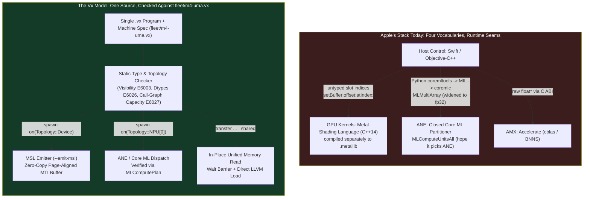

Here is a 38-line program in [Vx](https://vxlang.org)[^vx] that uses three processors on an Apple M4 in a single run:

```rust
// 1. A custom GPU kernel. `Topology::Device` in fleet/m4-uma.vx is the M4 GPU.
//    `Memory::SMEM` is its 32 KiB threadgroup memory. The compiler lowers this
//    body straight to Metal Shading Language.
pub fn reverse_row0(out : &mut Tensor<f32, [4, 64], Memory::HBM>) -> void {
  spawn on(Topology::Device) {
    for r in 0..4 across blocks {
      let mut tile = unsafe { Tensor<f32, [64], Memory::SMEM>::uninit() };
      for t in 0..64 across lanes {
        tile[t] = out[r][t];
      }
      for t in 0..64 across lanes {
        out[r][t] = tile[63 - t];
      }
    }
  }
  return;
}

// 2. A host read across Apple Silicon's unified memory. Because the parameter
//    is borrowed (`&Tensor`) and `view` is only read, the compiler elides the
//    copy and reads the GPU's pages in place after a barrier.
pub fn read_first(t : &Tensor<f32, [4, 64], Memory::HBM>) -> f32 {
  let view = transfer(t, Memory::CPU_DRAM);
  return view[0][0];
}

fn main() -> i32 {
  // 3. Allocate 512x512 fp16 matrices for the Apple Neural Engine (ANE).
  //    Smaller sizes or fp32 inputs will be silently rejected by Core ML's
  //    ANE partitioner; 512x512 in fp16 lands on the ANE hardware.
  let mut a = Tensor<f16, [512, 512], Memory::NPU_HBM>::new();
  let mut b = Tensor<f16, [512, 512], Memory::NPU_HBM>::new();
  let mut c = Tensor<f16, [512, 512], Memory::NPU_HBM>::new();
  for i in 0..512 {
    for j in 0..512 {
      a[i][j] = 2.0;
      b[i][j] = 1.0;
    }
  }

  // 4. Run the matrix multiplication on the Neural Engine.
  spawn on(Topology::NPU[0]) {
    c = a @ b;
  }

  // 5. Feed the ANE output into the M4 GPU kernel, then read it on the CPU.
  let mut host = Tensor<f32, [4, 64]>::new();
  host[0][63] = c[0][0] as f32;
  let mut dev = transfer(host, Memory::HBM);
  reverse_row0(&mut dev);

  print(read_first(&dev));
  return 0;
}
```

Run it on an M4 MacBook Air against the M4 machine specification (`fleet/m4-uma.vx`), with dispatcher logging enabled:

```console
$ VX_DISPATCH_VERBOSE=1 vxc m4_ane_and_gpu.vx --host default --machine fleet/m4-uma.vx
1024
[Vx Dispatcher] Intercepted kernel dispatch: vx_npu_kernel_1 with 3 args
[Vx Dispatcher] Recognised GEMM 512x512x512 f16 -> buffer
[Vx Dispatcher] CoreML plans matmul_512x512_fp16.mlmodelc on the Neural Engine (4 op(s))
--- COREML RAN THE fp16 512x512 MATMUL ---
[Vx Dispatcher] Intercepted kernel dispatch: vx_npu_kernel_0 with 1 args
[Vx Metal] vx_npu_kernel_0: grid 4 x 1 x 1, block 64, 0.010 ms on the GPU
```

One file. One type checker. The `512x512` `f16` projection ran on the 16-core Neural Engine. Its output went into a threadgroup-tiled kernel that `vxc` compiled into Metal Shading Language and ran on the M4 GPU in 10 microseconds. And the CPU read the result out of unified memory without allocating a buffer or copying a byte.

Keep that program in mind while reading the latest reports out of Cupertino. According to Bloomberg's Mark Gurman, Apple CEO John Ternus recently pulled Senior Vice President of Software Engineering Craig Federighi into a closed-door meeting and pressed him to accelerate Apple's AI roadmap.[^gurman] Ternus reportedly wants Apple to move past incremental Siri fixes and deliver autonomous, multi-step AI agents.

Most of the commentary treats that meeting as a cultural standoff. Federighi is cautious and worried about privacy and non-determinism. Ternus is impatient and worried about falling behind OpenAI and Google.

I don't buy the personality explanation. John Ternus ran Hardware Engineering before he became CEO. His old organization already built the exact computer an on-device AI agent wants. Every M4 Mac and A18 Pro iPhone is a unified, internally heterogeneous system-on-chip: performance CPU cores, efficiency CPU cores, an undocumented AMX matrix coprocessor, a tile-based GPU with on-chip threadgroup SRAM, and a 16-core Neural Engine, all sharing one pool of LPDDR5X memory.

Software Engineering is not slow because its engineers lack urgency. It is slow because to run one agent loop across the chip Ternus's team built, an Apple engineer has to write four languages across three runtimes that do not share a type system, an IR, or even a common definition of a pointer.

## What an agent asks of a client chip

A static image classifier is easy to ship on Apple Silicon. You export a frozen graph to Core ML once, load the `.mlmodelc` bundle, and let it run.

An autonomous agent does not look like that. A single multi-step task has to read a user's screen and mail context, draft a plan, invoke a local tool, and verify speculative tokens. It cycles through three distinct hardware regimes inside a few hundred milliseconds. I wrote about this split on datacenter silicon in [Heterogeneity Moved Inside the Chip](). On a battery-powered client device, the regime boundaries are even less forgiving:

1. **Context prefill and vision encoding** are dense and compute-bound. You want them on the Neural Engine in `f16` or quantized blocks so they burn milliwatts instead of watts and leave the GPU free to composite the display at 120 Hz.
2. **KV-cache attention, speculative verification, and custom activations** need dynamic indexing, 32-lane SIMD-group reductions, and explicit 32 KiB threadgroup scratchpad (`SMEM`) tiling on the GPU.
3. **Grammar-constrained sampling, state-machine routing, and tool execution** are latency-sensitive control flow that belong on the CPU and AMX.

Try building that loop in Apple's shipping stack today. You are immediately gluing together four incompatible worlds:



Host orchestration lives in Swift or Objective-C++. Custom GPU kernels live in Metal Shading Language (MSL), which is a dialect of C++14 compiled offline or from runtime strings, bound to host buffers by integer slot numbers (`[[buffer(0)]]`). If you want the Neural Engine, there is no public kernel language at all. You drop into Python, trace a model with `coremltools` into MIL (`mlprogram`), shell out to `xcrun coremlc` to compile a `.mlmodelc` directory bundle, and pass data in and out through `MLMultiArray` objects. If you want AMX on the CPU, you call C routines in `Accelerate`.

Apple's MLX framework[^mlx] is a genuine step forward for research, and its authors understand the hardware well. But MLX is a library with Python, C++, and Swift bindings over Metal and Accelerate. It does not compile kernels for the Neural Engine, and where an array lives or what dtype a device supports remains a runtime property of an `mlx::core::array`. Cross a boundary between your host agent code, a custom Metal kernel, and a Core ML ANE subgraph, and the compiler knows nothing about any of it.

## The Neural Engine trap: `MLComputeUnitsAll` is a wish

I learned the hard way how opaque the Neural Engine boundary is while building Vx's Apple Silicon backend.

To run an operation on the ANE through public APIs, you configure an `MLModel` with `config.computeUnits = MLComputeUnitsAll`. Notice the name. There is no `MLComputeUnitsNeuralEngineOnly`. You hand the model to Core ML and ask its internal partitioner to pick among the CPU, the GPU, and the ANE.

For months, three ANE tests in the Vx repository (`ane_matmul.vx`, `ane_conv.vx`, and an affine test) printed `--- EXECUTING ON APPLE NEURAL ENGINE ---` to the console and passed every CI run. Every one of them was a lie.

The dispatcher printed that banner whenever it took the Core ML code path. What Core ML then did with the model was its own business. Apple added `MLComputePlan`[^mlcomputeplan] in macOS 14.4 to report which device Core ML actually schedules each operation onto. When we wired it up, we found that our `4x4` `fp32` test model was running 100% on the CPU. The numbers came back right (`24.0` in every cell), so the test stayed green while the hardware we thought we were exercising sat dark.

I hate silent fallbacks. In systems work, getting the right answer from the wrong processor is worse than a crash, because a benchmark or a battery trace built on top of it is measuring a fiction.

So we wrote an audit harness (`scripts/tools/ane_device_check.py`) that builds 14 Core ML graphs via `coremltools`, compiles each with `xcrun coremlc`, queries `MLComputePlan` for the exact per-operation device assignment on an M4, and verifies the numerical output against NumPy. Every positive test fails if even one operation in the graph falls back to the CPU or GPU. Every negative control fails if it *does* land on the ANE.

Here is what the M4's Core ML partitioner actually does when you ask for `MLComputeUnitsAll`:

| Graph | Precision | Shape | `MLComputePlan` Device Per Op | Max Relative Error |
| :--- | :--- | :--- | :--- | :--- |
| `matmul_fp32_4x4` | `fp32` | `4 × 4` | `{'matmul': 'CPU'}` | `0.00e+00` |
| `matmul_fp32_1024` | `fp32` | `1024 × 1024` | `{'matmul': 'GPU'}` | `0.00e+00` |
| `matmul_f16_512` | `f16` | `512 × 512` | `{'cast': 'ANE', 'matmul': 'ANE'}` | `3.60e-04` |
| `matmul_f16_1024` | `f16` | `1024 × 1024` | `{'cast': 'ANE', 'matmul': 'ANE'}` | `4.50e-04` |
| `transpose_f16` | `f16` | `1 × 512 × 512` | `{'cast': 'ANE', 'transpose': 'ANE'}` | `2.44e-04` |
| `add_f16_2M` | `f16` | `1 × 2048 × 1024` | `{'cast': 'ANE', 'add': 'ANE'}` | `4.87e-04` |
| `softmax_f16_16M` | `f16` | `1 × 4096 × 4096` | `{'cast': 'ANE', 'softmax': 'ANE'}` | `2.08e-03` |
| `softmax_f16_512_alone` | `f16` | `1 × 512 × 512` | `{'cast': 'CPU', 'softmax': 'CPU'}` | `1.91e-07` |
| `chain_without_matmul` | `f16` | `1 × 512 × 512` | `{'cast': 'CPU', 'layer_norm': 'CPU', 'gelu': 'CPU', 'mul': 'CPU', 'softmax': 'CPU'}` | `5.05e-03` |
| `softmax_f16_512_after_matmul` | `f16` | `1 × 512 × 512` | `{'cast': 'ANE', 'matmul': 'ANE', 'softmax': 'ANE'}` | `3.52e-03` |
| `transformer_block_after_matmul` | `f16` | `1 × 512 × 512` | `{'cast': 'ANE', 'matmul': 'ANE', 'layer_norm': 'ANE', 'gelu': 'ANE', 'softmax': 'ANE'}` | `2.97e-03` |
| `attention_fused` (SDPA) | `f16` | `1 × 256 × 8192` | `{'cast': 'ANE', 'scaled_dot_product_attention': 'ANE'}` | `2.40e-03` |
| `attention_decomposed` | `f16` | `1 × 256 × 8192` | `{'cast': 'ANE', 'matmul': 'ANE', 'mul': 'ANE', 'softmax': 'ANE'}` | `2.58e-03` |

Look at the middle rows of that table.

First, `fp32` never reaches the Neural Engine at any size. A `4x4` `fp32` matmul stays on the CPU. A `1024x1024` `fp32` matmul goes to the GPU. Even in `f16`, square matrix multiplications up to `384x384` stay on the CPU. The ANE only wakes up at `512x512`.

Second, look at `softmax_f16_512_alone` versus `softmax_f16_512_after_matmul`. The standalone `f16` softmax on a `1 × 512 × 512` tensor is placed on the CPU. Add `layer_norm`, `gelu`, and `mul` in front of it (`chain_without_matmul`), and all four operations still run on the CPU. So operation count is not what moves the graph.

Put a `512 × 512` `f16` `matmul` in front of that exact same softmax (`softmax_f16_512_after_matmul`), or in front of the entire `layer_norm -> gelu -> softmax` block (`transformer_block_after_matmul`), and every single operation moves onto the Neural Engine.

**On Apple Silicon, ANE placement is a property of the graph, not of the operation.** The `matmul` is the anchor. Its neighbors ride onto the ANE with it.

And the boundary tax when you cross in and out of Core ML is steep:

```objc
// From runtime/npu_dispatch.mm: how data actually enters a Core ML ANE model.

// 1. Even when the MIL program computes in fp16 on the Neural Engine, Core ML
//    normalizes the model's MLMultiArray boundary to Float32.
MLMultiArray *arrayW =
    [[MLMultiArray alloc] initWithShape:@[ @(d), @(n) ]
                               dataType:MLMultiArrayDataTypeFloat32
                                  error:&error];

// 2. You cannot just wrap an arbitrary heap or mmap'd pointer with
//    initWithDataPointer:shape:dataType:strides:deallocator:error:.
//    The ANE's DMA engine expects IOSurface-backed or strictly aligned memory;
//    handing it an unaligned heap pointer faults inside the driver.
float *dst = (float *)arrayW.dataPointer;
for (size_t i = 0; i < elems; i++) {
  dst[i] = (float)w16[i];
}
```

If an engineer building an agent at Apple splits a transformer block across Metal and Core ML in the wrong place, or passes a dynamic shape below the partitioner's undocumented threshold, nothing fails to compile. Nothing throws an exception. The graph quietly drops off the ANE, widens at the boundary, and runs on the CPU.

## Unified memory is hardware. Zero-copy is software.

The second trap on Apple Silicon is the belief that Unified Memory Architecture (UMA) automatically eliminates copy overhead.

The hardware half of that claim is real. On our development M4 (`MacBook Air, T8132`, 32 GiB LPDDR5X-7500), we measured Metal kernels reading buffers that the CPU had just written in place via `newBufferWithBytesNoCopy:` against buffers already resident on the GPU. The GPU read the freshly written CPU memory at **106.0 GB/s** versus **106.3 GB/s** for GPU-warm memory. That is a ratio of `0.997`. When you actually use the zero-copy path on M4, the seam costs nothing.

An explicit `memcpy` of the same buffer in unified memory runs at **48.9 GB/s**. That is basic arithmetic: a copy inside one physical memory has to both read and write the same bus, moving two bytes of DRAM traffic for every byte copied, so it can never exceed half the 120 GB/s hardware peak.

Here is how easily Metal code falls off the 106.0 GB/s cliff onto the 48.9 GB/s path. Apple's `[MTLDevice newBufferWithBytesNoCopy:length:options:deallocator:]` requires the pointer to be aligned to `vm_page_size` (16 KiB on Apple Silicon) and the byte length to be a multiple of the page size.[^mtl-nocopy] Pass a pointer into the middle of an `mmap`'d weight file or a stack-allocated tensor that does not sit on a 16 KiB boundary, and `newBufferWithBytesNoCopy:` returns `nil`.

Most code responds to that `nil` by calling `newBufferWithBytes:length:options:MTLResourceStorageModeShared`. That call allocates a fresh buffer and copies every byte across unified memory at 48.9 GB/s.

Because Vx controls both the compiler lowering and the Metal runtime (`runtime/metal_dispatch.mm`), it does the page arithmetic around the tensor instead of giving up and copying:

```cpp
// Abbreviated from runtime/metal_dispatch.mm: mapping a Vx tensor onto the M4 GPU.

// 1. Compute the byte span [first, last) that the tensor's strides can reach,
//    then round outward to enclosing Mach VM pages (16 KiB on Apple Silicon).
const uintptr_t page = vm_page_size;
b.first = reinterpret_cast<uintptr_t>(aligned + lo * (int64_t)bytes);
b.last  = reinterpret_cast<uintptr_t>(aligned + hi * (int64_t)bytes);
b.start = b.first & ~(page - 1);
uintptr_t end = (b.last + page - 1) & ~(page - 1);

// 2. Record the element offset from the page boundary to the tensor's start.
//    The generated Metal kernel receives `base` in its constant word buffer
//    (`vx_w`) and indexes from `base`, so the pointer itself stays page-aligned.
const int64_t base =
    (int64_t)(reinterpret_cast<uintptr_t>(aligned) - b.start) / (int64_t)bytes;

// 3. Map the enclosing pages directly into the GPU's address space with no copy.
b.buffer = [device newBufferWithBytesNoCopy:reinterpret_cast<void *>(b.start)
                                     length:end - b.start
                                    options:MTLResourceStorageModeShared
                                deallocator:nil];
```

The other direction is the CPU reading a tensor the GPU just wrote. That path needs help from the type system. Even on unified memory, a GPU tensor and a CPU tensor cannot be the same type. If they were, the CPU could read a buffer while a GPU command buffer was still writing it, or a function written on an M4 would silently segfault when cross-compiled for a discrete GPU over PCIe.

In `fleet/m4-uma.vx`, the return edge from device memory to host memory is declared `shared`:

```rust
// From fleet/m4-uma.vx:
Topology Device {
  arch: applegpu,
  levels: [blocks(max_lanes: 1024, memory: cta), subgroups(lanes: 32), lanes(memory: thread)],
  memory: Memory::HBM,
  visible: [Memory::HBM, Memory::L2, Memory::SMEM],
  dtypes: [f32, bf16, f16, i8, u8, i16, u16, i32, u32, i64, u64, bool],
  transfer Memory::CPU_DRAM -> Memory::HBM : 120 GB/s,
  // Both processors address the same physical LPDDR5X.
  transfer Memory::HBM -> Memory::CPU_DRAM : shared,
  transfer Memory::HBM -> Memory::L2,
  transfer Memory::L2 -> Memory::SMEM
}
```

Look at what `vxc` does with that declaration when compiling two functions that transfer a borrowed GPU tensor back to `Memory::CPU_DRAM`:

```rust
// 1. Read-only on the host: the compiler elides the copy completely.
pub fn inspect(out : &Tensor<f32, [64], Memory::HBM>) -> f32 {
  let host_view = transfer(out, Memory::CPU_DRAM);
  return host_view[0];
}

// 2. Mutated on the host: the compiler must copy so `out` is not clobbered,
//    and warns that the program just paid for a copy on unified memory.
pub fn inspect_mut(out : &Tensor<f32, [64], Memory::HBM>) -> f32 {
  let mut host_view = transfer(out, Memory::CPU_DRAM);
  host_view[0] = 1.0;
  return host_view[0];
}
```

Compile both against `fleet/m4-uma.vx`:

```text
Warning: Warning in function `inspect_mut`: a transfer to CPU_DRAM copies a tensor,
because the program writes an element of the copy. The CPU reads the tensor in place
only when every use of the copy reads it.
```

And dump the LLVM IR (`--action emit-llvm`) for `inspect`:

```llvm
; Emitted by vxc for `inspect` on fleet/m4-uma.vx:
^bb2:
  ; 1. Issue a control barrier (opcode 5) to ensure the GPU has finished writing.
  %22 = llvm.alloca %11 x i32 : (i64) -> !llvm.ptr
  llvm.store %10, %22 : i32, !llvm.ptr
  %23 = llvm.call @vx_plugin_control(%9, %22) : (i32, !llvm.ptr) -> i32

  ; 2. Load element 0 directly from %arg1 (the GPU tensor's aligned pointer).
  ;    No allocation, no memcpy.
  %24 = llvm.getelementptr inbounds|nuw %arg1[%8] : (!llvm.ptr, i64) -> !llvm.ptr, f32
  %25 = llvm.load %24 : !llvm.ptr -> f32
  llvm.return %25 : f32
```

In `inspect`, `transfer(out, Memory::CPU_DRAM)` stays in the source code so the type changes from `Memory::HBM` to `Memory::CPU_DRAM` and the program remains portable to discrete accelerators. Because `fleet/m4-uma.vx` says the edge is `shared` and borrow analysis proves `host_view` is never written, the compiler lowers the transfer to a synchronization barrier followed by a direct load from `%arg1`. In `inspect_mut`, where `host_view[0]` is overwritten, the compiler emits `@vx_plugin_alloc_and_transfer` and warns you at compile time that you just triggered a copy.

## Turning runtime mysteries into compile-time refusals

In [Types Without Places, Places Without Types](), I argued that mainstream languages fail on heterogeneous hardware because they leave location out of the type system. And in [A Type System Is a Search Oracle](), I showed why that matters even more when engineers and coding agents iterate rapidly: a compiler error fed back in milliseconds guides search, whereas a runtime bug discovered in Instruments three hours later stalls the team.

On Apple Silicon, three classes of bugs routinely escape Swift, C++, and Python until runtime. `vxc` catches all three before emitting a single instruction.

### 1. Hardware dtype holes (`E6026`)

Apple's GPUs do not support 64-bit floating point in Metal (`Metal Shading Language Specification`, Table 2.1: *"Metal does not support the double, long long, unsigned long long, and long double data types"*).[^msl-spec] If a scientific or audio-processing step in an agent pipeline places an `f64` tensor on the GPU, frameworks either crash when compiling the shader at runtime or silently downcast your `f64` data to `f32` behind your back.

Vx refuses to alter the arithmetic you asked for. Because `fleet/m4-uma.vx` lists `dtypes: [f32, bf16, f16, i8, u8, i16, u16, i32, u32, i64, u64, bool]`, placing an `f64` tensor in `Memory::HBM` is an immediate compile error:

```rust
fn main() -> i32 {
  let _a = Tensor<f64, [4, 4], Memory::HBM>::new();
  return 0;
}
```

```text
Error[E6026] at m4_f64.vx:2:3: variable '_a' has element type f64, which Device cannot
represent; it declares [f32, bf16, f16, i8, u8, i16, u16, i32, u32, i64, u64, bool]
```

### 2. Interprocedural memory capacity (`E6027` and `E6009`)

Every Apple 9-family GPU limits threadgroup scratchpad (`Memory::SMEM`) to **32 KiB** (`32,768` bytes). On the system side, an on-device agent running in the background on an iPhone or MacBook has a strict unified memory ceiling before XNU's Jetsam kills the process.

A C++ or Rust library can tag a tensor type with a memory space, as Kokkos does. What a library cannot do is add up how much memory a call graph holds live at once. Each function compiles in isolation.

Because `vxc` sees both the call graph and `fleet/m4-uma.vx`, it computes peak live working sets across function calls. Here `outer` stages a 20 KiB tile (`64 × 80 × 4` bytes) into `Memory::SMEM` and calls `inner`, which stages a 16 KiB tile (`64 × 64 × 4` bytes) into `Memory::SMEM` before `outer` releases its own:

```rust
fn inner() -> i32 {
  let y = Tensor<f32, [64, 64]>::new();
  let _tile = transfer(y, Memory::SMEM);
  return 1;
}

fn outer() -> i32 {
  let x = Tensor<f32, [64, 80]>::new();
  let tile = transfer(x, Memory::SMEM);
  let r = inner();
  let _back = transfer(tile, Memory::HBM);
  return r;
}

fn main() -> i32 {
  return outer();
}
```

Neither function exceeds 32 KiB on its own. Together they peak at 36 KiB. `vxc` rejects the program at the call site:

```text
Error[E6027] at m4_smem.vx:10:11: the working set along call path 'outer -> inner' in
memory space 'SMEM' peaks at 36864 bytes, over its 32768 byte capacity: 'outer' holds
20480 bytes across its call, 'inner' itself peaks at 16384 bytes
```

The same admission pass checks total unified memory (`Memory::HBM`) against the target SKU's capacity (`E6009` and `E6010`). An engineer on a 128 GiB MacBook Pro can pass `--machine fleet/iphone-16-pro.vx` on the command line and know at compile time whether an agent's KV cache, draft model, and main weights fit inside the phone's memory envelope.

### 3. Single-source Metal codegen with bit-identical fallback

When you write a GPU kernel in Vx, you do not open a `.metal` file or write C++14 strings. You write a `spawn on(Topology::Device)` block in the same function, using `across blocks` and `across lanes` loops that the compiler checks against the M4's threadgroup limits (`max_lanes: 1024`, `subgroups(lanes: 32)`) and data-race rules (`E6032`).

For `reverse_row0` at the top of this post, `vxc --emit-msl` lowers the MLIR `gpu.module` through structured control flow (`src/dialect/MetalImage.cpp`) and emits standalone Metal Shading Language:

```cpp
// Emitted by `vxc --host default --machine fleet/m4-uma.vx --emit-msl`:
#include <metal_stdlib>
using namespace metal;

// vx.kernel vx_npu_kernel_0 m2
kernel void vx_npu_kernel_0(
    device float *p0 [[buffer(0)]],
    constant uint *vx_w [[buffer(1)]],
    uint3 vx_tgid [[threadgroup_position_in_grid]],
    uint3 vx_tid [[thread_position_in_threadgroup]],
    uint3 vx_ntg [[threadgroups_per_grid]],
    uint3 vx_tptg [[threads_per_threadgroup]],
    uint vx_lane [[thread_index_in_simdgroup]],
    uint vx_simd [[threads_per_simdgroup]]) {
  threadgroup float vx_npu_kernel_0_smem_0[64];
  const int p0_b = as_type<int>(vx_w[0]);
  ...
  vx_npu_kernel_0_smem_0[0 + v30 * 1] = v33;
  threadgroup_barrier(mem_flags::mem_device | mem_flags::mem_threadgroup);
  ...
}
```

Notice two engineering details in that lowering. First, the `Tensor<f32, [64], Memory::SMEM>` declaration inside the Vx loop became `threadgroup float vx_npu_kernel_0_smem_0[64]` with an automatically inserted `threadgroup_barrier(mem_flags::mem_device | mem_flags::mem_threadgroup)` between the two `across lanes` loops. Second, `metal_dispatch.mm` compiles that shader with `options.mathMode = MTLMathModeSafe`, while the CPU twin of the kernel sets `FPCR.FZ` (flush-to-zero for subnormal `f32` values) on `arm64` during execution so that setting `VX_METAL=0` produces the exact same bits on the CPU as on the M4 GPU.

And what happens when an on-device agent hits a reasoning step too large for local silicon and needs to hand off to Apple's Private Cloud Compute (PCC),[^pcc] which runs on Apple Silicon server nodes in the data center?

In Vx, a remote cloud worker is not a separate REST service with a hand-rolled serializer. It is a topology declared with `offload: true`. Because a remote worker does not share physical DRAM with the user's phone, `offload: true` disables the `shared` unified-memory exemption and requires an explicit `transfer(...)` (`E6003`), which lowers directly to Vx's length-framed wire protocol (`runtime/vx_wire.h` and `runtime/vx_remote_routing.h`). The programmer writes the exact same `spawn on` and `transfer` constructs across the CPU, the M4 GPU, the local ANE, and the cloud node.

## What Apple owns that I don't

I want to be explicit about where Vx stops today (`v0.0.3`), because the gap is the strongest part of the argument for why Apple itself should adopt this model.

| Capability on Apple Silicon | Status in Vx `v0.0.3` | What Blocks Going Further Outside Apple |
| :--- | :--- | :--- |
| **Placement, visibility (`E6003`), dtypes (`E6026`), call-graph capacity (`E6027`)** | Built and verified against `fleet/m4-uma.vx` | Nothing. Works today |
| **M4 GPU custom kernels (`arch: applegpu`)** | Compiles Vx to MSL (`--emit-msl`), runs via zero-copy `MTLBuffer` | Atomics, dynamic shared memory, and vector ops in the MSL printer (tracked in repo) |
| **Unified memory `shared` transfer elision** | Built. Lowers read-only host transfers to barrier + in-place load | Nothing. Works today |
| **Apple Neural Engine (`Topology::NPU[0]`)** | Routes `f16` GEMMs to pre-compiled `.mlmodelc` primitives, verified by `MLComputePlan` | **The ANE ISA and compiler below MIL are closed** |
| **Overlapped `spawn on` execution** | Sequential today (`waitUntilCompleted` in `metal_dispatch.mm`) | Moving the wait to `vx_plugin_await_future` at first host use (`docs/spawn_on.md`) |

Look at the fourth row. When `vxc` compiles a kernel for an NVIDIA GPU, it lowers MLIR through NVVM to PTX. When it compiles a kernel for the M4 GPU, it lowers MLIR to Metal Shading Language. When it targets the Apple Neural Engine, it has to stop at the Core ML wall and route recognized patterns into pre-compiled `.mlmodelc` bundles, because Apple does not document the ANE instruction set or expose a public compiler backend below MIL.

From outside Apple, I have to treat Core ML as a black box and interrogate `MLComputePlan` to make sure it didn't quietly dump my `f16` operations onto the CPU.

Apple's own compiler teams do not have that constraint. They sit in the same company as the people who designed the ANE's DMA engines, the AMX coprocessor, the GPU's threadgroup memory, and the XNU scheduler whose P/E core placement quirks I measured in [Tight, Reproducible, and Wrong]().

If Apple embraces Vx, or puts Vx's topology declarations, placement types, and interprocedural capacity algebra directly in front of its internal LLVM, Metal, and ANE backends, the entire Python-to-MIL-to-`coremlc`-to-`MLMultiArray` pipeline disappears. An engineer writing an on-device Siri agent could write one function in one language:

- If a `spawn on(Topology::ANE)` block contains an `f32` operation or a shape that cannot tile onto the Neural Engine's SRAM, the compiler refuses it at build time with a line number instead of silently running it on the CPU in production.
- If a multi-model agent loop allocates a KV cache and a vision buffer that together push unified memory over an iPhone's background footprint limit along one call path, `E6027` catches it in the editor before the patch is committed.
- If a kernel moves data from the ANE to the GPU to the CPU on unified memory, the compiler proves where ownership is read-only, inserts the hardware synchronization barriers, and emits zero copies.

Hardware companies have invented languages before whenever existing languages refused to describe their machines. NVIDIA built CUDA in 2007 because C++ had one pointer type and no notion of a device grid. Apple built Swift to replace Objective-C for application development, and built Metal Shading Language to replace OpenGL GLSL for graphics.

Agentic AI is the first workload that uses the entire Apple Silicon die (CPU, AMX, GPU, and ANE) inside a single tight latency loop. Trying to accelerate that roadmap while keeping those four processors behind four separate languages is fighting the chip with one hand tied behind your back. The silicon is already unified. Unify the language.

---

## References

[^vx]: **Vx (`vxlang.org`).** Open-source heterogeneous systems programming language (Apache-2.0 with LLVM Exceptions). The M4 machine model is [`fleet/m4-uma.vx`](https://github.com/vx-lang/Vx/blob/main/fleet/m4-uma.vx), the Metal dispatcher is [`runtime/metal_dispatch.mm`](https://github.com/vx-lang/Vx/blob/main/runtime/metal_dispatch.mm), the Core ML / ANE dispatcher is [`runtime/npu_dispatch.mm`](https://github.com/vx-lang/Vx/blob/main/runtime/npu_dispatch.mm), and the 14-case `MLComputePlan` audit is [`scripts/tools/ane_device_check.py`](https://github.com/vx-lang/Vx/blob/main/scripts/tools/ane_device_check.py). ([vxlang.org](https://vxlang.org), [GitHub](https://github.com/vx-lang/Vx))

[^gurman]: **Apple CEO urges software chief to accelerate AI efforts.** Reported by Mark Gurman in Bloomberg's *Power On* newsletter (November 2026) and summarized by LinkedIn News, 9to5Mac, and MacRumors: Apple CEO John Ternus pressured SVP of Software Engineering Craig Federighi in a closed-door meeting to accelerate Apple's AI roadmap and move past incremental Siri updates toward autonomous, multi-step AI agents. ([LinkedIn News](https://www.linkedin.com/news/story/apple-ceo-urges-software-chief-to-accelerate-ai-efforts-9658202/), [9to5Mac](https://9to5mac.com/2026/11/08/john-ternus-pushing-craig-federighi-to-move-faster-software-engineering/), [MacRumors](https://www.macrumors.com/2026/11/08/siri-ai-rumored-to-become-more-agentic/))

[^mlx]: **MLX: An array framework for Apple silicon.** Apple Machine Learning Research. Provides lazy evaluation and unified-memory arrays across CPU and Metal GPU with Python, C++, C, and Swift APIs. ([GitHub](https://github.com/ml-explore/mlx), [Documentation](https://ml-explore.github.io/mlx/))

[^mlcomputeplan]: **Apple Developer Documentation: `MLComputePlan`.** Introduced in macOS 14.4 / iOS 17.4 to inspect the estimated cost and preferred compute device (`MLNeuralEngineComputeDevice`, `MLGPUComputeDevice`, `MLCPUComputeDevice`) for each operation in an `MLProgram` model before execution. ([Apple Developer Documentation](https://developer.apple.com/documentation/coreml/mlcomputeplan))

[^mtl-nocopy]: **Apple Developer Documentation: `newBufferWithBytesNoCopy:length:options:deallocator:`.** Requires the memory allocation to be page-aligned (`vm_page_size`) and its length to be a multiple of the system page size, returning `nil` otherwise. ([Apple Developer Documentation](https://developer.apple.com/documentation/metal/mtldevice/1433382-newbufferwithbytesnocopy))

[^msl-spec]: **Metal Shading Language Specification, Version 3.2, §2.1 "Scalar Data Types" (Table 2.1).** Apple Inc. Specifies supported scalar types (`bool`, `char`/`uchar`, `short`/`ushort`, `int`/`uint`, `long`/`ulong`, `half`, `bfloat`, `float`) and explicitly notes: *"Metal does not support the double, long long, unsigned long long, and long double data types."* ([PDF](https://developer.apple.com/metal/Metal-Shading-Language-Specification.pdf))

[^pcc]: **Private Cloud Compute: A new frontier for AI privacy in the cloud.** Apple Security Research. Details Apple's custom Apple Silicon server nodes and stateless inference architecture used when Apple Intelligence requests exceed local on-device capacity. ([Apple Security Blog](https://security.apple.com/blog/private-cloud-compute/))

---

*Disclaimer: Researched and drafted with AI assistance (Gemini 4 Argon). Direction, technical judgment, and final edits are mine; every claim is traceable to the sources cited above. Vx is my own project, and the M4 measurements and compiler outputs were collected on my local development machine.*
