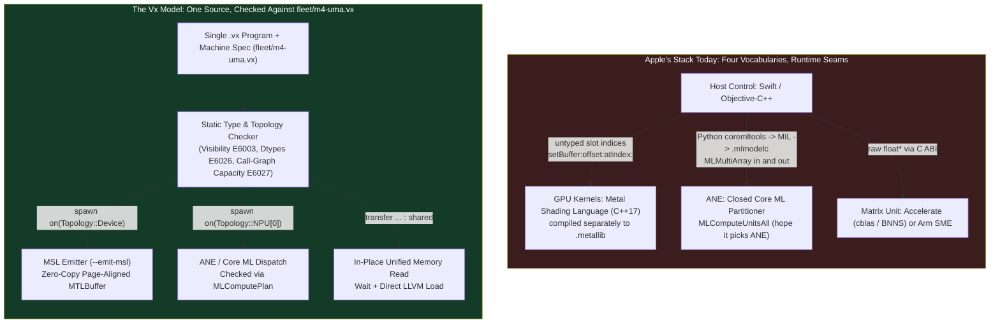

Here is a [Vx](https://vxlang.org)[^vx] program, 38 lines without its comments, that uses three processors on an Apple M4 in a single run:

```rust
// 1. A custom GPU kernel. `Topology::Device` in fleet/m4-uma.vx is the M4 GPU.
//    `Memory::HBM` is Vx's name for a device's main memory. On the M4 it is the
//    same unified memory the CPU uses. `Memory::SMEM` is the GPU's 32 KiB
//    threadgroup memory. The compiler lowers this body to Metal Shading Language.
pub fn reverse_rows(out : &mut Tensor<f32, [4, 64], Memory::HBM>) -> void {
  spawn on(Topology::Device) {
    for r in 0..4 across blocks {
      let mut tile = unsafe { Tensor<f32, [64], Memory::SMEM>::uninit() };
      for t in 0..64 across lanes {
        tile[t] = out[r][t];
      }
      for t in 0..64 across lanes {
        out[r][t] = tile[63 - t];
      }
    }
  }
  return;
}

// 2. A host read across unified memory. Because the parameter is borrowed
//    (`&Tensor`) and `view` is only read, the compiler elides the copy and
//    reads the GPU's pages in place after a wait.
pub fn read_first(t : &Tensor<f32, [4, 64], Memory::HBM>) -> f32 {
  let view = transfer(t, Memory::CPU_DRAM);
  return view[0][0];
}

fn main() -> i32 {
  // 3. Allocate 512 x 512 f16 matrices for the Apple Neural Engine (ANE).
  //    Core ML's partitioner plans every f32 matmul tried, and f16 ones up to
  //    384 x 384, for the CPU or the GPU. At 512 x 512 in f16 it plans the ANE.
  let mut a = Tensor<f16, [512, 512], Memory::NPU_HBM>::new();
  let mut b = Tensor<f16, [512, 512], Memory::NPU_HBM>::new();
  let mut c = Tensor<f16, [512, 512], Memory::NPU_HBM>::new();
  for i in 0..512 {
    for j in 0..512 {
      a[i][j] = 2.0;
      b[i][j] = 1.0;
    }
  }

  // 4. Run the matrix multiplication on the Neural Engine.
  spawn on(Topology::NPU[0]) {
    c = a @ b;
  }

  // 5. Feed the ANE output into the M4 GPU kernel, then read it on the CPU.
  let mut host = Tensor<f32, [4, 64]>::new();
  host[0][63] = c[0][0] as f32;
  let mut dev = transfer(host, Memory::HBM);
  reverse_rows(&mut dev);

  print(read_first(&dev));
  return 0;
}
```

Run it from a Vx checkout on an M4 MacBook Air, against the M4 machine specification (`fleet/m4-uma.vx`), with dispatcher logging on:

```console
$ VX_DISPATCH_VERBOSE=1 vxc m4_ane_and_gpu.vx --host default --machine fleet/m4-uma.vx
1024
[Vx Dispatcher] Intercepted kernel dispatch: vx_npu_kernel_1 with 3 args
[Vx Dispatcher] Recognised GEMM 512x512x512 f16 -> buffer
[Vx Dispatcher] CoreML plans matmul_512x512_fp16.mlmodelc on the Neural Engine (4 op(s))
--- COREML RAN THE fp16 512x512 MATMUL ---
[Vx Dispatcher] Intercepted kernel dispatch: vx_npu_kernel_0 with 1 args
[Vx Metal] vx_npu_kernel_0: grid 4 x 1 x 1, block 64
[Vx Metal] waited for 1 kernel, 0.011 ms on the GPU
```

One file. One type checker. Core ML planned the 512 × 512 `f16` matmul for the 16-core Neural Engine. Its output went into a threadgroup-tiled kernel that `vxc` compiled to Metal Shading Language and ran on the M4 GPU in about 10 microseconds. And the CPU read the result out of unified memory without allocating a buffer or copying a byte. The runtime log calls `reverse_rows` by its internal name, `vx_npu_kernel_0`.

According to Bloomberg's Mark Gurman, Apple CEO John Ternus recently held a closed-door meeting with Senior Vice President of Software Engineering Craig Federighi and pushed him to "accelerate" the company's software road map.[^gurman] Ternus reportedly wants Apple to "move quickly beyond merely making necessary improvements to Siri." Gurman expects Apple could make Siri "more like an agent as early as next year."

It is easy to read that meeting as a clash of temperaments, a careful software chief against an impatient CEO.

I don't buy the personality explanation. Ternus ran Hardware Engineering before he became CEO in September. Since then, all of Apple's hardware reports to him through Johny Srouji, the chief hardware officer whose team designs Apple silicon.[^leadership] That hardware side has already shipped the computer an on-device AI agent wants. Every M4 Mac and A18 Pro iPhone is a unified, internally heterogeneous system-on-chip. It has performance CPU cores, efficiency CPU cores, and a matrix unit beside the CPU. That unit is Apple's undocumented AMX, which M4 and A18 also expose through Arm's documented SME instructions.[^sme] It has a tile-based GPU with on-chip threadgroup memory and a 16-core Neural Engine. All of them share one pool of unified memory.

Software Engineering is not slow because its engineers lack urgency. It is slow because to run one agent loop across that chip, an Apple engineer has to write four languages across three runtimes that do not share a type system, an IR, or even a common definition of a pointer.

## What an agent asks of a client chip

A static image classifier is easy to ship on Apple silicon. You export a frozen graph to Core ML once, load the `.mlmodelc` bundle, and let it run.

An autonomous agent does not look like that. A single multi-step task has to read a user's screen and mail context, draft a plan, invoke a local tool, and verify speculative tokens. It cycles through three distinct hardware regimes inside a few hundred milliseconds. I wrote about this split on datacenter silicon in [Heterogeneity Moved Inside the Chip](). On a battery-powered client device, the regime boundaries are even less forgiving:

1. **Context prefill and vision encoding** are dense and compute-bound. You want them on the Neural Engine in `f16` or quantized blocks so they burn milliwatts instead of watts and leave the GPU free to composite the display at 120 Hz.
2. **KV-cache attention, speculative verification, and custom activations** need dynamic indexing, 32-lane SIMD-group reductions, and explicit 32 KiB threadgroup scratchpad (`SMEM`) tiling on the GPU.
3. **Grammar-constrained sampling, state-machine routing, and tool execution** are latency-sensitive control flow that belong on the CPU and its matrix unit.

Try building that loop in Apple's shipping stack today. You are immediately gluing together four incompatible worlds:



Host orchestration lives in Swift or Objective-C++. Custom GPU kernels live in Metal Shading Language (MSL), which has been based on C++17 since Metal 4.[^msl-spec] MSL is compiled offline or from runtime strings, and it binds to host buffers by integer slot numbers (`[[buffer(0)]]`). If you want the Neural Engine, there is no public kernel language at all. You drop into Python and trace a model with `coremltools` into MIL (`mlprogram`). Then you compile it to a `.mlmodelc` bundle, with `xcrun coremlc` or on the device with `MLModel.compileModel(at:)`, and pass data in and out through `MLMultiArray` objects. For the CPU's matrix unit, you call C routines in `Accelerate`, or on M4 and A18 you write Arm SME code with clang's SME intrinsics.

Apple is narrowing some of these seams. Metal 4 added tensor types to MSL, Shader ML for running small networks inside a shader, and Metal Performance Primitives for matrix multiplication.[^metal4] The M5 GPU puts a Neural Accelerator in every core.[^m5] Core AI, new in iOS and macOS 27, specializes a model for a set of allowed compute units, and `.neuralEngine` is one of them.[^coreai] The Foundation Models framework gives apps an on-device language model with tool calling.[^fm] Each of these closes one seam. None of them puts the host code, the GPU kernel, and the ANE graph in one type system, so a placement mistake is still something you find at run time.

Apple's MLX framework[^mlx] is good research infrastructure, and its authors know the hardware. But MLX is a library, with Python, C++, C, and Swift APIs over Metal. It does not target the Neural Engine. An MLX array has no location at all. It sits in unified memory, and each operation picks the CPU or the GPU through a stream argument at run time. Cross a boundary between your host agent code, a custom Metal kernel, and a Core ML ANE subgraph, and no compiler sees the whole picture.

## The Neural Engine trap: `MLComputeUnitsAll` is a wish

I learned the hard way how opaque the Neural Engine boundary is while building Vx's Apple silicon backend.

Through Core ML, you configure an `MLModel` with `config.computeUnits = MLComputeUnitsAll`, or with `MLComputeUnitsCPUAndNeuralEngine` to keep the GPU out.[^mlcomputeunits] Neither names the Neural Engine alone. Both hand the model to Core ML's internal partitioner, which decides what runs where.

For two months, three ANE tests in the Vx repository (`ane_matmul.vx`, `ane_conv.vx`, and `ane_attention.vx`) printed `--- EXECUTING ON APPLE NEURAL ENGINE ---` to the console and passed every run. Every one of them was a lie.

The dispatcher printed that banner whenever it took the Core ML code path. What Core ML then did with the model was its own business. Apple added `MLComputePlan`[^mlcomputeplan] in macOS 14.4 to report the device Core ML prefers for each operation. It is Core ML's plan, not a trace of execution, but it is the strongest evidence the public API offers. When we wired it up, the plan put our `4x4` `f32` test model entirely on the CPU. The numbers came back right (`24.0` in every cell), so the test stayed green while the hardware we thought we were exercising was not even in the plan.

I hate silent fallbacks. In systems work, getting the right answer from the wrong processor is worse than a crash, because a benchmark or a battery trace built on top of it is measuring a fiction.

Vx has one too. When the dispatcher cannot find its Core ML primitive, for example when `vxc` runs outside the checkout that holds `ane-primitives/`, it runs the matmul on the CPU. It still prints `1024`, and it says so only under `VX_DISPATCH_VERBOSE=1`.

So we wrote an audit harness (`scripts/tools/ane_device_check.py`) that builds 14 Core ML graphs with `coremltools` and compiles each with `xcrun coremlc`. It asks `MLComputePlan` for the planned device of every operation on an M4 and checks the numerical output against NumPy. Every positive test fails if even one operation is planned for the CPU or GPU. Every negative control fails if it *is* planned for the ANE.

Here is what the M4's Core ML partitioner plans when you ask for `MLComputeUnitsAll`, rerun on macOS 27.0.1:

| Graph | Precision | Shape | Planned device per op type (`MLComputePlan`) | Max Relative Error |
| :--- | :--- | :--- | :--- | :--- |
| `matmul_fp32_4x4` | `f32` | `4 × 4` | `{'matmul': 'CPU'}` | `0.00e+00` |
| `matmul_fp32_1024` | `f32` | `1024 × 1024` | `{'matmul': 'GPU'}` | `0.00e+00` |
| `matmul_f16_512` | `f16` | `512 × 512` | `{'cast': 'ANE', 'matmul': 'ANE'}` | `3.60e-04` |
| `matmul_f16_1024` | `f16` | `1024 × 1024` | `{'cast': 'ANE', 'matmul': 'ANE'}` | `4.50e-04` |
| `transpose_f16` | `f16` | `1 × 512 × 512` | `{'cast': 'ANE', 'transpose': 'ANE'}` | `2.44e-04` |
| `add_f16_2M` | `f16` | `1 × 2048 × 1024` | `{'cast': 'ANE', 'add': 'ANE'}` | `4.87e-04` |
| `mul_f16_2M` | `f16` | `1 × 2048 × 1024` | `{'cast': 'ANE', 'mul': 'ANE'}` | `6.91e-04` |
| `softmax_f16_16M` | `f16` | `1 × 4096 × 4096` | `{'cast': 'ANE', 'softmax': 'ANE'}` | `2.08e-03` |
| `softmax_f16_512_alone` | `f16` | `1 × 512 × 512` | `{'cast': 'CPU', 'softmax': 'CPU'}` | `1.91e-07` |
| `chain_without_matmul` | `f16` | `1 × 512 × 512` | `{'cast': 'CPU', 'layer_norm': 'CPU', 'gelu': 'CPU', 'mul': 'CPU', 'softmax': 'CPU'}` | `5.05e-03` |
| `softmax_f16_512_after_matmul` | `f16` | `1 × 512 × 512` | `{'cast': 'ANE', 'matmul': 'ANE', 'softmax': 'ANE'}` | `3.52e-03` |
| `transformer_block_after_matmul` | `f16` | `1 × 512 × 512` | `{'cast': 'ANE', 'matmul': 'ANE', 'layer_norm': 'ANE', 'gelu': 'ANE', 'softmax': 'ANE'}` | `2.97e-03` |
| `attention_fused` (SDPA) | `f16` | `1 × 256 × 8192` | `{'cast': 'ANE', 'scaled_dot_product_attention': 'ANE'}` | `2.40e-03` |
| `attention_decomposed` | `f16` | `1 × 256 × 8192` | `{'cast': 'ANE', 'matmul': 'ANE', 'mul': 'ANE', 'softmax': 'ANE'}` | `2.58e-03` |

First, `f32` never reaches the Neural Engine at any size tried. A `4 × 4` `f32` matmul is planned for the CPU and a `1024 × 1024` one for the GPU. In `f16`, the sweep in Vx's primitive generator found square matmuls up to `384 × 384` planned for the CPU, with the ANE taking over at `512 × 512`.

Second, compare `softmax_f16_512_alone` with `softmax_f16_512_after_matmul`. The standalone `f16` softmax on a `1 × 512 × 512` tensor is planned for the CPU. Put `layer_norm`, `gelu`, and `mul` in front of it (`chain_without_matmul`), and all four operations are still planned for the CPU. So operation count is not what moves the graph.

Put a `512 × 512` `f16` `matmul` in front of that same softmax (`softmax_f16_512_after_matmul`), or in front of a `layer_norm -> gelu -> softmax` chain (`transformer_block_after_matmul`), and every operation is planned for the Neural Engine.

**On Apple silicon, ANE placement is a property of the graph, not of the operation.** The `matmul` is the anchor. Its neighbors ride onto the ANE with it.

Crossing into Core ML also costs Vx a copy today:

```objc
// Adapted from runtime/npu_dispatch.mm: how an f16 tensor enters Vx's Core ML matmul.

// 1. The matmul primitive Vx generates takes f32 inputs and computes in f16,
//    so the dispatcher widens each f16 element into an f32 array that Core ML
//    allocates. Core ML has accepted f16 arrays since iOS 16, so a primitive
//    with f16 inputs and outputs would remove this loop.
MLMultiArray *arrayW =
    [[MLMultiArray alloc] initWithShape:@[ @(d), @(n) ]
                               dataType:MLMultiArrayDataTypeFloat32
                                  error:&error];
float *dst = (float *)arrayW.dataPointer;
for (size_t i = 0; i < elems; i++) {
  dst[i] = (float)w16[i];
}
```

That copy is Vx's own debt, not a Core ML rule. The generator declares `f32` inputs, and `coremltools` can declare `f16` ones for a model that targets iOS 16 or later.[^coremltools-io]

If an engineer building an agent at Apple splits a transformer block across Metal and Core ML in the wrong place, or passes a shape below the partitioner's undocumented threshold, nothing fails to compile. Nothing throws an exception. The plan quietly moves the graph off the ANE and onto the CPU.

## Unified memory is hardware. Zero-copy is software.

The second trap on Apple silicon is the belief that Unified Memory Architecture (UMA) automatically eliminates copy overhead.

The hardware half of that claim is real. On our development M4 (`MacBook Air, T8132`, 32 GB of unified memory), we measured Metal kernels reading buffers that the CPU had just written in place via `newBufferWithBytesNoCopy:` against buffers already resident on the GPU. The GPU read the freshly written CPU memory at **106.0 GB/s** versus **106.3 GB/s** for GPU-warm memory. That is a ratio of `0.997`. When you actually use the zero-copy path on M4, the seam costs nothing.

An explicit `memcpy` of the same buffer in unified memory runs at **48.9 GB/s**. That is basic arithmetic. A copy inside one physical memory has to both read and write the same bus, moving two bytes of DRAM traffic for every byte copied, so it can never exceed half the 120 GB/s hardware peak.[^m4-air]

Here is how easily Metal code falls off the 106.0 GB/s path onto the 48.9 GB/s one. Apple documents that `[MTLDevice newBufferWithBytesNoCopy:length:options:deallocator:]` takes a page-aligned pointer and a length that ends the region on a page boundary, where a page is `vm_page_size` (16 KiB on Apple silicon).[^mtl-nocopy] A tensor in the middle of an `mmap`'d weight file or a stack frame does not meet that contract.

Code that hits it either breaks the contract and hopes, or falls back to `newBufferWithBytes:length:options:`. That call allocates a fresh buffer and copies every byte across unified memory at 48.9 GB/s.

Because Vx controls both the compiler lowering and the Metal runtime (`runtime/metal_dispatch.mm`), it does the page arithmetic around the tensor and maps the enclosing pages instead of copying. It copies only when Metal refuses the memory:

```cpp
// Abbreviated from runtime/metal_dispatch.mm: mapping a Vx tensor onto the M4 GPU.

// 1. Find the byte span [first, last) that the tensor's strides can reach,
//    then round it outward to whole Mach VM pages (16 KiB on Apple silicon).
const uintptr_t page = vm_page_size;
const Access reach = reachOf(desc, rank, bytes);
b.first = reach.first;
b.last = reach.last;
b.start = b.first & ~(page - 1);
b.end = (b.last + page - 1) & ~(page - 1);

// 2. Record the element offset from the page boundary to the tensor's start.
//    The generated Metal kernel receives `base` in its constant word buffer
//    (`vx_w`) and indexes from it, so the buffer itself stays page-aligned.
const int64_t base =
    (int64_t)(reinterpret_cast<uintptr_t>(aligned) - b.start) /
    (int64_t)bytes;

// 3. Map the enclosing pages into the GPU's address space with no copy.
//    Tensors whose page spans overlap share one region.
r.buffer =
    [device newBufferWithBytesNoCopy:reinterpret_cast<void *>(r.start)
                              length:r.end - r.start
                             options:MTLResourceStorageModeShared
                         deallocator:nil];
```

The other direction is the CPU reading a tensor the GPU just wrote. That path needs help from the type system. Even on unified memory, a GPU tensor and a CPU tensor cannot be the same type. If they were, the CPU could read a buffer while a GPU command buffer was still writing it, or a function written on an M4 would silently segfault when cross-compiled for a discrete GPU over PCIe.

In `fleet/m4-uma.vx`, the return edge from device memory to host memory is declared `shared`:

```rust
// From fleet/m4-uma.vx (comments above the fields omitted):
Topology Device {
  arch: applegpu,
  levels: [blocks(max_lanes: 1024, memory: cta), subgroups(lanes: 32), lanes(memory: thread)],
  memory: Memory::HBM,
  visible: [Memory::HBM, Memory::L2, Memory::SMEM],
  dtypes: [f32, bf16, f16, i8, u8, i16, u16, i32, u32, i64, u64, bool],
  transfer Memory::CPU_DRAM -> Memory::HBM : 120 GB/s,
  // The CPU reads the GPU's memory directly. A transfer of a `&` tensor back to the CPU is
  // still a copy for the type system, but when the program only reads the copy, the CPU
  // waits for the GPU and reads the tensor in place. An owned tensor is still copied.
  transfer Memory::HBM -> Memory::CPU_DRAM : shared,
  transfer Memory::HBM -> Memory::L2,
  transfer Memory::L2 -> Memory::SMEM
}
```

Take two functions that transfer a borrowed GPU tensor back to `Memory::CPU_DRAM`:

```rust
// 1. Read-only on the host: the compiler elides the copy completely.
pub fn inspect(out : &Tensor<f32, [64], Memory::HBM>) -> f32 {
  let host_view = transfer(out, Memory::CPU_DRAM);
  return host_view[0];
}

// 2. Mutated on the host: the compiler must copy so `out` is not clobbered,
//    and warns that the program just paid for a copy on unified memory.
pub fn inspect_mut(out : &Tensor<f32, [64], Memory::HBM>) -> f32 {
  let mut host_view = transfer(out, Memory::CPU_DRAM);
  host_view[0] = 1.0;
  return host_view[0];
}
```

Compile both against `fleet/m4-uma.vx`:

```text
Warning: Warning in function `inspect_mut`: a transfer to CPU_DRAM copies a tensor,
because the program writes an element of the copy. The CPU reads the tensor in place
only when every use of the copy reads it.
```

`--action emit-llvm` prints the LLVM-dialect MLIR for `inspect`:

```mlir
// Emitted by vxc for `inspect` on fleet/m4-uma.vx (abbreviated):
^bb2:
  ...
  // 1. Wait for the GPU launches that write this tensor. %10 is the constant 6,
  //    VX_CTRL_WAIT_FOR_TENSORS, and %30 is a request that names the tensor.
  %42 = llvm.call @vx_plugin_control(%10, %30) : (i32, !llvm.ptr) -> i32

  // 2. Load element 0 directly from %arg1 (the GPU tensor's aligned pointer).
  //    No allocation, no memcpy.
  %43 = llvm.getelementptr inbounds|nuw %arg1[%9] : (!llvm.ptr, i64) -> !llvm.ptr, f32
  %44 = llvm.load %43 : !llvm.ptr -> f32
  llvm.return %44 : f32
```

In `inspect`, `transfer(out, Memory::CPU_DRAM)` stays in the source code so the type changes from `Memory::HBM` to `Memory::CPU_DRAM` and the program remains portable to discrete accelerators. Because `fleet/m4-uma.vx` says the edge is `shared` and borrow analysis proves `host_view` is never written, the compiler lowers the transfer to a wait on the launches that write the tensor, followed by a direct load from `%arg1`. In `inspect_mut`, where `host_view[0]` is overwritten, the compiler emits `@vx_plugin_alloc_and_transfer` and warns you at compile time that you just triggered a copy.

## Turning runtime mysteries into compile-time refusals

In [Types Without Places, Places Without Types](), I argued that mainstream languages fail on heterogeneous hardware because they leave location out of the type system. And in [A Type System Is a Search Oracle](), I showed why that matters even more when engineers and coding agents iterate rapidly: a compiler error fed back in milliseconds guides search, whereas a runtime bug discovered in Instruments three hours later stalls the team.

On Apple silicon, three classes of bugs routinely escape Swift, C++, and Python until runtime. `vxc` catches all three before emitting a single instruction.

### 1. Hardware dtype holes (`E6026`)

Apple's GPUs do not support 64-bit floating point in Metal. The Metal Shading Language Specification says so directly: *"Metal does not support the double, long long, unsigned long long, and long double data types."*[^msl-spec] If a scientific or audio-processing step in an agent pipeline places an `f64` tensor on the GPU, the failure shows up at run time. MLX, for one, raises an exception when the operation runs.[^mlx]

Vx refuses to alter the arithmetic you asked for. Because `fleet/m4-uma.vx` lists `dtypes: [f32, bf16, f16, i8, u8, i16, u16, i32, u32, i64, u64, bool]`, placing an `f64` tensor in `Memory::HBM` is an immediate compile error:

```rust
fn main() -> i32 {
  let _a = Tensor<f64, [4, 4], Memory::HBM>::new();
  return 0;
}
```

```text
Error[E6026] at m4_f64.vx:2:3: variable '_a' has element type f64, which Device cannot
represent; it declares [f32, bf16, f16, i8, u8, i16, u16, i32, u32, i64, u64, bool]
```

### 2. Interprocedural memory capacity (`E6027` and `E6009`)

Apple GPUs limit threadgroup scratchpad (`Memory::SMEM`) to **32 KiB** (`32,768` bytes), from the Apple4 family through Apple11. The M4's GPU is Apple9.[^feature-tables] On the system side, an on-device agent running in the background on an iPhone or MacBook has a strict unified memory ceiling before XNU's Jetsam kills the process.

A C++ or Rust library can tag a tensor type with a memory space, as Kokkos does. What a library cannot do is add up how much memory a call graph holds live at once. Each function compiles in isolation.

Because `vxc` sees both the call graph and `fleet/m4-uma.vx`, it computes peak live working sets across function calls. Here `outer` stages a 20 KiB tile (`64 × 80 × 4` bytes) into `Memory::SMEM` and calls `inner`, which stages a 16 KiB tile (`64 × 64 × 4` bytes) into `Memory::SMEM` before `outer` releases its own:

```rust
fn inner() -> i32 {
  let y = Tensor<f32, [64, 64]>::new();
  let _tile = transfer(y, Memory::SMEM);
  return 1;
}

fn outer() -> i32 {
  let x = Tensor<f32, [64, 80]>::new();
  let tile = transfer(x, Memory::SMEM);
  let r = inner();
  let _back = transfer(tile, Memory::HBM);
  return r;
}

fn main() -> i32 {
  return outer();
}
```

Neither function exceeds 32 KiB on its own. Together they peak at 36 KiB. `vxc` rejects the program at the call site:

```text
Error[E6027] at m4_smem.vx:10:11: the working set along call path 'outer -> inner' in
memory space 'SMEM' peaks at 36864 bytes, over its 32768 byte capacity: 'outer' holds
20480 bytes across its call, 'inner' itself peaks at 16384 bytes
```

The same admission pass checks total unified memory (`Memory::HBM`) against the machine's capacity (`E6009` and `E6010`). Vx does not ship an iPhone machine specification yet. With one, an engineer on a 128 GiB MacBook Pro could pass it with `--machine` and know at compile time whether an agent's KV cache, draft model, and main weights fit inside the phone's memory envelope.

### 3. Single-source Metal codegen with a bit-identical CPU fallback

When you write a GPU kernel in Vx, you do not open a `.metal` file or write MSL in C++ strings. You write a `spawn on(Topology::Device)` block in the same function, using `across blocks` and `across lanes` loops. The compiler checks them against the M4's threadgroup limits (`max_lanes: 1024`, `subgroups(lanes: 32)`) and against data races.

For `reverse_rows` at the top of this post, `vxc --emit-msl` lowers the MLIR `gpu.module` through structured control flow (`src/dialect/MetalImage.cpp`). It writes standalone Metal Shading Language, with a `.json` file beside it that describes each kernel's launch:

```cpp
// Emitted by `vxc --host default --machine fleet/m4-uma.vx --emit-msl` (abbreviated):
// Written by vxc for the Apple GPU.
#include <metal_stdlib>
using namespace metal;

// vx.kernel reverse_rows m2
kernel void reverse_rows(
    device float *p0 [[buffer(0)]],
    constant uint *vx_w [[buffer(1)]],
    uint3 vx_tgid [[threadgroup_position_in_grid]],
    uint3 vx_tid [[thread_position_in_threadgroup]],
    uint3 vx_ntg [[threadgroups_per_grid]],
    uint3 vx_tptg [[threads_per_threadgroup]],
    uint vx_lane [[thread_index_in_simdgroup]],
    uint vx_simd [[threads_per_simdgroup]]) {
  threadgroup float vx_npu_kernel_0_smem_0[64];
  const int p0_b = as_type<int>(vx_w[0]);
  ...
              float v32 = p0[o31 + v28 * 1];
              vx_npu_kernel_0_smem_0[0 + v28 * 1] = v32;
  ...
        threadgroup_barrier(mem_flags::mem_device | mem_flags::mem_threadgroup);
  ...
}
```

The `Tensor<f32, [64], Memory::SMEM>` declaration inside the Vx loop became `threadgroup float vx_npu_kernel_0_smem_0[64]`. The compiler put a `threadgroup_barrier(mem_flags::mem_device | mem_flags::mem_threadgroup)` after each `across lanes` loop, so the second loop reads only what the first finished writing.

`metal_dispatch.mm` compiles the shader with `options.mathMode = MTLMathModeSafe`. The GPU flushes subnormal `f32` values to zero, so the CPU copy of the kernel sets `FPCR.FZ` on `arm64` while it runs. The test `apple_gpu_kernels_give_the_same_bits_as_the_cpu.vx` runs a blur, a tiled matrix product, a subnormal halving, and other kernels on the M4 GPU and again with `VX_METAL=0` on the CPU. It requires both runs to print the same numbers, to the last digit.[^bits-test]

And what happens when an on-device agent hits a reasoning step too large for local silicon and needs to hand off to Apple's Private Cloud Compute (PCC),[^pcc] which runs on Apple silicon server nodes in the data center?

In Vx, a remote cloud worker is not a separate REST service with a hand-rolled serializer. It is a topology declared with `offload: true`. A worker on another node does not share the phone's memory, so `offload: true` removes the exemption that shared memory gets: a host tensor needs an explicit `transfer(...)` (`E6003`), as on a discrete GPU.[^offload] That transfer goes over Vx's length-framed wire protocol (`runtime/vx_wire.h` and `runtime/vx_remote_routing.h`). The programmer writes the same `spawn on` and `transfer` constructs across the CPU, the M4 GPU, the local ANE, and the cloud node.

## What Apple owns that I don't

Vx's last release is `v0.0.3`. The Apple GPU backend described here is newer and lives on `main`. Where it stops is the strongest part of the argument for Apple adopting this model.

| Capability on Apple silicon | Status on Vx `main` (2026-11-08) | What Blocks Going Further Outside Apple |
| :--- | :--- | :--- |
| **Placement, visibility (`E6003`), dtypes (`E6026`), call-graph capacity (`E6027`)** | Built and checked against `fleet/m4-uma.vx` | Nothing. Works today |
| **M4 GPU custom kernels (`arch: applegpu`)** | Compiles Vx to MSL (`--emit-msl`), runs via zero-copy `MTLBuffer`, with `i32` and `u32` atomics | Dynamic shared memory and vector ops in the MSL printer (`docs/gpu_backends.md`) |
| **Unified memory `shared` transfer elision** | Built. Lowers read-only host transfers to a wait plus an in-place load | Nothing. Works today |
| **Apple Neural Engine (`Topology::NPU[0]`)** | Routes `f16` GEMMs to pre-compiled `.mlmodelc` primitives, checked against `MLComputePlan` | **The ANE ISA and compiler below MIL are closed** |
| **Overlapped `spawn on` execution** | Partly built. Metal launches share one command buffer, and a wait blocks only on the launches that touch its memory | The Core ML path still ends in `waitUntilCompleted` (`docs/spawn_on.md`) |

When `vxc` compiles a kernel for an NVIDIA GPU, it lowers MLIR through NVVM to PTX. When it compiles a kernel for the M4 GPU, it lowers MLIR to Metal Shading Language. When it targets the Apple Neural Engine, it has to stop at the Core ML wall and route recognized patterns into pre-compiled `.mlmodelc` bundles, because Apple does not document the ANE instruction set or expose a public compiler backend below MIL.

From outside Apple, I have to treat Core ML as a black box and ask `MLComputePlan` where it plans to put my `f16` operations.

Apple's own compiler teams do not have that constraint. They sit in the same company as the people who designed the ANE, the CPU's matrix unit, the GPU's threadgroup memory, and the XNU scheduler whose P/E core placement quirks I measured in [Tight, Reproducible, and Wrong]().

If Apple adopted Vx, or put Vx's topology declarations, placement types, and interprocedural capacity algebra in front of its internal LLVM, Metal, and ANE backends, the Python-to-MIL-to-`coremlc`-to-`MLMultiArray` pipeline could go away. An engineer writing an on-device Siri agent could write one function in one language:

- If a `spawn on(Topology::NPU[0])` block contains an `f32` operation or a shape the Neural Engine cannot take, the compiler refuses it at build time with a line number instead of silently running it on the CPU in production.
- If a multi-model agent loop allocates a KV cache and a vision buffer that together push unified memory over an iPhone's background footprint limit along one call path, `E6027` catches it in the editor before the patch is committed.
- If a kernel moves data from the ANE to the GPU to the CPU on unified memory, the compiler proves where ownership is read-only, inserts the waits, and emits no copies.

Hardware companies have built languages before when existing ones could not describe their machines. NVIDIA released CUDA in 2007 as an extension of C, with qualifiers for where a function runs (`__global__`, `__device__`) and where a variable lives (`__shared__`, `__constant__`).[^cuda] Apple built Swift to replace Objective-C for application development, and built Metal Shading Language to replace OpenGL's GLSL for graphics on its platforms.

Agentic AI uses the whole Apple silicon die (CPU, matrix unit, GPU, and ANE) inside one tight latency loop. Accelerating that roadmap while those four processors sit behind four languages means fighting the chip. The silicon is already unified. Unify the language.

---

## References

[^vx]: **Vx (`vxlang.org`).** Open-source heterogeneous systems programming language (Apache-2.0 with LLVM Exceptions). The M4 machine model is [`fleet/m4-uma.vx`](https://github.com/vx-lang/Vx/blob/main/fleet/m4-uma.vx), the Metal dispatcher is [`runtime/metal_dispatch.mm`](https://github.com/vx-lang/Vx/blob/main/runtime/metal_dispatch.mm), the Core ML / ANE dispatcher is [`runtime/npu_dispatch.mm`](https://github.com/vx-lang/Vx/blob/main/runtime/npu_dispatch.mm), and the 14-case `MLComputePlan` audit is [`scripts/tools/ane_device_check.py`](https://github.com/vx-lang/Vx/blob/main/scripts/tools/ane_device_check.py). ([vxlang.org](https://vxlang.org), [GitHub](https://github.com/vx-lang/Vx))

[^gurman]: **Ternus pushes Federighi to speed up Apple's software road map.** Reported by Mark Gurman in Bloomberg's *Power On* newsletter on 2026-11-08. MacRumors quotes Ternus's push to "accelerate" the software roadmap and to move "beyond merely making necessary improvements to Siri," and Gurman's view that Apple could make Siri "more like an agent as early as next year." 9to5Mac covers the same closed-door meeting as a push to speed up software engineering, and LinkedIn News summarizes it. ([MacRumors](https://www.macrumors.com/2026/11/08/siri-ai-rumored-to-become-more-agentic/), [9to5Mac](https://9to5mac.com/2026/11/08/john-ternus-pushing-craig-federighi-to-move-faster-software-engineering/), [LinkedIn News](https://www.linkedin.com/news/story/apple-ceo-urges-software-chief-to-accelerate-ai-efforts-9658202/))

[^leadership]: **Apple leadership changes, 2026.** Apple Newsroom. John Ternus, previously senior vice president of Hardware Engineering, became CEO on 2026-09-01. Johny Srouji, who led Hardware Technologies and with it Apple silicon, became chief hardware officer on 2026-04-20 and now reports to Ternus. ([Ternus](https://www.apple.com/newsroom/2026/04/tim-cook-to-become-apple-executive-chairman-john-ternus-to-become-apple-ceo/), [Srouji](https://www.apple.com/newsroom/2026/04/johny-srouji-named-apples-chief-hardware-officer/), [Srouji leadership page](https://www.apple.com/leadership/johny-srouji/))

[^sme]: **"Hello SME! Generating Fast Matrix Multiplication Kernels Using the Scalable Matrix Extension."** arXiv 2409.18779 (2024). Reports that Apple's M4 is the first chip to support Arm's Scalable Matrix Extension. ([arXiv](https://arxiv.org/abs/2409.18779))

[^msl-spec]: **Metal Shading Language Specification, Version 4.1, §2.1 "Scalar Data Types" (Table 2.1).** Apple Inc. Since Metal 4 the language is C++17-based, and earlier versions are C++14-based. Table 2.1 lists `bool`, `char`/`uchar`, `short`/`ushort`, `int`/`uint`, `long`/`ulong`, `half`, `bfloat`, and `float`, and the text before it says: *"Metal does not support the double, long long, unsigned long long, and long double data types."* ([PDF](https://developer.apple.com/metal/Metal-Shading-Language-Specification.pdf))

[^metal4]: **Metal 4 machine learning.** WWDC25 session 262 introduces Shader ML and Metal Performance Primitives, and `MTLTensor` is the Metal 4 tensor resource. ([Session 262](https://developer.apple.com/videos/play/wwdc2025/262/), [`MTLTensor`](https://developer.apple.com/documentation/metal/mtltensor))

[^m5]: **Apple unleashes M5.** Apple Newsroom, 2025-10-15: "The 10-core GPU features a dedicated Neural Accelerator in each core." ([Apple Newsroom](https://www.apple.com/newsroom/2025/10/apple-unleashes-m5-the-next-big-leap-in-ai-performance-for-apple-silicon/))

[^coreai]: **Core AI.** Apple Developer Documentation, iOS and macOS 27. `SpecializationOptions.allowedComputeUnitKinds` is "the set of compute units the specialized model can use," drawn from the `ComputeUnitKind` cases `.cpu`, `.gpu`, and `.neuralEngine`. ([Core AI](https://developer.apple.com/documentation/coreai), [`ComputeUnitKind`](https://developer.apple.com/documentation/coreai/computeunitkind))

[^fm]: **Foundation Models.** Apple Developer Documentation. An on-device language model API with structured output and tool calling, in iOS and macOS 26. ([Apple Developer Documentation](https://developer.apple.com/documentation/foundationmodels))

[^mlx]: **MLX: An array framework for Apple silicon.** Apple Machine Learning Research. Python, C++, C, and Swift APIs. Its unified-memory guide says "you specify the device when you run the operation," and its data-type guide says "Using float64 arrays on the GPU will result in an exception." ([GitHub](https://github.com/ml-explore/mlx), [Unified memory](https://ml-explore.github.io/mlx/build/html/usage/unified_memory.html), [Data types](https://ml-explore.github.io/mlx/build/html/python/data_types.html))

[^mlcomputeunits]: **Apple Developer Documentation: `MLComputeUnits`.** The cases are `all`, `cpuOnly`, `cpuAndGPU`, and `cpuAndNeuralEngine`, the last since iOS 16 and macOS 13. ([Apple Developer Documentation](https://developer.apple.com/documentation/coreml/mlcomputeunits))

[^mlcomputeplan]: **Apple Developer Documentation: `MLComputePlan`.** Introduced in macOS 14.4 and iOS 17.4. Reports the preferred and supported compute devices (`MLNeuralEngineComputeDevice`, `MLGPUComputeDevice`, `MLCPUComputeDevice`) for each operation of an `MLProgram` model, with a relative cost weight between 0 and 1. It is a plan, not an execution trace. ([Apple Developer Documentation](https://developer.apple.com/documentation/coreml/mlcomputeplan))

[^coremltools-io]: **Core ML Tools: Model Input and Output Types.** "Starting in coremltools version 6, you can use the np.float16 type with ML programs," for models that target iOS 16 or later. ([Core ML Tools](https://apple.github.io/coremltools/docs-guides/source/model-input-and-output-types.html))

[^m4-air]: **MacBook Air (M4) technical specifications.** Apple Support. Lists 120GB/s of memory bandwidth and a 16-core Neural Engine. ([Apple Support](https://support.apple.com/en-us/122209))

[^mtl-nocopy]: **Apple Developer Documentation: `newBufferWithBytesNoCopy:length:options:deallocator:`.** Takes "a page-aligned pointer" and a length "that results in a page-aligned region of memory," and returns nil if it does not complete. The page does not say what a misaligned pointer does. On an M4 with macOS 27.0.1, a pointer 64 bytes past a page boundary still returned a working buffer, so the failure is not reliably a nil. ([Apple Developer Documentation](https://developer.apple.com/documentation/metal/mtldevice/1433382-newbufferwithbytesnocopy))

[^feature-tables]: **Metal Feature Set Tables.** Apple. Lists the M4 and A18 families as Apple9, and 32 KB of threadgroup memory for the Apple4 through Apple11 families. ([PDF](https://developer.apple.com/metal/Metal-Feature-Set-Tables.pdf))

[^bits-test]: **`apple_gpu_kernels_give_the_same_bits_as_the_cpu.vx`.** Vx test. Runs its kernels on the Apple GPU and again with `VX_METAL=0` on the CPU, and checks that both print the same numbers. ([GitHub](https://github.com/vx-lang/Vx/blob/main/tests/optimizations/pass/apple_gpu_kernels_give_the_same_bits_as_the_cpu.vx))

[^offload]: **Vx: Adding a topology.** "A worker of another node does not share the memory of this node," so a topology with `offload: true` needs a `transfer` (E6003) for a host tensor. ([GitHub](https://github.com/vx-lang/Vx/blob/main/docs/adding_a_topology.md))

[^pcc]: **Private Cloud Compute: A new frontier for AI privacy in the cloud.** Apple Security Research. Details Apple's custom Apple silicon server nodes and stateless inference architecture used when Apple Intelligence requests exceed local on-device capacity. ([Apple Security Blog](https://security.apple.com/blog/private-cloud-compute/))

[^cuda]: **NVIDIA CUDA Programming Guide, Version 1.0 (June 2007).** Describes CUDA as an extension to the C programming language, with the function qualifiers `__device__`, `__global__`, and `__host__` and the variable qualifiers `__device__`, `__constant__`, and `__shared__`. ([PDF](https://developer.download.nvidia.com/compute/cuda/1.0/NVIDIA_CUDA_Programming_Guide_1.0.pdf))

---

*Disclaimer: Researched and drafted with AI assistance (Gemini 4 Argon, Claude Opus 5.5). Direction, technical judgment, and final edits are mine; every claim is traceable to the sources cited above. Vx is my own project. The M4 measurements and compiler outputs come from an M4 MacBook Air.*
